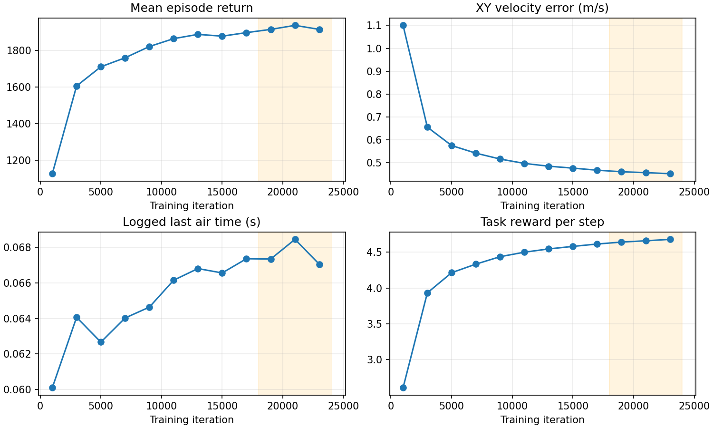

# AMP Height 24000 轮训练复核（2026-10-10）

## 对象与证据

运行目录：`imgo2_rl/logs/amp_rsl_rl/base_move_amp_height/2026-09-24_00-57-38_xiaoji_real1/`。提供的 event 文件包含 34 个标量 tag，迭代轴截止 23999；两个 `/time` tag 是墙钟轴，已排除。最终 checkpoint `model_24000.pt` 实际 `iter=24000`，actor 输入 45、critic 输入 48，策略与判别器权重均有限，含策略/判别器共用 Adam 的优化器状态和 AMP normalizer。checkpoint SHA256：`c5c934842e8e2af3aef806b5c34abcd41d8cdf053ed2af410e4fd6ceb498a70e`。

保存配置确认：4096 环境、seed 1、24 步 rollout、24000 轮；任务权重对应六项旧配方，`feet_air_time: null`，速度范围 vx -1～1.5、vy ±1 m/s、wz ±1.57 rad/s，lerp 0.3。这次运行没有 2026-10-10 新加的滞空奖励。模型记录为 `/root/Desktop/imgo2/imgo2_description/urdf/imgo2.urdf`；当前资产默认是 `imgo2_real.urdf`，以下命令显式选回同名 `imgo2.urdf`。缺少原训练机的模型内容哈希，不能证明当前该文件与当时字节一致。

## 平台期判断

以不重叠 2000 轮窗口取日志均值，而非读取单个末点：

| 指标 | 10000–11999 | 18000–19999 | 22000–23999 |
|---|---:|---:|---:|
| 平均回合总奖励 | 1863.95 | 1914.41 | 1914.50 |
| 平面速度误差（m/s，训练采样） | 0.4968 | 0.4604 | 0.4519 |
| 转向速度误差（rad/s） | 0.4813 | 0.4629 | 0.4555 |
| 每步任务奖励 | 4.5004 | 4.6414 | 4.6791 |
| 混合后的风格贡献（总每步回报−加权任务） | 0.5303 | 0.5309 | 0.5177 |
| 日志平均 last_air_time（s） | 0.06615 | 0.06734 | 0.06704 |

判定：约 16000–18000 轮后进入收益递减区，总回报及滞空时间已表现为平台；跟速还在缓慢改善，不是完全停止学习。最后两窗口对比：总奖励 +0.0047%，平面误差降低约 1.84%，转向误差降低约 1.60%，任务回报增加约 0.81%，风格贡献降低约 2.49%。22000–23999 轮机身均高 0.30654 m、低于 0.20 m 比例 0.0135%、超时终止约 99.18%、base 触地终止约 0.82%、回合长度约 995.65/1000 控制步；无日志非有限标量。能稳定存活与长期高度正常，但还有速度误差，不能称为性能完全收敛。

`Train/mean_amp_reward_step` 实际是混合后每步回报，不能当纯风格项。本记录用它减 `Train/weighted_task_reward_step` 得到风格贡献。训练日志包含探索动作和随机指令，不能当作固定 vx=0.5 的确定性回放成绩；日志里的 last_air_time 均值也不能直接换算步频，必须采集落地时间序列。



## 可执行命令（本机）

```bash
cd /home/tommy0929/Documents/imgo2/imgo2_rl
export PYTHONPATH="$PWD/source/imgo2_rl:$PWD/scripts/rl_lab${PYTHONPATH:+:$PYTHONPATH}"
export IMGO2_ISAACLAB_PYTHON=/home/tommy0929/miniconda3/envs/env_isaaclab/bin/python
export IMGO2_URDF_PATH=/home/tommy0929/Documents/imgo2/imgo2_description/urdf/imgo2.urdf
POLICY_CKPT=/home/tommy0929/Documents/imgo2/imgo2_rl/logs/amp_rsl_rl/base_move_amp_height/2026-09-24_00-57-38_xiaoji_real1/model_24000.pt

# 画面回放，默认固定 vx=1 m/s；脚本同时按正式入口导出 exported/policy.pt 与 policy.onnx
bash scripts/run_isaaclab.sh scripts/rl_lab/amp/play.py \
  --task=Imgo2-basemove-flat-amp-height-play \
  --checkpoint="$POLICY_CKPT" --num_envs=1 --device=cuda:0 --real-time

# 无头定量评估：vx=0.5 m/s，丢弃前 100 步，输出接触周期、步频、滞空、步幅等
bash scripts/run_isaaclab.sh scripts/tools/eval_gait.py \
  --task=Imgo2-basemove-flat-amp-height-play \
  --checkpoint="$POLICY_CKPT" --num_envs=8 --steps=1500 --warmup=100 \
  --command_vx=0.5 --device=cuda:0 --headless \
  --out=../docs/gait_eval_xiaoji_real1_24000.json

# 可选：基于当前含滞空项的新奖励，另建运行微调 3000 轮（24000→27000）
bash scripts/run_isaaclab.sh scripts/rl_lab/amp/train.py \
  --task=Imgo2-basemove-flat-amp-height --resume \
  --load_run=2026-09-24_00-57-38_xiaoji_real1 --checkpoint=model_24000.pt \
  --run_name=air_time_finetune --max_iterations=3000 --seed=1 \
  --num_envs=4096 --device=cuda:0 --headless
```

这些命令以当前配置和代码为准；play 使用当前模型与任务配置，不能自动恢复 env.yaml。回放奖励的修改不改变推理时的动作；续训才会受到新奖励影响。当前 train.py 为续训新建时间戳日志目录，旧运行可保留用于比较；`--max_iterations=3000` 表示新增 3000 轮，不是总轮数目标。命令参数、文件、脚本和解释器已逐项核对存在，本轮未执行这些仿真命令，也未启动后台训练。

## 是否继续训练

2026-10-10 后续服务器命令核对：用户要求以新奖励微调旧 `xiaoji_real1`。服务器项目位置来自用户 traceback，为 `/root/gpufree-data/imgo2/imgo2_rl`。激活 `isaaclab311`（复用独立 Sim 时仍需加载 `/isaac-sim/setup_conda_env.sh`，已有激活钩子则自动执行），设置 `IMGO2_ISAACLAB_PYTHON="$CONDA_PREFIX/bin/python"` 后使用上述 `--resume --load_run=2026-09-24_00-57-38_xiaoji_real1 --checkpoint=model_24000.pt` 参数。需先确认服务器同名日志目录存在 checkpoint；本机存在不等于服务器存在。

该命令读取当前源码奖励，不自动恢复旧 env.yaml；当前默认模型已为 `imgo2_real.urdf`，旧保存配置路径为 `imgo2.urdf`，若要只比较奖励需要使用旧训练时的同一模型文件内容（不能仅凭文件名确保相同）。上述较早本机示例显式指定旧模型路径；服务器默认命令使用当前模型。已完成参数与轮数语义核对；待确认服务器包路径、新配置的 feet_air_time 日志、短训练与长期微调结果。本轮未启动训练。

本机解释器原先找不到 `imgo2_rl`，且 `rl_lab` 指向 `/home/tommy0929/Downloads/Imgo2_rl/scripts/rl_lab/rl_lab`；上面的 PYTHONPATH 显式优先当前仓库的两个源码根，避免回放或续训误用另一份代码。使用 importlib 模块定位核对，覆盖后两个模块都解析到当前工作区。

技术上可以续训，checkpoint 的轮号、网络契约、权重与恢复状态具备条件。原配方继续加几千轮可能改善跟速，但现有曲线不能支持会显著延长步周期。若目标是周期 0.5–0.6 s，建议先测旧模型，再用新增滞空项微调 3000–5000 轮作独立实验，保持模型、速度范围与其他奖励固定。初版滞空项的步长尺度遗漏已在后续复核修正，当前配置见 [启用记录](amp_air_time_reward_2026-10-10.md)，仍需检查 `Episode_Reward/feet_air_time` 是否生效；总回报因奖励定义变化不能直接横向比较。用固定指令的周期、速度误差、站高、触地率决定是否延长训练。

## 已验证与待确认

已完成：源码/保存配置对照、日志分窗聚合、平台期分析、checkpoint CPU 加载与有限值检查、回放与续训参数核对；不是一次训练修复。系统 Python 3.10 的标准库工具生成 [全部窗口原始汇总](data/amp_training_plateau_2026-10-10.json)，用 env_isaaclab Python 3.11 的 TensorBoard EventAccumulator 对总奖励、平面速度误差和滞空时间的末窗口均值独立交叉核对。复现：

```bash
python3 imgo2_rl/scripts/tools/summarize_training_windows.py \
  imgo2_rl/logs/amp_rsl_rl/base_move_amp_height/2026-09-24_00-57-38_xiaoji_real1/events.out.tfevents.1790182680.gpufree-container.352811.0 \
  --out docs/amp/data/amp_training_plateau_2026-10-10.json
```

待修复／待确认：固定指令确定性回放及真实步周期、新奖励微调收益、训练模型字节一致性；需训练机运行上述评估，不能从 scalar 日志证明已达到 0.5–0.6 s。GUI 依然受此前 DISPLAY/GLX 问题限制，优先使用无头评估命令。
