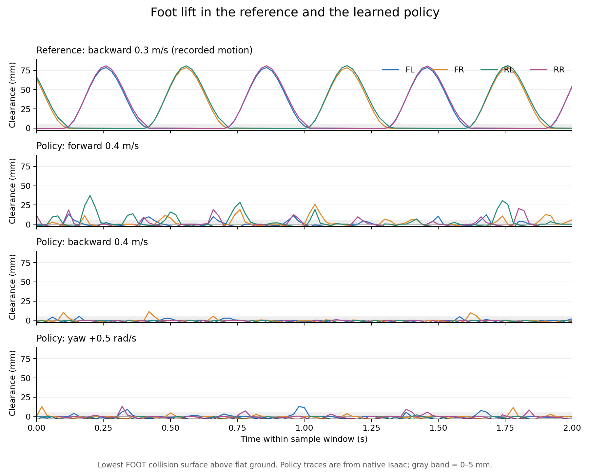

# 新 motion_new 25000：足端抬高、贴地与步态周期检查

日期：2026-10-13。关联：AMP-21/22、AMP-20。策略来源、惯量、切换瞬态见 [同轮部署排查](gazebo_amp_motion_new_25000_2026-10-13.md)。

后续已完成Gazebo AMP裁剪/反馈修正并重测四方向，同策略原Isaac补录关节时序；整体贴地/高频未改善，最新对照见 [修正记录](gazebo_amp_clip_fix_comparison_2026-10-13.md)。下面数据为修正前的测量阶段。

## 1. 结论

用户观察得到复现：前进0.4 m/s时Gazebo跟速较好，但抬脚偏低；后退0.4 m/s和原地转向时，多只脚长期贴地。原Isaac仿真也出现这一现象，因此不能只归因于Gazebo或惯量。

当前部署是motion_new_resume的model_25000官方导出，policy SHA256为`e40d81ec219c777a4aa88acffed935f12be526a2b8a52d7d56d38f3c9b7cc9d1`。本轮补测未改policy、模型、奖励、权重或策略周期，未启动训练或真机。

参考数据有约7–8 cm的抬脚幅度和0.6 s周期，但当前策略没有稳定复现。后退/转向的不规则短促卸载不能当成稳定迈步，也不能用一个统一频率描述。

## 2. 测量口径

- 高度取**足端碰撞几何最低表面**距平地的距离，包含FOOT球体/圆柱的偏移与旋转；不是FOOT link原点高度。Gazebo由基座姿态、关节角和real URDF做FK重建，Isaac由实际body pose计算。
- 下表p95是稳定窗口高度的95分位数，不是每步峰值的平均值；偶发最高点不能代表稳定步高。轻微负值可能来自接触穿透或重建误差。
- Isaac接触比例用实际接触力>1 N；已完成滞空用ContactSensor的first_contact/last_air_time，排除小于20 ms的事件。几何高度区间不是接触测量。
- 一环境一个命令、seed42，关闭startup/interval随机化；原生控制20 ms，900步，跳过前200步，均无reset。两个引擎的摩擦、接触与初始化仍有差异，不能据此直接辨识单项参数的影响。
- 本轮补充Gazebo两个±0.4命令，每次全新栈、gui=false、real模型、原控制参数与默认关闭的过渡；之前原地转向结果沿用同轮基线。所有测试进程已结束。

## 3. Gazebo：用户指定的0.4 m/s

| 指令 | 实际身体vx / yaw | FL / FR / RL / RR足底高度p95 | 说明 |
|---|---|---|---|
| 前进+0.4 m/s | +0.384 m/s / +0.006 rad/s | 16.8 / 12.7 / 24.3 / 22.3 mm | 能跟速，但步高明显低于参考 |
| 后退−0.4 m/s | −0.220 m/s / −0.062 rad/s | 0.1 / 0.1 / 0.1 / 0.7 mm | 四脚稳定窗口均没有超过1 cm的几何离地样本；主要贴地 |
| 原地yaw=+0.5 rad/s | +0.022 m/s / +0.464 rad/s | 3.5 / 约0 / 0.6 / 4.4 mm | 转得动，但抬脚很少 |
| 原地yaw=−0.5 rad/s | +0.031 m/s / −0.479 rad/s | 1.9 / 3.7 / 9.9 / 0.2 mm | 转向不对称，部分脚长期贴地 |

产物：[±0.4方向指标](gazebo_amp_motion_new_25000_foot_04_2026-10-13.json)、[±0.4足底高度](amp_motion_new_25000_foot_clearance_04_2026-10-13.json)、[原转向/±0.5高度](amp_motion_new_25000_foot_clearance_2026-10-13.json)。原始记录在本次run的`gazebo_audit_2026-10-13_foot_04/`（logs不入库）。

## 4. 原Isaac：实际接触与滞空

| 命令 | FL / FR / RL / RR接触比例 | FL / FR / RL / RR已完成滞空均值 |
|---|---|---|
| 前进+0.4 | 80.1 / 76.7 / 69.7 / 81.3% | 52 / 57 / 60 / 58 ms |
| 后退−0.4 | 90.4 / 93.3 / 98.6 / 97.7% | 38 / 29 / 22 / 21 ms |
| 原地yaw=+0.5 | 83.6 / 90.0 / 98.6 / 84.4% | 52 / 37 / 25 / 43 ms |
| 原地yaw=−0.5 | 91.3 / 82.3 / 81.3 / 98.3% | 35 / 37 / 43 / 22 ms |

后退两只后脚约98%时间接触，腾空约一个控制步；左转RL、右转RR也几乎一直接触。原Isaac里，前进足底高度p95约1–2 cm，后退两只后脚约0。说明贴地现象已存在于学习出的策略。

前进各脚合格落地事件间隔中位数约0.17–0.34 s，且不规则；后退/转向事件稀疏，有些只是短促卸载。不能把这些事件倒数当作整机稳定步频。此前Gazebo前进0.5的大腿自相关周期约0.268 s（3.74 Hz）是关节运动周期，与足端接触周期有不同口径。

[完整8方向结果](isaac_amp_motion_new_25000_feet_2026-10-13.json)。原始足端时序在本次run的`foot_native_raw_2026-10-13.json`。

## 5. 参考数据与训练约束

对新数据的前进0.3/0.6、后退0.3/0.6、左右转0.5六段轨迹重建：四脚高度p95−p05约7.4–8.0 cm，足端高度自相关周期均约0.6 s；超过5 mm的几何区间约0.26–0.28 s。记录没有接触力标签，后者不能称作实测滞空时间，也不能据此保证采集时间、速度元数据和所有片段均无问题。

[参考结果](amp_motion_new_reference_clearance_2026-10-13.json)。下图使用参考后退0.3与原Isaac当前策略的2秒片段；纵轴均为足底距地面，灰带0–5 mm。它展示抬高/节律差别，不是两个引擎在同条件下的逐帧对照。



当前保存env.yaml及`base_move/amp_env_cfg.py`的`_keep_only_amp_task_rewards()`仅保留速度tracking、身体高度、身体竖向速度、身体横滚/俯仰角速度和关节限位六项，**feet_air_time、feet_height、feet_slide均为None**。没有直接的足底抬高、接触滑动或目标周期约束。AMP判别器的局部运动状态对也没有显式接触/滞空计时；参考有抬脚并不保证混合优化后的策略复现完整周期。不能由这次回放单独断言某个混合权重是唯一根因。

配置位置：`imgo2_rl/source/imgo2_rl/imgo2_rl/tasks/manager_based/locomotion/velocity/base_move/amp_env_cfg.py:210`；奖励实现同级`mdp/rewards.py`。只重新赋一个奖励的weight而仍被keep名单过滤，无法启用。

## 6. 下一轮修改的优先级与陷阱

1. 先对齐AMP-20动作裁剪/last_action契约，保持一份基线；避免训练侧与部署侧同时改变多个条件。
2. 下一轮训练应联合检查**摆动脚离地高度、支撑脚世界速度、接触节律**。目标周期0.5–0.6 s需要明确节律约束/训练对照；策略推理频率50 Hz是控制频率，不能通过降低推理频率直接获得正确步态周期。
3. 抬脚项建议以足底几何离地高度或正确换算的FOOT原点高度为目标，并与摆动阶段/接触配合，避免奖励全脚同时腾空。现有`feet_height`取FOOT原点世界z，其target_height=0.05不等于足底离地5 cm；它是速度加权的平方误差项，应按惩罚使用。
4. **现有feet_slide不能直接当正确的防滑项启用**：源码先用足端世界速度减去基座世界速度，再计算接触脚平面速度。直立姿态下，真正固定在地面的脚世界速度0、基座前进0.4会被算成0.4；跟随基座平移的滑脚反而可能算成0。这是身体相对运动，不是脚相对地面的滑动。当前AMP该项关闭，故不是本次策略的直接原因；启用前需修正并验证，且要评估其它任务的既有使用。
5. 不建议只把原`feet_air_time`权重继续加大。其公式为`sum((last_air_time-threshold)*first_contact)`，是落地事件奖励，不是0.6 s周期控制器；脚一直不抬可能没有事件惩罚。threshold=0.3也不等于周期0.6。该函数的运动门控用**三维命令范数，包含yaw**，纯转向没有被这条门控排除。
6. 新配置建立独立实验，明确记录checkpoint恢复方式、AMP/task混合、每步奖励系数及RewardManager的dt换算；以固定前/后/纯转/组合命令及多种子接触测量判断收益，不能仅看总reward或某一分项是否转正。本轮没有启用这些奖励或验证任何新权重收益。

## 7. 复现与状态

本机仓库根、已安装Isaac环境的实际运行命令（解释器路径仅为本机示例）：

```bash
IMGO2_ISAACLAB_PYTHON=/home/tommy0929/miniconda3/envs/env_isaaclab/bin/python \
bash imgo2_rl/scripts/run_isaaclab.sh imgo2_rl/scripts/tools/eval_actor_directions.py \
  --headless --device=cuda:0 --steps=900 --warmup=200 --feet --linear_speed=0.4 \
  --json=/tmp/imgo2_native_feet.json
```

Gazebo已有原始stable.json时可离线重算足底高度：

```bash
python3 imgo2_rl/scripts/tools/summarize_foot_clearance.py \
  imgo2_rl/logs/amp_rsl_rl/base_move_amp_height/2026-10-13_00-35-21_motion_new_resume/gazebo_audit_2026-10-13_foot_04/backward_04/stable.json \
  --json=/tmp/imgo2_foot_clearance.json
```

已修复/完成：补足足底几何高度和原Isaac接触测量工具；本机env_isaaclab Python3.11实际完成8环境900步、Gazebo±0.4补测；4项足底几何/FK/贴地无伪周期回归通过，图已检查。测量脚本不训练、不导出policy。

待修复/确认（AMP-22）：抬脚与周期训练目标、现有feet_slide语义修正、单变量新奖励收益；还缺Gazebo接触力直接对照、长回放、多种子及GUI复现。动作裁剪待AMP-20。本轮确认了现象，**没有修好当前策略的贴地/高频步态**。
