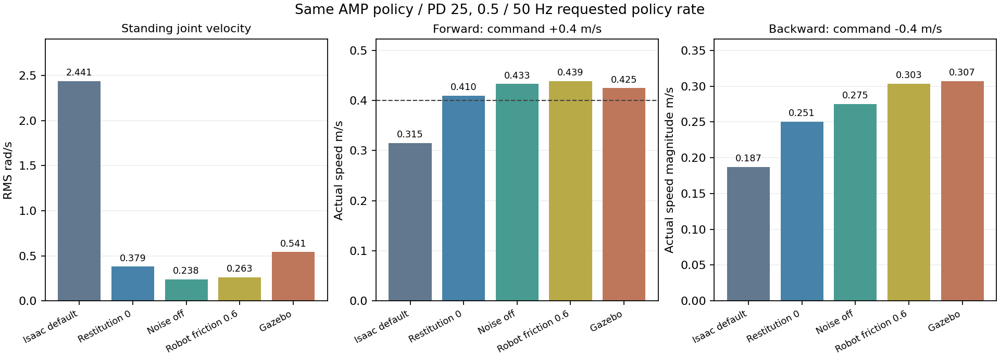

# 当前 AMP 策略：Isaac Sim 与 Gazebo 对照（2026-10-14）

## 结论与执行范围

用户要求先比较静止抖动、后退贴地与步频，近似则结束，否则检查部署链路。默认回放的症状相同，但定量差异明显，因此本轮继续检查了模型、接触、实际摩擦、观测/动作转换、关节映射、执行器与时钟，并做逐项短时对照。

**未发现当前 Gazebo 的腿序、关节轴符号、动作缩放或 last_action 转换错误。发现默认 Isaac play 与 Gazebo 的接触及观测条件不同。对齐这些条件后，跟速和机身高度接近；后退贴地、快速关节周期仍在原 Isaac 中出现。Gazebo 的持续静止目标变化仍较大，不能将所有剩余差异归因于奖励。**

本轮只修改诊断工具和文档；没有修改训练奖励、损失、生产 play 配置、部署 PD、URDF/xacro、motion 或 policy。没有启动训练、硬件、手柄交互 GUI。测试进程均已结束。此前 play.py 预加载专家数据的 OOM 未在本轮修复；本次直接读取现有正式导出的策略进行短测，不需要 AMP 训练 runner/专家预加载。

## 1. 固定身份与测量条件

- 当前部署 `imgo2_deploy/policy/imgo2/amp/policy.pt` SHA256：`9c6bf22baa552f39bcf023a288b7fa50ed82e687e66d2ed9c68ece3877e6fc66`。测试前后相同，所有 Gazebo trace 使用它重算通过。
- 对应最新 run `2026-10-14_00-20-45_motion_new_model_new/model_25000.pt`，不是前一天的 motion_new_resume 或旧 xiaoji_real1。checkpoint actor/导出身份依据见 [身份复核](../maintenance/rebase_latest_policy_identity_2026-10-14.json)。没有手写/重新导出策略。
- Isaac Sim：本机 env_isaaclab，任务 `Imgo2-basemove-flat-amp-height-play`，seed42，3个环境分别固定零速度、vx=+0.4、vx=−0.4 m/s；vy/yaw=0。每次900个控制步，跳过200步，稳定窗口13.98 s。命令在推理前直接固定，避免0.2 m/s死区与站立抽样干扰。
- Gazebo：本机 Humble/Gazebo11，软件GL、GUI关闭、ROS域59、master11369，每种指令独立世界，起身后进入AMP，跳过最初4 s，稳定窗口约16 s。只清理本轮自建进程组。
- 使用当前 `imgo2_real.urdf` / `imgo2_real.gazebo.urdf`；Isaac强制重新转换USD。双方实际控制指令PD均25/0.5，默认角0/.87/−1.82，髋动作缩放.125、其余.25。
- 当前checkpoint原训练六项奖励；本机配置另有缺口奖励，但确定性策略回放不更新网络，当前奖励项不会改写已有策略行为。

原始产物保存在 `imgo2_rl/logs/engine_audit_2026-10-14/`（Git忽略）；可入库的指标、SHA与条件见 [完整汇总](amp_engine_comparison_2026-10-14.json)。默认条件重复一次的Isaac结果一致；Gazebo新世界重复结果略有变化，本文采用带完整诊断的三场景run。

## 2. 默认回放确有差异

| 测量 | 当前默认 Isaac play 条件 | Gazebo |
|---|---:|---:|
| 静止实际关节速度RMS | 2.441 rad/s | 0.541 rad/s |
| 静止相邻目标角变化RMS | 0.0731 rad | 0.0866 rad |
| 前进+0.4：实际vx | +0.315 m/s | +0.425 m/s |
| 后退−0.4：实际vx | −0.187 m/s | −0.307 m/s |
| 前进机身平均高度 | 0.295 m | 0.281 m |
| 后退足底高度p95（FL/FR/RL/RR） | 1.92 / 3.22 / −0.03 / 0.01 mm | 9.05 / 4.68 / 3.58 / 0.60 mm |

目标角变化不是实际关节瞬间转动。原Isaac用位置50Hz差分算出的静止速度RMS仅0.544，但直接记录物理关节速度为2.441，说明仅看稀疏位置差分会漏掉快速震荡；表中使用实际速度。Gazebo表值来自模拟器joint_states的真实速度，而actor的控制器差分速度RMS约0.47，采样/估计方法存在小差异。

默认Isaac前进大腿自相关大多为弱峰，不给出单一“准确步频”。Gazebo前进约0.28 s/3.57 Hz；接触落地事件给出约0.27–0.28 s，而非用户目标的0.5–0.6 s。

## 3. 实际接触条件与单变量对照

当前play函数关闭材质随机化，却没有改变继承的默认材料。实际PhysX shape查询显示机器人材料全部是 **static=1、dynamic=1、restitution=1**；地面也为1/1/1，multiply组合。`observations.policy.enable_corruption` 仍为True，原配置保留关节等观测噪声。

Gazebo转换后的SDF足端mu1/mu2=.6、接触kp=1e6/kd=1；非足端mu=.2。地面模型mu1=100/mu2=50，ODE取接触双方较小值，因此足端有效摩擦为.6；恢复系数默认0。组合规则依据 [Gazebo ODE 实现](https://github.com/gazebosim/gazebo/blob/gazebo11/gazebo/physics/ode/ODEPhysics.cc#L1162)。接触kp/kd与电机PD25/.5是不同参数。

下表是连续单变量对照：每一行继承上一行，策略、控制周期和PD均未变；摩擦试验只改机器人shape，地面仍1。

| Isaac条件 | 静止速度RMS rad/s | 静止目标变化RMS rad | 前进vx | 后退vx |
|---|---:|---:|---:|---:|
| 原默认：恢复1、噪声开、摩擦1 | 2.441 | .0731 | .315 | −.187 |
| 仅恢复系数改0 | .379 | .0721 | .410 | −.251 |
| 再关闭观测噪声 | .238 | .0180 | .433 | −.275 |
| 再将机器人摩擦改.6 | .263 | .0207 | .439 | −.303 |
| Gazebo参考 | .541 | .0866 | .425 | −.307 |



在恢复0、噪声关、机器人摩擦.6的条件下，Isaac前进/后退大腿周期约.24/.26 s（相关性约.98），Gazebo约.28/.30 s，仍远快于.5–.6 s。Isaac后退足底p95仅.01/.00/1.92/.01 mm，足端仍贴地；Gazebo虽多几毫米，也不是稳定高抬脚。

**接触和噪声能解释默认回放的一部分抖动与跟速差异，但不是消除后退贴地和快步态的方案。** 对齐后Gazebo持续站立目标变化RMS仍约为Isaac的4倍、实际关节速度约2倍；执行器、反馈时序与求解器仍有残余差异，尚未因果定位。

另外，保持策略周期.02 s，仅把对齐条件下Isaac物理/显式PD周期从.005改成.001 s（1000Hz）的试验倒地，三个环境产生868/870/856次终止/重置报告。回放已关闭reset随机事件，倒地后会重复终止，后续窗口不能当有效步态数据。该试验不支持直接把训练步长改小，也没有将其写入生产配置。

## 4. 部署链路详细核对

### 模型

当前两份URDF的17个共同link质量、质心、惯量与碰撞几何一致，关节轴、原点、限位一致，全部质量正、惯量正定且满足三角不等式。Gazebo仅额外0.01kg IMU（12.9664 vs12.9564 kg），不构成腿序或惯量矩阵错误。工具 [audit_gazebo_model_physics.py](../../imgo2_rl/scripts/tools/audit_gazebo_model_physics.py) 已实际通过。本结论不等于CAD/真机惯量已经辨识，也不关闭既有模型登记/网格指纹问题。

SDF确实读取mu=.6、kp=1e6/kd=1，FOOT固定关节被合并到对应SHANK、碰撞仍存在。没有靠“看xacro写了什么”代替实际转换检查。

### 观测、关节角与动作映射

45维顺序是body角速度3、投影重力3、commands3、相对默认关节角12、关节速度12、last_action12。缩放.25 / 1 / 1 / 1 / .05 / 1，与训练一致。IMU与base固定安装无额外坐标旋转，ROS2角速度按body使用；四元数wxyz传入对应逆旋转。

策略关节/动作顺序FL、FR、RL、RR，每腿hip/thigh/shank；PhysX内部BFS关节顺序不同，但训练观测/动作明确按配置重排。ROS控制器按模型关节名组织，当前joint_mapping恒等。

三种Gazebo场景共3235个actor输入，重算策略最大误差不超过3e−6；raw action→默认角+缩放→目标角裁剪误差0，last_action反馈误差0。Isaac的processed target与相同公式误差约1.72e−7 rad。命令槽位实际为0/+.4/−.4，无错轴或命令比例变化。

Gazebo控制器还会按URDF位置限位额外裁剪：静止0帧、前进3帧、后退24帧（分别占约0%、0.2%、1.9%的完整trace）。这是已有接口差异；不能把少量限位解释成所有情况下都无法抬脚。

### 控制时钟、PD与执行器

ROS指令中的kp/kd实录均25/.5、前馈tau为0，非仅读取配置注释。实际actor约48.2–48.5Hz，仿真实时比.9985–.9992；Isaac严格50Hz。.02s控制周期大致对应，未发现两倍速度播放或步频由错误单位放大的证据。该结论限本轮无GUI负载。

GazeboODE步长.0005s、ROS effort PD更新1000Hz；IsaacPhysX步长.005s、DCMotor显式PD更新200Hz。Gazebo速度反馈由控制器位置差分得到，joint_states真实速度与它的量级接近；无10倍/20倍速度缩放错误，但仍有时序和估计差异。

IsaacDCMotor有23.7N·m、30.1rad/s的扭矩—速度包络，Gazebo是PD后恒定±23.7硬限幅；两边执行器并不完全等价。GetUp60/2到AMP25/.5以及第一条目标的交接也仍有不连续，不等同于持续抖动；本轮没有实现过渡控制。

### 实际接触力

读取GazeboContact消息的机器人侧力，再按各SHANK姿态FK转到世界坐标。ODE实际以link局部坐标发送wrench，不能直接把局部z相加当世界竖直力，也不能使用静态地面的未定义反馈；依据 [ODE接触反馈实现](https://github.com/gazebosim/gazebo/blob/gazebo11/gazebo/physics/ode/ODEPhysics.cc#L398)。本轮曾采集静态地面反馈，数据异常，已废弃，汇总仅使用经坐标核对的机器人侧力。

| 场景 | 足端合力平均Fz | 水平平均Fx/Fy | 最大穿透 |
|---|---:|---:|---:|
| 静止 | 125.87 N | .11 / −.15 N | .418 mm |
| 前进 | 125.97 N | 1.13 / −.12 N | .787 mm |
| 后退 | 126.32 N | −.43 / .35 N | .642 mm |

重量约127.20N；采样力平均接近承重，稳定窗口非足端接触与自碰撞采样比例均0，没有观察到机身/腿体顶地代替足端承重。Isaac原默认平均净Fz约125.48/124.92/122.58 N，也无数量级承重异常。峰值、微穿透和接触波形依赖各引擎与采样率，未强行视为一致。

Gazebo前进实际力>1N的落地周期约.27–.28s；后退腾空时间约.035–.057s，周期约.23–.31s。足底高度仍不到1cm，说明有高频小幅卸载/踏步，不能把它描述为完全四脚恒接触，也不属于目标的高抬脚慢步态。

## 5. 可复现工具与验证

- [原Isaac评测](../../imgo2_rl/scripts/tools/eval_actor_directions.py)：新增--diagnostics、--restitution、--disable_obs_noise、--robot_friction、--physics_dt。仅诊断覆盖，不改训练默认；输出实际材料、显式执行器PD、速度、力矩、contact_forces、actor输入。PhysX被动drive刚度0不是DCMotor的PD0。
- [Gazebo评测](../../imgo2_deploy/ros2_ws/scripts/run_gazebo_direction_audit.py)：新增可选--contact-tracer，自动管理所有自建进程与日志。
- [接触采集器](../../imgo2_deploy/ros2_ws/scripts/gazebo_contact_trace.cpp) 与 [世界坐标汇总](../../imgo2_rl/scripts/tools/summarize_gazebo_contacts.py)：C++采集局部机器人侧力，标准库工具按实际q/base姿态换算。
- [离线完整汇总](../../imgo2_rl/scripts/tools/compare_amp_engine_audit.py)：标准库计算指标及文件SHA，显式标记有reset的试验为无效。

从仓库根复算（原始产物保留在本机logs，换机器需另行拷贝）：

```bash
python3 imgo2_rl/scripts/tools/compare_amp_engine_audit.py \
  --json docs/deployment/amp_engine_comparison_2026-10-14.json

python3 imgo2_rl/scripts/tools/summarize_gazebo_contacts.py \
  imgo2_rl/logs/engine_audit_2026-10-14/gazebo_diagnostics/stand \
  imgo2_rl/logs/engine_audit_2026-10-14/gazebo_diagnostics/forward_04 \
  imgo2_rl/logs/engine_audit_2026-10-14/gazebo_diagnostics/backward_04

# 使用本机Gazebo11开发库，产物放临时目录：
g++ -std=c++17 -O2 imgo2_deploy/scripts/gazebo_contact_trace.cpp \
  -o /tmp/imgo2_gazebo_contact_trace $(pkg-config --cflags --libs gazebo)
```

已修复/完成：诊断力坐标与有效数据选择、默认回放条件的误判说明、工具输出/重置守卫；模型核对、三场景部署契约、原Isaac及接触/噪声/摩擦逐项运行已完成，诊断Python语法与C++编译通过。不是“站立抖动/步态已经修好”。

## 6. 待修复／待确认

1. **AMP-EVAL-01**：默认play恢复1和观测噪声开已实测造成评价差异，生产play配置尚未调整；需决定统一回放材质/噪声基线，修改后做GUI和新旧策略回归，不能不经验证影响训练配置。
2. **AMP-23 / DEPLOY-14**：Gazebo残余持续站立目标变化更大，切换PD/第一条目标交接也待改。需要同步记录每次传感/推理/命令/执行时间，及固定动作轨迹的双引擎对照，才能将残差分到反馈、执行器和接触求解器；本轮未证明某一项是唯一根因。
3. **AMP-21/22**：接触条件对齐后后退仍贴地、周期仍约.24–.30s；需要固定评价基线后做站立/足底高度/周期奖励与参考数据的单变量训练实验。本轮没有采集新专家数据或改奖励。
4. 所有有效指标来自一份当前策略和短测，未读取学长策略文件，未复现用户GUI的全部操作或所有历史机器人。不能把本轮结果推广为所有AMP模型都相同。
