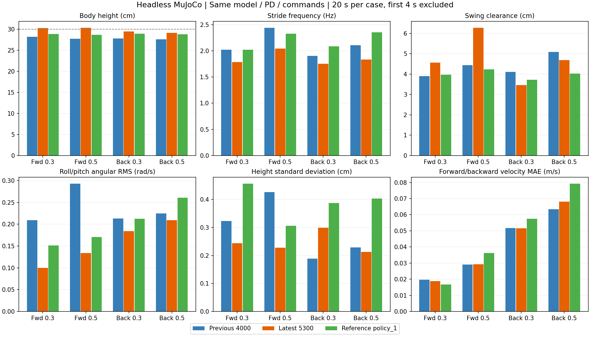

# 15-19-20新PPO 5300效果复审（2026-11-05）

## 结论

最新收到2026-11-05_15-19-20/model_5300.pt，事件到5437，保存预算7000但没有收到最终模型。MuJoCo同条件平地上，新5300在前后身高、前进角运动和步频方面优于上一13-55-41/4000，并保留有效后退/转向抬脚；前进+.5约30.35cm/角运动.134rad/s/2.04Hz，上一27.76/.293/2.44。值得保留为当前较好的平地候选，不宣称全面超过policy_1。右转角运动上升；Isaac固定初态前进仍欠跟踪且较旧稍退步，站立身高跨引擎不同。生产policy未替换，无奖励/模型/PD修改或新训练。

## 1. 身份与配置

从头resume=false、seed42、4096env、24step/env/iteration，plane、headingFalse、standing2%，vx±.5/vy±.4/yaw±.6，无方向分组/地形或速度课程。54份model state张量全有限，末std mean .15779/max .19292，未全面审计optimizer张量。正式ppo/play.py --export_only经env_isaaclab GPU导出，8个Actor张量diff0、seed42的1024组45维确定性输入输出max diff0、部署LibTorch实际加载通过；快照logs/ang03_compare_2026-11-05/new5300.pt，未手写导出。旧4000使用先前正式导出的独立快照，本次重新闭环测试。服务器git目录为空，实际函数逐字版本未知。

相比旧4000所属run保存env，除log_dir仅以下四项变化，因此是联合配置、不同训练时长，从头训练，不是角速度单变量续训：

| 配置 | 旧4000 | 新5300 |
|---|---:|---:|
| lin_vel_z_l2 | -5 | -4 |
| ang_vel_xy_l2 | -.1 | -.3 |
| baseheight target/weight | .30/-35 | .33/-35 |
| stand_still | -.1 | -.2 |

其余feet_slide-.15、FHB-4/-.20、feet_height关闭、air1.6/.5、variance-8、mirror-1、hip-.5、jointpos关闭、track1.5/1.2等保存值相同。-.3是角速度平方惩罚系数，不是RMS目标.3rad/s。

## 2. 训练曲线

| 窗口 | reward | xy内部指标 | yaw内部指标 | std均值 | value loss |
|---|---:|---:|---:|---:|---:|
| 1000-1499 | 39.84549 | 0.18838 | 0.21906 | 0.15919 | 0.00209 |
| 2500-2999 | 40.65079 | 0.18758 | 0.21488 | 0.15787 | 0.00198 |
| 4000-4499 | 41.08447 | 0.18521 | 0.20923 | 0.15679 | 0.00192 |
| 4800-5300 | 41.22023 | 0.18510 | 0.20866 | 0.15723 | 0.00191 |

有缓慢改善但4000后幅度较小，未见数值崩溃，不保证继续到7000一定更好。新4800–5300贡献：angxy-.08288/weight-.3=有效原始量.27627，对比旧.37922，门控平方量下降约27%，等效RMS约下降15%；不能把weight三倍造成的加权更负当抖动更大。高度贡献-.02134对应新目标.33，不可直接与旧目标.30比较身体保持；新MuJoCo实际约30cm，而不是已经达到33cm。不同配方总reward不能直接排名。

## 3. 同条件MuJoCo：27段实际运行

三策略×9指令，各20秒，排除前4秒、每段4000帧，全部failure空；同模型/场景/生产PD/反馈与仿真时钟，本次结束验证所有测试输入hash不变。旧4000和policy_1同批重跑，非混用历史指标。名义模型稳定站姿暖机后启动，未测GUI/FSM切换或减速过渡。净空为碰撞球底部离平地的完整摆动峰值均值；步频为同足落地周期，非控制Hz；角运动是roll/pitch轴角速度合成RMS，不是纯高频振动。

| 策略 | 指令 | 实际vx/vy/yaw | 身高cm | 高度std cm | 步频Hz | air s | 净空cm | 角运动RMS |
|---|---|---|---:|---:|---:|---:|---:|---:|
| new5300.pt | stand | 0.000/0.000/0.000 | 29.683 | 0.006 | — | — | — | 0.004 |
| new5300.pt | forward03 | 0.307/-0.005/-0.028 | 30.250 | 0.243 | 1.786 | 0.204 | 4.564 | 0.100 |
| new5300.pt | forward05 | 0.496/-0.011/-0.025 | 30.350 | 0.228 | 2.041 | 0.186 | 6.269 | 0.134 |
| new5300.pt | backward03 | -0.248/0.004/0.001 | 29.496 | 0.299 | 1.754 | 0.182 | 3.460 | 0.184 |
| new5300.pt | backward05 | -0.432/-0.009/0.002 | 29.172 | 0.212 | 1.835 | 0.198 | 4.681 | 0.209 |
| new5300.pt | left03 | 0.007/0.255/-0.002 | 29.855 | 0.204 | 2.273 | 0.160 | 4.385 | 0.219 |
| new5300.pt | right03 | 0.031/-0.255/0.002 | 30.044 | 0.095 | 2.174 | 0.173 | 4.758 | 0.207 |
| new5300.pt | turn_left03 | 0.017/-0.007/0.276 | 29.688 | 0.208 | 1.942 | 0.156 | 2.741 | 0.153 |
| new5300.pt | turn_right03 | 0.020/0.007/-0.286 | 29.742 | 0.273 | 2.000 | 0.151 | 2.706 | 0.181 |
| new4000.pt | stand | 0.000/-0.000/0.000 | 28.294 | 0.005 | — | — | — | 0.004 |
| new4000.pt | forward03 | 0.310/0.007/-0.008 | 28.217 | 0.323 | 2.020 | 0.168 | 3.895 | 0.210 |
| new4000.pt | forward05 | 0.471/0.026/-0.014 | 27.763 | 0.426 | 2.439 | 0.145 | 4.431 | 0.293 |
| new4000.pt | backward03 | -0.253/-0.006/-0.026 | 27.842 | 0.188 | 1.905 | 0.173 | 4.111 | 0.213 |
| new4000.pt | backward05 | -0.437/-0.013/-0.013 | 27.610 | 0.229 | 2.105 | 0.175 | 5.086 | 0.225 |
| new4000.pt | left03 | 0.034/0.264/0.022 | 28.264 | 0.101 | 2.381 | 0.161 | 4.357 | 0.254 |
| new4000.pt | right03 | 0.009/-0.260/0.008 | 28.178 | 0.200 | 2.469 | 0.153 | 4.476 | 0.271 |
| new4000.pt | turn_left03 | 0.034/0.009/0.291 | 28.124 | 0.164 | 2.174 | 0.139 | 2.410 | 0.176 |
| new4000.pt | turn_right03 | 0.027/0.005/-0.288 | 28.053 | 0.201 | 2.222 | 0.128 | 2.676 | 0.142 |
| policy_1.pt | stand | 0.000/0.000/-0.000 | 30.318 | 0.004 | — | — | — | 0.005 |
| policy_1.pt | forward03 | 0.288/-0.011/-0.015 | 28.906 | 0.456 | 2.020 | 0.191 | 3.966 | 0.151 |
| policy_1.pt | forward05 | 0.465/-0.010/-0.009 | 28.710 | 0.306 | 2.326 | 0.174 | 4.228 | 0.170 |
| policy_1.pt | backward03 | -0.243/0.006/-0.021 | 28.932 | 0.387 | 2.083 | 0.179 | 3.717 | 0.213 |
| policy_1.pt | backward05 | -0.421/0.009/-0.023 | 28.834 | 0.404 | 2.353 | 0.167 | 4.028 | 0.261 |
| policy_1.pt | left03 | 0.016/0.263/-0.018 | 29.227 | 0.478 | 2.174 | 0.166 | 3.754 | 0.281 |
| policy_1.pt | right03 | 0.015/-0.278/-0.017 | 28.976 | 0.482 | 2.222 | 0.167 | 3.666 | 0.276 |
| policy_1.pt | turn_left03 | 0.022/-0.004/0.142 | 30.107 | 0.366 | 1.575 | 0.096 | 0.983 | 0.145 |
| policy_1.pt | turn_right03 | 0.016/-0.006/-0.131 | 30.058 | 0.490 | 1.600 | 0.063 | 0.464 | 0.110 |

PNG已实际打开检查。前进+.3：高28.22→30.25cm、RMS.2095→.0997、步频2.02→1.79Hz；+.5：高27.76→30.35cm、RMS.2929→.1341（降低约54%）、步频2.44→2.04Hz。新实际vx+.307/+.496接近指令；与policy_1+.288/+.465不同，不能严格当相同实际速度下的品质比较，但新+.5速度更快同时角运动更低。

后退-.3新实际-.248、净空3.46cm、1.75Hz、高29.50cm；-.5实际-.432、净空4.68cm、1.83Hz、高29.17cm。抬脚没有恢复成贴地，足高比旧4.11/5.09cm略低但仍有效。左右转yaw+.276/-.286接近±.3，净空2.74/2.71cm；右转角运动.142→.181增加，是明确未全面改善方向，且policy_1本身yaw欠跟踪，不能只按其更低角运动证明同速度稳定性更好。新MuJoCo静止约29.68cm、RMS.0045，所有case动作饱和为0，未复现严重稳态站抖或旧髋持续饱和。

## 4. Isaac固定初态交叉对照：8case

新5300/旧4000各stand、前+.3、后-.3、yaw+.3，600步/12秒排除前2秒，seed42，固定root初态、关闭执行器增益随机化、obs噪声/startup/interval事件；actual actuator gains25/.5、默认关节角/序及dt完全匹配。显式DCMotor的真实增益取robot.actuators，不把physx joint_stiffness0解释为Kp0。不是原服务器训练逐字复现，不与MuJoCo执行器/接触/起步协议完全一致。

| 策略 | 指令 | 实际vx | 实际yaw | 身高cm | 角运动RMS | last_air均值s |
|---|---|---:|---:|---:|---:|---:|
| new5300 | stand | -0.002 | -0.002 | 26.65 | 0.025 | 0.056 |
| new5300 | forward03 | 0.195 | 0.018 | 29.58 | 0.256 | 0.126 |
| new5300 | backward03 | -0.278 | 0.005 | 29.93 | 0.259 | 0.092 |
| new5300 | turn_left03 | 0.001 | 0.278 | 30.06 | 0.239 | 0.082 |
| previous4000 | stand | 0.000 | -0.010 | 26.22 | 0.069 | 0.037 |
| previous4000 | forward03 | 0.215 | 0.008 | 28.53 | 0.223 | 0.106 |
| previous4000 | backward03 | -0.250 | -0.022 | 28.54 | 0.284 | 0.089 |
| previous4000 | turn_left03 | 0.023 | 0.220 | 28.58 | 0.261 | 0.071 |

全部upright_fraction1/reset0，非能力验收。后退实际-.250→-.278、左转yaw.220→.278改善；前进实际.215→.195更欠跟踪、角运动.223→.256稍增。不能声称两个引擎各方向都减抖，MuJoCo的+.5优势尚未在Isaac+.5测试（此探针没有该指令）。固定Isaac stand高26.65cm，与MuJoCo29.68不同；前进/后退身高较旧升高，跨引擎站立与起步适应仍需核对，未归因为策略转换或模型错误。Isaac未测足碰撞几何真实净空，不以last_air给出厘米数。

## 5. 判断与建议

新5300是值得保留的平地候选，按用户高身、慢步、减角运动和保留后退抬脚的目标，在MuJoCo中这轮明显优于旧4000。先保留当前配方和checkpoint，不急着继续加大所有稳定性惩罚，也不继续统一提高足高。若当前服务器继续训练，可保留5300为对照，选择后续checkpoint看同条件动作，不按轮数/总reward强制选最新。

下一验收重点：右转角运动与漂移、Isaac前进跟速/起步和站立高度、速度下降到零及FSM切换；通过后再考虑扩速/rough，不能由本批平地直接宣称复杂地形能力。四项参数同时变化与训练总量不同，未分离哪个修改贡献最大；没有实现新归一化净空奖励，当前FHB局限不因这次成功就消失，也不要求为了改机制立即推倒有收益的策略。单seed/初态不能证明配方普遍最好。

已完成：保存配置/曲线、54模型有限性、正式导出Actor全等、27MuJoCo/8Isaac实际运行、图表QA和归档。无训练奖励/模型/PD/生产策略改动，无新训练或硬件运行。待确认：服务器源码、Gazebo、更多初态/seed、减速/切换、rough/高速/硬件，以及跨引擎前进/站立差异和单项因果。PPO-GAIT-01保留待修/待验证，不标全面解决。

原始JIT/CSV/导出及Isaac日志集中imgo2_rl/logs/ang03_compare_2026-11-05。

- [MuJoCo指标](ang03_mujoco_2026-11-05.json)、[Isaac摘要及增益](ang03_isaac_2026-11-05.json)。
- [配置/模型/导出身份](../training/ang03_identity_2026-11-05.json)、[训练窗口](../training/ang03_training_windows_2026-11-05.json)、[奖励分项](../training/ang03_reward_scales_2026-11-05.json)。
