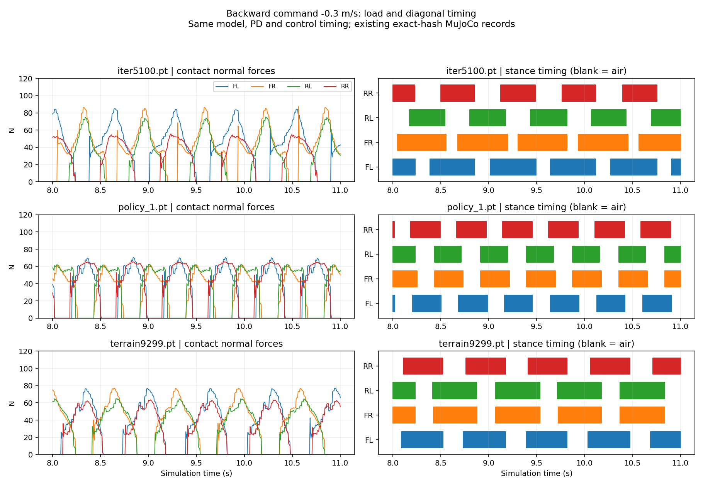

# 部署5100后退载荷与对角配合复核（2026-11-06）

## 结论与状态

用户询问刚确认的部署5100后退是否对角脚步一边轻一边重。现有同哈希MuJoCo记录支持后退的前后承重/支撑时间明显不均、对角触地时序较差，以及左右足高不同；左右整侧总载荷和两组对角总载荷均较接近，不能描述为整条左侧或某一对角组持续严重偏载。平均承重不等于落脚冲击，前后重心本来就不要求50/50，需结合静止与同模型策略比较。

已完成/已修复：补充可复现逐足法向力、支撑比例/完整支撑峰值及冲量统计、与policy_1和新9299对照、曲线和身份复核；无生产控制/奖励修复。待确认：Gazebo/硬件实际轻重感、动态起步、不同初态/seed的持续性和具体成因。部署policy.pt本轮开始已不在原路径，未恢复/替换；下次启动须先确认用户选定策略文件。

## 数据身份与方法

此次是既有回放重分析，不是新启动仿真。最初尝试重新回放时发现imgo2_deploy/ros2_ws/policy/imgo2/ppo/policy.pt不存在，脚本在读取文件阶段退出，未运行策略。使用11/05 around5000_mujoco/run.json及iter5100 CSV；其中策略SHA256=8744dbb6cbfd8cdca16c4d96ebec4c5fb442aa6cf43890ad4783d466078fbd36，与上一轮实际部署文件一致，该文件Actor已匹配原11/05 model_5100.pt。旧CSV的7个共同模型/控制源/配置哈希与policy_1基准全相同。新9299使用本日已有同条件CSV。

每工况20s、前4s排除、剩余16s、5ms采样；独立重置、同模型/25/.5 PD/默认角/动作映射/反馈时钟。*_contact_n来自mj_contactForce接触法向力，在此水平地面近似竖直载荷；不代表任意地形中的世界z力。均值含摆动零力；触地5N进入/2N离开、10ms持续、去20ms短片段；完整支撑段峰值及冲量用中位数，窗口截断段排除。无完整支撑段时峰值/冲量为空，不把静止时的空值解释成无承重。

给现有analyze_contact_coordination.py追加load_balance纯标准库统计，保留原输出项、添加新键；已用12工况实际分析，语法通过，group first_share经独立原始均值复核。未引入新训练/部署奖励。

## 5100后退−0.3逐足统计

| 足 | 平均法向力N | 完整支撑峰值中位N | 触地时间占比 | 平均滞空s | 摆动净空cm |
|---|---:|---:|---:|---:|---:|
| FL | 38.92 | 84.14 | 76.8% | 0.148 | 3.46 |
| FR | 39.25 | 86.06 | 82.7% | 0.111 | 2.55 |
| RL | 25.92 | 74.02 | 59.7% | 0.258 | 3.78 |
| RR | 23.05 | 54.80 | 56.8% | 0.271 | 3.10 |

FL左前、FR右前、RL左后、RR右后。5100实际vx约-.248，与policy_1约-.243接近，比较不是靠一个完全不动来获得较小载荷波动。

5100前腿总载荷61.48%、后腿38.52%；静止前腿55.34%，后退偏前更明显。左侧51.00%、右侧49.00%；对角FL+RR占48.74%、FR+RL占51.26%。所以整体左右/对角承重比例接近，但同一对角里的前后脚差异明显：FL38.92N vs RR23.05N、FR39.25N vs RL25.92N。FL/RR滞空.148/.271s，FR/RL .111/.258s，对角前后两脚并不同步离地。右前净空2.55cm低于左前3.46cm，右后3.10cm低于左后3.78cm，也可能产生视觉轻重差异。

后退-.5仍有相近前后偏载：前腿60.97%、左右50.81%/49.19%、对角49.98%/50.02%；前后负担差不是仅-.3的一次瞬态。

## 对角协调与策略对比

触地相关系数用整段二元触地信号计算，越接近1代表两足触地时序越同步；不是保证步态正确的唯一标准，也不要求所有地形/步态相同。

| 策略，后退−0.3 | 前腿载荷比例 | 左腿载荷比例 | FL/RR触地相关 | FR/RL触地相关 |
|---|---:|---:|---:|---:|
| iter5100.pt | 61.48% | 51.00% | 0.628 | 0.557 |
| policy_1.pt | 47.47% | 50.55% | 0.886 | 0.911 |
| terrain9299.pt | 52.91% | 50.70% | 0.928 | 0.968 |

policy_1四足触地比例约58.8–65.7%，5100则56.8–82.7%，前腿支撑明显拖长。9299前腿52.91%，两组对角相关.928/.968，后退协调比5100改善；不能因此认定9299前进或全部方向更好，前进代价见[整体比较](terrain5300_review_2026-11-06.md)。

5100前进+.3对角相关.883/.981，比后退.628/.557高，支持问题具有方向性。旧Isaac5100后退回放也有前足触地占比FL85.6%/FR81.6%、后足RL59.8%/RR71.0%的趋势；该记录只有接触布尔值（1N门槛），没有逐足法向力，不拿它证明Isaac载荷比例或与MuJoCo门槛逐点相等。

## 如何理解与后续

此结果可以解释后退时前腿更重、后腿较轻、对角脚步不齐的观感，但不是已证明的关节映射或惯量错误；这些不对称可由策略、姿态/质心、接触与控制共同形成。joint_mirror约束关节角，不保证接触相位、法向冲量或支撑时间一致，不建议只为了接触同步重新盲目加重镜像，也不要求强行四脚等力。先以同速度/同地面/同起步复核Gazebo实际接触和姿态，再决定奖励调整；本轮未更改任何权重。

[机器可读统计](deploy5100_load_balance_2026-11-06.json)；原始路径及CSV哈希均在统计内。复算方法：python3 imgo2_rl/scripts/tools/analyze_contact_coordination.py --run imgo2_rl/logs/final7000_compare_2026-11-05/around5000_mujoco/run.json --output /tmp/5100_contact_check.json。它会分析该run所有已有case，不修改记录。

图采用8–11秒窗口、颜色对应四足、空白为离地；图已视觉核对。统计使用系统python3，绘图使用env_isaaclab Python。不是新Gazebo/实机测试，未重新训练或改部署策略。
