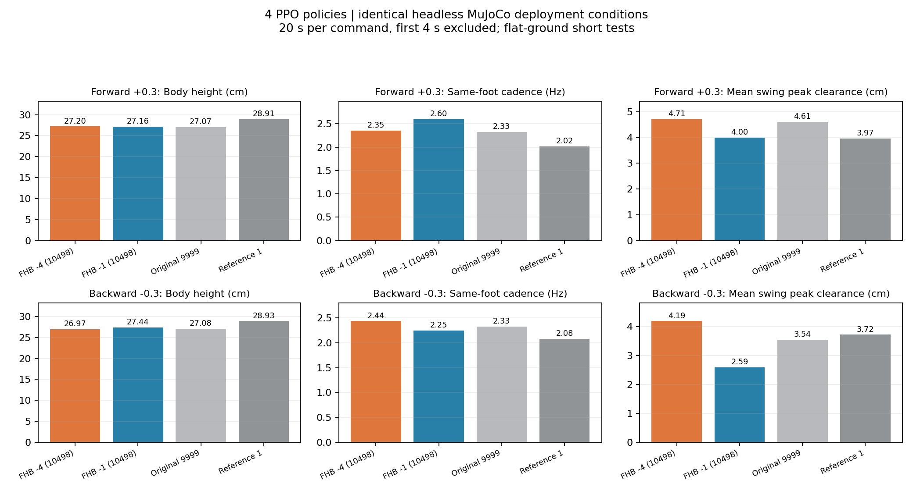

# 足高权重-4/-1续训对照复审（2026-11-03）

## 当前结论

不建议直接切到feetheight_1并继续长训。以正常前后行走为优先，feetheight_4.0/model_10498.pt表现较好，但下一轮单项试验建议仍从共同起点9999出发、把已完成的-4/10498作为对照；两组均非全面赢家，-1右横移角运动和左转跟踪有优点，但损失前进步频/平稳和后退跟速/净空。机身高度问题两组都没有实质解决。这是500轮单seed权重敏感性比较，不是关闭整项的完整消融，不能据此证明足高对蹲低完全无影响。

之前提出“-4减到-1可能改善高度/抖动”是待验证假设。此次结果不支持直接采用-1作为更好配方，应据实保留负结果，不事后将假设描述成既定因果。

## 1. 对照是否成立

- A：logs/rsl_rl/base_move_rough/2026-11-03_17-24-27_feetheight_4.0。
- B：logs/rsl_rl/base_move_rough/2026-11-03_17-32-21_feetheight_1。
- 两组保存agent均resume=true、load_run=2026-11-02_23-12-30、load_checkpoint=model_9999.pt、seed42、4096环境、500追加轮，最终model_10498.pt。每组6个checkpoint，CPU检查12份全部有限，最终std均值.4199/.4175、最大.5494/.5373，没有数值爆炸证据。
- 使用yaml.BaseLoader比较参数，env仅差log_dir和feet_height_body.weight(-4/-1)，agent仅差run_name。属于保存参数上的单变量对照。两个git目录为空，缺服务器源码快照，不能独立确认运行期所有源码逐字相同；GPU训练也有随机性，单seed不构成普遍结论。
- 用项目正式ppo/play.py --export_only在GPU导出最终checkpoint；输出在各run/exported/，另建日志目录内快照供对比，不修改deploy策略。兼容导出产生model_10498_rslrl5.pt，是工具转换产物，不是新的训练轮次。
- 两导出Actor与各自原checkpoint逐张量相等（mlp.*对应actor.*），1024输入max diff均0，并被部署LibTorch实际加载。身份和配置差异保存在logs/feetheight_ab_2026-11-03/{identity_checks,config_diff,policies}.json。

## 2. 训练曲线

事件均覆盖9999–10498。最后10400–10498窗口：

| 指标 | -4 | -1 |
|---|---:|---:|
| mean reward | 11.426 | 11.657 |
| xy误差 | .4106 | .4083 |
| yaw误差 | .4175 | .4186 |
| 地形等级 | 5.975 | 6.000 |
| 平均回合步数 | 999.984 | 999.986 |
| feet_height_body加权贡献 | -.00855 | -.00226 |
| base_height_l2加权贡献 | -.01155 | -.01118 |
| ang_vel_xy_l2加权贡献 | -.07903 | -.07881 |

差异很小，-1总reward较高不能当作步态更好：减少惩罚本身会抬高分数。足高贡献除绝对权重约.00214/.00226，不能用-.00855与-.00226直接说误差改善四倍。续训初期地形从约3.5重新增长至6，回合统计也在填充；早段reward先涨后降不自动表示策略崩溃。曲线窗口分别见[weight4](../training/feetheight4_2026-11-03_windows.json)、[weight1](../training/feetheight1_2026-11-03_windows.json)。

## 3. MuJoCo实际回放

4策略×9指令=36组，每组2秒固定站姿+3秒零策略指令+20秒测试，取指令后4–20s。四策略为两组10498、原9999、policy_1。生产PD/反馈适配器，控制.005、策略.02、PD25/.5，电机附加反馈延迟10ms、IMU0；每组独立重置，相同模型和固定指令。复用此前已编译的benchmark，run.json记录源码哈希及配置。全部未触发失败阈值，不是复杂地形或硬件验收。

| 指令 | 策略 | 实际主速度 | 机身高(cm) | 步频(Hz) | 净空(cm) | gyro xy RMS(rad/s) |
|---|---|---:|---:|---:|---:|---:|
| stand | -4/10498 | -0.000 | 29.38 | — | — | 0.004 |
| stand | -1/10498 | 0.000 | 29.79 | — | — | 0.005 |
| stand | 原9999 | 0.000 | 29.96 | — | — | 0.004 |
| stand | policy_1 | 0.000 | 30.32 | — | — | 0.005 |
| forward03 | -4/10498 | 0.331 | 27.20 | 2.35 | 4.71 | 0.168 |
| forward03 | -1/10498 | 0.361 | 27.16 | 2.60 | 4.00 | 0.229 |
| forward03 | 原9999 | 0.351 | 27.07 | 2.33 | 4.61 | 0.190 |
| forward03 | policy_1 | 0.288 | 28.91 | 2.02 | 3.97 | 0.151 |
| forward05 | -4/10498 | 0.508 | 26.55 | 2.56 | 5.84 | 0.252 |
| forward05 | -1/10498 | 0.534 | 26.74 | 2.63 | 5.46 | 0.268 |
| forward05 | 原9999 | 0.512 | 26.59 | 2.50 | 5.73 | 0.231 |
| forward05 | policy_1 | 0.465 | 28.71 | 2.33 | 4.23 | 0.170 |
| backward03 | -4/10498 | -0.241 | 26.97 | 2.44 | 4.19 | 0.205 |
| backward03 | -1/10498 | -0.181 | 27.44 | 2.25 | 2.59 | 0.206 |
| backward03 | 原9999 | -0.215 | 27.08 | 2.33 | 3.54 | 0.163 |
| backward03 | policy_1 | -0.243 | 28.93 | 2.08 | 3.72 | 0.213 |
| left03 | -4/10498 | 0.249 | 26.68 | 3.12 | 4.52 | 0.296 |
| left03 | -1/10498 | 0.249 | 27.15 | 3.39 | 5.15 | 0.326 |
| left03 | 原9999 | 0.236 | 26.92 | 3.39 | 3.99 | 0.366 |
| left03 | policy_1 | 0.263 | 29.23 | 2.17 | 3.75 | 0.281 |
| right03 | -4/10498 | -0.252 | 27.03 | 3.12 | 5.06 | 0.423 |
| right03 | -1/10498 | -0.228 | 27.30 | 3.33 | 4.45 | 0.273 |
| right03 | 原9999 | -0.261 | 26.86 | 2.94 | 4.89 | 0.361 |
| right03 | policy_1 | -0.278 | 28.98 | 2.22 | 3.67 | 0.276 |
| turn_left03 | -4/10498 | 0.087 | 28.51 | 1.75 | 0.26 | 0.142 |
| turn_left03 | -1/10498 | 0.198 | 28.38 | 1.95 | 0.44 | 0.173 |
| turn_left03 | 原9999 | 0.126 | 28.66 | 1.79 | 0.59 | 0.125 |
| turn_left03 | policy_1 | 0.142 | 30.11 | 1.57 | 0.98 | 0.145 |
| turn_right03 | -4/10498 | -0.188 | 28.59 | 1.11 | 0.58 | 0.150 |
| turn_right03 | -1/10498 | -0.120 | 29.65 | 2.25 | 0.18 | 0.146 |
| turn_right03 | 原9999 | -0.169 | 29.07 | 1.33 | 0.39 | 0.184 |
| turn_right03 | policy_1 | -0.131 | 30.06 | 1.60 | 0.46 | 0.110 |

前进+.3：-4比-1跟速更好，净空较大且角运动较小；高度仅27.20/27.16cm，减弱足高没把身体抬起来。后退-.3：-1速度-.181明显弱于-4的-.241，净空2.59对4.19cm；虽机身提高约.47cm、频率下降，不能据此视为综合改善。-4左横移优于原9999；右横移gyro RMS .423比-1的.273大，是明确缺点，不能说-4所有方向更稳。-1左转+.3实际.198优于-4 .087，但伴随前向漂移.051m/s对.017；两者右转也有取舍。

对角接触相关和支撑类型均已计算，见[JSON](feetheight_ab_contacts_2026-11-03.json)。两组仍有对角配合，-1后退恰好两条对角腿支撑比例约45.0%，-4约61.0%。单个比例不是唯一评分标准。相同指令下两组实际速度不同，部分角运动差异可能通过速度变化产生，不能将所有RMS变化等同于相同运动状态下的稳定性变化。



## 4. Gazebo复核

| 组 | 指令 | vx | vy | yaw(rad/s) | 高度(cm) | roll/pitch标准差(°) |
|---|---|---:|---:|---:|---:|---|
| feetheight4_10498.pt | forward03 | 0.335 | 0.019 | -0.003 | 27.24 | 0.267/0.487 |
| feetheight4_10498.pt | backward03 | -0.239 | 0.001 | 0.021 | 26.99 | 0.319/0.308 |
| feetheight4_10498.pt | left03 | 0.030 | 0.237 | -0.012 | 26.80 | 0.541/0.528 |
| feetheight4_10498.pt | turn_left03 | 0.005 | -0.002 | 0.044 | 28.93 | 0.709/0.451 |
| feetheight1_10498.pt | forward03 | 0.367 | -0.009 | -0.020 | 27.18 | 0.280/0.699 |
| feetheight1_10498.pt | backward03 | -0.181 | 0.015 | 0.012 | 27.47 | 0.319/0.362 |
| feetheight1_10498.pt | left03 | 0.064 | 0.231 | 0.009 | 27.14 | 0.633/0.457 |
| feetheight1_10498.pt | turn_left03 | 0.043 | 0.007 | 0.178 | 28.46 | 0.501/0.498 |

生产Gazebo每组重新启动，共8组，墙钟24s/组，起身6s、策略后再跳过3s，按消息仿真时间统计。对应导出快照经临时相对model_name加载，未覆盖任何deploy policy；批次finally恢复原config，状态全部completed。前进-4/-1实际.335/.367m/s、高27.24/27.18cm，频率2.38/2.56Hz、几何摆动峰值4.52/3.89cm；后退-.239/-.181m/s、几何峰值4.04/2.58cm。左转+.3时-4仅.044rad/s、-1约.178rad/s，-4有明显低速转向缺陷。Gazebo与MuJoCo主要前后差异一致，但统计口径/物理不同，不把数值完全相等作为要求。详见[Gazebo指标](feetheight_ab_gazebo_2026-11-03.json)。


## 5. 建议如何继续（未实施）

1. 保留原9999、两组10498和policy_1，不将-1替换成默认部署策略，也不把-4末策略称为全面改进：其低速左转退步。现有deploy仍保留原9999。
2. 不原样追加数千轮，也不从零重训。下一轮从原model_9999出发，以已经完成的-4/10498（500轮）作为A对照，单独新跑500轮C组；这样不需再跑一份原参数控制，也避免把A续500中的转向退步直接叠加到新起点。先测试稳定性：FHB保持-4/target-.20，lin_vel_z=-2、air_time=1.8及其他设置保持，只把ang_vel_xy_l2从-.05调至-.1，再追加300–500轮，命名新run。-.1是候选而非最佳值，重点评估横移/前进角运动，同时防止净空下降/拖脚。它不直接保证更高机身或更慢步频。
3. 若要专门研究机身高度，另做独立试验：body-reference足高target由-.20调整为更接近预期净空的-.24左右，而非继续减小weight或直接加大weight。目标在机身30cm时约对应更低的摆动高度要求，但精确净空还取决于足端原点/碰撞。此候选也未经训练验证；不能与第2步同时改，否则无法解释改善来源。
4. 真正需要慢步和低速专门质量时，速度/静止采样与课程另作一轮配方设计，保持低速覆盖。当前两组仍为宽速度+地形课程，500轮试验未改变这一训练分布。

服务器续训前应把当前代码的FHB重新确认成-4（最后跑B时可能仍为-1），resume不会恢复旧env.yaml。第2步候选命令，在服务器imgo2_rl目录：

```bash
bash scripts/run_isaaclab.sh scripts/rl_lab/ppo/train.py \
  --task=Imgo2-basemove-rough-ppo --resume \
  --load_run=2026-11-02_23-12-30 \
  --checkpoint=model_9999.pt \
  --run_name=fhb4_angxy01_test \
  --num_envs=4096 --max_iterations=500 --seed=42 \
  --device=cuda:0 --headless
```

命令只加载权重；需事先在HIM无关的PPO rough配置中保持feet_height_body=-4并将ang_vel_xy_l2=-.1，本轮没有替用户修改或启动。其它配置应与A一致。

## 6. 验证范围与数据

[MuJoCo全部指标](feetheight_ab_mujoco_2026-11-03.json)、[接触配合](feetheight_ab_contacts_2026-11-03.json)。原始CSV、正式导出日志/快照、配置差异、Actor核对、Gazebo记录集中在imgo2_rl/logs/feetheight_ab_2026-11-03，没有散建多个logs顶层对比目录。CPU脚本使用/usr/bin/python3，torch/正式导出使用env_isaaclab解释器；仿真调用部署LibTorch。

脚本入口：eval_mujoco_policies.py、analyze_mujoco_policies.py、analyze_contact_coordination.py、eval_gazebo_ppo_policies.py、summarize_gazebo_ppo_comparison.py。后两者本轮增加绝对导出快照路径及可选cases/policies支持，生产部署代码不变。只要调用Gazebo工具，就会临时切换PPO config.model_name；finally恢复，禁止同期编辑该配置。当前部署policy未替换。PNG已查看。

已完成：12份checkpoint有限性/两份正式导出与原Actor一致性、36组MuJoCo和8组Gazebo实际回放、保存参数单变量核对。MuJoCo源码/模型/配置/策略在测试内哈希不变，Gazebo临时配置已恢复；本轮测试进程结束。未修改训练参数/代码、模型、PD、公共部署代码或当前部署策略，没有启动新训练。待验证：下一轮角速度候选及高度/慢步优化、服务器源码一致性与多seed可靠性。单seed短续训不证明奖励绝对因果，不代表强度-4最优；原训练服务器缺源码快照，粗糙地形/楼梯、不同种子、真实硬件、后续候选参数的收益均待验证。

## 7. 两服务器并行候选（用户询问，同日计划，未实施）

已完成feetheight_4可作为同9999起点、500轮的参考控制。建议两服务器各测试一个独立修改，均与该控制比较，而不是凭两组不同目标下的总reward直接排名：

| 候选 | FHB weight | FHB target | ang_vel_xy weight | 独立问题 |
|---|---:|---:|---:|---|
| A angxy01 | -4 | -.20 | -.10 | roll/pitch角速度约束加倍是否减抖，并保留跟速/净空 |
| B fhb_target024 | -4 | -.24 | -.05 | 减少机身系抬脚高度要求是否缓解蹲低，并保留摆动净空 |

两者均load_run=2026-11-02_23-12-30、checkpoint=model_9999.pt、4096环境、seed42、追加500轮。其余代码、模型、PD、base_height=-16/target.30、lin_vel_z=-2、air_time=1.8/threshold.5、速度/地形/课程保持已保存A控制配置，不从两组10498继续叠加。B的-.24为试验值，约在机身30cm时要求足端原点6cm高，不是精确6cm碰撞净空，也不保证一定抬高机身。

需统一两机项目版本和Python/Isaac/RSL依赖语义，不只统一run_name；GPU/数值随机性不同是限制。检查站立、前进/后退±.3、横移±.3、转向±.3及+.5；按实际速度误差、roll/pitch角运动、机身高度、几何净空/接触、频率判断。A仅变安静但不走、B仅抬高机身却拖脚均不算成功。单seed小差异须换seed或交换设备复核，不直接认定因果。不要同时改滞空、竖直惩罚或课程，也不合并尚未独立验证的两项。尚未改代码/参数、启动任一候选；结果待验证。
