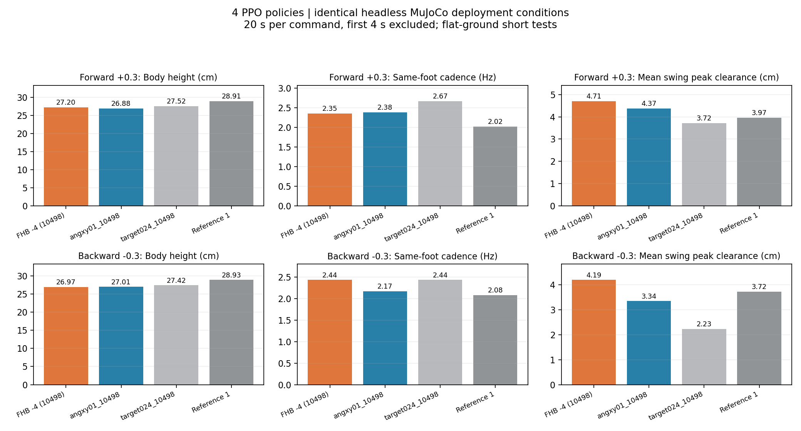

# 两服务器续训候选复审（2026-11-03）

## 结论

两个候选都没有全面胜过已完成的feetheight_4控制。角速度惩罚-.10有方向性收益，但后退跟速/净空退步；足高目标-.24略抬高机身，同时前进变快步、后退净空明显下降。暂不合并两项或替换生产策略，不凭总reward选赢家。原建议是待验证假设，本轮保留负结果。

## 配置与身份（已核对）

- A：2026-11-03_19-19-42_feetheight_4.0，保存env相对17-24-27控制仅ang_vel_xy_l2.weight -.05→-.10以及log_dir不同；虽然run_name仍feetheight_4.0，实际试验是角速度约束。
- B：2026-11-03_19-26-37_fefeet_height_target_0.24，仅feet_height_body target -.20→-.24、log_dir/run_name不同，weight仍-4。
- 均从2026-11-02_23-12-30/model_9999.pt、seed42、4096环境追加500轮，最终10498，未从旧10498叠加。12份checkpoint全部有限，末std均值A .3937/B .4081。两run git目录为空，仍缺运行源码快照，不能单靠env证明所有源码/依赖一致。
- 本机env_isaaclab解释器在GPU用正式ppo/play.py --export_only导出，Actor八个参数逐张量全等，各run/exported有policy.pt/onnx及兼容转换checkpoint；未手工拼TorchScript。部署LibTorch实际加载通过。

## 训练曲线

最后10400–10498窗口，旧控制/A/B：xy误差 .4106/.4116/.4009，yaw误差 .4175/.4083/.4034；terrain level 5.975/6.003/5.985，episode length均约999.98。末reward 11.426/10.637/11.813，配方不同不能直接排名。

角速度项原控制-.07903，A -.13626；除以绝对权重后约1.581→1.363，即日志对应原始量约下降14%，并非惩罚翻倍证明抖动翻倍。不是部署所有方向减抖的保证。B base-height贡献-.01033，对照-.01155略减；实际高度仍需看回放。

各run前100轮地形级别约3.93，后升到约6，reward先升后降不能单独判断崩溃；没有非有限标量。单seed、课程变化和统计窗口限制仍在。

## 同条件MuJoCo实际测试

新增18组：两策略×静止、+.2、+.3、+.5、-.3、左右横移±.3、左右转向±.3，每组20秒，前4秒不统计；全部无failure。采用生产PD/反馈与固定仿真时钟，非GUI/FSM时间调度测试。下表旧控制/原9999/policy_1复用此前数据，未重复运行；共同源码、模型、场景、配置哈希与前批一致，评测期间文件不变。平地数据不代表rough或上下楼能力。

速度列为vx/vy/yaw，单位m/s、m/s、rad/s；角运动为roll/pitch角速度RMS(rad/s)，不是高频硬件振动。净空为完整摆动期间碰撞球底部离平地的峰值平均，同足着地事件估计频率，非控制频率。

| 场景 | 策略 | vx/vy/yaw | 高度cm | 步频Hz | 净空cm | 角运动RMS |
|---|---|---|---:|---:|---:|---:|
| stand | 控制-4 | -0.000/-0.000/-0.000 | 29.38 | — | — | 0.004 |
| stand | 角速度-.10 | 0.000/-0.000/-0.000 | 29.33 | — | — | 0.003 |
| stand | 足高目标-.24 | 0.000/-0.000/-0.000 | 29.77 | — | — | 0.004 |
| stand | policy_1 | 0.000/0.000/-0.000 | 30.32 | — | — | 0.005 |
| forward03 | 控制-4 | 0.331/0.019/-0.002 | 27.20 | 2.35 | 4.71 | 0.168 |
| forward03 | 角速度-.10 | 0.347/0.012/0.002 | 26.88 | 2.38 | 4.37 | 0.167 |
| forward03 | 足高目标-.24 | 0.349/0.006/-0.001 | 27.52 | 2.67 | 3.72 | 0.165 |
| forward03 | policy_1 | 0.288/-0.011/-0.015 | 28.91 | 2.02 | 3.97 | 0.151 |
| forward05 | 控制-4 | 0.508/0.013/0.006 | 26.55 | 2.56 | 5.84 | 0.252 |
| forward05 | 角速度-.10 | 0.510/0.011/0.017 | 26.44 | 2.50 | 5.68 | 0.190 |
| forward05 | 足高目标-.24 | 0.520/0.000/0.001 | 27.16 | 2.67 | 5.20 | 0.219 |
| forward05 | policy_1 | 0.465/-0.010/-0.009 | 28.71 | 2.33 | 4.23 | 0.170 |
| backward03 | 控制-4 | -0.241/0.001/0.018 | 26.97 | 2.44 | 4.19 | 0.205 |
| backward03 | 角速度-.10 | -0.191/-0.005/0.017 | 27.01 | 2.17 | 3.34 | 0.232 |
| backward03 | 足高目标-.24 | -0.215/0.000/0.004 | 27.42 | 2.44 | 2.23 | 0.193 |
| backward03 | policy_1 | -0.243/0.006/-0.021 | 28.93 | 2.08 | 3.72 | 0.213 |
| left03 | 控制-4 | 0.023/0.249/-0.005 | 26.68 | 3.12 | 4.52 | 0.296 |
| left03 | 角速度-.10 | 0.044/0.243/0.037 | 26.75 | 3.12 | 4.96 | 0.269 |
| left03 | 足高目标-.24 | 0.047/0.252/-0.025 | 27.30 | 3.57 | 3.63 | 0.349 |
| left03 | policy_1 | 0.016/0.263/-0.018 | 29.23 | 2.17 | 3.75 | 0.281 |
| right03 | 控制-4 | 0.020/-0.252/-0.007 | 27.03 | 3.12 | 5.06 | 0.423 |
| right03 | 角速度-.10 | 0.025/-0.239/0.007 | 26.82 | 3.03 | 4.29 | 0.319 |
| right03 | 足高目标-.24 | 0.037/-0.230/-0.013 | 27.55 | 3.12 | 4.05 | 0.426 |
| right03 | policy_1 | 0.015/-0.278/-0.017 | 28.98 | 2.22 | 3.67 | 0.276 |
| turn_left03 | 控制-4 | 0.017/0.002/0.087 | 28.51 | 1.75 | 0.26 | 0.142 |
| turn_left03 | 角速度-.10 | 0.076/0.013/0.205 | 28.20 | 1.64 | 1.53 | 0.167 |
| turn_left03 | 足高目标-.24 | 0.039/-0.000/0.112 | 28.83 | 1.67 | 0.40 | 0.138 |
| turn_left03 | policy_1 | 0.022/-0.004/0.142 | 30.11 | 1.57 | 0.98 | 0.145 |
| turn_right03 | 控制-4 | 0.025/0.008/-0.188 | 28.59 | 1.11 | 0.58 | 0.150 |
| turn_right03 | 角速度-.10 | 0.025/-0.002/-0.206 | 28.78 | 1.14 | 0.42 | 0.138 |
| turn_right03 | 足高目标-.24 | 0.023/-0.000/-0.187 | 29.57 | 2.15 | 0.34 | 0.179 |
| turn_right03 | policy_1 | 0.016/-0.006/-0.131 | 30.06 | 1.60 | 0.46 | 0.110 |

## 解释与下一步（待验证）

1. A在+.5角运动.252→.189、左横移.296→.269、右横移.423→.319，确有收益。但-.3实际速度-.241→-.191、净空4.19→3.34cm、角运动.205→.232，不是全方向改善；+.3高度27.20→26.88cm，没有解决低机身。左转实际yaw .087→.205改善，但前向漂移.017→.076m/s明显，不能只看yaw。不建议无条件采用-.10长训。
2. B在+.3高度27.20→27.52cm，仅增加3.2mm；+.5高26.55→27.16cm。与此同时+.3频率2.35→2.67Hz，后退净空4.19→2.23cm，右横移角运动仍约.426。减小body系抬脚要求有高度收益，但与用户慢步/抬脚目标不一致，暂不采用-.24作为确定改善。
3. 静止两组均稳定：A高29.33/B29.77cm、角运动.0034/.0037。两者步频均不是接近参考policy_1的全面慢步解。当前同指令实际速度不同是比较抖动的混杂因素。
4. 先保留原9999、控制-4/10498、policy_1与新两份；不把A和B叠加，不因reward较高选择B，也不原样延长几千轮承诺会变好。若继续研究慢步，优先单独验证低速/纯转向/零指令覆盖与过渡，或从共同起点关闭FHB做完整消融；这些是下一轮候选，需先固定评价目标和其它配方，未实施。单次500轮结果不能排除更多适应或更早checkpoint更好。

## 完成与限制

已完成：保存参数单变量核对、12份checkpoint有限性、正式导出Actor一致性、18段MuJoCo、已有控制哈希复核、曲线与图表归档（PNG已查看）。没有更改生产策略、训练奖励、模型、PD或启动新训练。待确认：Gazebo复核、训练Isaac原配置回放、启动/减速等过渡、复杂地形、多seed和硬件；本轮未运行Gazebo，不能将本轮数值称为Gazebo结果。

原始日志及快照统一在imgo2_rl/logs/feetheight_followup_2026-11-03；指标见[JSON](feetheight_followup_mujoco_2026-11-03.json)，训练窗口见[JSON](feetheight_followup_training_2026-11-03.json)，配置差异与Actor检查见同名前缀config_diff/identity_checks JSON。离线重算入口仍为scripts/tools/analyze_mujoco_policies.py与read_tfevents.py，仿真入口eval_mujoco_policies.py；均无需修改生产部署配置。

## 足高目标试验目的澄清与下一步优先级（同日补充，未实施）

用户指出-.20→-.24必然降低相对机身的足高目标，这是正确的。在机身30cm、近水平且忽略足端原点/球半径时，世界足端原点目标约10cm→6cm。它原本是降低机身系足高要求、观察是否减少蹲低的诊断试验，不是提高抬脚或降低步频的直接办法；推荐时应更明确说明这项代价，不能将试验目标说成步态优化已成立。其实际收益仅几毫米、净空和步频退步，因此不保留-.24为下一默认目标。

下一步优先完整FHB消融，而非继续猜target或同时加大多项惩罚：从共同9999出发，FHB weight=0（target保留-.20以便回退），ang_vel_xy=-.05、base_height=-16/target.30、lin_vel_z=-2、air_time=1.8/threshold.5及速度/课程/模型/PD保持控制，追加500轮，与已有-4/10498比较。既往-1不等于关闭整项。这个试验用于判断保留FHB的净收益，不能保证关闭后步态改善，也不等于最终策略不需要足高引导。

若关闭后更拖脚，则支持保留足高引导，下一步再研究相对局部地面的摆动净空/摆动阶段目标，避免靠降低机身减小误差；若高度/稳定性改善且净空不损失，再单独处理足高项。单seed有限续训不证明普遍因果。慢步问题另需结合实际速度、步长/支撑时间及接触时序判断，足高目标本身不规定周期；暂不直接再增air_time或base_height/竖直惩罚。

两台服务器不必同时更改更多参数；另一台可用于新策略Gazebo/Isaac一致性与过渡检查，或在固定方案后复核不同seed。上述均为待执行建议，本轮仅澄清与记录，未修改源码/参数或启动训练。

## 滞空时间、步频与足高抖动的关系（同日源码说明）

现feet_air_time在首次落地时累计(last_air_time-threshold)，不是把时长逼近threshold的误差目标，也不是直接周期约束。单足周期T=摆动滞空时间+支撑时间，频率f=1/T；只有支撑占比大致固定时才可由滞空时间近似推断步频。增加threshold使每次落地扣项更大，增加正weight强化长滞空偏好，均不能单独保证指定Hz，可能通过减少落地/延长支撑、飞行或其它取巧方式改变收益。说明为策略优化偏好，不是对接触时刻可微的直接梯度。

足高项与滞空项可分别引导空间高度和时间行为，但两者耦合，不能独立指定波形。目标由-.24提高至-.20是要求更高；weight由-4到-8是加大同一误差的惩罚，含义不同。高足端轨迹在很短摆动时间内通常要求更大的运动加速度，并可能增加反力/落地冲击；机身系目标还与机身高度/姿态竞争。当前FHB为摆动掩码×速度tanh×固定高度平方误差，缺少起落阶段目标渐变；因此可能增加抖动，但不是必然，也未被本轮单变量证据证明为唯一成因。不能由-.24组结果直接断言提高足高必然增抖。

建议保留当前-.20与-4作基准，不同时提高足高/足高权重和airtime；如果优先研究减步频，独立测试时间项或采样，记录每足摆动/支撑/周期、实际速度、净空及角运动，而非只读feet_air_time reward。此轮仅源码核对与说明，未改配置/训练，新增候选与硬件因果仍待验证。

## 关闭地形课程的方法（同日说明，未修改配置）

PPO rough_env_cfg.py的Imgo2RoughEnvCfg.__post_init__中，在已有速度课程关闭代码附近，加入self.curriculum.terrain_levels = None以及self.scene.terrain.terrain_generator.curriculum = False。父配置在其post_init时按terrain_levels设置生成器开关，子类修改需显式同步两个值。临时运行可在原训练命令末尾追加env.curriculum.terrain_levels=null与env.scene.terrain.terrain_generator.curriculum=false。关闭课程不等于平地或最低难度：原有地形类型仍保留，不再按表现升降级；生成器curriculum=false的地形难度生成/分配也可能变化，不能承诺保持原来的固定难度。若想仅平地，另用terrain_type=plane并清空generator，属于另一项设置。本轮源码核对，无训练/配置改动；关闭后的实际运行和训练效果待验证。
