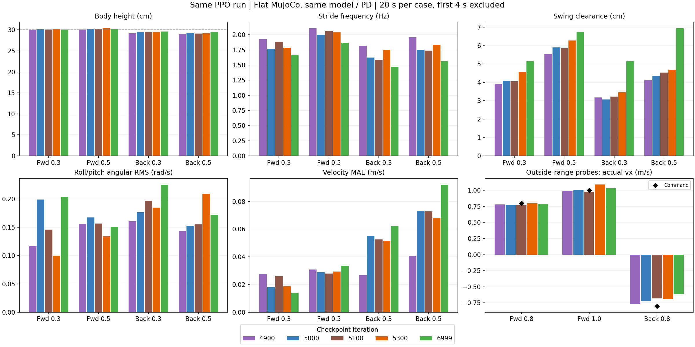

# 7000轮与5000附近checkpoint选择复核（2026-11-05）

## 结论与状态

对象：`imgo2_rl/logs/rsl_rl/base_move_rough/2026-11-05_15-19-20`。更新后的event已覆盖6999，最终文件是`model_6999.pt`。本次补测4900、5000、5100，并与5300、6999比较。

**建议速度课程优先从5300开始，5100备选；没有证据说明精确5000最好，也没有证据说明6999全面胜出。** 5300低速前进角运动较小，Isaac后退/转向跟踪较好；4900在MuJoCo后退跟踪方面更强，各checkpoint存在取舍。该建议基于当前闭环表现，不能保证未来课程学习一定以5300最优，更不是“轮次小就更适合PPO”。

- 已完成：更新event复读、71份模型有限性检查、正式导出一致性检查、60个MuJoCo与20个Isaac平地测试、曲线与指标归档。
- 已修复：之前event不完整造成的后期趋势证据缺口；无生产控制/奖励/模型修复，未启动训练、未替换部署policy。
- 待确认：多seed/初态、Gazebo、指令变化/FSM切换、rough与硬件效果，以及哪个起点在实际速度课程中收敛最好。需要相应运行验证；服务器原始奖励源码版本亦未保存，不能仅凭env.yaml证明历史函数实现。

## 训练趋势：接近平台，没有数值崩溃依据

| 统计窗口 | Mean reward | 日志xy误差 | 日志yaw误差 | mean noise std | value loss |
|---|---:|---:|---:|---:|---:|
| 4800–5300 | 41.2202 | .18510 | .20866 | .15723 | .001907 |
| 5500–5999 | 41.5821 | .18402 | .20717 | .15620 | .001850 |
| 6000–6499 | 41.6728 | .18445 | .20642 | .15603 | .001819 |
| 6500–6999 | 41.6848 | .18512 | .20754 | .15669 | .001828 |

后期reward约增加1.13%，xy基本不变，yaw误差约减少0.54%；属于小幅优化/平台，不能据此宣称闭环步态全面提升。4900–5099与5100–5299 reward分别41.2071、41.2754，曲线也不支持精确5000明显优于附近。日志误差是训练命令分布内的统计，不能替代固定指令测试。

后期air贡献−.08081→−.06842、slide−.03475→−.03188、FHB−.00654→−.00519，但高度贡献约−.02134→−.02144，角运动贡献−.08288→−.08156。贡献变小不等于所有固定工况都更好；air贡献含落地频率，不能直接换算平均滞空时长。

依据：[完整窗口](../training/final7000_training_windows_2026-11-05.json)、[5000附近窗口](../training/around5000_windows_2026-11-05.json)、[奖励量级](../training/final7000_reward_scales_2026-11-05.json)。

## 导出与共同测试条件

4900/5000/5100/6999均通过正式`ppo/play.py --export_only`导出；5300复核已有正式导出缓存。Actor张量及1024条seed42确定性45维输入对比均max diff=0；五份JIT均在部署LibTorch测试链路实际加载。71份checkpoint模型张量均有限，不代表已穷举验证优化器状态。见[身份记录](../training/final7000_identity_2026-11-05.json)。

MuJoCo：五策略各12工况，每个20秒、剔除前4秒、4000帧，60次均无测试失败、动作饱和率0。两批共同模型/控制输入7份哈希一致，各批前后输入未变。工况包括静止、前进.3/.5/.8/1.0、后退.3/.5/.8、左右横移.3、左右转向.3。训练vx范围±.5，**.8/1.0及−.8只是分布外仿真探测，不是高速训练/实机验收**。

Isaac：五策略各4工况（静止、前进.3、后退−.3、左转.3），每个12秒、剔除前2秒；固定重置、关闭观测噪声和startup/interval随机化，seed42。实际执行器25/.5、关节顺序、参考角、dt=.02一致。20个工况均无reset且upright fraction=1；illegal_contact关闭，因此不能当作完整安全/跌倒验收。

两引擎接触和初始化不同，不要求数值完全一致；Isaac是当前配置固定条件诊断，不是完整复现服务器随机训练环境。没有做Gazebo、动态加减速、FSM或硬件测试。

## 固定工况比较

角运动为`√mean(ωx²+ωy²)`，单位rad/s，数值小表示该指标较稳，不等于roll/pitch角度RMS。足端周期是同脚重复落地周期，不是单次滞空时间。

| checkpoint | MuJoCo前进.3角运动RMS↓ | 前进.3步频Hz | 前进.3净空cm | 后退−.5实际vx | Isaac后退−.3实际vx | Isaac左转.3实际yaw |
|---|---:|---:|---:|---:|---:|---:|
| 4900 | .117 | 1.92 | 3.92 | −.463 | −.237 | .242 |
| 5000 | .199 | 1.77 | 4.09 | −.427 | −.230 | .226 |
| 5100 | .146 | 1.89 | 4.06 | −.427 | −.264 | .270 |
| 5300 | **.100** | 1.79 | 4.56 | −.432 | **−.278** | **.278** |
| 6999 | .203 | 1.67 | 5.14 | −.408 | −.270 | .249 |

- **4900**：四个前后.3/.5工况平均vx MAE .0314m/s，五者最低，平均角运动.1441亦最低；但前进1.0时横漂约.0566m/s、yaw漂移−.0710rad/s，Isaac后退/转向跟踪弱于5300。不能忽略其后退优势，也不能凭单一工况定全局优胜。
- **5000**：前进.3角运动大于4900/5100/5300，Isaac前进.3仅.155m/s、后退−.230、左转.226；没有整体优势。
- **5100**：各方向比较均衡，Isaac后退/转向接近5300；MuJoCo前进1.0角运动.321优于5300的.343，适合作备选。
- **5300**：优先满足平地低速前进稳、后退/转向基础好的目标；但MuJoCo前进1.0存在yaw漂移−.0813rad/s，不是高速成熟策略。
- **6999**：步频更慢、足高更高；前进1.0的速度过冲和高度波动较5300改善、yaw漂移也更小。代价是前进.3角运动约翻倍，MuJoCo后退−.8实际−.615（5300为−.692、4900为−.765），不是全面升级。机身高度也未普遍提高：前进.3为30.07cm，5300为30.25cm。

所有指标与共同输入身份见[合并MuJoCo结果](final7000_selection_metrics_2026-11-05.json)、[Isaac结果](final7000_isaac_2026-11-05.json)。



## 下一步速度课程建议

先保留这次奖励、模型、PD，以5300为起点，在平地渐进扩速，保留静止、前后低速、横移与纯转向测试/采样；暂不同时改足高权重和引入rough，以免无法判断变化来源。原run仅2%显式静止，三轴范围vx±.5、vy±.4、yaw±.6，heading关闭；速度课程和地形课程均关闭。

代码`mdp/curriculums.py::command_levels_lin_vel`会同时扩vx/vy，首次按`range_multiplier[0]`缩小配置范围，默认.1；`UniformThresholdVelocityCommand`还会将平移范数≤.2清零。若最终vx±1、vy±.6，默认初始化±.1/±.06会全部落入死区，不能直接盲开默认课程。只开启课程而不扩大最终范围，也不会自动超过原±.5。需要核对实际初始/最终范围和采样分布；本次未修改或运行课程。

## 产物位置与限制

原始CSV、日志与独立策略快照位于`imgo2_rl/logs/final7000_compare_2026-11-05/`，5000附近MuJoCo在其`around5000_mujoco/`。5300快照位于`imgo2_rl/logs/ang03_compare_2026-11-05/new5300.pt`。选择训练起点应使用原run的`model_5300.pt`，不是导出JIT。

**该run的`exported/policy.pt`目前是最后一次导出的5100，不能仅看目录名把它当6999。** 各次独立快照已保留，本次没有替换`imgo2_deploy/ros2_ws/policy/imgo2/ppo/policy.pt`。

本次只在单seed固定条件、短时间平地比较；未来课程收益、复杂地形能力和真实机器稳定性仍待验证。

## 同日补充：如何开启速度课程（源码核对，尚未改配置）

在`base_move/rough_env_cfg.py`约230行，用下面内容替换现有速度课程配置（不能保留后面的两个`= None`）：

```python
self.curriculum.command_levels_lin_vel.params["range_multiplier"] = (0.5, 1.0)
self.curriculum.command_levels_ang_vel.params["range_multiplier"] = (0.5, 1.0)
# self.curriculum.command_levels_lin_vel = None
# self.curriculum.command_levels_ang_vel = None
```

基类`velocity_env_cfg.py::CurriculumCfg`已有两个CurrTerm，去掉子类None覆盖即恢复；无须新写奖励/课程函数。当前本机最终范围vx±1.2、vy±.8、yaw±1.0，因此以上初始范围是±.6、±.4、±.5，最终达到原配置范围。服务器若不同，应按服务器范围计算。每次满足函数更新时机且归一化跟踪贡献>对应weight的80%，范围两端扩大.1；线速度同时扩x/y，角速度独立判断。不是按固定训练轮数扩速。

若此阶段仅做平地扩速，应取消本机当前被注释的三行平地覆盖（plane、generator=None、terrain_levels=None）；目前本机这三行均注释，因此不能假定仅开启速度课程就仍是平地。heading可继续False。续训重新创建环境，课程从新配置初始倍率开始，不能假定恢复旧环境课程进度。以上是设置方法，未实际修改或验证新课程运行。

待确认：用户追加要求的5400/5500尚未导出/测试，不能把当前5300推荐解释为已胜过这两份。

## 同日服务器附件复核：速度课程仍被关闭

附件`58c64791-d2af-4e36-b7d7-d19d0e0b474f/已粘贴的文本.txt`通过Python3 AST解析。虽将两个range_multiplier设为(.5,1)，其后又将两个课程赋为None，最终速度课程关闭，范围直接为vx±1.2、vy±.8、yaw±1.5。平地覆盖与关闭地形课程有效。修法是只注释两个课程的None赋值；开启后初始范围±.6、±.4、±.75，最终±1.2、±.8、±1.5。已确认配置覆盖原因；未修改附件/训练源码或运行，服务器修复与短恢复验证仍待完成。
