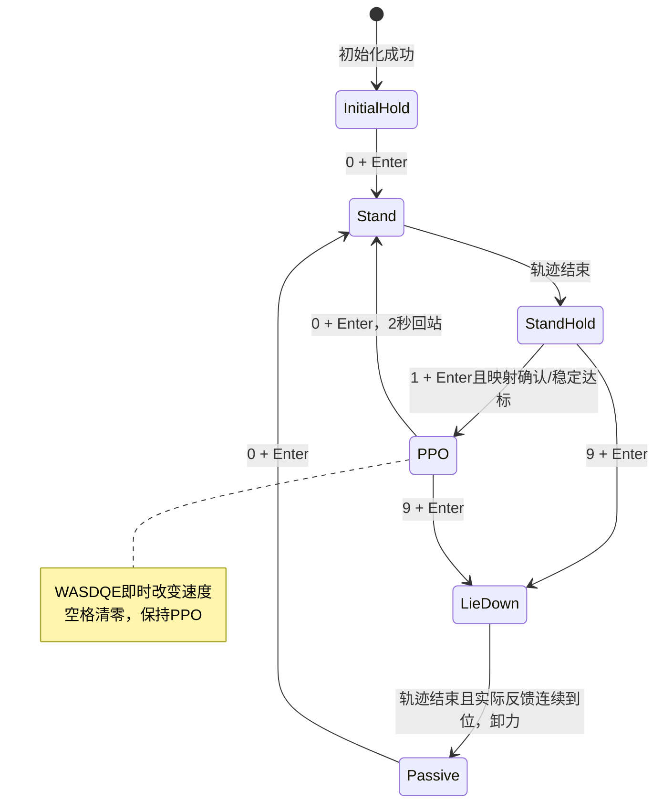

# go_imu 当前控制流程与键盘操作手册

源码核对：2026-10-15。本文面向当前 `go_imu/rl_real_imgo2.cpp` 独立部署入口，说明“设置什么、怎样启动、如何切换、什么时候停止”。已随状态拆分更新：站立/趴下独立配置，Passive到位后卸力；本手册核对未启动真实硬件。实现及历史离线验证见 [部署指南](go_imu_sim2real_2026-10-15.md)。

## 1. 先分清要运行哪个程序

| 程序 | 用途 | 是否连接硬件 | 操作方式 |
|---|---|---|---|
| `rl_real_imgo2` | 当前完整真机控制：保持、站起、PPO、趴下 | 是，电机和IMU都需要 | 本文的0/1/2/9与WASDQE |
| `fsm_check` | 正式FSM＋模拟反馈，查看轨迹和PPO输出 | 否 | 0/1/2占位/9需回车；WASDQE即时；固定面板 |
| `go_stand` | 原独立站立工具 | 只连接电机 | 0＋回车站起；没有PPO/趴下状态 |
| `go_monitor` | 电机＋IMU反馈诊断 | 是 | 原地刷新；电机发送零控制量查询反馈 |
| `go_pd_demo` | 原电机保持测试 | 只连接电机 | 原控制流程 |

同一串口只能由对应的一个程序使用。不要同时运行monitor和真机部署程序。

**本文的真机可执行文件在 `go_imu/build/`。ROS包 `src/imgo2_deploy/src/rl_real_imgo2.cpp` 是保留的参考入口，不是这里的新串口实现。**

**阅读本手册不等于实机PPO已安全验收。** 已确认用户看到的是fsm_check目标数字变化，尚无本轮实机切入PPO的验证；保持当前参数进行离线检查有依据，不能解释为可直接大胆上机。

## 2. 哪些参数需要指定

正常运行无需逐项输入参数。程序已有默认配置；你需要确认所用文件和物理对应正确，再按需要调整。

### 2.1 初始化参数来源总索引

| 文件（相对go_imu） | 设置内容 | 修改后怎样生效 |
|---|---|---|
| `config/real_config.h` | 启动角宏、关节限位宏、速度/力矩/增益上限、通信/看门狗/新鲜度参数 | 重新编译 |
| `config/real_config.cpp` | 四条电机总线的设备名、ID、方向、启动角赋值；IMU设备名 | 重新编译 |
| `config/deployment.yaml` | 站立/趴下目标、轨迹时长、推理/控制节拍、状态交接、速度命令范围、策略→硬件映射 | 启动时读取；修改后重启程序 |
| `policy/ppo/config.yaml` | 模型名、训练参考姿态default_dof_pos、fixed/rl增益、观测缩放、动作裁剪、action_scale | 启动时读取，必须与模型匹配 |
| `policy/ppo/policy.pt` | 已导出的策略网络 | 启动时加载/预热；不支持运行中热换 |

C++初始化路径是：`MotorConfig`/`ImuConfig`构造函数与头文件字段默认值→`makeHardwareConfig()`组合→真机main补充映射元数据→`RealHardware`保存配置；`DeploymentConfig::load()`先默认构造（`deployment_config.h/.cpp`），再用指定YAML覆盖存在的键，最后validate。`PolicyConfig::load()`从指定policy目录加载配套YAML并严格检查契约。构造配置本身不打开硬件；改外部配置不会热更新运行中的控制器。

其他初始化与固定值入口：

| 文件/类（相对go_imu） | 初始化内容与职责 |
|---|---|
| `config/deployment_config.h/.cpp` | YAML缺项时的默认时长、容差、默认姿态、映射；通常编辑deployment.yaml来覆盖 |
| `fsm/deployment_states.cpp`的RobotFSM构造 | measured初始目标、fixed增益、q/dq/tau向量、速度命令零值、generation及状态注册 |
| `fsm/states/stand_state.h`的StandSettings | **仅独立go_stand**的默认8秒、25/0.5、tau=0；完整部署会传入自己的时长和fixed增益 |
| `stand_main.cpp::buildStandGoal()` | **仅独立go_stand**的每腿0/0.87/−1.82目标，不读取deployment.yaml |
| `pd_demo_main.cpp` | **仅独立demo**的25/0.5、保持当前角、dq/tau=0；主循环固定1ms |
| `fsm/deployment_states.cpp::velocity()` | WASDQE每次±0.1，进入/切换状态时命令清零，幅值限于deployment.velocity_limits |
| `apps/deployment_input.h` | 数字0/1/2/9整行回车事件，WASDQE/空格即时；输入缓冲上限32字符 |
| `sdk/policy_runner.cpp` | CPU模型eval，预热16次；每次PPO激活重置previous action=0、sequence=0 |
| `hardware/real_hardware.cpp` | 反馈温度≤80℃、FOC模式且error=0；安全监督循环固定5ms |
| `Motor/inc/go_motor_array.h` | 电机启动线程报告等待上限start_timeout_=5000ms（不是状态轨迹时间） |
| `Motor/inc/go_protocol.h`及`Motor/src/go_protocol.cpp` | 减速比6.33、FOC模式1、报文/CRC/单位编码；不是调站姿的配置入口 |
| `fsm_check.cpp` | 离线PPO模拟反馈：stand_pose、dq=0、单位四元数和gyro=0；面板100ms刷新 |
| `go_monitor.cpp` | 联合诊断CLI默认刷新200ms、单次请求40ms；与控制库MotorConfig的20ms请求上限不同 |

完整部署实际读取的是`go_imu/policy/ppo`。ROS参考链路中的`imgo2_deploy/ros2_ws/policy/imgo2/ppo`是另一个路径，除非显式指定`--policy-dir`为合适目录结构，否则修改那边不会改变本程序。默认路径相对**可执行文件目录**，不相对当前终端目录；构建后的副本与源YAML需注意一致，推荐显式指定源路径，见第3节。

没有启动时临时输入KP/KD、offset或串口名的交互步骤。真机入口目前只接受 `--policy-dir`、`--config`、`--check-policy`、`--help`。

### 2.2 你首先要确认的参数

1. **物理初始姿态**与启动角宏一致。这是编码器初始化所依据的姿态，不能站起后重启并仍按趴下姿态归零。
2. **`policy_to_hardware`**确实对应策略关节顺序与总线/ID顺序。
3. 确认映射后才把 **`mapping_confirmed`** 改成 `true`，允许进入PPO；当前文件为 `false`。
4. `policy.pt`与PPO YAML配套；默认使用当前已有45维观测、12维位置动作模型。
5. 分别设置 `stand_pose` 和 `crouch_pose`：两组均为硬件顺序12项rad，文件已列出默认值，可逐关节修改；详见 [状态拆分记录](go_imu_state_split_2026-10-15.md)。

udev名称和IMU轴一致性已由用户确认，本程序沿用它们，不再加安装旋转。`ImuConfig::mount_quaternion`目前是预留元数据，改它不会使SDK自动旋转IMU数据。

### 2.3 硬件顺序与关节映射

当前硬件按下面顺序展开；每条腿均为ID0髋、ID1大腿、ID2小腿：

| 硬件索引 | 腿 | 设备 |
|---|---|---|
| 0、1、2 | FL左前 | `/dev/robot/leg_fl` |
| 3、4、5 | FR右前 | `/dev/robot/leg_fr` |
| 6、7、8 | BL左后 | `/dev/robot/leg_bl` |
| 9、10、11 | BR右后 | `/dev/robot/leg_br` |

`policy_to_hardware[i] = j`：策略第i个关节对应硬件第j个关节。例如确认策略第0个关节实际对应硬件第3个时，才填写第一项为3。必须是0～11的不重复排列，不能仅为了让程序进入PPO而把确认标志改为true。

当前排列为：

```yaml
policy_to_hardware: [0, 1, 2, 3, 4, 5, 6, 7, 8, 9, 10, 11]
mapping_confirmed: false
```

上述键放在已有 `deployment:` 节点内。策略YAML中的旧 `joint_mapping`不再叠加应用，实际物理重排由这里统一负责。

### 2.4 deployment.yaml当前参数

| 参数 | 当前值 | 含义 |
|---|---|---|
| `control_ms` | 5 | 主控制循环设定间隔，约200Hz目标 |
| `policy_ms` | 20 | 推理线程设定间隔，约50Hz目标 |
| `result_timeout_ms` | 100 | 首结果等待、结果年龄和结果输入快照年龄的超时界限 |
| `torch_threads` | 1 | Torch CPU计算线程数配置 |
| `stand_s` | 8.0 | 初次/Passive卸力后站起轨迹时间，秒 |
| `return_stand_s` | 2.0 | 仅PPO返回Stand的轨迹时间，秒 |
| `crouch_s` | 8.0 | 趴下轨迹时间，秒 |
| `blend_s` | 0.5 | PPO目标/增益交接时间，以及回固定状态的增益交接时间 |
| `settle_s` | 0.5 | 允许进入PPO前的连续稳定时间，秒 |
| `position_tolerance` | 0.1 | 各关节与站姿目标允许误差，rad |
| `velocity_tolerance` | 0.5 | 各关节允许速度绝对值，rad/s |
| `velocity_limits` | `[0.5, 0.2, 0.5]` | vx、vy、yaw速度命令的绝对值上限；m/s、m/s、rad/s |
| `stand_pose` | 每腿0/0.87/−1.82 | 独立固定站姿，12个硬件顺序的逻辑输出端角度，rad |
| `crouch_pose` | 文件显式列出原启动姿态值 | 独立趴下目标，同为12个硬件顺序角度，rad |
| `crouch_position_tolerance` / `crouch_velocity_tolerance` | 0.05rad / 0.5rad/s | 趴下后实际反馈的到位条件 |
| `crouch_settle_s` / `crouch_arrival_timeout_s` | 0.2s / 2s | 轨迹结束后连续达标时间/最大等待时间，超时Fault卸力 |

**主循环周期与Motor总线线程周期是两处参数。** Motor周期仍由 `MotorConfig::period`配置，默认也是5ms；改deployment的control_ms不会自动修改总线周期。所有频率是目标节拍，实际成功收发和推理频率需测量。

IMU默认 `/dev/robot/imu`、460800波特率；硬件启动等待有效IMU最长2000ms，电机反馈过期100ms、IMU过期500ms。位置/速度/力矩的方向、减速比和offset继续由Motor处理，SDK不重复处理。

### 2.4.1 电机、IMU、硬件层的完整设置位置

以下字段在`config/real_config.h`定义；设备/接线/方向的赋值在`config/real_config.cpp`，修改C++后重新编译。

| 参数/组 | 当前值 | 用途 |
|---|---|---|
| HIP/THIGH/SHANK_START_OFFSET宏 | 3.49° / 67.43° / −165.01°，宏内转rad | **机械启动姿态的逻辑角**，不是永久编码器offset，也不是运行站姿 |
| buses设备/ID | leg_fl/fr/bl/br，每条ID0/1/2 | 总线展开顺序FL/FR/BL/BR，每腿髋/大腿/小腿 |
| motor_directions | FL +++；FR +−−；BL −++；BR −−− | 位置/速度/力矩读写的方向，见real_config.cpp |
| hip逻辑位置范围 | −0.523～0.523rad | HIP_LIMIT_POS_MIN/MAX |
| thigh逻辑位置范围 | −0.9～2.87rad | THIGH_LIMIT_POS_MIN/MAX |
| shank逻辑位置范围 | −3.0～−0.733rad | SHANK_LIMIT_POS_MIN/MAX |
| 各关节dq_max | 30.1rad/s | 各LIMIT_VEL_MAX；不等于目标q差分变化率硬限制 |
| tau_max / kp_max / kd_max | 23.7 / 70 / 10 | MOTOR_LIMIT_TAU/KP/KD_MAX；tau只限制前馈项 |
| MotorConfig::baud | 4000000 | 电机串口4Mbps |
| io_timeout_us | 20000μs | 单电机请求—应答共同截止时间 |
| command_timeout_ms | 100ms | 单电机运动命令有效期，过期故障 |
| period | 5ms | 每条总线线程目标循环周期，不保证实际收发200Hz |
| watchdog | 80ms | 上层整组目标未刷新时请求卸力；不替代整机故障监督 |
| ImuConfig::device | /dev/robot/imu | real_config.cpp的ImuConfig默认构造函数 |
| ImuConfig::baud | 460800 | IMU串口 |
| read_timeout_ms | 100ms | 采集读取等待上限，不是IMU反馈频率 |
| stale_after_ms | 500ms | IMU反馈新鲜度上限 |
| mount_confirmed / mount_quaternion | false / [1,0,0,0] | 预留元数据；本程序不据此旋转数据，也不额外阻止PPO |
| HardwareConfig::imu_ready_timeout_ms | 2000ms | 启动等待四元数+角速度有效帧 |
| motor_stale_after_ms | 100ms | 整机接口判关节反馈过期 |
| joint_names / policy_to_hardware元数据 | names默认空；main复制deployment映射 | 实际策略排列在RobotAdapter做一次，硬件不重复排列 |

归零的工作方式：启动时发全零FOC请求、取得当前编码器反馈，再调整内部offset，让“现在这一机械姿态”的逻辑角恰等于各bus.start_pose_rad。它不会自动识别机器人到底趴着还是站着。FL/BL髋启动角为+3.49°、FR/BR为−3.49°，大腿/小腿如表。**物理姿态必须与这些值一致，不能站着重启并让软件把站姿认作趴姿。** 进入Stand/Passive只重新规划，不重新归零。

内部工作坐标：控制与反馈均为逻辑输出侧rad；Motor做方向/offset转换，协议层再做一次减速比转换。不要在状态目标上再次加启动宏、乘方向或乘6.33。

### 2.4.2 PPO YAML逐组参数与实际生效范围

来源`policy/ppo/config.yaml`，由sdk/policy_config.cpp读取：

| 键 | 当前值/作用 |
|---|---|
| model_name | policy.pt，真实加载的CPU TorchScript文件 |
| num_observations / num_of_dofs | 45 / 12，其他维数当前拒绝 |
| observations | ang_vel、gravity_vec、commands、dof_pos、dof_vel、actions，顺序必须一致 |
| observations_history / wheel_indices | [] / []，当前只支持无历史、无轮关节 |
| clip_obs | 100，拼出的45维观测逐项裁剪 |
| default_dof_pos | [0,0.87,−1.82]×4，训练参考姿态；不等于PPO每次都会输出的目标 |
| action_scale | [0.125,0.25,0.25]×4，把动作转为相对参考姿态的rad偏移 |
| clip_actions_lower/upper | 每项−3 / +3，动作裁剪，之后才乘action_scale |
| rl_kp / rl_kd | 全部25 / 0.5，PPO控制增益 |
| fixed_kp / fixed_kd | 全部60 / 2，InitialHold/Stand/StandHold/趴下固定增益来源 |
| ang_vel_scale | 0.25，IMU角速度缩放 |
| dof_pos_scale / dof_vel_scale | 1 / 0.05，关节相对参考位置和反馈速度缩放 |
| commands_scale | [1,1,1]，速度命令的观测缩放 |
| joint_mapping | 旧字段，解析并校验，但不再次应用；实际排列由deployment.policy_to_hardware决定 |
| torque_limits | 每项23.5，只读取/校验，目前未用于计算或限制电机内部PD总力矩 |
| lin_vel_scale | 2.0，当前45维观测无base_lin_vel，本SDK未读取/应用该字段 |
| observations_history_priority | time，当前无历史，只是原配置保留字段，本SDK未使用 |

注意：`MOTOR_LIMIT_TAU_MAX`也是限制前馈tau，不是电机内部PD总输出力矩。PPO目前下发位置+增益，dq=0、tau=0，PD在电机内部执行。不能把上述23.5/23.7当作已经实现的PD总力矩软件硬上限；需要哪种总力矩保护及电机支持方式仍待确认，本轮不改变控制实现。

### 2.4.3 action_scale等处理不是集中写在PPOState

本节回答“policy部署参数是否都接入、具体在哪个文件执行”。当前已接入的是已有这份45维、12位置动作、无观测历史的PPO契约，不能概括成任意policy/YAML所有字段通用。AMP仍未实现，非空history/wheel配置启动时拒绝。

```text
主程序启动
  → PolicyConfig::load：读取PPO YAML
运行时真实反馈
  → RobotAdapter::toPolicy：按deployment映射重排关节
  → PolicyRunner::infer
      → buildObservation：gyro/重力/指令/q-default/dq/last_action，共45维
      → 模型forward
      → clipActions：原始动作按上下界裁剪
      → convertAction：q=default_pose+action_scale*裁剪动作；配置rl_kp/kd，dq/tau=0
      → 保存裁剪动作作为下一次last_action
  → RobotFSM::update：核对结果generation/新鲜度，toHardware重排目标
  → PPOState::run：按blend_s交接角度与kp/kd
  → RealHardware::sendCommand / Motor安全检查：有限值、目标范围和增益限制
```

定位：读取器在sdk/policy_config.cpp；观测/裁剪/位置换算在sdk/rl_sdk.cpp的buildObservation/clipActions/convertAction；模型与动作历史在sdk/policy_runner.cpp；状态交接在fsm/states/ppo_state.cpp。因此PPOState收到的已经是经过action_scale转换的关节目标，不能在里面再乘一次scale、再加一次default_dof_pos。

当前默认髋/大腿/小腿scale依次0.125/0.25/0.25；例如大腿参考0.87rad、裁剪后action=1，convertAction得到1.12rad。PPOState在入口过渡期将上一条目标平滑交接到这个1.12rad，最后Motor还可依据硬件限位裁剪。参数只转换一次。

范围和未生效项仍以上一节逐项表为准：lin_vel_scale未使用（无base线速度观测）；旧joint_mapping只校验、实际只应用deployment映射；torque_limits读取但不约束电机内部PD总力矩。离线数值/状态回归证据验证现有实现，不等于任意策略可直接替换或真机已通过。本轮仅源码核对与补文档，未新增代码/参数/测试。

### 2.4.4 IMU到策略的转换与验证边界

当前45维PPO的IMU输入为3维机体系角速度和3维机体系投影重力，不直接输入RPY或4维四元数，也不输入原始加速度。

链路：Imu/src/yesense_parser.cpp校验/解析协议→ImuSensor分包读取并取最新帧→ImuMonitor线程安全快照→RealHardware检查字段与新鲜度→hardware/robot_adapter.cpp复制wxyz和gyro→sdk/rl_sdk.cpp拼观测。

| 数据 | 代码中的处理 | PPO最终使用 |
|---|---|---|
| 协议gyro | 从deg/s转换为rad/s，x/y/z顺序 | 再乘ang_vel_scale=0.25，观测前三维 |
| 协议四元数 | 按w/x/y/z解析并归一化，零范数拒绝 | my_myth::projectedGravity计算R(q)^T*[0,0,-1]的3维方向；单位四元数得到[0,0,-1] |
| 协议Euler | 协议pitch/roll/yaw度重排为roll/pitch/yaw弧度；面板再显示度 | 仅显示，不直接入当前PPO |
| 协议加速度 | 解析为m/s² | 仅诊断显示，不拿它替代投影重力 |

SDK使用的四元数约定是body-to-world，投影重力通过逆旋转得到body坐标方向。沿用用户已确认对齐的传感器轴，不额外加安装旋转，mount_quaternion当前仍为元数据。IMU偏离机身中心不影响刚体角速度/姿态对应；当前又不使用加速度观测，所以不引入平移/杠杆臂补偿。若以后新增加速度或线速度观测，需要重新审视相应契约。

控制启动要求当前有效帧含Quaternion|AngularVelocity；运行时字段缺失、串口错误或主机接收年龄达到500ms判无效并卸力锁定。非有限值、非单位或无效四元数也拒绝。四元数归一化不等于验证了四元数物理参考方向；真实前倾/侧倾时投影重力和gyro符号与训练是否一致，仍须实际倾斜核对。各设备有接收时间，但没有同步采样或时间对齐补偿，不能声称整个真实输入已全部完成实机验证。

2026-10-15专项复核：imu_parser/imu_serial/policy_core/robot_fsm **4/4通过（0.09秒）**，包括协议单位/顺序/归一化、分包、零姿态与倾斜重力数学、观测缩放及无效IMU故障路径；imu_serial使用伪终端。本轮仅只读核对和文档补充，未改代码/参数、未启动真实设备。已完成：当前PPO所需转换链已实现并离线验证；待确认：真实传感器四元数参考/旋转方向、倾斜符号、实际频率/时延与闭环效果，需要实际反馈验证，仍由DEPLOY-13跟踪。

### 2.5 姿态和增益

| 阶段 | 目标角/来源 | KP/KD |
|---|---|---|
| 初始保持 | 初始化后的当前测量角 | YAML `fixed_kp/fixed_kd`，当前60/2 |
| 站起与站姿保持 | deployment `stand_pose`，当前每腿0/0.87/−1.82rad | 60/2 |
| PPO | 默认站姿＋action_scale×裁剪动作 | YAML `rl_kp/rl_kd`，当前25/0.5 |
| 趴下轨迹与到位等待 | deployment的crouch_pose | 60/2；从PPO退出时平滑由25/0.5回到60/2 |
| Passive正常卸力 | 保留合法q参考，dq/tau/KP/KD全部为0 | 0/0，不再保持姿态 |
| Fault/退出 | 撤销活动目标、零控制量 | 卸力 |

趴下缺省为：FL/BL髋+3.49°、FR/BR髋−3.49°，所有大腿67.43°、小腿−165.01°。这些是逻辑输出端姿态，不是再次加到URDF限位上的偏置。

站起/趴下均以当前测量角作为起点，五次角度曲线产生q，曲线时间导数产生dq；初末速度为零。轨迹端点、增益或峰值速度不合法会拒绝轨迹，不悄悄裁剪整条站起轨迹。PPO目标仍走Motor有限值检查和安全限幅。

原独立 `go_stand`/demo的默认25/0.5没有跟随新入口变成60/2。不要把两个程序的增益混淆。

### 2.6 每个状态初始化和参数从哪里来

所有具体实现均在`fsm/states/`。状态代码执行逻辑，默认姿态/时长/增益通常来自上述配置；不要只改状态头文件中的独立工具默认值，以为完整部署会跟着变。

| 状态/模式 | 实现文件 | enter时保存/初始化什么 | run及退出条件 |
|---|---|---|---|
| InitialHold | hold_state.h/.cpp，实例名InitialHold | 以硬件初始化后的实际角建立fixed.q，kp/kd取PPO YAML的fixed值，dq/tau=0 | 保持；0＋回车才规划Stand；**此阶段已经60/2主动保持** |
| Stand | stand_state.h/.cpp | 每次从最新有效测量q锁存起点；目标stand_pose；保存上一状态kp/kd；按来源选8秒或2秒，计时/phase重新开始 | q五次轨迹、dq导数，增益blend_s恢复fixed；计时完成进入StandHold |
| StandHold | hold_state.h/.cpp，实例名StandHold | 锁存站立终点，恢复fixed kp/kd、dq/tau=0 | 持续保持；1需映射确认及反馈连续稳定，9可趴下 |
| PPO | ppo_state.h/.cpp | 保留上一目标，清空首次结果标记/交接计时；切换时速度命令归零，新generation；worker重置last_action与sequence | 首结果前保持；首结果起blend_s交接q/PD到策略；0回Stand，9趴下，结果超时/异常进Fault |
| Passive趴下过程（模式Crouching，名称LieDown） | passive_state.h/.cpp | 从最新测量q锁存起点，目标crouch_pose；卸力/连续达标标志清零，保存上一PD | crouch_s五次轨迹、dq导数、blend_s恢复60/2；到位连续满足crouch_settle_s后将kp/kd/dq/tau置零 |
| Passive已卸力 | 同一个passive_state实例，不创建另一状态 | 保留合法的crouch q参考与零控制量；硬件线程/IMU继续 | 等待0可从新测量角站起；不能直接1进入PPO；到位之前超时则Fault |
| Fault | fault_state.h/.cpp | 状态目标各量置零；主程序对RealHardware.requestStop锁定卸力 | 不继续发送普通PD目标，不接受0/1/9恢复；需要退出、排查并在正确机械姿态重新初始化 |
| AMP | amp_state.h | 仅抽象接口，无运行实例，无参数加载 | 未注册、未调用；2只提示，不改变状态 |

每次状态转换保存上一条目标、增加generation、清零速度命令及站稳计时；不同状态之间不会重新调用RealHardware.start。状态对象复用时，enter重置本次运行的起点/计时，避免沿用上轮轨迹。故障锁定不因重新收到数据自动解除。

## 3. 在工程内编译与选择配置

从仓库根目录执行：

```bash
cd /home/tommy0929/Documents/imgo2
cmake -S imgo2_deploy/real -B imgo2_deploy/real/build_layout \
  -DCMAKE_BUILD_TYPE=Release -DGO_IMU_BUILD_RL=ON \
  -DCMAKE_PREFIX_PATH="$PWD/imgo2_deploy/ros2_ws/library/inference_runtime/libtorch"
cmake --build imgo2_deploy/real/build_layout --target rl_real_imgo2 fsm_check -j2
```

这是本机已存在的路径示例；搬到其他机器需改仓库位置和LibTorch位置。已有build若缓存 `GO_IMU_BUILD_RL=OFF`，仅执行build不会生成RL目标，必须先执行上面的configure命令。当前检测程序名是 `fsm_check`，有下划线；旧ppo_check、imu_reader、go_probe已按用户要求删除。

默认运行读取：

```text
build/rl_real_imgo2
build/config/deployment.yaml
build/policy/ppo/config.yaml
build/policy/ppo/policy.pt
```

这些资源在目标构建后复制。**仅修改源码目录的YAML，不保证build中的副本自动更新**；为了明确读取你正在编辑的配置，推荐从go_imu目录显式指定：

```bash
cd /home/tommy0929/Documents/imgo2/imgo2_deploy/real

# 只验证配置、模型、预热和固定轨迹，不打开硬件
./build/rl_real_imgo2 --check-policy \
  --policy-dir ./policy --config ./config/deployment.yaml

# 离线键盘FSM，首行状态＋四腿目标，不打开硬件
./build/fsm_check --policy-dir ./policy --config ./config/deployment.yaml

# 真机控制入口：实际操作时才执行
./build/rl_real_imgo2 --policy-dir ./policy --config ./config/deployment.yaml
```

`--policy-dir`指向包含ppo子目录的目录，不是ppo目录本身，也不是policy.pt文件。两个文件路径均在启动时读取；改完配置后应退出程序再启动。

fsm_check复用下文键盘状态流程；PPO反馈固定为站姿和零IMU，说明与数值结果见 [测试指南](fsm_check_2026-10-15.md)。

## 4. 真机程序启动后做什么

```text
命令行与配置
  ↓
加载PPO模型 → CPU预热16次 → 校验配置/固定姿态/轨迹
  ↓                         --check-policy在这里结束
准备退出信号和即时键盘
  ↓
RealHardware.start()
  ├─ 电机启动健康检查、按配置机械初始姿态归零
  ├─ 启动IMU采集，等待含四元数和角速度的有效数据
  └─ 启动硬件安全监督
  ↓
读取实际关节反馈 → 建立RobotFSM → 启动推理工作线程
  ↓
InitialHold：按当前初始化后的角度保持，等待0＋回车
```

上述“校验固定姿态”会构造一次只在内存中的预检RobotFSM；硬件启动后再用真实测量角构造运行RobotFSM。这不是两次电机初始化，预检不碰串口/offset。

实际启动顺序：四条总线各一个线程，内部按ID逐台零FOC探测，全部健康后将当前反馈对齐启动角；电机启动报告最多等5秒。随后启动独立IMU采集并最多等2秒取得四元数+gyro。任何启动失败都会清理已启动资源。硬件监督线程启动后，才读取当前角建立运行FSM并开始InitialHold。

运行中，主线程目标5ms读取快照、处理最多64个键盘字节、FSM更新、下发12关节目标并提交策略快照；PPO推理线程目标20ms独立计算，四总线各自循环，IMU持续采集。设备快照各有接收时间，不宣称同步采样。主线程/总线/推理的目标频率与IMU实际帧率是不同指标。

模型已经加载不等于正在控制PPO。初始保持、站起、固定保持、趴下期间，推理线程不提交运动策略结果；PPO状态才激活推理。

**不要先用go_stand站起，再直接重启rl_real_imgo2。** 本程序仍按启动机械姿态初始化，正确流程是在与启动角对应的姿态启动本程序，然后在同一个进程内按0站起、按1进入策略。

## 5. 实际键盘操作顺序

1. 启动程序，看到“初始保持”提示。此时已有保持控制，不是无力状态。
2. 输入 `0`，再按回车。只按0尚未触发。
3. 看到“开始站起”，等待约8秒，直到显示 `状态: StandHold`。
4. 稳定至少0.5秒后输入 `1`＋回车。
5. 若显示“PPO锁定”，说明mapping_confirmed仍为false；若显示“尚未就绪”，程序保持当前轨迹/站姿，**条件满足后需要重新输入1＋回车**，不会自动排队进入PPO。
6. 进入PPO后，按W/S、A/D、Q/E改变速度指令，无需回车。先进入时速度命令为零。
7. 按空格立即把三个速度命令都清零；仍处于PPO，策略继续推理。
8. 输入 `0`＋回车可退出PPO、用轨迹回到固定站姿；或者输入 `9`＋回车直接执行趴下轨迹。
9. 趴下轨迹结束后，实际角度和速度连续达标0.2秒即卸力，显示 `状态: Passive`。不再保持60/2，但通信继续；按0＋回车可以从实际反馈重新站起。轨迹结束后2秒未达标则Fault卸力。
10. Ctrl+C退出并卸力。**Ctrl+C不会自动先趴下**，需趴下时先按9并等轨迹完成。

### 5.1 状态切换图



任何运行状态都可能因硬件/数据/推理故障进入Fault；图中省略各状态到Fault及退出的重复连线。

### 5.2 不同状态下数字键的实际效果

下表的数字都要求回车：

| 当前状态 | 0 | 1 | 2 | 9 |
|---|---|---|---|---|
| InitialHold初始保持 | 开始站起 | 忽略 | AMP占位提示，不切换 | 忽略 |
| Stand正在站起/回站 | 忽略 | 提示尚未就绪，不排队 | AMP占位提示，不切换 | 忽略 |
| StandHold固定站姿 | 忽略 | 条件满足才进PPO | AMP占位提示，不切换 | 开始趴下 |
| PPO | 2秒回固定站姿 | 忽略 | AMP占位提示，不切换 | 开始趴下 |
| LieDown正在趴下 | 忽略 | 忽略 | AMP占位提示，不切换 | 忽略 |
| Passive趴下到位后卸力 | 开始站起 | 忽略 | AMP占位提示，不切换 | 忽略 |
| Fault | 忽略 | 忽略 | 忽略 | 忽略 |

首次/Passive站起仍为8秒；PPO退出回Stand使用return_stand_s（默认2秒），与blend_s（默认0.5秒）增益过渡同时开始。回站结束后还须连续稳定settle_s（默认0.5秒），然后重新输入1。Fault仍锁定，0不恢复故障。

轨迹期间消费到的状态请求不排队，结束后需要再输入。AMP目前没有可进入的运行状态，不能用2加载模型。

### 5.3 PPO即时速度键

| 按键 | 改变的量 | 每次变化 | 默认范围 |
|---|---|---|---|
| W / S | 前后vx | +0.1 / −0.1 m/s | −0.5～+0.5m/s |
| A / D | 左右vy | +0.1 / −0.1 m/s | −0.2～+0.2m/s |
| Q / E | 转向yaw速度 | +0.1 / −0.1 rad/s | −0.5～+0.5rad/s |
| 空格 | vx、vy、yaw全部 | 置零 | — |

按X前/Y左/Z上的约定，正vx向前、正vy向左、正yaw为左转。这里是给策略的期望速度，不是直接给关节加角度。实际方向还需映射和实机反馈吻合。

- 大小写均可；只在PPO中改变速度。
- **松键不归零**。例如按一次W后，vx会保持0.1，直到再改、按空格或离开PPO。
- 长按会受系统键盘重复事件影响，持续递增到范围边界。
- Q是转向，不是退出；退出使用Ctrl+C。
- 切换状态会清零速度命令，重新进入PPO从零命令开始。
- 数字候选行输入期间不要夹杂速度键；例如 `0w`＋回车不再是合法的0状态指令，但在PPO下w仍会即时改变速度。
- 状态行只接受单字符0/1/2/9；`10`、空行、其他数字不触发。终端关闭回显，输入数字时看不到字符是当前实现的正常行为；回车后看状态提示。方向键不会触发WASD。

## 6. 每个控制周期怎样运行

```text
主线程（默认5ms）
  读取RealHardware安全快照
  → 处理本轮键盘事件
  → FSM检查硬件和推理结果，并生成整份12关节目标
  → RealHardware.sendCommand
  → GoMotorArray.setTargets：有限值/限幅/整份发布
  → 各总线线程逐ID通信
  → 完整观测快照交给推理线程

推理线程（PPO激活时默认20ms）
  取最新观测快照
  → 45维观测
  → PolicyRunner模型推理
  → 动作裁剪
  → q = default_dof_pos + action_scale * action
  → 带状态代次/序号/输入时间/生成时间的最新完整结果
  → 主线程消费
```

主线程不等待单次推理结束；四条总线并行，每条总线内部逐电机请求应答。Motor层统一做方向、减速比和编码器零位换算。不同设备的反馈不是同一时刻采样，不能把5ms主循环当成全身同步反馈。

45维观测依次为：角速度3、投影重力3、速度指令3、相对站姿关节角12、关节速度12、上一裁剪动作12。四元数wxyz经部署数学接口变为三维投影重力，RPY显示值不直接拼入观测。当前PPO不用线加速度，IMU位置偏移不需要在这条观测链路中补偿。

进入PPO会重置last_action；首次有效结果到来前保持原目标，之后默认0.5秒把位置和增益交接至策略。退出PPO后，在途旧结果按状态代次丢弃，不能回头覆盖站起/趴下目标。

## 7. Fault和退出究竟做什么

| 提示/情形 | 当前行为 |
|---|---|
| 配置/模型不合法 | 打开设备前报错退出 |
| `start failed` | 电机健康检查失败、IMU打开/就绪失败等；清理已启动资源后退出 |
| `轨迹拒绝` | 不执行这次轨迹，保持当前状态 |
| `PPO锁定` / `尚未就绪` | 保持当前状态，不自动进入PPO；就绪后重新输入1＋回车 |
| 反馈错误/过期、IMU无效、推理错误/超时 | 进入Fault，撤销活动目标，通知全部总线零控制量 |
| Fault后数据恢复 | 保持Fault，不自动恢复 |
| Ctrl+C/SIGTERM | 先请求卸力，再回收推理和硬件线程，恢复终端后退出 |
| 标准输入EOF/断开 | 请求卸力并退出 |

Fault状态下界面通常只报告一次错误，进程等待退出；普通状态键不解锁。排查后重新启动前仍须回到与启动角相符的机械姿态，不能依靠重启在任意姿态重归零。

`FaultState::enter()`把目标各字段清零，主线程同时调用 `RealHardware::requestStop()` 真正锁定硬件并撤销活动目标；不是仅修改状态名。零控制量是卸力指令，不是让关节转到0rad。物理串口断连时不能保证电机收到了零指令，硬件保护与实际卸力效果仍需实测。

## 8. 读代码的顺序与本轮结论

建议按下面顺序阅读：

部署状态现分在 `fsm/states/` 的stand/passive/ppo/hold/fault文件中；AMP仅抽象头文件，不注册。`deployment_states.cpp`负责总调度，分工见 [拆分记录](go_imu_state_split_2026-10-15.md)。

1. [主函数](../../imgo2_deploy/real/rl_real_imgo2.cpp)：启动、键盘、循环、退出。
2. [状态定义](../../imgo2_deploy/real/fsm/deployment_states.h)和[状态实现](../../imgo2_deploy/real/fsm/deployment_states.cpp)：request、change、update和各状态enter/run。
3. [输入解析](../../imgo2_deploy/real/apps/deployment_input.h)：数字整行、即时速度键和终端设置。
4. [硬件接口](../../imgo2_deploy/real/hardware/real_hardware.cpp)：启动、数据年龄、命令发布和故障监督。
5. [策略处理](../../imgo2_deploy/real/sdk/rl_sdk.cpp)与[推理线程](../../imgo2_deploy/real/sdk/inference_worker.cpp)：观测、动作转换、异步结果。

已完成：当前源码流程、参数默认值、键盘状态条件、工程内编译方式及配置副本问题已核对并形成本文；文档链接和差异格式检查通过。状态拆分本轮已完成31/31离线回归，详见拆分记录；没有实机验收结论。

待确认：物理关节映射、倾斜时四元数/投影重力、实际通信及推理频率、60/2固定姿态和25/0.5策略的真实效果、轨迹裕量及故障卸力。当前 `mapping_confirmed=false`、AMP未开放；继续由根README问题DEPLOY-13跟踪。离线测试历史与限制见 [部署指南](go_imu_sim2real_2026-10-15.md)，不把本次文档核对记为实机通过。


## 9. 初始化参数地图维护记录（2026-10-15）

本轮按用户要求逐项对照真实主程序、MotorConfig/ImuConfig/HardwareConfig、DeploymentConfig及YAML、PolicyConfig读取器、全部state、stand/demo和offline入口，补齐参数位置、覆盖/生效规则、启动顺序与状态初始化表。特别说明：InitialHold已经60/2保持；独立go_stand/demo为25/0.5；torque_limits读取但不限制电机内部PD总力矩；lin_vel_scale、历史优先级和安装旋转元数据不是当前生效的控制项。

已完成：参数来源与每次运行流程文档补齐并按源码核对。本轮仅文档与只读查询，没有改配置、代码或策略，也没有新增编译/测试或启动硬件。前轮30/30离线回归及其限制见回站复审记录，不能当作本轮硬件验证。待确认：逐控制周期变化率、真实闭环PPO、关节映射与实际频率/裕量、PD总力矩保护需求及电机可支持方式。需要真实反馈和相应设备能力确认，继续在README DEPLOY-13跟踪。
