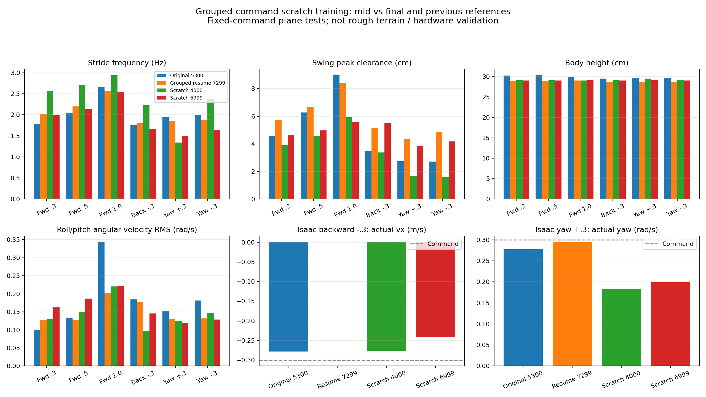

# 分组速度课程从头训练4000/6999复核（2026-11-06）

## 结论与本轮状态

最新run：`imgo2_rl/logs/rsl_rl/base_move_rough/2026-11-06_00-36-44_speed_curriculum`，最终`model_6999.pt`。本次正式导出4000、6999，新增32个MuJoCo及8个Isaac固定指令平地工况，对照已有原低速5300、上次分组续训7299。

**从头训练这次恢复了Isaac低速后退响应；4000→6999在MuJoCo中步频降低、后退/纯转向净空提高，不支持“后期轮数太多导致快步”。但更慢的步态伴随部分前进/后退角运动增大、低速后退跟踪减弱，机身仍约29cm，左转欠跟踪。6999是慢步候选，并非所有指标胜过4000或原5300。**

- 已完成/已修复：补齐从头训练配置、完整event、71份模型有限性、两份正式导出一致性、中期/最终双引擎检查与图表证据；无新增生产控制/奖励修复。
- 待修复/待确认：机身高度、身体稳定性与低速左转、后退跟踪误差，动态加减速/FSM、更多初态/seed、Gazebo、rough和硬件。需要对应闭环，不以总reward/满回合代替验收。
- 未修改训练配置/奖励/命令代码/模型/PD或部署生产策略，未启动新训练。旧请求原低速run的5400/5500不是本次对象，仍未补测。

## 是否从头、配置是否一致

agent保存resume=false、7000轮、seed42、4096环境、24步/env；load_run/checkpoint是默认正则，但resume关闭，不能据其存在认定加载了旧模型。初始model_0的std均值.9935，也不同于续训起点约.158。最终文件编号6999符合0起始索引。

与22:07分组续训run相比：env.yaml除log_dir外完全相同；agent仅max_iterations/run_name/resume/load_run/load_checkpoint变化，保存的模型、奖励、动作、观测、随机化、PD、采样比例/范围和课程相同。因此本次可以讨论“相同保存配方下从头/续训的差别”，但服务器git目录为空，未保存函数源码/采样计数；不能声称严格同源码多seed因果实验。

仍为平地，地形生成器与地形课程关闭；10%静止/40%低速六方向/50%混合。两项课程(.5,1)，event中线速度约375轮扩至1.2、角速度约417轮扩至1.5，后面长期处于最终范围，不是后期还在不断扩大速度。

## 曲线与数值健康

| 窗口 | mean reward | xy日志误差 | yaw日志误差 | noise std | value loss |
|---|---:|---:|---:|---:|---:|
| 1000–1499 | 32.579 | .25279 | .27183 | .25703 | .00803 |
| 2000–2499 | 34.274 | .24174 | .26663 | .24801 | .00729 |
| 3000–3499 | 34.906 | .23618 | .26120 | .24647 | .00705 |
| 4000–4499 | 35.209 | .23472 | .26079 | .24575 | .00699 |
| 5000–5499 | 35.465 | .23362 | .25703 | .24470 | .00686 |
| 6000–6499 | 35.741 | .23229 | .25629 | .24228 | .00659 |
| 6500–6999 | 35.967 | .22952 | .25383 | .23912 | .00641 |

后期小幅改善、收益递减，未见数值崩溃。4000窗口到最终reward约+2.15%，xy误差约−2.2%。71份checkpoint模型张量和所有已解析标量有限；最终std均值.238492、最大.298374，无凭据因其数值判停。没有穷举验证优化器张量。

后期分项：track_lin +1.39651、track_yaw +1.09328；lin_z−.04531、ang_xy−.14575、base_height−.02277、hip_deviation−.11111、action_rate−.03821、air−.10248、air_variance−.07948、slide−.05464、FHB−.00686。episode长度1000、time_out=1，但illegal_contact关闭，因此不代表100%安全。

[事件与窗口](../training/grouped_scratch_windows_2026-11-06.json)、[模型/导出身份](../training/grouped_scratch_identity_2026-11-06.json)。

## 导出与测试方法

4000/6999均经正式`ppo/play.py --export_only`导出；8个Actor张量及seed42的1024条45维确定性输入与checkpoint均max diff=0。两份JIT均被部署LibTorch实际加载。

MuJoCo：两策略各16工况，各20秒4000帧、剔除前4秒，使用相同生产PD/反馈适配器、确定仿真时间和独立重置/暖启动。32次无测试失败、动作饱和率均0，输入文件前后不变；与旧对照的7份共同模型/控制源码/配置哈希完全一致。工况含静止、前进.3/.5/.8/1/1.2、后退.3/.5/.8、横移±.3、yaw±.3/±.8、前进.4+yaw.8。无GUI/FSM时序验证。

Isaac：各策略静止/前进.3/后退−.3/左转.3四工况，600步12秒、剔除前100步2秒，固定重置/seed42、关闭观测噪声与startup/interval随机化、实际执行器25/.5。dt、关节顺序、参考角、执行器、固定重置/平地契约匹配旧基准。新8次均resets=0、upright_fraction=1；非法接触终止关闭，不能视为完整跌倒/安全验收。使用当前源配置固定指令诊断，不是原服务器随机训练环境全量复现。

旧5300/分组续训7299对照使用此前已测JSON，本次没有冒称重跑它们。

## MuJoCo：中期到最终的变化

角运动=√mean(ωx²+ωy²)，rad/s，不是roll/pitch角度RMS。净空是完整离地段碰撞球底部峰值均值；周期为同脚落地间隔。

| 指标 | 原低速5300 | 分组续训7299 | 新从头4000 | 新从头6999 |
|---|---:|---:|---:|---:|
| 前进.3实际vx | .307 | .334 | .329 | **.299** |
| 前进.3步频Hz | 1.786 | 2.020 | 2.564 | **2.000** |
| 前进.3周期s | .560 | .495 | .390 | **.500** |
| 前进.3净空cm | 4.56 | 5.75 | 3.89 | **4.63** |
| 前进.3机身高cm | **30.25** | 28.87 | 29.11 | 29.06 |
| 前进.3角运动 | **.100** | .126 | .130 | .162 |
| 前进.5步频Hz | 2.041 | 2.198 | 2.703 | **2.139** |
| 前进.5角运动 | .134 | **.128** | .150 | .186 |
| 后退−.3实际vx | −.248 | −.245 | **−.258** | −.238 |
| 后退−.3步频Hz | 1.754 | 1.802 | 2.222 | **1.667** |
| 后退−.3净空cm | 3.46 | 5.15 | 3.37 | **5.51** |
| 后退−.3角运动 | .184 | .177 | **.097** | .145 |
| 左转.3实际yaw | .276 | **.291** | .232 | .247 |
| 右转−.3实际yaw | −.286 | −.301 | −.278 | **−.300** |
| 左/右转.3净空cm | 2.74/2.71 | 4.32/4.88 | 1.69/1.63 | **3.85/4.18** |
| 前进1.0实际vx | 1.091 | **1.013** | .984 | .960 |
| 前进1.0角运动 | .343 | **.203** | .221 | .223 |

6999前进.3步频比4000降低约22%，后退.3降低25%；滞空均值前进.3从.1415→.1935s、后退.3从.1528→.2375s。足高/慢步确实改善，所以不能把所有后期变化称为过训练。

代价是：前进.3角运动.130→.162、前进.5 .150→.186、后退.3 .097→.145，后退低速实际速度也变小；同样较慢不等于机身必然更稳。6999前进.3 roll角标准差约.314°（4000 .153°）、后退.3约.320°（4000 .078°），应与角运动/跟速一起看，不能单看频率。

机身依然约29cm，尚未回到原5300低速约30.25cm；左转.3只有.247且仍欠跟踪。6999横移±.3实际约+.237/−.244，存在欠跟踪。静止MuJoCo高29.62cm、角运动.0039，未复现严重静站抖动。四髋裁剪占比均0，无旧极端髋动作饱和迹象。

[本次32工况](grouped_scratch_mujoco_2026-11-06.json)、[含此前对照的80工况合并数据](grouped_scratch_combined_2026-11-06.json)。

## Isaac：后退恢复，但不是全指标胜出

| 工况 | 原5300 | 分组续训7299 | 新从头4000 | 新从头6999 |
|---|---:|---:|---:|---:|
| 前进.3实际vx | .195 | .278 | .277 | .274 |
| 后退−.3实际vx | −.278 | +.001 | **−.277** | −.242 |
| 左转.3实际yaw | .278 | **.295** | .184 | .199 |
| 静止角运动RMS | .0249 | **.0143** | .0358 | .0152 |
| 前进.3角运动RMS | .256 | .252 | .288 | .297 |
| 后退−.3角运动RMS | .259 | .059（近不动） | **.167** | .229 |

本次两个checkpoint均能在固定初态下低速后退，上一版“近不动”未复现，这是有价值的改进，但单初态不等于彻底修复所有后退启动情况。6999比4000静止更稳、左转略改善，但后退跟踪与运动角速度更差；Isaac前进角运动仍不理想，左转只有目标约66%。

[Isaac摘要与契约](grouped_scratch_isaac_2026-11-06.json)。

## 下一步建议

- 保留6999作为本次慢步/抬脚候选，4000作为跟踪/运动稳定性对照，不按轮次自动选小或大。
- 不必因7000轮就认定PPO“训太久”，也不建议现在再从头重训；本次后期仍有实测收益和代价。
- 不要再一味增大足高/滞空奖励：6999净空已经恢复/提高，而高度、身体角运动、左转/横移欠跟踪尚未解决。下一步应围绕这些缺口做针对性核查，避免一次改多项权重。
- 暂不直接上rough或实机替换；先验收动态指令、左右转、减速/站立、后退启动和高度保持。更多轮次不能替代这些工况。

## 产物与边界



运行原始文件在`imgo2_rl/logs/grouped_scratch_compare_2026-11-06/`，含两正式导出日志、独立`scratch4000.pt`/`scratch6999.pt`、CSV与Isaac逐步JSON。新run的`exported/policy.pt`目前是最后导出的6999。未覆盖部署生产policy。

标准库解析使用系统python3；导出/Isaac/绘图使用`/home/tommy0929/miniconda3/envs/env_isaaclab/bin/python`。图已视觉复核。单seed/初态、有界平地固定指令，未做Gazebo、动态/FSM、rough、硬件或新训练。

## 同日rough接入建议：以6999作候选起点（尚未实施）

若用户决定开始地形适应，可从本run的model_6999.pt另开rough续训run，保留原平地结果。选择依据是6999符合当前慢步/抬脚目标且Isaac后退已响应；不是断言它是最优起点或平地已完全合格。低速左转、身体角运动/高度仍有缺口，先轻地形并保留平地，不直接投入最高难度。

当前同名任务本来继承LocomotionVelocityRoughEnvCfg，只是服务器配置末尾把terrain_type改plane、terrain_generator设None并关闭terrain_levels。首先注释/移除所有这三项平地覆盖，保证继承的generator对象保留（不能在None上设置curriculum）。本机rough_env_cfg.py这三行已注释，服务器应以实际文件为准。

沿用先前CurrTerm/mdp导入，在__post_init__末尾设置：

```python
self.scene.terrain.terrain_type = "generator"
self.scene.terrain.terrain_generator.curriculum = True
self.scene.terrain.max_init_terrain_level = 0
self.curriculum.terrain_levels = CurrTerm(func=mdp.terrain_levels_vel)

# 地形阶段先固定混合速度，避免速度范围和地形同时升级。
self.curriculum.command_levels_lin_vel = None
self.curriculum.command_levels_ang_vel = None
self.commands.base_velocity.ranges.lin_vel_x = (-0.6, 0.6)
self.commands.base_velocity.ranges.lin_vel_y = (-0.4, 0.4)
self.commands.base_velocity.ranges.ang_vel_z = (-0.6, 0.6)
```

10/40/50分组和low_*保护范围继续保留，奖励/PD/动作/观测先不变。此处None关闭的是速度课程，terrain_levels仍开启。地形难度0起步不是全平地，楼梯仍从最小台阶附近生成；本机子类已覆盖楼梯range为(.025,.08)，不是Isaac原始默认(.05,.23)。

默认ROUGH_TERRAINS_CFG没有独立平地类型。为保留平地步态，建议显式加入40%平地，需顶部导入`from isaaclab.terrains import MeshPlaneTerrainCfg`，在恢复generator后加入：

```python
generator = self.scene.terrain.terrain_generator
generator.sub_terrains["flat"] = MeshPlaneTerrainCfg(proportion=0.40)
for name, proportion in {
    "flat": 0.40,
    "pyramid_stairs": 0.15,
    "pyramid_stairs_inv": 0.15,
    "boxes": 0.10,
    "random_rough": 0.10,
    "hf_pyramid_slope": 0.05,
    "hf_pyramid_slope_inv": 0.05,
}.items():
    generator.sub_terrains[name].proportion = proportion

# 温和随机起伏；当前HF random_uniform函数忽略difficulty，不能指望它从低等级自动变平。
generator.sub_terrains["random_rough"].noise_range = (0.01, 0.03)
```

比例对应当前Isaac基础配置的六个地形键，服务器若改了地形字典先核对键。平地比例实际按地形列分配而非每次reset独立抽取；当前20列可按上述比例分配。地形课程按相对出生点的平面位移/命令预计距离升降，不按转向质量、抬脚或机身稳定性升级，静止/纯转向不等于自动通过复杂地形。随机起伏的difficulty被忽略是已读本机Isaac源函数确认的行为。

本机checkpoint6999实际Actor首层512×45、Critic首层512×235；现有平地run本来保留critic高度扫描、actor不含高度扫描。只恢复地形而不更改观测声明没有已知输入维数冲突，不需要切另一个task或重写导出；不能新增actor高度观察后还声称可直接完整恢复。实际rough恢复/射线/接触与采样交互仍待4环境10轮冒烟，未运行或声称通过。

起点路径已本机确认存在：`imgo2_rl/logs/rsl_rl/base_move_rough/2026-11-06_00-36-44_speed_curriculum/model_6999.pt`。服务器应有对应文件；续训使用原task=Imgo2-basemove-rough-ppo、--resume、--load_run=2026-11-06_00-36-44_speed_curriculum、--checkpoint=model_6999.pt及新的run_name。先短恢复验证再决定长训预算；本次只提供修改方法，未改源码或启动训练。

## 同日澄清：11/05低速最佳与新7000的reward/std

本轮再次核对部署`policy_lowBest.pt`与`ang03_compare_2026-11-05/new5300.pt`：seed42的1024条45维输入max diff=0，支持用户所指低速最佳就是11/05 15:19/5300参考。

旧4800–5300窗口reward41.2202、mean std.15723、xy/yaw日志误差.18510/.20866；新6500–6999窗口reward35.9670、std.23912、误差.22952/.25383。数值确实旧组更好看，但旧组命令仅vx±.5/vy±.4/yaw±.6、2%站立无分组，而新组混合最大±1.2/±.8/±1.5、10/40/50分组，不是相同任务分布，不能把reward、value loss和std直接当同一难度的收敛排名。

std是策略训练分布的探索尺度，不是步态误差或“收敛程度得分”；更小不保证所有方向更好。部署本次正式JIT是确定性Actor均值，不把训练std直接当随机电机动作噪声，机身晃动不能简单归因于std较大。

实际固定低速MuJoCo前进支持优先保留旧5300：+.3高度30.25 vs29.06cm、角运动.0997 vs.1624；+.5高度30.35 vs29.07cm、角运动.1341 vs.1865，步频也更低/相近。按“低速前进高身、平稳”优先目标，可把11/05 5300/policy_lowBest作为首选基准。不能扩展为唯一全方向最优：新6999后退−.3净空5.51 vs3.46cm、角运动.1454 vs.1843，左右转净空/角运动有收益；左转跟踪旧组较好，新右转更接近指令。本轮不新增仿真/训练或修改奖励/控制，使用已测同条件数据澄清；完整同分布随机评估、多seed与统一综合权重排名仍待验证。


## 双起点地形续训方案与奖励建议（2026-11-06，未实施）

用户澄清：不是只选择5300，而是两组都测试。候选A为2026-11-05_15-19-20/model_5300.pt，B为2026-11-06_00-36-44_speed_curriculum/model_6999.pt；本轮再次确认两文件存在。A低速前进机身较高且角运动较小；B后退/转向净空和大范围速度经验有优势，不能预判rough赢家。

为比较起点，两组都用相同的轻地形分布、分组采样、固定速度范围、奖励、seed和追加轮数，各开独立run。关闭两项command_levels课程，但明确填写ranges，关闭课程不会自动变成低速。首轮可统一x±.5、y±.4、yaw±.6，heading=False，保留10%静止/40%低速纯方向/50%混合；分组low_*独立于ranges，需要同时核对。本配置会改变原5300的采样分布，因此比较的是两个起点对同一新配方的适应，不是各自原环境的严格延长。若分别保留两组原速度包络，也可作产品路线对照，但不能把结果差异仅归因起点。

两组保存奖励配方相同；本机rough_env_cfg当前值与保存配方不同，不能直接宣称本机配置等同旧run。候选地形配方以保存值为准，仅减弱joint_mirror -1→-.3、feet_air_time_variance -8→-4；这是经验性起步值，尚无新训练验证。镜像函数直接比较对角腿thigh/shank角度平方差，非接触相位约束；variance同时约束各足上次滞空和支撑时长（各clip到.5），不只滞空。楼梯不同落脚高度/时机需要允许不对称，但弱化也可能损失原平地协调。

其余先保留：base_height -35/target .33，lin_vel_z -4，ang_vel_xy -.3，flat_orientation -5，feet_height_body -4/target -.20，feet_air_time 1.6/threshold .5，feet_slide -.15，track_lin 1.5/track_yaw1.2，hip L1 -.5，joint_pos_penalty关闭，扭矩/加速度/功率/action_rate等不变。不因6999垂直弹动就同时增加多个身体惩罚，爬阶本身需要竖直速度和俯仰；先轻台阶/坡，若以后坡度明显提高，再独立评估减弱或地形自适应flat_orientation。暂不新增feet_gait或世界绝对高度feet_height。

FHB当前源码仅摆动脚生效，使用世界水平足速门控、机身系z误差；它不是离地净空，不保证启动抬脚，-.20在rough上不能换算成固定10cm净空。base_height当前使用height_scanner_base有效射线均值；须保留sensor_cfg，不能改成固定世界z。多台阶命中会使均值目标跳变；全无效时env_origin回退也不能准确表达任意楼梯局部地面。若高度奖惩或机身动作突变，先检查射线/参考面，不直接加大高度权重。新版服务器奖励函数是否相同仍需对照。

地形接线沿用前节：保留继承generator、terrain curriculum=True、max_init_terrain_level=0、terrain_levels=CurrTerm(mdp.terrain_levels_vel)；40%平地和轻地形，random_rough噪声先.01–.03（该实现不随difficulty缩小）。不在terrain_generator=None上赋属性。禁用速度课程后排查末尾是否又创建CurrTerm。checkpoint不恢复环境课程进度。

先各做4环境/10轮冒烟，成功后建议两组等预算追加约1000–2000轮并保留中间模型。该预算不是保证收敛的轮数。固定平地静止/前后/横移/转向以及同高度台阶和坡、不同初态测试，比较跌倒/通过率、跟踪、局部地面相对高度、垂直速度RMS/高度std、roll/pitch角运动、足端净空与步频；不能跨地形分布以总reward/std直接排名。当前illegal_contact关闭，time_out=1不等于不跌倒，需要显式跌倒指标或核对终止配置。

已完成：方案澄清、源码语义和既有实测复核、路径核对；无新增生产修复。待确认/待修复：服务器函数一致性、两起点rough冒烟/训练及平地保留效果、射线异常/多初态与实机；本轮未改训练代码/奖励/部署策略，未启动训练或仿真。
