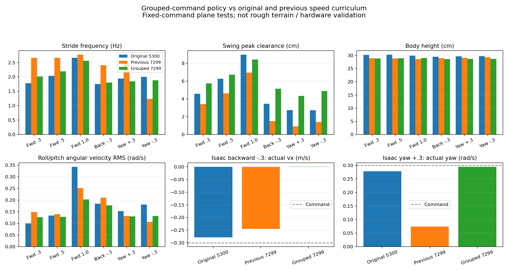

# 最新分组速度课程7299复核（2026-11-06）

## 结论与状态

最新run为`imgo2_rl/logs/rsl_rl/base_move_rough/2026-11-05_22-07-33_speed_curriculum_resume`，最终文件`model_7299.pt`。本次正式导出并新增16个MuJoCo、4个Isaac平地工况，与已有原低速5300及上一版19:15速度7299比较。

**MuJoCo中分组版明显改善了低速快步与后退/转向低净空，保留了高速前进能力；但机身高度未恢复，Isaac低速后退仍基本不走，不能判为全方向/跨引擎通过。** 建议保留为新的MuJoCo候选，不直接替换实机策略或立即开始rough。

- 已完成/已修复：补齐最新run配置、训练趋势、21份checkpoint有限性、正式导出一致性、两引擎固定工况和图表证据。无新增生产代码/控制修复。
- 待修复/待确认：Isaac后退启动/初态与接触差异、机身高度、更多初态/seed、动态加减速/FSM、Gazebo、rough和硬件；需要相应日志及闭环，不能只看平均reward。分组的具体因果仍需同条件/多seed证据。
- 本轮未修改训练配置、奖励、模型、PD、命令代码或部署生产policy，未启动新训练。

## 保存配置与训练趋势

agent.yaml与上版19:15 run完全相同：seed42、4096环境、每环境24步、resume=true，从原`2026-11-05_15-19-20/model_5300.pt`额外2000轮。env.yaml中除log_dir与指令配置外无差异，奖励/模型/动作/观测保存值一致；地形plane、terrain_generator与terrain_levels为null。

保存配置确认为`GroupedVelocityCommand`：静止.1、低速.4、剩余.5混合；低速幅值x(.25,.5)、y(.25,.4)、yaw(.2,.5)。混合最终范围vx±1.2、vy±.8、yaw±1.5，两课程倍率(.5,1)。heading=False；heading_control_stiffness虽从.5变1，但heading关闭，不能解释为有效控制增益变化。

event中课程上界最终1.2/1.5，在5550/5634附近即达上限；比上版5592/5675更早。低速/静止组参与原80%平均跟踪判据，未修改为仅混合组验收，不能据此宣称每个方向均已合格。保存配置确认启用分组，但server的git目录为空、event未写采样组计数，无法从日志独立还原精确实际抽组比例/服务器函数版本。

| 窗口 | mean reward | xy日志误差 | yaw日志误差 | noise std | value loss |
|---|---:|---:|---:|---:|---:|
| 5300–5499 | 35.754 | .17410 | .19397 | .17314 | .00447 |
| 5500–5999 | 33.465 | .25890 | .26946 | .25497 | .01033 |
| 6000–6499 | 34.343 | .24652 | .26431 | .24983 | .00837 |
| 6500–6999 | 34.792 | .24200 | .26229 | .24736 | .00800 |
| 7000–7299 | 34.766 | .24246 | .26232 | .24796 | .00798 |

后两窗口接近平台，没有NaN/Inf崩溃证据，也看不出平均指标还在明显提升。不能把此run reward≈34.8与旧版≈31直接当作质量排名：采样分布不同，静止/低速更容易跟踪。

后期实际贡献：track_lin +1.38425、track_yaw +1.08548；lin_z−.04878、ang_xy−.15533、height−.02961、hip_deviation−.11834、action_rate−.03948、air−.10452、air_variance−.08299、slide−.05568、FHB−.00581。旧版air−.13849、slide−.07290；新贡献减小不等于所有固定指令都改善。新air_variance更负亦需按新分布理解，不能只按分项平均定因果。

[完整窗口/原始标量](../training/grouped_speed_training_windows_2026-11-06.json)。

## 身份与测试条件

21份checkpoint模型张量均有限，最后std均值.244483、最大.307287。正式`ppo/play.py --export_only`导出JIT；8个Actor张量及1024条seed42的45维确定性输入与checkpoint均max diff=0，部署LibTorch实际加载通过。[身份记录](../training/grouped_speed_identity_2026-11-06.json)。

MuJoCo：16工况各20秒4000帧、剔除前4秒，确定仿真时间/生产PD与反馈适配器，独立重置与既有暖启动；与旧版的7份共同模型/源码/配置哈希一致，前后输入文件均未变。16次无测试失败；新策略只在前进1.2时有约.146%的动作饱和，其余为0，各工况四髋动作裁剪占比均0。该检查不等于GUI/FSM时序等价。

Isaac：静止、前进.3、后退−.3、左转.3各12秒600步、剔除前2秒；seed42、固定重置/名义实际25/.5执行器，关闭观测噪声与startup/interval随机化。dt、关节顺序、参考角、执行器增益、平地与固定重置契约匹配旧5300/旧7299元数据。四次resets=0、upright_fraction=1，illegal_contact关闭，不能当完整安全验收。使用当前源配置的固定指令诊断，不是还原服务器完整随机训练环境。旧两份策略的对照数据为上次已测缓存，本次新增只测分组7299。

## MuJoCo比较

角运动为√mean(ωx²+ωy²)，rad/s；净空为完整离地段碰撞球底部峰值均值；“周期”为同脚重复落地间隔，不是滞空时间。

| 工况/指标 | 原低速5300 | 上版速度7299 | 新分组7299 |
|---|---:|---:|---:|
| 前进.3实际vx | .307 | .329 | .334 |
| 前进.3步频Hz | 1.786 | 2.667 | **2.020** |
| 前进.3周期s | .560 | .375 | **.495** |
| 前进.3净空cm | 4.56 | 3.41 | **5.75** |
| 前进.3机身高cm | **30.25** | 28.96 | 28.87 |
| 前进.3角运动 | **.100** | .148 | .126 |
| 前进.5步频Hz | 2.041 | 2.667 | **2.198** |
| 前进.5角运动 | .134 | .141 | **.128** |
| 后退−.3实际vx | −.248 | −.232 | −.245 |
| 后退−.3步频Hz | 1.754 | 2.410 | **1.802** |
| 后退−.3净空cm | 3.46 | 1.50 | **5.15** |
| 左转.3实际yaw | .276 | .325 | **.291** |
| 右转−.3实际yaw | −.286 | −.177 | **−.301** |
| 左转.3净空cm | 2.74 | .90 | **4.32** |
| 右转−.3净空cm | 2.71 | 1.41 | **4.88** |
| 前进1.0实际vx | 1.091 | **1.009** | 1.013 |
| 前进1.0角运动 | .343 | .252 | **.203** |

与上版相比，前进.3步频下降约24%，后退.3下降约25%；前进.3平均离地时间恢复到.196s（原5300 .204s），后退.3约.195s。至少在这些MuJoCo工况中，分组后确实出现了较慢、较高摆脚，而不是靠牺牲所有高速能力得到。

但仍有取舍：机身没有恢复，前进.3约28.87cm、后退.3约28.65cm、纯转向约28.7cm；部分场景比旧版还低。新转向伴随约+.039m/s前漂。横移±.3实际+.257/−.268，角运动约.248/.233，略大于旧版.213/.197。足高已高于原5300，不建议仅为“继续抬脚”而继续加大足高/滞空项。

静止MuJoCo：高度29.73cm、角运动.0042rad/s，与原5300/上版相近，未出现强烈静站抖动。四髋平均外展通常在约±1°内，无此前极端髋饱和迹象。

[新16次结果](grouped_speed_mujoco_2026-11-06.json)、[含两份旧对照的48次合并数据](grouped_speed_combined_2026-11-06.json)。

## Isaac比较与主要缺口

| 工况 | 原5300实际vx/yaw | 上版7299 | 新分组7299 |
|---|---:|---:|---:|
| 前进.3（vx） | .195 | .297 | .278 |
| 后退−.3（vx） | −.278 | −.245 | **+.001（基本不走）** |
| 左转.3（yaw） | .278 | .074 | **.295** |
| 静止角运动RMS | .0249 | .0969 | **.0143** |

新策略纯转向与静止改善明显，但低速后退没有通过。后退时机身平均约27.96cm，与MuJoCo活动状态不同；不能因为角运动.0593较低就说更稳更好，它实际上没有完成运动任务。前进.3角运动.2524，高于上版.1916，亦不是全场景稳定性胜出。

同一正式JIT已经验证精确一致，当前没有证据把差异直接归咎于导出转换错误。需要进一步核对后退从不同初态/站立预热/连续指令是否能启动，以及接触/初始化差异；本轮未额外展开这些实验，不虚称根因已定位。

[Isaac摘要与契约](grouped_speed_isaac_2026-11-06.json)。

## 后续建议

1. 保存这版为新的MuJoCo候选；保留原5300/上版7299，不覆盖实机生产策略。
2. 采样保护值得继续保留，至少在MuJoCo达成了低速慢步与抬脚改善。但单seed实验且服务器源码缺失，不将全部变化归因于单一字段或保证后续训练一定保持。
3. 暂不继续增大足高/滞空奖励，也不同时加重多项身体惩罚；足高已足够甚至高于原5300，而机身高度仍不足。
4. 先确认Isaac后退响应及高度问题，再考虑rough；不能用“满1000步、reward更高”替代验收。后期已接近平台，单纯按相同配置追加很多轮缺乏明确收益依据，也不代表必须从头重训。

## 产物与边界

本次日志/JIT/CSV/Isaac逐步JSON在`imgo2_rl/logs/grouped_speed_compare_2026-11-06/`；独立策略`grouped7299.pt`。本次run的`exported/policy.pt`对应新分组7299，不要与19:15旧run同名文件混淆（旧run的exported在上次中间轮次导出后为6000）。

标准库解析用系统python3，导出/Isaac/绘图用`/home/tommy0929/miniconda3/envs/env_isaaclab/bin/python`。图已视觉核对。单seed/初态、有界平地固定指令测试，未做动态/FSM、Gazebo、rough、硬件或新训练。
