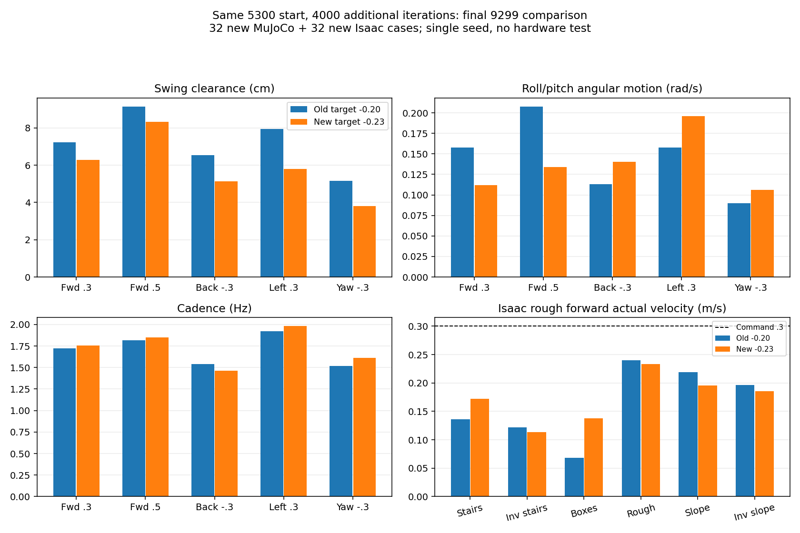

# 足高目标−0.23新训练复核（2026-11-07）

## 结论和状态

新run：2026-11-06_21-49-38，仍从原2026-11-05_15-19-20/model_5300.pt恢复，追加4000轮，最终9299。不是从上一组9299接着训练。与旧2026-11-06_15-10-00保存env相比，除log_dir外只改feet_height_body.target_height：-.20→-.23。其余保存参数/seed/预算相同，适合作为一次同起点配方对照，但服务器git目录未提供源码，单seed不能证明普遍最优。

新9299平地前进角运动明显减小、机身略提高、足高下降但仍较高；后退-.3跟速和触地同步性退步，横移部分更晃。rough平均跟踪误差小幅降低，不是全面替代旧-.20组。中期6300前进.5角运动反而更大，不能因轮数少自动选择中期。若优先减前进抖动，值得把新9299作为低速下一候选；若优先后退协调，保留旧9299对照。

已完成/已修复：41模型数值、保存配置/事件、两正式导出一致性及新32MuJoCo+32Isaac工况和逐足载荷/时序对照完成，补图表/统计；无生产控制修复。待修复/待确认：后退跟速与协调、横移稳定/漂移、足高仍大、障碍前进、FSM切换/多seed/Gazebo/硬件与通过率。未修改训练/奖励/部署控制，未启动新训练或实机，未替换当前deploy策略。

## 训练曲线和身份

41checkpoint模型张量有限，最终std均值.179409、最大.227734；未穷举优化器张量。

| 窗口 | reward | xy误差 | yaw误差 | noise std | 地形均级 | value loss |
|---|---:|---:|---:|---:|---:|---:|
| 5300-5499 | 32.1294 | 0.2378 | 0.2281 | 0.2030 | 0.5060 | 0.0100 |
| 5800-6299 | 38.0515 | 0.2263 | 0.2315 | 0.1936 | 0.6696 | 0.0042 |
| 8800-9299 | 39.5587 | 0.2121 | 0.2219 | 0.1790 | 0.7196 | 0.0030 |

旧/新末500轮reward39.3868→39.5587、xy误差.212146→.212076、yaw.223345→.221944、地形均级.720486→.719609，差异很小；FHB贡献从-.005814→-.003094是目标改变后的新代价，不能仅凭该项数值变好推断步态提升。曲线近平台、无数值崩溃证据，不据std大小独立排名。

新6300/9299经官方ppo/play.py --export_only导出，两份Actor张量相等，1024个seed42确定性45维输入对checkpoint差0；Actor45/Critic235，部署LibTorch在MuJoCo测试中实际加载。独立文件：imgo2_rl/logs/height23_compare_2026-11-07/height23_6300.pt、height23_9299.pt；新run/exported/policy.pt最后为新9299。当前生产policy.pt前后SHA均d2334e9845c237062fc0671e6df8e79440efbfa035c0c9a3c2c884daac40cfea，仍是旧-.20目标组9299。两组都叫9299，必须带run名或目标值区分。

[配置/事件/模型审计](../training/terrain_followup_audit_2026-11-07.json)、[身份与部署未变证据](height23_identity_2026-11-07.json)。

## 方法与限制

MuJoCo：新两策略各16固定工况、每次20秒4000帧、前4秒剔除；同默认角/25/.5 PD/动作映射/反馈适配器及控制时钟。32次无基准failure，生产输入文件哈希前后不变；共同7模型/控制源/配置哈希与旧-.20基准全相同，旧结果沿用此前有身份缓存，不冒称重跑。

Isaac：新两策略各4平地+12rough，共32工况，每次600步12秒、前100步2秒剔除，固定名义重置/seed42/25/.5，观测噪声及startup/interval随机化关闭，rough六类型×前后±.3、difficulty=.5、12×12地块、按列分配、不在评测时升级。全部upright_fraction=1、reset=0；illegal_contact仍关闭，不等于完整安全/爬楼验收。world xy完成轨迹/局部离地高度未采集，rough原始z相对patch原点，不以此衡量机身蹲低或脚底净空。

## 平地MuJoCo：前进改善与后退代价

角运动为√mean(ωx²+ωy²)，rad/s，非roll/pitch角度RMS。净空为完整摆动脚底峰值均值。

| 策略 | 工况 | vx或yaw实际值 | 身高cm | 高度std mm | 步频Hz | 净空cm | 角运动rad/s |
|---|---|---:|---:|---:|---:|---:|---:|
| terrain6300.pt | forward03 | 0.308 | 29.42 | 3.86 | 1.835 | 5.23 | 0.188 |
| terrain6300.pt | forward05 | 0.474 | 29.53 | 3.49 | 1.942 | 7.61 | 0.173 |
| terrain6300.pt | backward03 | -0.290 | 28.68 | 3.77 | 1.835 | 4.99 | 0.171 |
| terrain6300.pt | backward05 | -0.469 | 28.26 | 3.81 | 1.923 | 6.78 | 0.183 |
| terrain6300.pt | left03 | 0.005 | 29.54 | 2.56 | 2.174 | 5.80 | 0.209 |
| terrain6300.pt | turn_right03 | -0.250 | 29.52 | 3.82 | 1.600 | 2.71 | 0.130 |
| height23_6300.pt | forward03 | 0.319 | 29.82 | 2.64 | 1.835 | 6.09 | 0.169 |
| height23_6300.pt | forward05 | 0.501 | 29.77 | 3.48 | 1.980 | 8.12 | 0.216 |
| height23_6300.pt | backward03 | -0.256 | 29.10 | 4.40 | 1.695 | 4.50 | 0.159 |
| height23_6300.pt | backward05 | -0.429 | 28.62 | 4.11 | 1.786 | 6.44 | 0.183 |
| height23_6300.pt | left03 | 0.029 | 29.84 | 2.55 | 2.000 | 6.80 | 0.214 |
| height23_6300.pt | turn_right03 | -0.272 | 29.69 | 3.69 | 1.613 | 3.31 | 0.126 |
| terrain9299.pt | forward03 | 0.330 | 29.39 | 3.55 | 1.724 | 7.23 | 0.158 |
| terrain9299.pt | forward05 | 0.504 | 29.40 | 3.84 | 1.818 | 9.14 | 0.208 |
| terrain9299.pt | backward03 | -0.259 | 28.99 | 2.51 | 1.538 | 6.53 | 0.113 |
| terrain9299.pt | backward05 | -0.427 | 28.55 | 2.39 | 1.626 | 8.61 | 0.169 |
| terrain9299.pt | left03 | 0.013 | 29.62 | 2.08 | 1.923 | 7.94 | 0.158 |
| terrain9299.pt | turn_right03 | -0.268 | 29.46 | 3.63 | 1.515 | 5.15 | 0.090 |
| height23_9299.pt | forward03 | 0.326 | 29.61 | 2.66 | 1.754 | 6.28 | 0.112 |
| height23_9299.pt | forward05 | 0.517 | 29.66 | 2.74 | 1.852 | 8.31 | 0.134 |
| height23_9299.pt | backward03 | -0.229 | 29.10 | 3.13 | 1.460 | 5.14 | 0.140 |
| height23_9299.pt | backward05 | -0.411 | 28.78 | 2.17 | 1.575 | 7.29 | 0.129 |
| height23_9299.pt | left03 | 0.037 | 29.78 | 3.65 | 1.980 | 5.79 | 0.196 |
| height23_9299.pt | turn_right03 | -0.294 | 29.44 | 3.09 | 1.613 | 3.81 | 0.106 |

两最终9299对比：前进.5净空9.14→8.31cm，身高29.40→29.66cm，高度std3.8→2.7mm，角运动.2076→.1341（约降低35%）；前进.3角运动.1577→.1119（约降低29%）。说明这次目标调整在当前种子得到前进收益，但净空只降低约.83cm，并非目标降3cm就足端降3cm，也没有恢复原5300约30.35cm的前进身高。

后退-.3实际-.259→-.229，欠跟踪加重；角运动.113→.140增大、净空6.53→5.14cm。后退-.5角运动.169→.129改善但速度-.427→-.411更慢。左横移角运动.157→.196，前向漂移约.013→.037；右转-.3实际-.269→-.294改善，但角运动略增。改善有方向性，不能只用前进数据选全部方向最优。

新最终后退-.3前腿承重54.05%、左右50.93/49.07，对角触地相关.805/.871；旧最终前腿52.91%、相关.928/.968。新策略仍较旧5100的61.48%、相关.628/.557协调，但不及旧-.20的9299。不是严重左右整侧偏载，也不能由相关系数单独定义步态。

静止MuJoCo均接近不动，新最终高29.45cm、角运动.0053；未覆盖FSM站起/切换。高速度属于外推：新最终forward1.2实际1.141、角运动.418、动作元素裁剪约3.02%，仍不作为高速部署已验证；低速主要工况动作裁剪0，髋动作裁剪未见旧极端饱和迹象。

[新32工况指标](height23_mujoco_2026-11-07.json)、[旧新64工况合并](height23_combined_2026-11-07.json)、[逐足载荷/接触](height23_contacts_2026-11-07.json)。

## Isaac平地与六类地形

平地新最终前进.3实际.215、后退-.3实际-.378，前进欠跟踪、后退过冲依然存在。旧最终对应.236/-.365。前进角运动.220→.192改善，但后退.162→.188增加。左转.3实际.224→.256、角运动.182→.155改善。两引擎都不支持各方向全面变稳；不能仅凭MuJoCo静止/前进优势证明实机已改善。

| 方案 | rough平均vx MAE | rough平均角运动 |
|---|---:|---:|
| 旧-.20/6300 | 0.1377 | 0.2975 |
| 新-.23/6300 | 0.1493 | 0.2765 |
| 旧-.20/9299 | 0.1024 | 0.3319 |
| 新-.23/9299 | 0.0994 | 0.3123 |

新最终MAE .0994对旧.1024，约下降2.9%，小幅收益；中期新.1493比旧.1377更差，因此不建议因“少训练更好”选择新6300。

| 地形/方向 | 旧-.20最终实际vx | 新-.23最终实际vx |
|---|---:|---:|
| pyramid_stairs_forward03 | 0.136 | 0.172 |
| pyramid_stairs_backward03 | -0.302 | -0.328 |
| pyramid_stairs_inv_forward03 | 0.122 | 0.114 |
| pyramid_stairs_inv_backward03 | -0.212 | -0.210 |
| boxes_forward03 | 0.069 | 0.138 |
| boxes_backward03 | -0.288 | -0.303 |
| random_rough_forward03 | 0.240 | 0.234 |
| random_rough_backward03 | -0.315 | -0.319 |
| hf_pyramid_slope_forward03 | 0.219 | 0.196 |
| hf_pyramid_slope_backward03 | -0.363 | -0.382 |
| hf_pyramid_slope_inv_forward03 | 0.197 | 0.186 |
| hf_pyramid_slope_inv_backward03 | -0.287 | -0.297 |

正楼梯前进.136→.172、boxes前进.069→.138改善，但目标仍是.3，仍明显欠跟踪；反向楼梯前进.122→.114略退、随机粗糙/坡前进也未全部改善。平均误差不能替代爬完多少阶/距离的完成率，不宣布rough通过。

[Isaac统计](height23_isaac_2026-11-07.json)。

## 建议（未实施）

1. 若当前重点是前进机身抖动、过高摆腿，优先用新-.23组9299作低速对照候选；不要选新6300只因轮数少。旧-.20/9299保留给后退协调对照，两组均不全面替代原5300或policy_1。
2. 不再立刻继续压低足高目标或增加airtime。前进.5仍8.3cm净空，但横移/后退已有代价，下一步先观察新版本实际前后/横移/转向，避免只为一个指标继续修改。
3. 固定低速上机/仿真验收时区分跟速差异和抖动差异，保留旧版本；当前deploy未自动替换，导出路径在前文。
4. 训练两组都没有独立平地保留、没有Grouped纯方向采样保护；后续要解决方向覆盖/平地保留可围绕这些缺口设计，不把所有问题继续归于FHB目标。
5. 同奖励长训曲线收益已小，无数值崩溃；尚无证据必须再训练几千轮或重训。更有价值的是具体弱方向/通过率验证。

图已视觉核对。系统python3用于事件/指标和接触分析，env_isaaclab Python用于模型/导出/Isaac/绘图。原始新测试在imgo2_rl/logs/height23_compare_2026-11-07/；未运行Gazebo、硬件、动态FSM或长期训练。
