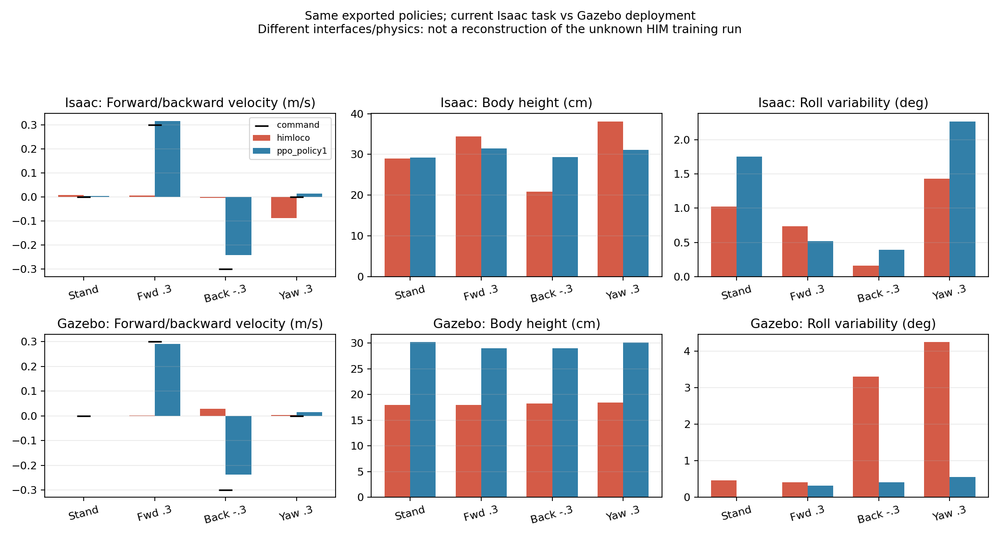

# HIMLoco 与 PPO policy_1 双引擎实测（2026-11-03）

## 结论

用户指定deploy中的HIMLoco与PPO policy_1作对比，并确认HIMLoco只有导出policy，没有checkpoint或保存的env/agent配置。现有HIMLoco在Gazebo部署下不能正常跟随前后/转向；同一文件在当前Imgo2 Isaac源码配置下也未正常跟随前后指令。**未复现“同一已知训练配置中Isaac正常、只有Gazebo异常”**，也不能否定他人在原环境中的观测。缺原训练配置使训练复现和部署参数最终定责仍未完成。

此前11/2报告中的GPU/ROS阻塞仅发生在受限沙箱。本轮先验证沙箱外GPU可用，再获准在该环境实际运行Isaac及Gazebo；不是在没有运行的情况下沿用历史结论。

## 策略身份与实验方法

- HIMLoco：imgo2_deploy/ros2_ws/policy/imgo2/himloco/himloco.pt，SHA256 d9945f85a399开头；PPO：同级ppo/policy_1.pt，SHA256 53a57f909b61开头。完整身份/网络形状/模型哈希在logs/himloco_compare_2026-11-03/identities.json。
- 本机RTX4060、驱动580.178.04；Isaac使用/home/tommy0929/miniconda3/envs/env_isaaclab/bin/python。未训练、未导出或替换权重。
- Isaac：各4个并行环境，固定站立、前进+.3m/s、后退-.3m/s、左转+.3rad/s；控制dt .02s，1000步20秒，前200步4秒不计统计。使用各自当前rough任务配置，诊断改为平地、关闭观测噪声及startup/interval随机化/课程、固定指令；HIM六帧最新在前，PPO单帧。不创建训练runner，不需要原checkpoint。
- Isaac诊断不是原训练复现：使用当前源码名义默认姿态/PD/动作处理，不是从权重推断出的真实训练参数。两引擎的接触、摩擦和动作裁剪等也未强行改成完全一致，不应视为严格的物理参数单变量实验。
- Gazebo：生产gazebo.launch.py、rl_sim、评测脚本，earth平地、gui=false；每种策略每种指令重新起一套栈，共8组，每组墙钟24秒，起身6秒，切策略后再跳过3秒。统计按消息仿真时间，不把墙钟慢速误当作步频。键2为HIM，键1为PPO。PPO测试仅临时把model_name改为policy_1.pt，批次结束恢复原配置；不覆盖policy.pt。
- Gazebo自动化启动/清理和结果在imgo2_rl/logs/himloco_compare_2026-11-03；独立DDS域92和Gazebo端口11366，首次探测域91/端口11365。原始odom、关节及切换过程/命令反馈均保留。

## 数字与图

完整指标见[JSON](himloco_ppo_comparison_2026-11-03.json)，图见下方。Gazebo足端高度由当前URDF、关节角和odom重建碰撞底面，属于几何净空而非接触传感器测得的滞空。Isaac记录的foot_origin_z只是足端原点，不能与几何净空混用。

| 引擎 | 策略 | 指令 | 实际vx(m/s) | 实际yaw(rad/s) | 机身高(cm) | roll标准差(°) |
|---|---|---|---:|---:|---:|---:|
| Isaac | himloco | stand | 0.008 | -0.017 | 28.98 | 1.021 |
| Isaac | himloco | forward03 | 0.006 | 0.016 | 34.47 | 0.732 |
| Isaac | himloco | backward03 | -0.003 | -0.005 | 20.89 | 0.157 |
| Isaac | himloco | turn_left03 | -0.087 | 0.626 | 38.13 | 1.433 |
| Gazebo | himloco | stand | -0.000 | -0.001 | 17.97 | 0.460 |
| Gazebo | himloco | forward03 | 0.001 | -0.003 | 17.93 | 0.410 |
| Gazebo | himloco | backward03 | 0.028 | -0.117 | 18.21 | 3.311 |
| Gazebo | himloco | turn_left03 | 0.003 | -0.163 | 18.40 | 4.250 |
| Isaac | ppo_policy1 | stand | 0.004 | 0.000 | 29.18 | 1.749 |
| Isaac | ppo_policy1 | forward03 | 0.317 | -0.040 | 31.41 | 0.521 |
| Isaac | ppo_policy1 | backward03 | -0.241 | 0.092 | 29.31 | 0.394 |
| Isaac | ppo_policy1 | turn_left03 | 0.015 | 0.064 | 31.14 | 2.268 |
| Gazebo | ppo_policy1 | stand | 0.000 | -0.000 | 30.19 | 0.002 |
| Gazebo | ppo_policy1 | forward03 | 0.290 | -0.020 | 29.01 | 0.319 |
| Gazebo | ppo_policy1 | backward03 | -0.238 | -0.026 | 28.97 | 0.416 |
| Gazebo | ppo_policy1 | turn_left03 | 0.015 | 0.093 | 30.09 | 0.557 |

Gazebo policy_1前进/后退有效步频约2.04/2.08Hz，几何摆动峰值均值约3.94/3.70cm；Isaac同策略前进大腿自相关频率约2.27Hz。HIM前后均未有效跟速，不报告静态关节小振动为步态频率；后退某脚几何峰值较高也不是正常后退抬脚的证据。HIM在Gazebo后退/转向roll标准差3.31°/4.25°，policy_1对应.42°/.56°；但HIM前进近乎不动，因此其前进姿态变化小不能解释为稳定行走。policy_1也并非完美：+.3rad/s转向指令仅跟到Isaac .064、Gazebo .093rad/s。




## 链路核对与可疑差异

| 契约 | 本仓当前Imgo2 HIM训练源码 | HIM部署config.yaml |
|---|---|---|
| 指令缩放 | 原值 | vx/vy乘2，yaw乘.25 |
| 默认关节角 | 各腿0/.87/-1.82 | 髋±.1，前大腿.8、后大腿1，小腿-1.5 |
| 运动PD | 25/.5 | 40/1 |
| 关节顺序 | FL/FR/RL/RR逻辑顺序 | mapping交换左右腿 |
| 动作限制位置 | 缩放偏置后的目标角clip±3 | 原始网络动作clip±100 |
| 历史 | 当前帧+过去5帧，最新在前 | 六帧，最新在前 |

表中差异是源码事实，但由于没有原训练配置，**不能直接断言所有部署参数都错了，也不能直接把PPO参数抄给HIM**。历史文档将此HIM文件标为Go2参考占位，当前没有可匹配的Imgo2训练run；形状/文件名不能证明训练机器人。

确认过的链路：真实rl_sim有历史缓冲分支，HIM模型输入270维；评测脚本键2已是RB+DPadRight的正确负轴方向，实际日志出现RL Controller [himloco]。不是将45维误喂给270维网络，也不是始终留在起身状态。当前mapping同时用于反馈和目标发送，但它是否匹配未知原策略仍待确定。

源码位置：himloco_env_cfg.py定义观测/动作，rl_lab/wrapper/himloco_vec_env_wrapper.py堆叠历史，modules/him_actor_critic.py与him_estimator.py负责估计器及Actor；deploy/himloco/config.yaml定义部署接口，rl_sim.cpp::GetState/SetCommand/Forward及library/core/rl_sdk负责拼输入和映射目标。

## 已完成与待确认

已完成：两策略实际双引擎短测、权重身份记录、真实FSM和六帧输入核对，评测按键离线2项检查通过。新增eval_exported_locomotion.py直接运行现有导出策略，summarize_himloco_comparison.py复算指标（标准库，绘图可选matplotlib）。未改生产控制逻辑、训练奖励、PD、模型或HIM配置。

待确认：原HIM训练参数和机器人来源；同一原配置下Isaac正常的证据；恢复训练接口后与部署同输入同输出以及接触/摩擦/增益的严格逐项对照。用户已说明没有其它文件，故当前不能完整复现原训练；需要训练者提供原配置或可运行工程，或明确授权基于现有权重另做接口重建。不要先靠调奖励/重训解释当前接口不明的问题。一次短测不足以评价复杂地形、长期鲁棒性或硬件安全。


## 重现入口与最终状态

Isaac工具示例（在imgo2_rl目录、可用Isaac Python环境中）：

```bash
python scripts/tools/eval_exported_locomotion.py \
  --task=Imgo2-basemove-rough-himloco \
  --policy=../imgo2_deploy/ros2_ws/policy/imgo2/himloco/himloco.pt \
  --history=6 --steps=1000 --warmup=200 --device=cuda:0 --headless \
  --json=logs/himloco_compare_2026-11-03/isaac_himloco.json
```

PPO对照使用rough-ppo任务、ppo/policy_1.pt、history=1。输出目录须预先存在。无GUI不等于无需GPU；本轮在沙箱外运行。

Gazebo批次脚本：source /opt/ros/humble/setup.bash及工作区install/setup.bash后，用/usr/bin/python3运行imgo2_rl/scripts/tools/eval_gazebo_himloco_ppo.py。它会短暂修改PPO config的model_name并在finally恢复；不要并行编辑该文件，也不要同时使用同一专用域/端口。复跑会覆盖本日期结果，先备份或修改OUT。汇总工具summarize_himloco_comparison.py接收日志目录、--json和可选--plot。

8组Gazebo状态全部completed、ppo_config_restored=true；两策略SHA不变。Isaac两批正常退出；额外启动的域91探测栈已按专用域和端口匹配清理，无本次长期训练或硬件运行。绘图PNG已实际查看，尚未制作视频。
