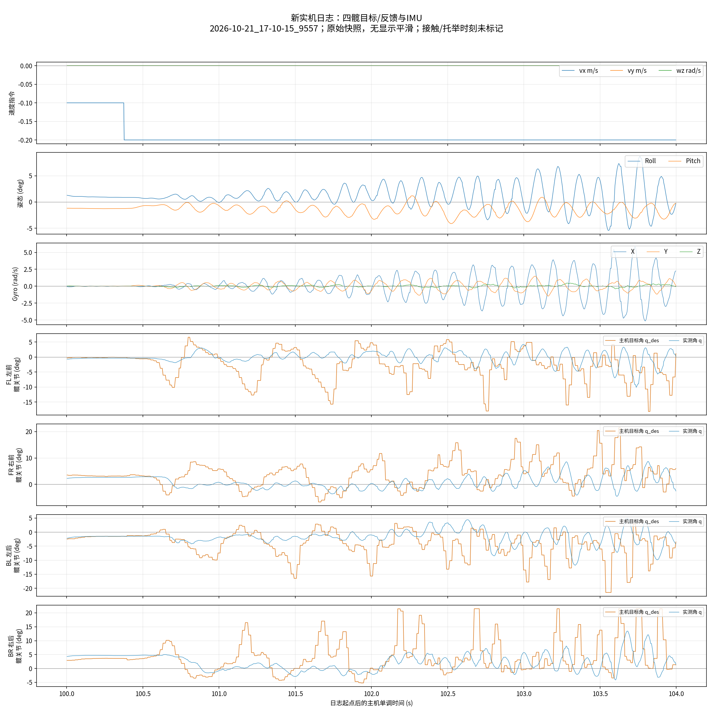

# 新批量通信日志：四髋反馈与IMU振荡核对

2026-10-21。用户上传`real/build/log/2026-10-21_17-10-15_9557/`，报告本轮运动抖动更强；要求画髋关节反馈，与仿真IMU比较并检查是否IMU问题。本轮只读日志和现有源码，生成离线统计与图；不改控制、参数、策略、模型或原始日志，不运行硬件/新仿真。

## 1. 结论

**新日志存在明显的运动闭环振荡，部分窗口比旧338秒记录及Gazebo更强；尚不能认定IMU故障。** 四髋目标和反馈、机身Roll/gyro同时有周期振荡，部分活跃窗口约7–8Hz；gyro与四元数变化在时间平滑后高度一致，没有发现NaN、四元数归一化异常、全程冻结等直接数据异常证据。

这些检查降低了“gyro孤立随机尖峰/严重单位错误”的优先级，不证明真实姿态绝对正确：四元数和gyro来自同一设备，融合可能共享误差；40ms检验不能覆盖全部高频/延迟。已存在关节和策略目标振荡，不能仅凭IMU曲线大就说传感器测错，也不能单凭内部一致性完全排除动态IMU影响。

## 2. 新旧通信与版本边界

新robot.csv共56,522行，282.782209秒，PPO从59.870秒开始；policy.csv共11,146行。meta记录PPO25/.5、默认站姿0/.87/−1.82、主循环5ms、策略20ms、总线周期**5ms**。旧记录总线7ms。新Gazebo200Hz试验使用15/.5、base6kg，故主要幅度对照采用历史25/.5的Gazebo图，仍不是相同轨迹/接触条件。

| 指标 | 旧338秒 | 新283秒 |
|---|---:|---:|
| 主循环平均 | 199.893Hz | 199.875Hz |
| 新策略结果取用平均 | 49.995Hz | 49.999Hz |
| 每ID末尾trace记录频率 | 约140–141Hz | 约197.6–198.5Hz |
| bus0整轮body快照中位 | 5.020ms | 2.136ms |
| bus0 body快照P99 | 10.056ms | 4.909ms |
| 关节反馈年龄中位/P99 | 5/12ms | 2/7ms |
| IMU数据年龄中位/P99 | 2/7ms | 2/6ms |

新IMU窗口接收频率启动2秒后中位200Hz、P99 200.5Hz、最大200.7Hz；没有证据表明变成另一采样率。总线body是主循环重复采样的最新值，不是每轮独立计数；trace仅末尾约6.9秒，不代表全程逐帧速率。

**上传源码目前`GoBus::cycle()/exchange`仍是逐台请求应答，尚未看到对应新批量实现。** 新日志的重叠事务时标、5ms meta和末尾bytesIn=48符合用户所述改变，但本轮不能完成新批量解析器/ID分发审查。每ID记录次数频率可作日志统计，`start+waited`的具体语义需新埋点源码确认；不能继续把重叠waited逐台相加当总线耗时，也不将旧transport代码自动当成这次运行版本。

末尾282.810秒仍Fault：FL motor0 feedback timeout，round waited20983us、budget20000us、bytesIn48、bad0/stray0。48字节到主机不等于三个正确ID均及时完成解析；也可能涉及截止时间和记账语义，缺新源码不能定性。不通过取消超时/故障锁定处理。

## 3. 四髋曲线

- [全程PNG](imu_hip_new_log_2026-10-21_full.png)、[全程PDF](imu_hip_new_log_2026-10-21_full.pdf)：同一时间轴的速度指令、Roll/Pitch、gyro XYZ、四髋主机目标/实测角。
- [100–104秒放大PNG](imu_hip_new_log_2026-10-21_detail.png)、[放大PDF](imu_hip_new_log_2026-10-21_detail.pdf)。橙色为主机提交目标，蓝色为反馈，角度为度；不是把目标线画作反馈。100.377秒前后指令由−.1切−.2，窗口包含过渡。



放大图可见目标先后快速反复变化，实测髋关节与机身振幅逐渐增大。100–104秒四髋目标标准差约4.67–6.05°、反馈标准差2.04–2.99°；目标与反馈RMS差约5.89–7.12°，包括平均受载误差及动态误差。不能仅凭这一数值判断Kp偏小。

214–218秒前进+.3保持时，四髋目标标准差4.57–6.05°、反馈1.62–2.19°，四髋反馈和gyro X在2–40Hz检索范围内的主峰均约7.5Hz。100–104秒gyro X约7.75Hz、前三髋反馈约8Hz，右后低频分量更强。共同频率支持机械/反馈闭环振荡线索，不能从共频直接判定谁首先触发。

部分髋目标触及SDK动作边界：hip action_scale=.125、raw裁剪±3，输出边界±.375rad≈±21.49°；新PPO右后髋约1.47%主循环快照在边界，旧约1.33%。不是Motor限幅告警为0就没有SDK裁剪，亦不是新版本独有现象。目标变化过激和观测反馈敏感度值得后续分析，但本轮不改action_scale或裁剪。

用户不记得托举时刻，建议从髋曲线恢复平稳识别窗口。本轮据此区分强/弱振动，但**平稳并不能证明正常落地行走**：部分窗口即使有速度指令也可能被提起、负载减轻或未实际行走，日志没有机身速度/接触真值。

## 4. 与旧实机/Gazebo比较

以下都为原始gyro X RMS和Roll标准差，不使用显示平滑。仿真是+.25…+.35附近缓变，实机为+.3保持；是相近指令的描述性举例。

| 窗口 | gyro X RMS | Roll标准差 |
|---|---:|---:|
| Gazebo25/.5，18–20s | .205rad/s | .365° |
| 旧实机+.3，73–75s | .590rad/s | .848° |
| 新实机+.3，214–218s | 1.216rad/s | 1.500° |
| 新实机+.3，250–253s | .393rad/s | .750° |
| 新实机零指令，62–66s | .00188rad/s | .016° |

新214–218秒gyro X约旧例2.1倍、Gazebo例5.9倍；同一新日志250–253秒又明显较弱。所以“本轮所有时候都更抖”不成立，但存在更强的代表窗口。新123–125秒横移+.2时gyro X RMS约2.114rad/s、Roll标准差2.866°；历史仿真图vy=0，不能当横移对照。新100–104秒gyro X RMS约1.766rad/s，峰值全日志X范围−6.079…+5.889rad/s。

没有accel/独立机身实际速度列，不能比较线加速度或实际跟速；也不能自动给安静段标注“正常走”。所有明确窗口与额外同命令2秒窗口在[分析JSON](imu_hip_new_log_2026-10-21.json)。

## 5. IMU异常检查

- 全部56,522行的IMU有效标记为1，IMU七个数值无NaN/Inf。有效标记是上传程序的判定，不是独立校准证据。
- 四元数范数范围0.999999301–1.000000710，未发现归一化错误。
- 100Hz主机时间分桶，对归一化四元数计算40ms居中相对旋转`conj(q_start)*q_end`得到body角速度，与同窗平均gyro比较。PPO阶段XYZ相关系数约**.9981/.9978/.9968**；拟合尺度约1.073/1.041/1.032。有限窗口、分桶和机身转动产生偏差，不把尺度差直接解释为标定误差或严格误差上限。
- 旧日志相同方法也约.998相关，说明新数据没有在该检验中突然失去姿态/gyro内部一致性。能解释“姿态摆动和角速度对应”，不能证明与base安装坐标、外部真实姿态一致，也不能证明没有融合/相位问题。

据现有证据，优先怀疑**运动时观测—策略目标—实际关节/接触构成的耦合振荡**，不能在关节与IMU之间强行二选一。通信常态已改善，但目标仍大幅反复变化；名义200Hz到位不保证真实执行器与训练动态相同。

## 6. 下一步与完成边界

已完成：新/旧全日志解析，当前Gazebo原始CSV窗口对照，四髋目标/反馈与IMU全程及放大图，单位/有限值/四元数范数与角速度内部一致性、频谱线索检查；标准库分析工具实际运行。已用已知1rad/s四元数旋转、符号反转不变性和8Hz正弦检验计算，py_compile与git diff --check通过。原始日志、控制代码和参数未修改；未完成IMU故障定位或振荡修复。

待确认/处理：

1. 提供这次运行对应的新批量收发与埋点源码，优先审查按ID分发、长度/CRC、重复帧、序号与时间戳及目标实际下发顺序。现有日志不能独立排除反馈分发错误。
2. 保存真正推理输入/previous_action与对应动作、每设备时间/序号。当前上传policy日志的输入是否已修订缺对应源码，不能直接逐行归因；原有重构obs限制仍需核验。
3. 在离线/仿真里对同一状态分别扰动gyro、重力、q/dq，比较髋目标的敏感度；给仿真加入新版本实测更新/延迟，而不是继续使用旧7ms链路。策略敏感不等于传感器错误。
4. 若需要判定IMU是否测错，仍需已知运动或独立姿态参考。不要在真机行走时屏蔽IMU或关节反馈作消融；本轮不提出新的实机参数。

## 7. 复现

标准库分析在仓库根执行（需要原始log，不启动硬件）：

```bash
python3 imgo2_rl/scripts/tools/audit_imu_hip_log.py \
  --log imgo2_deploy/real/build/log/2026-10-21_17-10-15_9557 \
  --window 62:66 --window 100:104 --window 123:125 \
  --window 214:218 --window 250:253 --window 258:262 \
  --output /tmp/imu_hip_audit.json
```

绘图工具仅额外依赖Matplotlib，数据分析仍为标准库；不需要ROS环境或LibTorch：

```bash
python3 imgo2_deploy/ros2_ws/scripts/plot_real_hip_imu.py \
  --log imgo2_deploy/real/build/log/2026-10-21_17-10-15_9557 \
  --output-prefix /tmp/hip_full
# 加 --start 100 --end 104 可生成放大图。
```

[时序JSON](imu_hip_new_log_2026-10-21_frequencies.json)保存日志哈希；其中current_source_sha256仅表示本机被读源码，不是新批量运行构建来源。[比较JSON](imu_hip_new_log_2026-10-21_comparison.json)保存旧实机/Gazebo窗口指标和SDK边界计数。跨机复现需拷贝原始日志；派生JSON不能替代原始数据。
