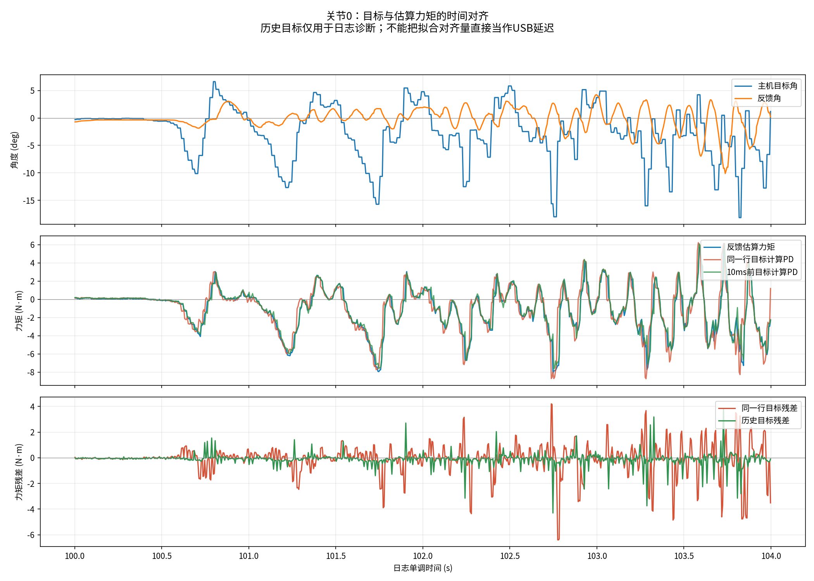

# 继续对照：仿真小延迟不抖后的关节动态与记录时序

日期2026-10-21。用户已测试Gazebo小反馈延迟仍未复现，补充当前真机前后指令上限.5、横移.4，要求继续从已上传日志查找问题。本轮只分析新283秒/旧338秒记录、读取当前配置与源码、生成时间对齐图；未修改运行参数/控制/模型/策略，没有运行硬件或新Gazebo。

## 1. 当前判断

小反馈延迟未复现不能推出“只有实物会抖”。它只排除了该次模型、增益、命令和延迟组合能够触发相同表现。当前有更具体的**主机目标与反馈估算力矩时间不对齐**线索，且关节q/dq内部一致，优先复核实际执行/遥测/日志时序与动态响应；尚未确定物理根因，不把拟合延迟当实测USB延迟。

已知IMU四元数/gyro内部一致与7–8Hz四髋/机身共振荡仍成立，见[新日志分析](imu_hip_new_log_2026-10-21.md)。没有证据可据此宣布传感器完全正确或完全错误。

## 2. 先核对运行配置，不猜测新设置已进入旧log

- 本轮目录仍只有新`2026-10-21_17-10-15_9557`、旧`2026-10-19_22-15-26_19277`及InitialHold短记录，没有其他更晚的运动log。
- 新283秒meta的velocity_limits是`.5/.2/.5`；PPO记录指令绝对最大值为`vx=.5、vy=.2、wz=0`。因此**本次不能核验横移.4的运行情况**。用户可能在小电脑后续改了，不能以当前上传log否定其当前设置。
- 当前本机real/config/deployment.yaml也仍是`.5/.2/.5`；当前Gazebo PPO YAML实查Kp=35、Kd=.5；新实机日志meta为25/.5。Gazebo配置一直由用户调整，不能把当前35当作旧试验实际增益。要比较同条件应记录每次真实加载的值，本轮不把用户参数自动改回。
- 实际速度上限不是抖动的充分解释：新log在−.2后退、+.2横移已有明显振荡，不需要达到.4/.5才发生。cmd_vx/vy是指令，不是机身实测速度。

## 3. 12关节q与dq是否相容

对PPO段剔除切入首1秒，位置使用主机相邻±2行（约20ms）差分，与同窗5行平均dq比较；排除局部超过40ms的时间跨度。包含真实动态，不仅静态检查。

| 项目 | 新283秒 | 旧338秒 |
|---|---:|---:|
| 全12关节q导数与dq相关范围 | .982–.994 | .969–.984 |
| 四髋q导数/dq拟合尺度 | 1.010–1.017 | 1.005–1.011 |

新四髋接近一致，没有发现符号反转或6.33倍等数量级错误。部分大腿/小腿尺度约.91–.96，与滤波、频率内容和主机采样方法有关；不能仅由此判速度标定差了9%。新数据更快更新后该20ms比较的平滑特性也不同。q和dq来自同一电机，不是外部运动真值，不能排除物理映射/零点或共同错误。

## 4. 新发现：历史目标更能解释反馈估算力矩

用日志输出侧单位检查：

`tau_pred = Kp*(q_des(t−L)−q_feedback(t)) + Kd*(dq_des(t)−dq_feedback(t)) + tau_ff(t)`。

L在0、2.5、5、7.5、10、15、20、30、40ms候选中扫描；历史q_des只选主机时间之前最新行，绝不取未来值。既做配置增益固定的残差检查，也做Kp/Kd/常数项自由回归以检验量级。**不是把位置响应峰值延迟直接视作传输延迟**。

| 四髋 | 新记录更优目标对齐L | 配置25/.5固定时：同一行目标RMSE→更优历史目标RMSE |
|---|---:|---:|
| FL | 10ms | .704→.307 N·m |
| FR | 10ms | .708→.289 N·m |
| BL | 10ms | .805→.344 N·m |
| BR | 7.5ms | 1.060→.458 N·m |

新12关节自由回归中10个更优L为10ms、两个7.5ms，R²约.94–.97；旧12关节均更优L约15ms。新日志的100–104、123–125、214–218、250–253秒单独窗口，多数四髋固定增益检查也偏向7.5–10ms，不只是由一段静态数据主导。

四髋自由拟合Kp约23.82–25.06，接近日志25；Kd约.36–.46，不能据此直接改参数，拟合受力矩估算/滤波、状态异步与模型简化影响。协议本身还会量化增益，配置数字不是无限精度。总体结果不支持“输出侧Kp单位错了一个减速比量级”这个假设，但并非固件增益的独立标定。



[PNG](joint_feedback_dynamics_2026-10-21_alignment.png)、[PDF](joint_feedback_dynamics_2026-10-21_alignment.pdf)。绿色是使用10ms前主机目标按配置增益计算的PD，蓝色是反馈估算力矩，红色使用同一行目标；下方残差可见历史目标总体改善。图中不是给真实电机加10ms，也没有把q本身平移冒充新测量。

### 不能把7.5–10ms解释成什么

它不是已经测准的“USB延迟10ms”，也不是新确认的执行器物理响应时间。主机目标尚未被实际总线应用、反馈回到主机、估算力矩内部滤波、异步快照和记录时刻，都可能贡献这个对齐量。tau本身是驱动估算，不是独立测力；拟合有闭环相关性。真实推理输入时间/实际wire命令时间未完整记录，缺少新批量源码，仍不能拆分贡献。

但它足以说明：**1.5ms请求/回复空档不能代表整条“新目标到对应反馈记录”关系。** 仿真仅增加外部反馈1.5ms，未必复现该完整关系；也不能把拟合10ms再加上原有反馈年龄和1.5ms，重复叠加同一等待。

## 5. 力矩和限幅

PPO段12关节反馈估算力矩绝对最大：新约22.674N·m，旧22.847N·m；两组没有≥23.5的已记录样本。不能声称这次已经持续顶到YAML的23.5总力矩，也不能据此证明没有内部限流/饱和，因为YAML上限与真实固件保护并非同一测量。

SDK动作边界及目标大幅反复、四髋共同7–8Hz已由此前分析记录。本轮不以降低action_scale、增Kp或滤波作为未经验证的修复。静态25/.5稳定也不证明动态跟踪和时序裕度足够。

## 6. 下一步优先级

1. **先拿到该次运行的新批量收发源码**，审查实际应用目标的时刻、ID/包分发、何时发布q/dq/tau、timeout/bytes48记账，以及上一轮数据是否可能混入。当前上传的GoBus仍是旧串行实现，不能对新版本宣称审查通过。
2. **补真正的时间配对**：目标发布序号/时间、总线实际发送目标和发送时间、每个ID接收/发布时刻，以及真实推理输入与对应动作。保持控制不改，定位上述7.5–10ms属于哪一段。
3. **仿真条件先一致**：日志对应的25/.5、策略/站姿/动作缩放/命令范围固定后，分别测命令应用延迟、反馈延迟、执行器响应/限矩，而不是只增加IMU噪声或base质量。可用5/10/15ms作为诊断扫描点，不能当实测独立延迟；同时记录实际生效反馈年龄，防止重复计数。
4. **IMU并行检查保留**：现有内部一致性降低随机数值故障优先级，仍需外部/已知运动参考排除动态姿态融合/安装问题。不能把“延迟没复现”直接当成“只剩IMU”。

本轮没有确定唯一根因。相比继续凭感觉换IMU或调刚度，目标—实际应用—反馈—日志的时序对齐已有定量线索，优先级更高。

## 7. 已完成与复现

已完成：两份全PPO日志12关节动态q/dq比较、各候选目标对齐的固定PD残差与自由回归、4个新窗口复核、速度指令/meta及当前YAML核对、力矩范围检查、对齐图。标准库实现已实跑；已用合成独立位置/速度项检验回归恢复25/.5与偏置，py_compile与git diff --check通过。没有修改实际参数、原始日志或控制程序，也未新增硬件/仿真运行。

待确认：新批量运行源码与真实序号/时标、当前横移.4对应日志、仿真测试实际加载参数、原权重训练配置、外部姿态与执行器动态标定。代码/文档核对不能替代这些实测。

- [新日志结果](joint_feedback_dynamics_new_2026-10-21.json)、[旧日志结果](joint_feedback_dynamics_old_2026-10-21.json)，含原始robot/meta哈希、全部候选拟合和局部窗口。
- 标准库复现（仓库根）：

```bash
python3 imgo2_rl/scripts/tools/audit_joint_feedback_dynamics.py \
  --log imgo2_deploy/real/build/log/2026-10-21_17-10-15_9557 \
  --window 100:104 --window 123:125 --window 214:218 --window 250:253 \
  --output /tmp/joint_dynamics.json
```

绘图仅额外需要Matplotlib，不启动ROS或硬件：

```bash
python3 imgo2_deploy/ros2_ws/scripts/plot_joint_pd_alignment.py \
  --log imgo2_deploy/real/build/log/2026-10-21_17-10-15_9557 \
  --joint 0 --start 100 --end 104 --alignment-ms 10 \
  --output-prefix /tmp/joint_alignment
```
