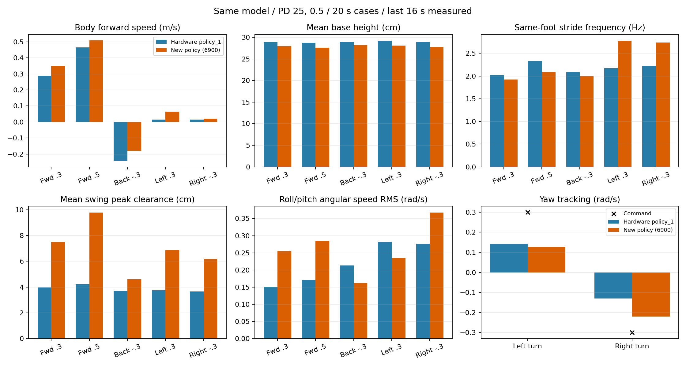
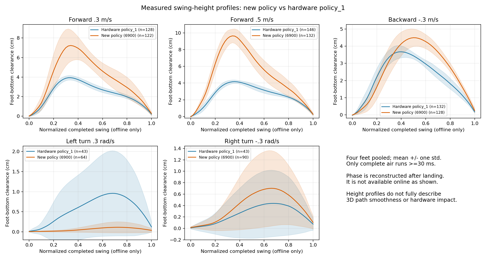

# 新policy.pt与真机policy_1：同条件对比及摆动足高建议

核对日期：2026-10-30。用户要求对比新策略和真机使用的policy_1，并讨论去除支撑足高度惩罚、与base_height配合的方案。本轮完成26段有界MuJoCo回放；没有操控硬件、重新训练、导出或替换策略，也没有修改生产PD/训练奖励。

2026-10-31补充勘误：该6900 run保存的base target实际为.32m、8192环境，之前仅列weight而漏掉这两项，不能将阶段高度提高独立归因于base weight。本文后述.30m身体目标是设计示例，不是6900的保存值。ce77后来已重命名为policy_latest_2.pt，当前文件名对应以[三阶段复核](../training/ppo_three_stage_reward_review_2026-10-31.md)为准；本次26段结果仍按原哈希有效。

## 1. 身份与测试条件

| 文件 | SHA256 | 身份 |
|---|---|---|
| ros2_ws/policy/imgo2/ppo/policy.pt | ce77ab5596809147bcfed97a8cce2602e3ce33c1661d93185ae0430855160a86 | 新策略，6900轮 |
| ros2_ws/policy/imgo2/ppo/policy_1.pt | 53a57f909b61d2a708d24d6c08a90e086409b6d4fce4fdd3e6f3e1849abce7cf | 用户指定的真机策略基准 |
| real/policy/ppo/policy.pt | 同上53a57f | 本机真机目录策略确实与policy_1一致；服务器/机器人磁盘未远程读取 |

新策略8个Actor权重/偏置张量与`logs/rsl_rl/base_move_rough/2026-10-30_17-37-05_resume/model_6900.pt`逐项max diff=0。实际保存配方：base=-20、air=2.0、hip L1=-1、joint_pos_penalty=-.1、镜像只含thigh/shank，两种足高项关闭。不要用本机当前-16/1.8源码代替这个历史保存配方。

主组：两策略×8种指令，共16段；PD25/.5，默认姿态0/.87/-1.82、髋scale .125/其余.25、50Hz策略、200Hz控制/记录、.5ms逐步PD；电机额外反馈延迟10ms、IMU额外延迟0及既有噪声；seed12345。每段独立reset，先2s固定站姿，再3s零指令策略，再20s测试指令，统计最后16s。

补充组：只在日志目录诊断YAML把Kd改为.8，其他配置相同；两策略×静止/前进.3/后退.3/左右转.3，共10段。因为本机真机配置是25/.8、仿真25/.5，做这一组检查排序是否依赖Kd；它不是完整硬件时序/接触/估计器复现。

使用已有C++ benchmark及生产MujocoMotorPd/MujocoFeedback；当前C++、两个适配器、MJCF与该binary构建记录源哈希一致。全部26段4000帧、无failure-stop，运行前后生产文件哈希一致。没有模拟GUI/FSM切换瞬态或异步真实线程。

## 2. 主组结果（Kd=.5）

| 指令 | 指标 | policy_1 | 新policy |
|---|---|---:|---:|
| 静止 | 机身高度cm / vx | 30.32 / ≈0 | 30.80 / ≈0 |
| 前进+.3 | 实际vx m/s | .288 | .348 |
| | 机身高度cm | 28.91 | 27.98 |
| | 同脚完整周期s / 步频Hz | .495 / 2.02 | .520 / 1.92 |
| | 平均摆动峰值净空cm | 3.97 | 7.52 |
| | roll/pitch角速度RMS rad/s | .151 | .255 |
| 前进+.5 | 实际vx m/s | .465 | .509 |
| | 机身高度cm | 28.71 | 27.59 |
| | 同脚完整周期s / 步频Hz | .430 / 2.33 | .480 / 2.08 |
| | 平均摆动峰值净空cm | 4.23 | 9.79 |
| | roll/pitch角速度RMS rad/s | .170 | .284 |
| 后退-.3 | 实际vx m/s | -.243 | -.179 |
| | 机身高度cm / 步频Hz | 28.93 / 2.08 | 28.18 / 2.00 |
| | 平均摆动峰值净空cm | 3.72 | 4.60 |
| | roll/pitch角速度RMS rad/s | .213 | .161 |
| 左移+.3 | 实际vy m/s / 步频Hz | .263 / 2.17 | .224 / 2.78 |
| 右移-.3 | 实际vy m/s / 步频Hz | -.278 / 2.22 | -.226 / 2.74 |
| 左转+.3 | 实际yaw rad/s / 净空cm | .142 / .98 | .128 / .12 |
| 右转-.3 | 实际yaw rad/s / 净空cm | -.131 / .46 | -.220 / .73 |

净空是足端碰撞球底相对平地，不是FOOT link世界z。同脚周期用5N/2N接触滞回、10ms持续、剔除<20ms抖动，完整腾空段≥30ms；转向拖步下周期中位数不保证规则步态。角速度RMS不包含期望yaw，不等于硬件振动计实测。



解读：

- 新策略前进周期更慢，+.5跟速更准，髋保持中立，裁剪率0～约1%；没有重现旧8400的持续髋饱和。
- 旧策略前进机身高约1cm、足高适中，前进roll/pitch角速度更小；新策略+.3过冲、后退与横移偏弱。
- 新策略不是所有方向都更慢：横移频率更高。左转仍贴地；旧策略两个转向本身也不是强基线。
- 两策略在本条件静止都稳定，没有复现严重静站抖动；不能据此排除实际机器人时序、PD、IMU、机械或切换问题。
- 新策略+.5机械功率代理`mean(sum(abs(tau*dq)))`约43.35W，旧约22.46W；实际速度不同，不可把全部差异归因于足高，更不是电池/电机电功率实测。

## 3. Kd=.8补充

| 场景 | policy_1 | 新policy |
|---|---|---|
| 前进+.3 | vx .264，z28.93cm，净空3.35cm，gyro .183 | vx .329，z27.99cm，净空6.30cm，gyro .229 |
| 后退-.3 | vx-.223，z28.92cm | vx-.169，z27.97cm |
| 左转+.3 | yaw .109，净空1.53cm | yaw .123，净空.13cm |
| 右转-.3 | yaw-.020 | yaw-.236 |

前进新策略高抬脚、机身略低、后退弱以及左转贴地的现象保持；转向对Kd敏感，不能将主组的数值当作真机预测。右转新策略明显强于旧策略，所以不能说旧策略每项都更好。

## 4. 回答tanh与支撑足疑问

`tanh(2*||v_rel_xy||)`只是平滑的0～1速度权重，不是摆动开关：足速0/.1/.3/.5m/s时约0/.197/.537/.762。它无法直接知道脚是否触地。

原FHB没有contact mask；当指令门控开启且误差、速度权重非零时，支撑足也可贡献负分。但不是任何时候必罚：高度误差0、速度0、零/小指令门控关闭、直立系数0或weight=0均可使对应贡献0。当前6900运行FHB关闭，并没有在实际训练中产生这些分数。非零软惩罚本身也不表示设计错误，不应以每项必须归零作为训练目标。

正常前进时支撑足对地速度0，对机身速度却非零。对本次轨迹按原FHB离线重算（target=-.20、单位负权重），得到：

| 同指令+.3 | 全四足原始代价均值 | 仅未触地足代价均值 | 支撑部分占比 |
|---|---:|---:|---:|
| 新policy | .005531 | .000817 | 85.2% |
| policy_1 | .007082 | .001758 | 75.2% |

这是从MuJoCo轨迹重建足端相对速度、1N法向力近似接触的离线分数，不是Isaac原始sensor日志。去掉支撑部分能明显减少“正常支撑也扣分”的影响，用户提出的方向有依据。

但**只加摆动mask并不保证学成旧策略**：同一目标-.20下，新策略摆动项代价已经比旧策略低，尽管它抬脚更高、前进gyro更大。实际速度和高度也不同，因此不能将该评分用于独立因果归因；它至少证明这个标量不等同于轨迹美观、适中净空或低抖动。

## 5. FHB能否与base_height配合

可以。它能塑造相对机身的足部运动，不能一概否定。但需要明确三个边界：

1. 去掉支撑足约束，可以消除原代价的大部分支撑贡献，**仍未从数学上消除机身与足端的高度耦合**：`z_body=z_foot_world-H_base`。base奖励只能权衡该耦合，不能让固定-.20自动等于固定离地5cm。
2. 若摆动全程拉向固定-.20，起脚、落脚也有高度误差；水平速度tanh还可能弱化最高点、纯转向/低水平足速的约束。不能把只加mask当成完整摆动轨迹。
3. 足高只约束竖直方向，不保证前后轨迹、横向站宽、落地冲击、脚尖避障或完整步态周期。所谓“更美观”应转成可测的适中净空、轨迹平滑、方向一致性与稳定落地。

优先考虑当地地面参照的摆动净空，而不是恢复世界z=.10或原FHB全足-6：

```text
h_i = 足底世界高度 - 当地地面高度
h_target(s) = h_peak * sin(pi*s)^2
cost = mean_4脚(swing_mask_i * phase_weight(s_i)
               * ((h_i-h_target(s_i))/h_ref)^2)
reward_step = -w_h * dt * cost
```

起脚/落脚目标接近0，中段目标可先围绕平地4～6cm标定；身体目标仍独立保持.30m。该范围只是本机低速平地候选，不保证适合全部速度/台阶。训练时需要在线相位或摆动时长参考，不能读取未来落地时间；现有绘图相位是离线重建，只用于比较。本轮没有实现这个奖励。



图中四足池化平均±1标准差；带宽同时含腿间差异和周期间差异，不应当作单脚重复性指标。新策略前进过高、左转过低清晰可见。单纯下限奖励只能减少太低，不能抑制过高，应考虑目标曲线或允许区间的上/下界。若保留机身系形式，应按当地地面和实际机身位置计算目标，这样才不把净空误差转化为降机身收益。

## 6. 修改优先级与短训方案（候选，未实施）

### 保留当前已经验证可用的骨架

从6900或另一个同条件验证合格的完整checkpoint微调，不急于从零训练。以其保存配方为准：base=-20、hip L1=-1、jpp=-.1、mirror仅thigh/shank、stand=-.1；不为了新足高项同时改变这些权重。当前本机源码-16/1.8不可误认为原配方恢复。

### 实验A：最省时的现有权重对照

只试airtime 2.0→1.8，其他保持6900配置，短续200～300轮、每50轮保存/回放。看前进净空能否下降、后退能否改善，同时防止步频重新变快。这是候选，不保证下降airtime就改善所有指标。用户接受≤.2不走，因此不把扩大超低速覆盖作前置要求。

### 实验B：正确的摆动足高目标

从同一合格起点独立比较“关闭”与“局部地面+摆动目标曲线”，不要同时在A的基础上改多个因素后归因。先用已有轨迹计算新项的分布和相对跟速项贡献，重新标定权重，不能照搬旧-6或masked版权重；平方米、归一化误差、求和/四足平均会改变系数意义。先小贡献、200轮筛选，再决定是否延长。

如果只想先验证mask，保留原函数、增加接触筛选可作为独立消融，但要接受它仍可能偏好当前高抬脚形状；不要宣称这是完整净空修复。若使用明确相位目标，可以去掉水平足速tanh、改用相位权重，避免纯旋转低水平足速时目标失效。

### 方向跟速与平滑另做实验

优先增加纯后退和纯旋转样本，同时保留前进；目前独立采样vx/vy/yaw不保证这些纯轴样本充分。若只调整现有跟速weight，可独立对照track_lin 1.5→1.7，不与air/base/新足高同时改；不是保证消除过冲的数学结论。新策略已前进高抬脚，暂不继续增加airtime、base或所有动态惩罚。已有feet_slide速度语义和base高度全batch异常回退仍需修复，详见[配置复审](../training/ppo_rough_config_fhb_review_2026-10-30.md)。

验收：静止、+.3、+.5、-.3、左右横移和yaw±.3；每方向看跟速、同脚周期、净空波形/上界、gyro、机身高度、髋角与裁剪率。固定同seed/预算先筛，最后需多seed/更长回放及rough/楼梯检查，不能把本次平地结果视作实机或越障通过。

## 7. 复现、产物与状态

主组可从仓库根复现：

```bash
/usr/bin/python3 imgo2_rl/scripts/tools/eval_mujoco_policies.py \
  --output imgo2_rl/logs/mujoco_ce77_vs_policy1_2026-10-30 \
  --policies policy.pt policy_1.pt \
  --cases stand,forward03,forward05,backward03,left03,right03,turn_left03,turn_right03 \
  --seconds 20 \
  --binary imgo2_rl/logs/mujoco_policy_comparison_2026-10-27_final/benchmark

/usr/bin/python3 imgo2_rl/scripts/tools/analyze_mujoco_policies.py \
  --run imgo2_rl/logs/mujoco_ce77_vs_policy1_2026-10-30/run.json \
  --output imgo2_rl/logs/mujoco_ce77_vs_policy1_2026-10-30/metrics.json

/usr/bin/python3 imgo2_rl/scripts/tools/analyze_policy_swing_profiles.py \
  --run imgo2_rl/logs/mujoco_ce77_vs_policy1_2026-10-30 \
  --output docs/deployment/mujoco_ce77_vs_policy1_2026-10-30.json
```

复跑前需先确认策略/模型/配置哈希仍与本报告相同，避免覆盖本次原始数据。若没有旧binary，省略--binary会重新编译。补充组使用相同脚本新增的`--policy-config`读取日志目录诊断YAML，不修改生产配置。分析工具使用标准库；绘图工具`plot_policy_swing_comparison.py`需要matplotlib，已生成并目视检查两张PNG及对应PDF。CPU张量身份检查使用本机env_isaaclab Python，非服务器通用路径。

- [数值及来源JSON](mujoco_ce77_vs_policy1_2026-10-30.json)：全部26组指标、源/策略/工具哈希、FHB支撑/摆动分解、相位曲线和机械功率代理。
- 原始26CSV、run/metrics/诊断配置和日志归档`mujoco_ce77_vs_policy1_2026-10-30_raw.tar.gz`，49,983,745字节，SHA256 `cd878acb85c53c547a89ae5c8b37b75aa4f847995bde1b3af6ba9b25dfb07b4c`；根*.tar.gz规则忽略，**仅本机保留，不入库**。
- 已完成：两策略身份/真机目录一致性、26段短回放、前后生产哈希保全、离线评分和图形核对。
- 待修/待确认：摆动足高目标实现及权重、脚滑/高度异常语义、纯方向采样、转向贴地/后退弱、真实接触/时序/切换与rough/实机验证；继续PPO-GAIT-01/PPO-ROUGH-01。没有把推荐配方标为已验证收益。
