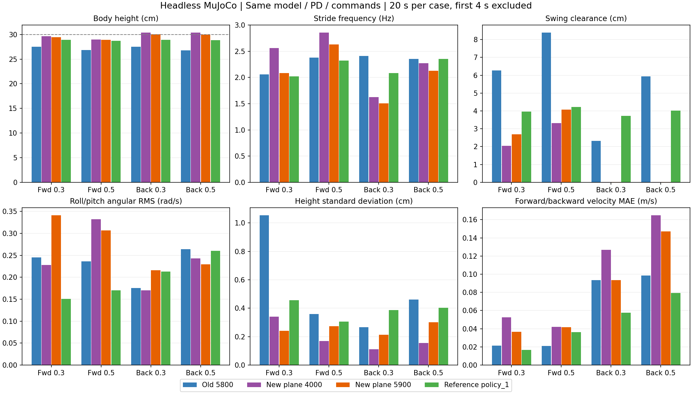

# 新平地低速训练4000/5900与旧策略对比（2026-11-05）

## 结论

本次从零训练的新策略在MuJoCo中显著提高机身高度，5900前进+.3高29.47cm（原5800为27.49）、后退-.3高30.04cm（原27.49），但后退/横移净空接近零，不能把较低的后退接触事件频率称为理想慢步。前进+.3由4000的2.56Hz降到5900的2.08Hz，前进足高2.04→2.69cm，有收益；前进角运动和静止角运动却增加。4000→5900没有全面改善，训练曲线在4000后接近当前分布平台，不能承诺继续原样训练到7000自动解决。暂不建议进入高速/rough作为已验收低速基础，也不替换生产policy；policy_1仍是平地综合参考，不意味着其转向在所有环境都理想。

已完成：60份checkpoint model张量有限性、4000/5900正式play导出与Actor8张量差0、36组MuJoCo平地、三策略固定初态/名义增益12个Isaac平地case；另有5900随机重置/增益4case探针仅诊断用。未新训/替换生产策略/修改奖励模型PD，未跑Gazebo、硬件、rough或高速评测。

## 1. 实际训练设置

run=2026-11-04_23-37-54；agent resume=false、seed42、4096env、24step/env/iteration、max_iterations7000。事件记录到5982，当前文件最大checkpoint5900，没有收到6999；不能因此认定服务器训练已停止。

| 设置 | 保存配置 |
|---|---|
| 地形 | plane，generator null，地形课程null |
| 指令 | vx±.5、vy±.4、yaw±.6；10秒重采样 |
| heading/静止 | False / 2%，没有方向分组 |
| baseheight | -40 / target .30 |
| lin_z / ang_xy / flat | -10 / -.1 / -5 |
| tracklin / trackyaw | 1.5 / 1.2 |
| hip L1 / joint_pos_penalty | -.5 / null（关闭） |
| FHB / airtime / variance | -4,target-.20 / 1.6,threshold.5 / -8 |
| actionrate / mirror | -.01 / -1（对角thigh/shank） |

这是从头平地低速任务，不能将其reward38直接与旧rough reward13比较；未见保存的高速/rough阶段配置。server git目录为空，函数源码不可完整追溯，配置只能证明保存的数值。

## 2. 训练曲线与0.9秒问题

| 窗口 | reward | xy内部误差 | yaw内部误差 | mean std | value loss | collection秒 | learning秒 |
|---|---:|---:|---:|---:|---:|---:|---:|
| 0-99 | -0.81167 | 0.57689 | 0.56049 | 0.66238 | 0.01638 | 0.86318 | 0.09522 |
| 2000-2399 | 38.55830 | 0.20283 | 0.24137 | 0.19250 | 0.00234 | 0.74973 | 0.08969 |
| 3600-3999 | 38.73610 | 0.19628 | 0.23627 | 0.18779 | 0.00226 | 0.75672 | 0.09023 |
| 4600-4999 | 38.93223 | 0.19359 | 0.23563 | 0.18875 | 0.00228 | 0.75182 | 0.08990 |
| 5500-5900 | 38.79685 | 0.19461 | 0.23733 | 0.19149 | 0.00233 | 0.78486 | 0.09268 |

从2000后mean_episode_length1000，4000后跟踪/回报基本平台而非发散。晚期采样.7849+学习.0927≈.8775秒，4096*24=98304样本/轮，和用户0.9秒一致；控制dt仍.005*4=.02秒。没有环境数/rollout步数减少的证据，平地计算简化是合理解释，未作同机器同配方单独性能基准，不将其证明为唯一原因。最后checkpoint std mean .19078/max .29052，有限性只覆盖模型张量，不宣称每个优化器状态已验。

## 3. 正式导出与MuJoCo同条件实际结果

使用env_isaaclab解释器与ppo/play.py --export_only，两份Actor8参数逐张量与checkpoint完全相同，独立JIT快照plane4000.pt与plane5900.pt，部署LibTorch已实载。四策略×9指令，每段20秒、排除前4秒、各4000帧，全部failure为空，固定模型/生产PD/反馈/仿真时间；run.json前后文件hash不变。旧5800和policy_1本次同批重跑，不混入旧批数值。MuJoCo是平地、固定初态，无GUI/FSM切换，不是原训练环境复现。

| 策略 | 指令 | 实际vx/vy/yaw | 高度cm | 高度std cm | 频率Hz† | air s† | 净空cm | xy角运动RMS |
|---|---|---|---:|---:|---:|---:|---:|---:|
| plane4000.pt | stand | 0.000/-0.000/0.000 | 30.673 | 0.010 | — | — | — | 0.014 |
| plane4000.pt | forward03 | 0.352/0.013/-0.007 | 29.663 | 0.341 | 2.564 | 0.095 | 2.038 | 0.228 |
| plane4000.pt | forward05 | 0.538/0.027/0.014 | 29.015 | 0.168 | 2.857 | 0.108 | 3.319 | 0.333 |
| plane4000.pt | backward03 | -0.173/0.001/-0.015 | 30.389 | 0.112 | 1.626 | 0.042 | 0.011 | 0.170 |
| plane4000.pt | backward05 | -0.335/0.010/-0.015 | 30.381 | 0.156 | 2.273 | 0.043 | 0.016 | 0.243 |
| plane4000.pt | left03 | 0.001/0.292/0.016 | 30.445 | 0.129 | 3.279 | 0.062 | 0.126 | 0.303 |
| plane4000.pt | right03 | 0.021/-0.310/-0.004 | 30.515 | 0.234 | 3.704 | 0.061 | 0.187 | 0.372 |
| plane4000.pt | turn_left03 | 0.035/-0.023/0.239 | 30.562 | 0.123 | 1.709 | 0.057 | 0.358 | 0.200 |
| plane4000.pt | turn_right03 | -0.016/0.021/-0.227 | 30.679 | 0.080 | 1.460 | 0.039 | 0.020 | 0.159 |
| plane5900.pt | stand | 0.000/-0.000/0.000 | 30.930 | 0.101 | — | — | — | 0.119 |
| plane5900.pt | forward03 | 0.335/0.041/0.001 | 29.472 | 0.241 | 2.083 | 0.105 | 2.693 | 0.341 |
| plane5900.pt | forward05 | 0.540/0.034/0.008 | 28.896 | 0.273 | 2.632 | 0.107 | 4.076 | 0.307 |
| plane5900.pt | backward03 | -0.207/0.004/-0.018 | 30.043 | 0.212 | 1.504 | 0.042 | 0.014 | 0.216 |
| plane5900.pt | backward05 | -0.353/-0.004/-0.020 | 30.009 | 0.301 | 2.128 | 0.043 | 0.018 | 0.230 |
| plane5900.pt | left03 | 0.012/0.290/0.056 | 30.466 | 0.170 | 3.333 | 0.063 | 0.078 | 0.301 |
| plane5900.pt | right03 | -0.012/-0.281/-0.037 | 30.831 | 0.166 | 3.448 | 0.056 | 0.017 | 0.312 |
| plane5900.pt | turn_left03 | 0.003/-0.018/0.258 | 30.848 | 0.111 | 2.020 | 0.048 | 0.089 | 0.171 |
| plane5900.pt | turn_right03 | -0.003/0.005/-0.214 | 30.924 | 0.091 | 1.569 | 0.042 | 0.045 | 0.139 |
| baseline5800.pt | stand | 0.000/0.000/0.000 | 29.400 | 0.015 | — | — | — | 0.004 |
| baseline5800.pt | forward03 | 0.316/0.011/0.009 | 27.485 | 1.054 | 2.062 | 0.158 | 6.268 | 0.245 |
| baseline5800.pt | forward05 | 0.507/-0.002/0.005 | 26.874 | 0.359 | 2.381 | 0.148 | 8.393 | 0.236 |
| baseline5800.pt | backward03 | -0.207/0.004/0.004 | 27.491 | 0.267 | 2.410 | 0.103 | 2.327 | 0.175 |
| baseline5800.pt | backward05 | -0.402/-0.025/-0.028 | 26.787 | 0.462 | 2.353 | 0.142 | 5.933 | 0.264 |
| baseline5800.pt | left03 | 0.080/0.249/-0.036 | 27.180 | 0.279 | 2.985 | 0.118 | 4.945 | 0.310 |
| baseline5800.pt | right03 | 0.012/-0.246/-0.033 | 27.139 | 0.267 | 3.030 | 0.129 | 5.720 | 0.322 |
| baseline5800.pt | turn_left03 | 0.101/-0.001/0.289 | 28.254 | 0.633 | 2.105 | 0.085 | 1.457 | 0.176 |
| baseline5800.pt | turn_right03 | 0.078/-0.007/-0.260 | 28.523 | 0.514 | 2.222 | 0.068 | 0.677 | 0.140 |
| policy_1.pt | stand | 0.000/0.000/-0.000 | 30.318 | 0.004 | — | — | — | 0.005 |
| policy_1.pt | forward03 | 0.288/-0.011/-0.015 | 28.906 | 0.456 | 2.020 | 0.191 | 3.966 | 0.151 |
| policy_1.pt | forward05 | 0.465/-0.010/-0.009 | 28.710 | 0.306 | 2.326 | 0.174 | 4.228 | 0.170 |
| policy_1.pt | backward03 | -0.243/0.006/-0.021 | 28.932 | 0.387 | 2.083 | 0.179 | 3.717 | 0.213 |
| policy_1.pt | backward05 | -0.421/0.009/-0.023 | 28.834 | 0.404 | 2.353 | 0.167 | 4.028 | 0.261 |
| policy_1.pt | left03 | 0.016/0.263/-0.018 | 29.227 | 0.478 | 2.174 | 0.166 | 3.754 | 0.281 |
| policy_1.pt | right03 | 0.015/-0.278/-0.017 | 28.976 | 0.482 | 2.222 | 0.167 | 3.666 | 0.276 |
| policy_1.pt | turn_left03 | 0.022/-0.004/0.142 | 30.107 | 0.366 | 1.575 | 0.096 | 0.983 | 0.145 |
| policy_1.pt | turn_right03 | 0.016/-0.006/-0.131 | 30.058 | 0.490 | 1.600 | 0.063 | 0.464 | 0.110 |

†频率是5N/2N滞回、10ms持续和20ms去毛刺后的同足卸载/加载事件周期；空中段还要求≥30ms。对于新策略后退/横移，这些段净空近零，更像接触力卸载而非真正离地，因此不能将1.50Hz理解为优质慢步，也不能把其.042秒当作准确的物理离地时长。净空为足碰撞球底相对平地的完整候选摆动峰值均值，0.01cm量级接近接触求解精度，只报告近贴地，不解释为精确0.1mm物理轨迹。角运动是roll/pitch角速度RMS，不是硬件高频振动。

图已实际打开检查。5900较4000：前进+.3净空2.04→2.69cm、频率2.56→2.08Hz改善，但角运动.228→.341rad/s；+.5频率2.86→2.63Hz、净空3.32→4.08cm改善，但都不如policy_1前进角运动.151/.170rad/s。后退-.3实际vx-.173→-.207有改善但仍欠跟踪、净空始终近零；横移近指令但近贴地，不符合用户期望正常抬脚。新5900静止均值速度近零，但角运动.119比4000 .0139及policy_1 .0047明显更大，不能说站立所有指标稳定不变。动作饱和除了5900前进+.3约.03%外近零，未复现旧髋持续饱和问题。

## 4. Isaac平地交叉探针与限制

先跑5900默认随机root/随机执行器增益4case，不用于严格对照；随后补固定root姿态/速度、关闭增益随机化的三策略×4case，seed42、600步/12秒、排除100步/2秒、无obs噪声/startup/interval事件。新增eval_exported_locomotion.py可选--fixed-reset，原默认行为保留；输出实际robot.actuators的stiffness/damping，因为显式DCMotor时robot.data.joint_stiffness可能为0，不代表实际控制Kp=0。本轮真实输出所有case名义25/.5、默认关节角/顺序/dt完全一致；两引擎执行器模型/接触与暖机仍不同，不宣称跨引擎所有条件相同。

| 策略 | 指令 | 实际vx | 实际yaw | 高度cm | xy角运动RMS | sensor last_air均值s |
|---|---|---:|---:|---:|---:|---:|
| plane5900 | stand | -0.004 | -0.000 | 26.52 | 0.050 | 0.035 |
| plane5900 | forward03 | 0.243 | -0.018 | 30.58 | 0.433 | 0.056 |
| plane5900 | backward03 | -0.057 | -0.013 | 30.00 | 0.417 | 0.019 |
| plane5900 | turn_left03 | -0.005 | 0.053 | 29.30 | 0.202 | 0.033 |
| baseline5800 | stand | 0.003 | 0.002 | 28.37 | 0.089 | 0.047 |
| baseline5800 | forward03 | 0.328 | 0.007 | 29.66 | 0.289 | 0.098 |
| baseline5800 | backward03 | 0.001 | 0.000 | 27.68 | 0.054 | 0.061 |
| baseline5800 | turn_left03 | 0.013 | 0.128 | 31.12 | 0.245 | 0.051 |
| policy1 | stand | -0.002 | -0.001 | 28.12 | 0.034 | 0.057 |
| policy1 | forward03 | 0.268 | -0.009 | 29.96 | 0.206 | 0.127 |
| policy1 | backward03 | -0.268 | -0.006 | 29.54 | 0.189 | 0.108 |
| policy1 | turn_left03 | 0.001 | -0.004 | 28.00 | 0.111 | 0.047 |

全部upright_fraction1、resets0，但不是走路合格证明。5900后退vx-.057、last_air约.019s，policy_1后退-.268、.108s，新后退弱不只在MuJoCo观察到。其它量不完全一致：5900零指令Isaac高度26.52cm、MuJoCo30.93cm；policy_1的Isaac纯yaw也近零，和MuJoCo不同，短探针/起步/接触与部署动力学差异未归因，不能由这一项宣称策略转换损坏或所有Isaac表现等于MuJoCo。未采集Isaac每足局部净空/完整接触轨迹，不能声称后退确切离地毫米值已双引擎相等验证。此轮只对照平地，不验收rough能力。

## 5. 奖励量级与下一步

新run最后5500–5900：tracklin+1.4254/yaw+1.1055，height-.01061、linz-.04093、angxy-.04322、FHB-.00364、air-.06856、variance-.23116、hip-.07518、actionrate-.02784、slide-.05135。variance是当前最大负项，但累计贡献不是优化梯度和因果排名。raw高度误差等效RMS约sqrt(.01061/40)=1.63cm，相比旧rough约2.65cm小，分布和权重同时改，不能单独归因-40。

用户“jointpos导致快步”的假设尚未证实：该项已关闭，4000前进仍2.56/2.86Hz，5900横移卸载频率仍约3.3–3.45Hz且拖脚。不能据此说该项完全无影响，未做同分布单变量对照。抬脚项是摆动掩码×水平足速×固定机身系目标平方误差，未启动摆动或持续接触可弱化甚至关闭，不能单独驱动正常抬脚；强linz/姿态/接触/时间项也可能让贴地动作在总收益上有利，但本轮不能唯一归因-10或其它项。

建议：保留4000与5900、旧5800/policy_1，当前不直接扩速或进入rough来赌抬脚自动恢复，不原样再延长大量轮次。先解决零指令稳定和纯后退/横移有效摆腿，采样需显式覆盖而不是只有随机混合。下一次训练应优先审查摆动净空奖励目标/门控与竖直运动惩罚的协调；不同时把variance、airtime、足高、稳定项全部加大。名义PD一致性与起步敏感性可作为单独部署复核，不能因本次不同引擎数值就直接改生产PD。若后续测试短对照，保存共同起点与完整源码/配置，报告清楚是否从头/续训。以上是待验证方案，未实施，不保证固定4000/7000轮能学成。

## 6. 完成与待确认

已完成：保存配置/日志窗口/60checkpoint、正式导出Actor一致性、36MuJoCo+16Isaac平地case、固定初态选项与实际执行器增益输出实跑、图表QA与报告归档。生产策略/训练配置/模型均未改，无新训练或硬件运行。新run/exported最后导出的是4000，5900快照保留在本任务目录，不要按exported名字误认5900。

待确认：服务器reward/依赖源码、原环境完全复现、随机初态/多seed、更长评估、速度减速与FSM切换、Gazebo/硬件、跨引擎高度和纯yaw差异、rough/高速能力、具体奖励成因与修法。只有修过评测诊断，没有修复训练步态，PPO-GAIT-01继续保留。

原始快照/CSV/导出及Isaac日志统一在imgo2_rl/logs/plane_low_compare_2026-11-05。

- [MuJoCo指标](plane_low_mujoco_2026-11-05.json)、[固定Isaac指标与实际增益](plane_low_isaac_fixed_2026-11-05.json)、[随机探针](plane_low_isaac_2026-11-05.json)。
- [保存配置](../training/plane_low_config_audit_2026-11-05.json)、[训练窗口](../training/plane_low_training_windows_2026-11-05.json)、[模型/导出核对](../training/plane_low_checkpoint_audit_2026-11-05.json)、[奖励分项](../training/plane_low_reward_scales_2026-11-05.json)。
