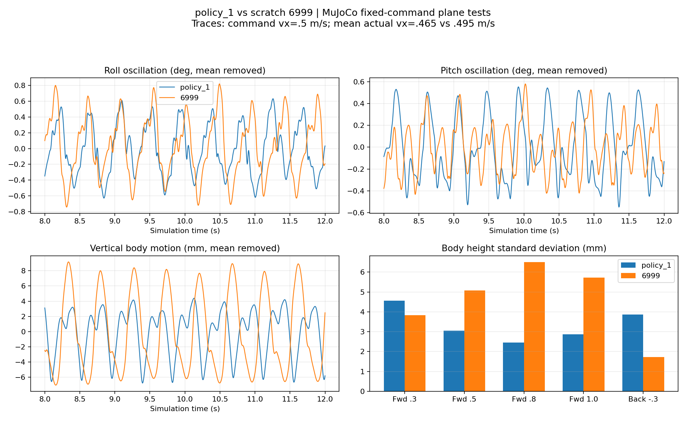

# 6999与policy_1机身晃动对照（2026-11-06）

## 结论与状态

用户询问新从头训练6999是否比policy_1晃动更剧烈。本次在相同模型/PD/反馈/控制时钟下重新实跑两策略各16个MuJoCo工况，并新增policy_1的4个Isaac固定工况，对照已有6999的相同条件结果。

**用户关于前进时更弹的观察有依据：6999在前进.5/.8/1m/s的上下波动明显大于policy_1。低速前进角运动也略大，Isaac前进.3角运动增加约44%。但不是所有工况/所有晃动都更差：MuJoCo后退、左转及较快前进部分角运动指标更小，静止没有严重抖动。** 不把这些差异笼统定为全方向“剧烈抖动”或已证明的奖励代码错误。

- 已完成/已修复：补齐policy_1直接同条件比较、区分垂直弹动与roll/pitch、身份与曲线证据；无生产控制修复。
- 待确认/待修复：前进垂直弹动、低速角运动的成因与训练修法；动态/FSM、更多初态/seed、Gazebo、rough和实机验证。需实际单变量/闭环，不能直接从贡献大小定因果。
- 本轮未修改奖励/配置/模型/PD、命令代码或生产策略，未启动新训练。

## 身份与条件

policy_1：部署目录`imgo2_deploy/ros2_ws/policy/imgo2/ppo/policy_1.pt`，SHA256 `53a57f909b61d2a708d24d6c08a90e086409b6d4fce4fdd3e6f3e1849abce7cf`。

6999：本机已正式导出的独立快照`imgo2_rl/logs/grouped_scratch_compare_2026-11-06/scratch6999.pt`，来自`2026-11-06_00-36-44_speed_curriculum/model_6999.pt`。已在此前检查Actor/JIT精确一致，本次LibTorch重新加载运行。当前部署policy.pt的文件哈希虽不同，但seed42的1024条45维确定性输入与6999输出max diff=0，未发现此次对错策略的证据。policy_1原训练checkpoint/env不在本次资料中，不假定能还原它的奖励配方。

MuJoCo新32工况，各20秒4000帧、剔除前4秒；确定仿真时间、相同25/.5 PD、相同默认关节角/动作缩放/模型与生产反馈适配器、独立重置及相同暖启动。全部无测试失败、动作饱和率0，前后输入文件哈希不变。工况与前次相同：静止、前进.3/.5/.8/1/1.2、后退.3/.5/.8、横移±.3、yaw±.3/±.8、前进.4+yaw.8。无GUI/FSM等价声明。

Isaac新增policy_1四工况，与此前6999四工况缓存比较；各12秒600步、剔除前2秒，固定重置/seed42、实际执行器25/.5，关闭观测噪声与startup/interval随机化，契约相同。四次新测试resets=0、upright_fraction=1；illegal_contact关闭，不能视为完整安全验收。policy_1原训练模型不详，这里比较的是两者在当前统一模型的表现。

[身份记录](policy1_vs_scratch6999_identity_2026-11-06.json)、[本次32组MuJoCo](policy1_vs_scratch6999_mujoco_2026-11-06.json)、[Isaac摘要/契约](policy1_vs_scratch6999_isaac_2026-11-06.json)。

## 上下弹动：前进.5以上明显增大

高度波动采用去均值高度标准差，单位mm；它不是平均机身高度，也不是振幅/峰峰值。

| 指令 | policy_1高度std mm | 6999高度std mm | 新/旧 |
|---|---:|---:|---:|
| 前进.3 | 4.56 | 3.84 | .84倍 |
| 前进.5 | 3.06 | **5.07** | **1.66倍** |
| 前进.8 | 2.46 | **6.50** | **2.64倍** |
| 前进1.0 | 2.86 | **5.73** | **2.00倍** |
| 后退−.3 | 3.87 | **1.73** | .45倍 |

前进.5全稳态窗口的高度峰峰值为11.47→16.59mm，body垂直速度RMS约.0659→.0780m/s。实际vx=.465→.495m/s，因此是同指令比较，非严格同实际速度；不能把全部差异强行归因于奖励某一项。前进.8/1.0也有明显的垂直弹动差异。

平均高度并未全面降低：前进.5分别28.71/29.07cm，6999略高，但上下波动更大。静止分别30.32/29.62cm，转向6999也更低；应分工况讨论。

[补充垂直速度/峰峰值/绝对角RMS](policy1_vs_scratch6999_body_extra_2026-11-06.json)。

## 横滚/俯仰：不是所有方向都增大

角运动RMS=√mean(ωx²+ωy²)，单位rad/s；不包含期望yaw，不等于角度RMS。角度波动采用去均值标准差，单位度，均值偏置另见原始JSON。

| 工况 | policy_1角运动 | 6999角运动 | policy_1 roll/pitch std° | 6999 roll/pitch std° |
|---|---:|---:|---|---|
| 前进.3 | .151 | .162 | .309 / .191 | .314 / .159 |
| 前进.5 | .170 | .187 | .314 / .297 | .381 / .223 |
| 前进.8 | .246 | **.180** | .320 / .407 | **.199 / .186** |
| 前进1.0 | .291 | **.223** | .313 / .445 | **.243 / .246** |
| 后退−.3 | .213 | **.145** | .307 / .277 | .320 / .324 |
| 左转.3 | .145 | **.120** | .691 / .364 | **.260 / .226** |
| 右转−.3 | .110 | .129 | .299 / .268 | .241 / .311 |

低速前进角运动分别增约7.5%/9.5%，.5时roll波动增加约21%，pitch却减小；不能说横滚/俯仰都明显变大。右转policy_1实际yaw−.131、6999−.300，二者完成任务程度不同，单比较角运动值不能判policy_1全面更稳。左转实际yaw为.142→.247，也应结合跟踪任务看。

步频方面，前进.3 policy_1约2.020Hz、6999 2.000Hz，几乎相同；前进.5为2.326→2.139Hz。前进.5净空4.23→4.97cm。更慢步频不保证机身更稳，也不能仅因足高略高就证明FHB是根因。

静止MuJoCo角运动.0047→.0039rad/s，roll/pitch std都约.005–.007°，这次没有复现严重静站抖动。动态切换/硬件仍未测。

## Isaac核对

| 工况 | policy_1实际vx/yaw | 6999实际vx/yaw | policy_1角运动RMS | 6999角运动RMS |
|---|---:|---:|---:|---:|
| 静止（yaw） | −.0008 | −.0005 | .0340 | **.0152** |
| 前进.3（vx） | .268 | .274 | **.2064** | .2969 |
| 后退−.3（vx） | −.268 | −.242 | **.1894** | .2287 |
| 左转.3（yaw） | −.004 | .199 | .1113 | .2334 |

Isaac前进.3角运动增加约44%、后退约21%，支持当前新策略运动稳定性仍有不足。policy_1在该Isaac左转工况基本不转，不能把低角运动当作转向合格或完全优于6999。静止6999反而更稳。

## 如何使用这个结论

用户的“前进更弹”观察有实测依据，尤其.5–1m/s高度波动，不应以“步频慢/足高好”宣布6999全面超过policy_1。当前新策略有跟速/摆脚和部分转向收益，也有身体运动代价。

下一步应把前进垂直速度/高度波动和低速角运动纳入固定验收，保留policy_1对照；不要单看周期或总reward，也不要继续盲目加足高/滞空权重。没有本轮因果消融，尚不确定是足高目标、身体惩罚、控制交互或采样训练共同造成。若开始rough也只能作为保留平地的轻地形试验，不能当作已解决稳定性再扩难度。

## 图与原始结果

曲线为前进.5、仿真8–12秒，减去各自4–20秒窗口均值，以比较波动而非平均姿态。曲线已视觉核对。原始CSV/日志在`imgo2_rl/logs/policy1_vs_scratch6999_2026-11-06/`；标准库分析用python3，Isaac/绘图用`/home/tommy0929/miniconda3/envs/env_isaaclab/bin/python`。未改生产策略/控制或启动训练，未跑Gazebo、动态/FSM、rough或硬件。

## 同日续训建议：可做有界原范围延长，非再次扩大高速

6999的课程在375/417轮已分别到最终vx±1.2/yaw±1.5，后续长期训练完整混合范围，因此不能将当前弹动解释为“还没训练高速”。若用户希望先排除尚未充分优化，可保留6999并另开一个平地同奖励/同10-40-50分组的短续训run，额外500–1000轮作为一次对照；不同时扩大范围、增加混合比例或加入rough，也不承诺会改善上下弹动。

若目标是直接在完整范围继续训练，应在该次配置末尾关闭command_levels_lin_vel/ang_vel两项课程、维持ranges x±1.2/y±.8/yaw±1.5；分组仍生效。否则新建环境common_step_counter=0，(.5,1)课程会重新缩到一半，并不会恢复6999的环境课程进度。只在原range边界已确认且希望固定满范围时使用此设置。

验收用相同固定指令.5/.8/1m/s高度std/垂直速度RMS、roll/pitch角运动及跟速，并检查低速前后/左右转/静止不退化。只看reward提升不足以说明变稳；同配方延长无改善时，不再自动继续堆轮数，应转向身体稳定性目标/代价权衡的受控调整。以上为候选方案，未修改代码/运行训练，额外轮数并非最优预算结论。
