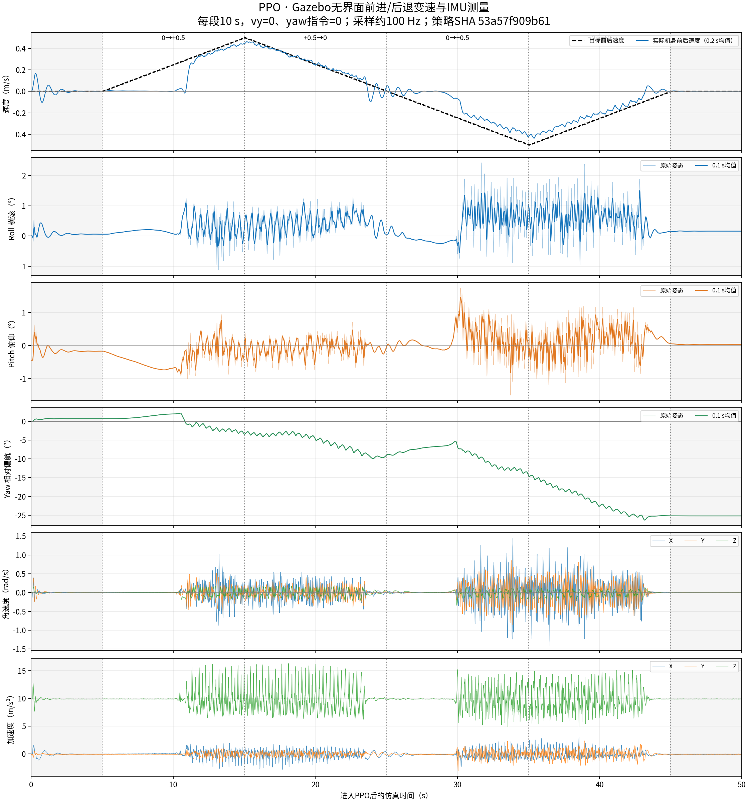

# PPO无界面Gazebo前后变速与IMU曲线（2026-10-16）

## 已完成与待确认

已完成：使用当前部署PPO跑完单次无界面Gazebo变速过程，自动起身并进入PPO，记录IMU/真值位姿/实际发布指令，绘制曲线。没有更改模型、策略、增益、接触或部署控制代码；运行前后哈希一致，结束后清理本次启动的进程。没有连接硬件或启动训练。

待确认：转向指令为零时存在累计航向偏移；小速度加速初段实际速度接近零，不能将“发布了缓变速度”视为“真实速度完全跟踪”。本次只采集和测量，没有定位根因或调整策略。需要相同配置重复运行、固定低速/固定速度对照，及控制反馈/策略动作记录才能区分策略、接触和时序影响。

## 运行条件与时间表

- 当前PPO文件：`imgo2_deploy/policy/imgo2/ppo/policy.pt`，SHA256 `53a57f909b61d2a708d24d6c08a90e086409b6d4fce4fdd3e6f3e1849abce7cf`。
- 当前模型：`imgo2_description/urdf/imgo2_real.gazebo.urdf`，SHA256 `e8021e5f94108ccc2e441c605420f5dcb87d84e7aaaafe5db4484452aee1086f`；Gazebo ROS2 Humble，gui=false、软件GL、独立ROS domain61与master11371。
- 使用已构建rl_sim，日志确认PPO；PPO配置25/0.5，站起60/2。完整模型/配置/程序哈希在 [JSON结果](ppo_gazebo_ramp_2026-10-16.json)。本轮没有重新构建或改变控制周期。
- 时间以仿真时钟为准：先给6秒起身，随后进入PPO并以此为t=0。共50秒策略窗口；IMU和odom原始记录还包含起身段。

| PPO时间 | 前后速度指令vx（m/s） | 说明 |
|---|---|---|
| 0–5s | 0 | 初始静止，含切入瞬态 |
| 5–15s | 0→+0.5 | 匀速增加，+0.05m/s² |
| 15–25s | +0.5→0 | 匀速减小，−0.05m/s² |
| 25–35s | 0→−0.5 | 后退加速，−0.05m/s² |
| 35–45s | −0.5→0 | 后退减速，+0.05m/s² |
| 45–50s | 0 | 最后静止 |

vy和yaw指令全程为零。根据当前/clock更新节奏，实际发布指令约10Hz（每段100次、每次约0.005m/s），IMU约100Hz；不是连续模拟信号，也不是四个独立重置场景。升降速全程保持在同一次PPO运行中。

## 曲线和数值



- 全程原始IMU/odom各5599帧，图中PPO窗口5000帧，IMU间隔0.01s、最大间隔0.01s。
- Roll原始范围−1.13°…+2.42°，标准差0.43°；Pitch−1.50°…+1.74°，标准差0.39°。没有超过60°的倾倒，策略窗口最低base高度0.276m。
- 转向指令为零，累计Yaw变化**−25.20°**（右偏）；前进加/减速分别约−4.23°/−5.51°，后退加/减速约−5.47°/−10.64°。这是真实测得的姿态变化，不是给了转向指令。
- 全策略窗口前后速度RMSE约0.0836m/s；四个变速阶段分别0.131、0.034、0.110、0.060m/s。加速早段明显滞后，不能只看峰值附近的跟踪。
- 后退加速段gyro XYZ RMS约0.290/0.217/0.067rad/s；前进加速段0.177/0.113/0.066rad/s。本次后退横滚/俯仰角速度波动更大，未把这一个试验推广到所有速度或真机。

姿态由/imu四元数按ZYX的roll/pitch/yaw计算，曲线单位度；Yaw解缠后相对首个PPO样本置零，未去除漂移。原始角速度rad/s、加速度m/s²；加速度为IMU比力，Z静止接近+g，与策略的向下单位重力投影不同。

实际速度由/odom世界位置中心差分后旋到机身平面计算，以0.2秒中心均值显示和统计；姿态同时显示原始与0.1秒均值。平滑只用于离线显示，不反馈控制。未采集关节足端数据，不据本图宣称步高/步频通过。

## 原始数据与复现

- [IMU原始CSV压缩包](ppo_gazebo_ramp_2026-10-16_imu.csv.gz)：仿真时间、阶段、计划vx、RPY、gyro、accel、wxyz。
- [实际发布指令CSV压缩包](ppo_gazebo_ramp_2026-10-16_commands.csv.gz)：vx/vy/wz及阶段、仿真时间。
- [odom原始CSV压缩包](ppo_gazebo_ramp_2026-10-16_odom.csv.gz)：世界位置与yaw。
- [PDF图](ppo_gazebo_ramp_2026-10-16.pdf)、[JSON分阶段统计](ppo_gazebo_ramp_2026-10-16.json)。

本机原始CSV与进程日志：`imgo2_rl/logs/ppo_gazebo_ramp_2026-10-16/`（Git忽略）；上方压缩档已逐字节校验并与本记录一起保留。

以下为本机示例路径，换机器须先按根README准备ROS2/Gazebo及部署构建。复跑要用新输出目录，避免覆盖原始记录。

```bash
cd /home/tommy0929/Documents/imgo2
/usr/bin/python3 imgo2_deploy/scripts/run_gazebo_ppo_ramp.py \
  --output imgo2_rl/logs/ppo_gazebo_ramp_repeat \
  --ramp-seconds 10 --hold-seconds 5

MPLCONFIGDIR=/tmp/imgo2_ramp_mpl /usr/bin/python3 \
  imgo2_deploy/scripts/plot_gazebo_imu_ramp.py \
  imgo2_rl/logs/ppo_gazebo_ramp_repeat \
  --output-prefix imgo2_rl/logs/ppo_gazebo_ramp_repeat/curves
```

采集使用系统/usr/bin/python3，子进程加载ROS与工作区环境；绘图使用系统numpy/matplotlib。最初受限环境因默认~/.ros/log只读启动失败，脚本现把ROS_LOG_DIR放在输出目录；随后在允许本机ROS/Gazebo通信的环境实际跑完。

验证：实际完成全部四个单调速度段，发布值达到±0.5，vy/wz为零，控制日志收到正负指令且确认PPO；IMU数值全部有限，四元数转换/采样时序可复核，PNG人工查看通过且PDF已生成。记录只代表当前策略/模型的一次前后速度扫描；实机IMU方向、真实安装、长期稳定性和航向问题根因仍待确认。
