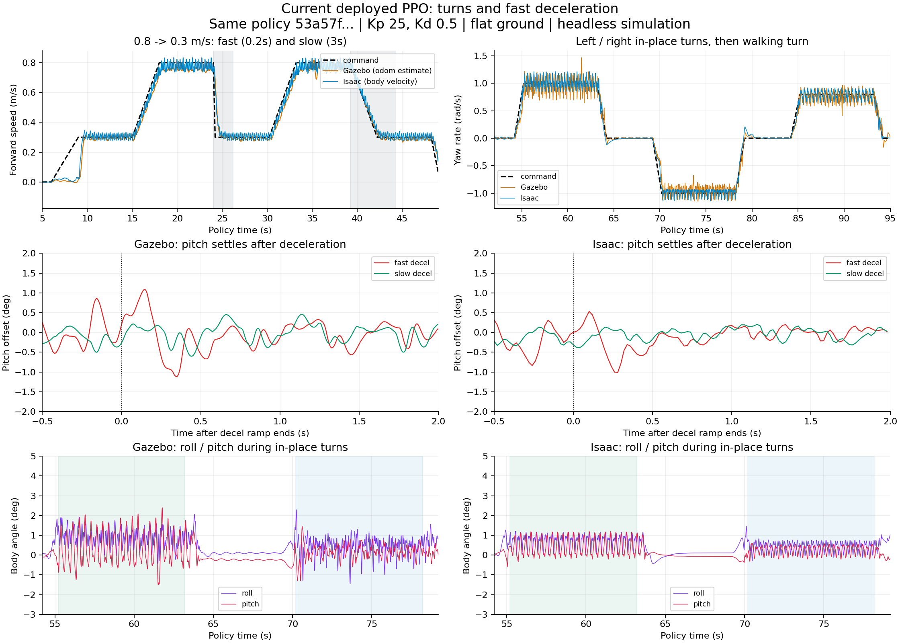

# 当前PPO转向与快速减速的双引擎实测（2026-10-26）

## 1. 测试对象和方法

直接使用当前Gazebo部署JIT：`imgo2_deploy/ros2_ws/policy/imgo2/ppo/policy.pt`，SHA256 `53a57f909b61d2a708d24d6c08a90e086409b6d4fce4fdd3e6f3e1849abce7cf`。不是新训练的rough策略；准确原始任务/奖励仍待原run确认，见 [来源核对](ppo_stairs_confirmation_2026-10-26.md)。没有训练、重新导出、替换策略或修改生产模型/控制配置，也没有运行硬件。

Gazebo使用当前已构建rl_sim、imgo2_real.gazebo.urdf、earth平地、标称Kp25/Kd.5，base.yaml附加电机/IMU反馈延迟均0。GUI关闭；domain67/master11377隔离本次ROS通信。先GetUp六仿真秒，再切PPO执行100.2秒。发布/记录以仿真时钟计时，实际日志确认vx最高.8、yaw±1，vy始终0。Gazebo每组21240帧IMU（含起身）、10620帧odom，IMU约200Hz、odom约100Hz。

Isaac使用现有eval_ppo_stairs的平地诊断分支直接加载同一JIT：当前imgo2_real.urdf、同一默认角/动作尺度、Kp25/Kd.5、物理5ms/策略20ms；关闭观测噪声和启动/重置随机化，诊断摩擦.6、恢复0。单环境seed42、每组5010控制步，实际Actor观测与部署约定逐帧拼接最大差0。该环境只承载模型和接口，不是旧策略原训练配置的重建。

两轮均执行同一时序：静站、低速、升到.8、.2秒快速减到低速、再次升速、3秒缓慢减到低速、静站、原地左转/右转（±1rad/s，各8秒）、行走转弯（vx.4/yaw.8，各8秒）和最终静站。第一轮低速.1m/s几乎停住，故补一轮低速.3m/s，确认持续行走情况下的减速表现；不是靠第一轮的停步过渡推断所有低速表现。

## 2. 结果与结论

以下主表来自低速.3补测；“转向稳定段”指该恒定指令段舍去前两秒，仍存在步态周期摆动，不能将其叫作零抖动状态。角度摆幅为该窗口max−min，RMS角速度为sqrt(mean(gyro_x²+gyro_y²))，没有把指令偏航速度混入机身摇摆指标。

| 场景/窗口 | Gazebo | Isaac |
|---|---:|---:|
| .3m/s直行实际平均vx | .294m/s | .307m/s |
| .8m/s直行实际平均vx | .754m/s | .776m/s |
| .3m/s直行俯仰摆幅 | 1.22° | .42° |
| 原地左转俯仰摆幅 | 3.91° | 1.41° |
| 原地右转俯仰摆幅 | 1.41° | .80° |
| .3m/s直行roll/pitch角速度RMS | .211rad/s | .130rad/s |
| 原地左转roll/pitch角速度RMS | .388rad/s | .277rad/s |
| 原地右转roll/pitch角速度RMS | .345rad/s | .196rad/s |
| 快速减速结束后前2秒俯仰摆幅 | 2.21° | 1.54° |
| 缓慢减速结束后前2秒俯仰摆幅 | 1.06° | .59° |

**确认用户观察的趋势，但需要区分持续步态摆动与减速瞬态。** 转圈时持续存在较直行更强的机身角速度变化；左转在两引擎里更明显，Gazebo放大。快速减速后短时姿态过渡更大；.8→.3的后2…6秒，Gazebo/Isaac角速度RMS恢复至.222/.132，接近原低速基线.211/.130，不是本次逐渐发散或一直停不下来的振荡。两引擎全程没有倒地/重置，初始静站非常平稳（角速度RMS约.002rad/s），未复现持续剧烈的零速自转。最终Gazebo有小幅缓慢姿态收敛，不能把所有静止时刻均称为完全稳定。

第一轮.8→.1时，快速/缓慢减速后2秒俯仰摆幅：Gazebo3.84°/1.10°，Isaac1.88°/.57°；.1恒定段实际vx在两边接近0。这份策略不满足“可持续跟踪.1m/s低速行走”的目标。当前rough命令自身还有.2m/s平移死区，后续新训低速应一起明确，不能仅调跟速奖励权重。



图主用.3补测：第一行速度/yaw跟踪；第二行比较快速与缓慢减速结束后的俯仰（各自减去后2…6秒均值，仅用于显示过渡）；第三行展示左右原地转向的原始roll/pitch。原始全时序与窗口指标见JSON/CSV。

两边都有同类现象，说明当前策略/模型组合本身就存在该运动特征；不能把它全部归因于Gazebo转换。Gazebo幅度更大仍可能受接触、求解器、执行器与调度影响，本次不是严格PhysX/ODE等价性或根因实验。单次seed与有限指令不足以判定原训练损失是否收敛，也没有证据从当前rough权重反推旧策略的训练根因。

## 3. 与当前rough配方的关系

当前rough的19项实际非零奖励、含义、权重与已知风险统一见 [训练复审第2节](../training/ppo_rough_review_2026-10-26.md#2-最终生效的19项奖励)。本轮重新读取rough覆盖并用标准库AST核对19项权重，未改参数。

对于先训练正常行走：重点验收零速/.1/.3/.8、左右原地转向、行走转弯及快速/缓慢加减速；在低速范围/死区、指令变化覆盖和脚滑语义明确后再做短训对照。现有stand_still是默认关节姿态偏差项，不能独立保证静止无自转；action_rate_l2、ang_vel_xy_l2等是已有平滑/机身运动约束，不等于它们已把转向或制动训练好。feet_height权重为0，feet_height_body为机身坐标高度，不是8cm地面净空；feet_air_time=.5s门槛也不是指定步态周期。未提出已经验证的替代权重或未经测试的收敛保证。

## 4. 复现与归档

以下为本机已存在解释器/路径；换机器需先配置对应环境。

```bash
cd /home/tommy0929/Documents/imgo2
/usr/bin/python3 imgo2_deploy/ros2_ws/scripts/run_gazebo_ppo_ramp.py \
  --profile maneuvers --maneuver-low-speed .3 --domain 67 --master-port 11377 \
  --wall-timeout 420 --output imgo2_rl/logs/ppo_maneuvers_repeat/gazebo_low03

IMGO2_ISAACLAB_PYTHON=/home/tommy0929/miniconda3/envs/env_isaaclab/bin/python \
  bash imgo2_rl/scripts/run_isaaclab.sh imgo2_rl/scripts/tools/eval_ppo_stairs.py \
  --terrain plane --profile maneuvers --maneuver-low-speed .3 --headless --device cuda:0 \
  --output imgo2_rl/logs/ppo_maneuvers_repeat/isaac_low03
```

- [低速.1指标与运行元数据](ppo_maneuvers_2026-10-26.json)、[低速.3指标与运行元数据](ppo_maneuvers_2026-10-26_low03.json)、[图PDF](ppo_maneuvers_2026-10-26.pdf)。
- .1原始：[IMU](ppo_maneuvers_2026-10-26_low01_gazebo_imu.csv.gz)、[odom](ppo_maneuvers_2026-10-26_low01_gazebo_odom.csv.gz)、[指令](ppo_maneuvers_2026-10-26_low01_commands.csv.gz)、[Isaac](ppo_maneuvers_2026-10-26_low01_isaac.csv.gz)。
- .3原始：[IMU](ppo_maneuvers_2026-10-26_low03_gazebo_imu.csv.gz)、[odom](ppo_maneuvers_2026-10-26_low03_gazebo_odom.csv.gz)、[指令](ppo_maneuvers_2026-10-26_low03_commands.csv.gz)、[Isaac](ppo_maneuvers_2026-10-26_low03_isaac.csv.gz)。
- 标准库分析工具 `imgo2_rl/scripts/tools/analyze_ppo_maneuvers.py`，支持.csv和.csv.gz；输入两个引擎轨迹、可选Gazebo odom、`--low-speed .3`和输出JSON。Gazebo vx为.2秒位移窗口旋转到机身的估计；Isaac vx为原生root_lin_vel_b，不将两种速度处理口径视为完全相同。
- 绘图工具 `imgo2_deploy/ros2_ws/scripts/plot_ppo_maneuvers.py` 需要numpy/matplotlib，接受 `--input-root`（含gazebo_low03/isaac_low03的记录根）与 `--output-prefix`。
- 完整运行日志位于被忽略的 `imgo2_rl/logs/ppo_maneuvers_2026-10-26/`；跨机复核使用上述压缩CSV与JSON，勿只依赖本机logs。

## 5. 已完成与待修复/确认

已完成：两引擎各两次100.2秒实际推理、策略哈希/生产资源未变检查、指令范围与PPO进入日志确认、无重置/无倾倒检查、逐帧观测契约核对、标准库窗口统计、压缩归档校验和图像查看。新增命令profile与诊断功能，不改变生产控制。另修正eval_ppo_stairs汇总max_pitch_abs_deg误取yaw列的问题；从原始CSV重算本轮第一组汇总，第二组用修正后脚本直接生成，姿态终止原本使用正确roll/pitch，不受该汇总字段影响。

待确认/改善：低速.1不可持续行走、转向摆动和急减速瞬态的训练改进；原策略训练配置缺失；Gazebo幅度放大的具体来源仍需受控对照。rough本机训练前置与脚滑/高度/终止语义沿用PPO-ROUGH-01。没有宣称修好步态，没有长训、GUI或硬件运行；本次全部仿真进程已停止。
