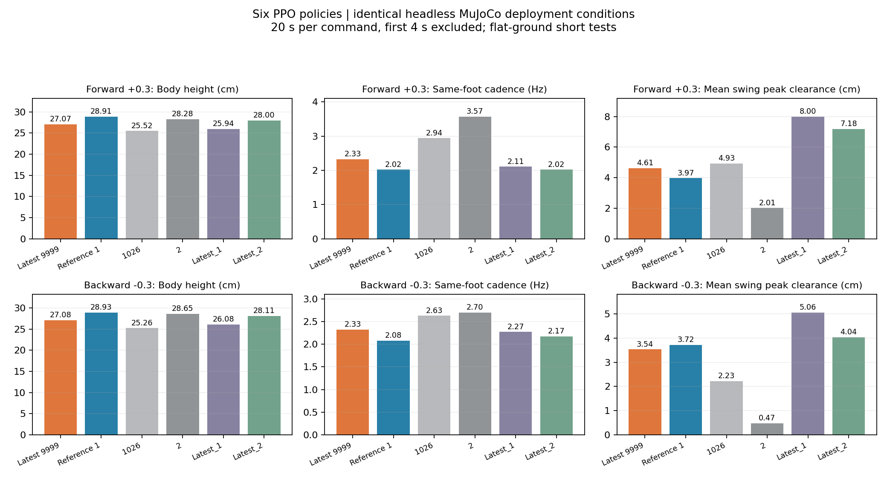
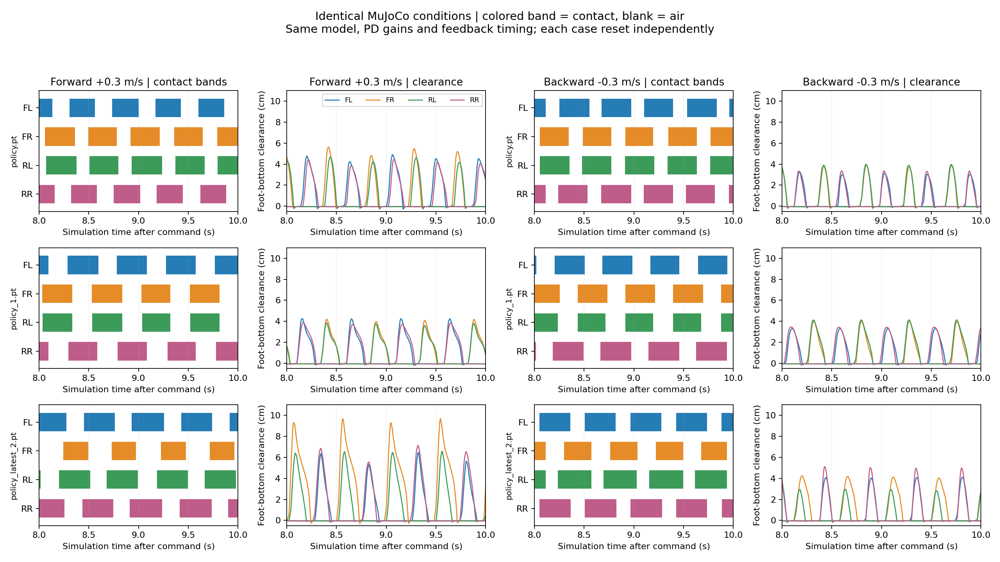

# 最新PPO与历史策略对比（2026-11-03）

## 结论

用户指定deploy/ppo/policy.pt为最新，暂不测试HIMLoco。本轮完成6份PPO×9指令的54组MuJoCo测试，另对最新和policy_1各4组Gazebo实测。新策略恢复有效对角配合、前后正常抬脚，没有此前1999那种前后分组短跳/后退近乎拖地；仍未达到policy_1的低步频和行走高度。不是所有指标全面更差：后退机身角运动更小，.5m/s前进均值更接近指令；但.2/.3有前进过冲、横移频率偏高、低速转向跟踪不足。

这些是单次短测，不是长期/rough/楼梯/硬件验证；稳态站立稳定也不等于已量化整个起身到策略切换过程。

## 1. 身份与方法

最新文件SHA256 a3c84b45c5c6348bf7b46fa3e91be2bc7521ec450047725c7810c0dbfc7f27f3，与logs/rsl_rl/base_move_rough/2026-11-02_23-12-30/exported/policy.pt逐字一致。JIT使用mlp.*，checkpoint使用actor.*，逐键映射后与model_9999.pt的8个Actor张量全等；1024个确定性输入输出max diff=0。不是此前5a4cc726/1999策略。其它文件身份见日志identities.json；policy_1=53a57f90，latest_1=79102100，latest_2=dd130ea9，policy_2=45a8ff21，policy_1026=c10919a7。

MuJoCo3.2.7/C++LibTorch：同一scene.xml/机器人、名义PD25/.5、默认角0/.87/-1.82、45维PPO接口、policy dt .02s、motor反馈附加延迟10ms、IMU0ms。每组重置，2s固定站姿+3s零指令策略，再测20s；分析指令后4–20s。九指令：站立、+.2/+.3/+.5、后退-.3、横移±.3、转向±.3rad/s。全部未触发benchmark失败阈值。实际生产PD/feedback适配器参与，仍不是GUI/FSM墙钟调度完全等价。

Gazebo：当前生产launch+rl_sim+eval_gazebo_policy，earth平地、gui=false；专用ROS域93/Gazebo端口11367。每组重新启动，共8组；墙钟24秒，起身6秒，切策略后跳过3秒，按消息仿真时间统计。测试期间临时选择对应model_name，最终恢复policy.pt，不覆盖任何策略。Gazebo步频为大腿自相关，足高为URDF/FK/odom重建的碰撞底面；与MuJoCo接触力事件口径不同，不能把微小数差理解为精确引擎误差。

## 2. 六份策略在前进+.3m/s时

| 文件 | 实际vx(m/s) | 高度(cm) | 步频(Hz) | 摆动净空(cm) | gyro xy RMS(rad/s) |
|---|---:|---:|---:|---:|---:|
| policy.pt | 0.351 | 27.07 | 2.33 | 4.61 | 0.190 |
| policy_1.pt | 0.288 | 28.91 | 2.02 | 3.97 | 0.151 |
| policy_1026.pt | 0.428 | 25.52 | 2.94 | 4.93 | 0.541 |
| policy_2.pt | 0.351 | 28.28 | 3.57 | 2.01 | 0.228 |
| policy_latest_1.pt | 0.326 | 25.94 | 2.11 | 8.00 | 0.203 |
| policy_latest_2.pt | 0.328 | 28.00 | 2.02 | 7.18 | 0.260 |

较旧的policy_1026机身低、动作裁剪较多；policy_2快步低净空；latest_1抬脚大但更蹲；latest_2抬脚大且较慢，但前进角运动更大。最新处于这些取舍之间，不能仅以一个综合分数替代用户偏好。

## 3. 最新与policy_1细节（MuJoCo）

- 稳态站立高度29.96/30.32cm，gyro xy RMS .0035/.0047rad/s，都很小；最新没有严重静站抖动。未独立量化初始切换瞬间。
- 前进+.3：最新实际.351、policy_1 .288m/s；频率2.326/2.020Hz，对应周期.430/.495s。最新更快约15%，机身27.07/28.91cm；净空4.61/3.97cm。最新gyro xy RMS .190/.151rad/s，前进角运动更大。
- 后退-.3：最新-.215、policy_1-.243m/s；频率2.326/2.083Hz、净空3.54/3.72cm、高度27.08/28.93cm；最新gyro xy RMS .163/.213rad/s，后退角运动反而更小。后退欠速仍在，已不是不抬脚。
- +.2：最新走到.279m/s，policy_1约.002m/s（基本站住）。这是低速响应差异；用户此前接受.2不动，不能自动将“肯走”视为更优；最新过冲约.079m/s。
- +.5：最新.512、policy_1 .465m/s；高度26.63/28.7cm左右，最新频率2.5/2.326Hz。
- 左/右横移.3：最新实际.236/-.261m/s，policy_1 .263/-.278；最新频率3.39/2.94Hz，policy_1 2.17/2.22Hz，机身也更低。最新横移角运动更大。
- 左转+.3：最新.126、policy_1 .142rad/s；右转-.3：最新-.169、policy_1-.131rad/s。二者都未良好跟踪原地低速转向，转向净空小；大腿波形/零碎接触事件不应作为标准trot周期。
- 最新9组原始动作裁剪比例均为0；前进+.3髋外展均值前+.53°/后-.77°，不是此前极端髋饱和。即使均值正常，也不能仅凭此证明所有关节轨迹最优。

前进恰好两条对角腿支撑比例：最新61.66%、policy_1 75.13%；后退57.44%/69.69%。最新对角脚接触相关性前进.830/.857、后退.931/.929，确有对角配合；支持类型比例不是单独的步态好坏分数。

## 4. Gazebo复核

| 文件 | 指令 | 实际vx(m/s) | 实际yaw(rad/s) | 高度(cm) | 步频(Hz) | 几何摆动峰值(cm) |
|---|---|---:|---:|---:|---:|---:|
| policy.pt | stand | 0.000 | -0.000 | 29.77 | — | — |
| policy.pt | forward03 | 0.352 | 0.014 | 27.07 | 2.33 | 4.45 |
| policy.pt | backward03 | -0.206 | 0.019 | 27.14 | 2.33 | 3.40 |
| policy.pt | turn_left03 | 0.034 | 0.122 | 28.68 | — | 1.84 |
| policy_1.pt | stand | 0.000 | -0.000 | 30.19 | — | — |
| policy_1.pt | forward03 | 0.291 | -0.020 | 28.98 | 2.08 | 3.83 |
| policy_1.pt | backward03 | -0.234 | -0.025 | 28.98 | 2.08 | 3.64 |
| policy_1.pt | turn_left03 | 0.019 | 0.119 | 30.13 | — | 1.90 |

最新和policy_1的主要差异在Gazebo仍成立：最新站得住，但前进过冲、行走偏低、频率偏快；后退能够抬脚，但欠速。并非仅MuJoCo出现。最新Gazebo前进roll/pitch标准差.243°/.234°，policy_1 .337°/.254°，前进这项并不更差；MuJoCo的gyro RMS与Gazebo姿态标准差不是同一个指标，不能混用来宣称所有情况下更抖。后退最新.276°/.239°、policy_1 .442°/.466°，最新更小；转向最新pitch标准差.505°比policy_1 .346°大。

## 5. 最新训练配方与建议

保存env.yaml：base_height_l2=-16,target=.30；feet_height_body=-4,target=-.20,tanh_mult=2；air_time=1.8,threshold=.5；air_time_variance=-8；hip L1=-1；joint_pos_penalty=-.1；joint_mirror=-1；slide=-.05。速度范围vx±1.2、vy±.8、yaw±1；heading_command=true、rel_heading_envs=1、站立比例2%；地形课程开启。不是先前80%平地、关闭课程、15%静止的低速专用配方。git目录未包含可核对的训练源码diff，本轮不能仅凭参数函数路径证明服务器足高函数完整版本；不把效果变化归因于单独一项奖励。

事件覆盖到9999。8000–8999到9000–9999窗口：mean reward10.573→11.008，xy误差.4226→.4142，yaw误差.4268→.4200，noise std .4292→.4240，课程等级约5.96→5.94。仍有小幅向好趋势，没有看到这些窗口的数值崩溃；不代表继续增加轮数会自动降低步频、抬高机身或改善低速。日志窗口见[JSON](../training/ppo_latest_2026-11-03_windows.json)。

建议保留当前9999作为可用候选；按用户“慢一些、保持机身高度”的标准，policy_1仍是更合适的基准。下一步先集中低速过冲/横移快步/行走高度，不建议直接再增大足高权重或盲目追加长训。机身参考足高即使只对摆动脚计算，仍与机身升降耦合：target=-.20不是固定离地10cm，不能把当前27cm行走高度视为目标已达成。若试验，分开做低速指令/静止比例与机身参考足高目标的单变量比较；具体权重需新对照，不在本轮擅自修改。

## 6. 产物、复现与状态

- [MuJoCo全量指标](ppo_policy_comparison_2026-11-03.json)、[接触配合](ppo_policy_coordination_2026-11-03.json)、[Gazebo指标](ppo_gazebo_comparison_2026-11-03.json)。PNG已查看，接触PDF为同图导出但未逐页查看。
- 原始CSV/ROS样本/启动与控制日志、权重身份与精确checkpoint匹配：imgo2_rl/logs/ppo_compare_2026-11-03。
- 工具：eval_mujoco_policies.py、analyze_mujoco_policies.py、analyze_contact_coordination.py；新增eval_gazebo_ppo_policies.py、summarize_gazebo_ppo_comparison.py、plot_ppo_comparison.py均在imgo2_rl/scripts/tools/。统计使用/usr/bin/python3；torch核对/绘图使用env_isaaclab/bin/python，仿真C++使用部署LibTorch。
- MuJoCo运行命令参数及编译指令保存在run.json，54组20s独立测试；Gazebo须source ROS Humble与工作区install/setup.bash后运行eval_gazebo_ppo_policies.py --output <日志目录> --policies policy.pt policy_1.pt。注意固定专用域/端口和临时model_name选择，禁止并行编辑相同配置；复跑另选输出目录，避免覆盖。

已完成：54组MuJoCo、8组Gazebo、策略身份/Actor一致性、稳态速度/姿态/净空/步频/接触配合核对。六份权重均未改变；临时PPO配置已恢复，测试进程退出。没有改训练奖励、模型、PD或部署控制代码，也没有测试HIMLoco。

待确认：复杂地形/楼梯、不同初始条件和重复种子、速度升降过渡及硬件效果；足高与高度竞争/横移频率的唯一因果仍需训练对照。低速快步、行走偏低和转向欠跟踪保留为待优化，不因完成测试而标为修好。

## 7. 10000轮之后是否继续、足高是否导致抖动（同日补充，仅建议）

> 后续已完成-4/-1各500轮，未观察到-1的预期全面改善；以[AB复审](feetheight_ab_review_2026-11-03.md)为最新结论，下文保留当时假设与试验设计。

4096环境×24步×10000轮约9.83亿transition，已经是较大采样预算，但PPO没有统一的“10000轮即足够”标准。末段reward和跟速误差仍小幅改善；观察到的是当前目标仍有优化，而不是慢步/高机身一定会自行出现。当前有可用对角步态，不建议为此直接抛弃9999从零长训，也不建议原配方盲目再跑10000轮。

“更抖”需区分条件：MuJoCo+.3 gyro xy RMS .190对.151rad/s，左右横移.366/.361对.281/.276，确实较大；后退.163对.213较小，静站两者都接近0。Gazebo+.3 roll/pitch标准差最新并未更大，后退也较小；右转等情况不同。因此不认定所有场景都更抖，且相同指令下最新实际前进更快，也是姿态差异的混杂因素。

按新版摆动脚足高实现解释，FHB仍可能间接偏好蹲低：忽略足端原点偏置/姿态，脚离地4cm时，机身30cm对应body-z=-.26，目标-.20误差.06；机身27cm对应-.23，误差.03，平方误差减至1/4。支撑掩码消除了直接处罚支撑脚，却没消除摆动足高与机身高度的耦合。大目标还可能改变摆腿/触地动作并影响姿态，但没有消融实测，不能据此把抖动全部归因于FHB。真正零指令站立时原指令门控关闭该项，不能解释为它在每步直接惩罚静站。保存git没有函数快照，因此最终服务器版本仍应核对。

建议下一步只做短续训单变量比较：从同一model_9999、同seed/环境数各新建run，A保持FHB=-4，B仅减到-1；target=-.20及其它奖励/指令/地形保持不变，各300–500轮后按相同指令比较高度、净空、接触、频率、速度误差和角运动。-1是试验值，不是已验证最佳权重。不要在同一试验同时改target、base weight、速度范围和课程；若B明显改善且净空保留，再延长或调目标；如果因新课程/新接口改变整体分布而决定从头重训，应另作完整配方方案。单seed的差异仅为线索，多seed重复才更可靠。本轮没有调整代码/配置、执行续训或新增仿真；待修和因果验证仍保留在PPO-GAIT-01。

## 8. 是否同时加竖直/角速度惩罚和滞空奖励（同日补充，仅建议）

为避免将所有抖动归为上下跳，直接从同批MuJoCo CSV的4–20s窗口重算机身系vz RMS，与lin_vel_z_l2源码的root_lin_vel_b[:,2]语义对应。数据见[JSON](ppo_vertical_motion_2026-11-03.json)。单位m/s，新/参考：前进+.3 .0813/.0899，+.5 .0464/.0659，后退-.3 .1104/.0631，左移.0375/.0777，右移.0362/.0788，左转.0800/.0346，右转.0438/.0503。竖直速度不是所有方向都更大；相同指令下实际速度仍有差异，且body-z不完全等于世界竖直速度。

角速度也分场景：新策略前进/横移gyro xy RMS偏大，后退较小。ang_vel_xy_l2惩罚roll/pitch角速度，不是姿态偏角；flat_orientation_l2处理倾斜。yaw需要跟踪yaw指令误差，不能直接惩罚所有yaw速度而妨碍转弯。

当前lin_vel_z_l2=-2、ang_vel_xy_l2=-.05、air_time=1.8/threshold=.5、FHB=-4。建议先做第7节同起点FHB=-4/-1短续训对照，其他项保持。若摆动足高与机身偏低耦合减弱后，前进/横移角运动仍偏大，再单独试ang_vel_xy_l2 -.05→-.1；这是试验值，不是已验证最佳。竖直惩罚暂不统一加大，后退/左转body-z偏大应单独检查；强行抑制上下运动可能诱导更小抬脚/更快换脚或拖脚，粗糙地形还需要合理竖直运动。滞空奖励暂保留1.8，不与上述同时增加；增加可能延长摆动，也可能引入更大腾跃/冲击，并不能保证慢步。所有奖励对齐到同样速度跟踪/高度/净空指标判断，不只看reward。

已完成：已有CSV离线重算及源码语义核对，无新仿真、无代码/权重修改或训练。待确认：短对照效果、足高/角运动因果与粗糙地形副作用，仍列PPO-GAIT-01。
