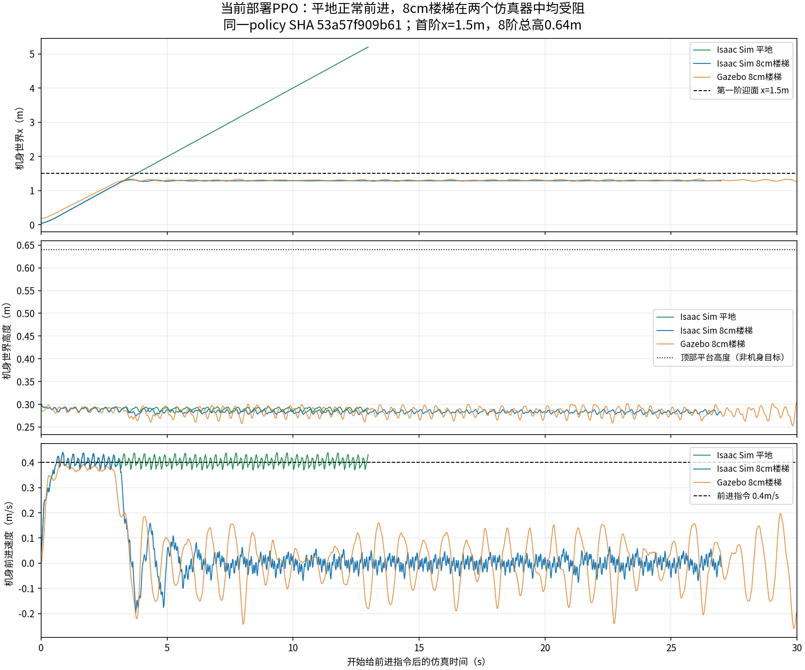

# 当前部署PPO来源与8cm楼梯双引擎确认（2026-10-26）

## 1. 策略来源：可以确认和不能确认的部分

当前Gazebo部署件为 `imgo2_deploy/ros2_ws/policy/imgo2/ppo/policy.pt`，SHA256为 `53a57f909b61d2a708d24d6c08a90e086409b6d4fce4fdd3e6f3e1849abce7cf`。同级real工程 `real/policy/ppo/policy.pt` 也为相同哈希，本轮没有运行真实设备。

该哈希与 [历史来源核对](ppo_policy_provenance_2026-09-19.md) 中参考 `policy/imgo2/base_move/policy_flat.pt`（6月30日12:45）一致，不是参考目录另一个policy.pt，也不是当前rough配置本轮训练的新结果。

**准确训练任务ID仍不能确证。** 原文件名暗示平地版本，但TorchScript Actor/文件名不是训练任务记录；本机未找到对应原始checkpoint+params。新增核对：Downloads/Imgo2_rl中2个导出策略均不匹配；其5个flat/rough运行目录下59个model checkpoint均成功读取，按导出键或Actor有序张量精确比较，没有匹配项。因此不把文件名推断写成“已确定Imgo2-basemove-flat-ppo训练”。原始任务ID、训练模型版本、奖励和课程仍需原run的env.yaml/agent.yaml或匹配checkpoint才能关闭。

## 2. 本轮实际测试

直接加载上述部署JIT，不训练、不重新导出、不替换策略。Isaac诊断脚本为 `imgo2_rl/scripts/tools/eval_ppo_stairs.py`。

- Isaac Sim使用当前 `imgo2_real.urdf`、flat PPO任务的45维观测/动作设置，仅作为加载机器人与接口的载体，**不是据此确定原训练任务**。
- 平地与楼梯各一个环境、seed42；标称PD25/.5、物理5ms/策略20ms。清除观测噪声和startup/reset/interval随机化，诊断中使用机器人/地面摩擦.6、恢复0。
- 楼梯静态长方体从当前Gazebo `stairs_8cm.world` 直接读取9个link的pose/碰撞size创建，无需复制机器人模型；8阶×8cm、踏面.3m、宽2m、首阶x=1.5m、平台顶.64m。
- Isaac先零指令3秒，再持续vx=.4m/s，vy/yaw为零。平地16秒，楼梯30秒，未发生重置或倾倒。
- Actor输入与部署约定的独立拼接逐步比较，两个场景最大差为0，45→12推理正常。
- Gazebo用当前已构建rl_sim、同一JIT/25/.5和8cm场景，独立domain66/master11376，起身后持续vx=.4约30仿真秒，vy/yaw为零。使用现有eval_gazebo_policy记录odom、关节及命令；日志确认PPO。停止本次全部进程。

## 3. 结果：两边都停在第一阶前

| 场景 | 最大机身x | 前进表现 | 结果 |
|---|---:|---|---|
| Isaac Sim平地 | 5.199m | 移动阶段平均.397m/s，最后10秒.403m/s | 平地可正常走 |
| Isaac Sim 8cm楼梯 | 1.317m | 最后10秒约−.00018m/s | 停在第一阶前，未登阶完成 |
| Gazebo 8cm楼梯 | 1.338m | 最后10秒约−.00220m/s | 同样停在第一阶前，未登阶完成 |

第一阶迎面x=1.5m，表中是机身原点，不是前脚位置；机器人前脚会先触到台阶。楼梯场景机身保持约.28–.30m高度，未持续升高。不能把机身x没有达到1.5直接等同于某只脚从未触及台阶，但整机确实没有完成登阶，也没有发生绕过楼梯后被当作通过。



结论：用户反馈的“sim2sim上不了楼梯”在当前策略/模型/速度组合下得到复现，而且在Isaac Sim也出现。**不是只在Gazebo发生，不能仅归因于Gazebo转换。** 不据这次实验声称所有sim2sim执行器/接触差异均已排除；原策略训练模型/配置缺失，不能进一步断言它从未训练过任何台阶。

后续优先完善当前rough训练配方并训练/微调登阶能力，前置问题见 [PPO rough复审](../training/ppo_rough_review_2026-10-26.md)，而非继续假设换一个world即可让现有Actor获得能力。本轮没有实施新训练。

## 4. 复现与数据

本机路径示例（已验证存在）；换机器需先准备Isaac环境：

```bash
cd /home/tommy0929/Documents/imgo2
export IMGO2_ISAACLAB_PYTHON=/home/tommy0929/miniconda3/envs/env_isaaclab/bin/python
bash imgo2_rl/scripts/run_isaaclab.sh imgo2_rl/scripts/tools/eval_ppo_stairs.py \
  --terrain stairs --headless --device cuda:0 --seconds 30 \
  --speed .4 --output imgo2_rl/logs/ppo_stairs_repeat
```

平地对照把terrain改为plane。脚本读取部署JIT并自行插入当前source路径，不需要加载训练runner、AMP数据或从checkpoint导出。无需改全局安装。

- [完整汇总JSON](ppo_stairs_confirmation_2026-10-26.json)、[PDF](ppo_stairs_confirmation_2026-10-26.pdf)。
- 原始Isaac轨迹（含q、足端世界位置与观测差）：[平地](ppo_stairs_confirmation_2026-10-26_isaac_plane.csv.gz)、[楼梯](ppo_stairs_confirmation_2026-10-26_isaac_stairs.csv.gz)。
- [Gazebo位姿/速度轨迹](ppo_stairs_confirmation_2026-10-26_gazebo.csv.gz)。Gazebo图中前进速度按world位移差分、yaw旋回并以.2秒均值显示；不是额外控制滤波。Isaac显示真实root_lin_vel_b。
- 本机完整原始日志：`imgo2_rl/logs/ppo_stairs_audit_2026-10-26/`（忽略，不作为跨机唯一依据）。

## 5. 已完成与待确认

已完成：重新核对当前策略字节与历史来源，59个旧checkpoint张量检索，无界面Isaac平地/楼梯实际推理，Gazebo楼梯复测，观测接口检查，轨迹归档及曲线人工查看。

待确认：原始准确训练任务ID/模型/配方，需要对应run配置或checkpoint；当前策略的登阶能力需要进一步训练和受控评测。单次seed、.4m/s、当前模型不能推广到所有速度/台阶。Isaac静态材料近似Gazebo足端条件、但没有完全复制非足端材料、求解器和电机模型；两引擎初始站立/起身方式不同，不能用此试验宣称精确物理A/B。GUI和真机未运行。
