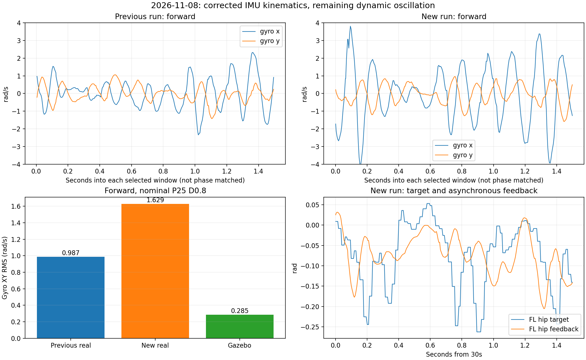

# 22:40实机新记录与21:32/Gazebo对照（2026-11-08）

## 结论与状态

用户确认这次改过IMU处理，但暂不能提供新源码；因此以新数据检查，不假定具体用了左乘、原始姿态或其他实现。

**新记录四元数/gyro动态轴已一致，旧错轴现象未复现；前进运动角速度RMS仍比旧记录增大约65%，同PD Gazebo差距更大。IMU参考问题不是全部抖动的充分解释。当前应继续核对实际推理时序、关节执行/接触模型，而不能直接判奖励问题或恢复旧错误坐标。**

- 已完成：两日志配置/指令/IMU运动学、动作转换、动态关节、时序与候选策略重放对照；补标准库比较工具与图。
- 已改善的证据：新实机动态quat/gyro轴相关性约0.998；仅说明当前记录内部运动学一致。
- 待修复/待确认：实际forward输入输出配对记录、真实动作应用时标、剩余抖动根因；IMU到机器人本体的绝对安装/倾角还需独立物理验证。新IMU代码尚未同步本机，不能宣称当前仓库源码已修好。
- 本轮无硬件操作、训练、策略/PD/生产代码修改；沿用上一轮已完成的同PD Gazebo日志，未重复仿真。

## 数据与公平比较范围

- 旧实机：`imgo2_deploy/logs/2026-11-08_21-32-40_7802/`。
- 新实机：`imgo2_deploy/logs/2026-11-08_22-40-31_15337/`，robot 18809行、policy 3720行，均无坏行、日志队列丢弃0。
- metadata config逐字段相同：P25/D0.8、action scale、默认角、映射、观测缩放、5ms主环、20ms策略周期一致。metadata无策略/二进制哈希，不能确认文件严格相同。
- 新15.270s进入PPO、89.701s开始趴下；此记录没有旧记录末尾的Fault事件。
- 旧前进46–52s，vx=.5、平均vy约0；新前进30–36s，vx=.5、平均vy=−.0192、yaw=0，属于近似前进，并非完全相同指令/地面/历史。
- 旧后退66–70s为纯后退；新46–54s平均vx=−.492、vy=−.104，横移明显。故新后退变差受指令混杂影响，不能算纯后退同条件对照。

## 1. 抖动变化

| 指标 | 旧前进 | 新前进 | 变化 |
|---|---:|---:|---:|
| gyro XY向量RMS rad/s | .9865 | **1.6290** | **+65.1%** |
| 12关节速度RMS rad/s | 2.6916 | 3.2178 | +19.5% |
| 目标角跟踪RMS rad | .2219 | .2345 | +5.7% |
| 相邻策略输出动作差RMS | .4131 | .5247 | +27.0% |
| 裁剪边界动作元素占比 | .778% | 2.417% | 增加 |
| 反馈估算力矩绝对峰值 N·m | 22.25 | 24.33 | 增加 |

同P25/D0.8 Gazebo前进gyro XY RMS约.2849，新实机约5.72倍；仿真实际均速约.455m/s，实机没有测量基座速度，所以不是严格相同实际速度。

新前进四髋速度RMS分别约1.33/1.27/1.33/1.48rad/s；旧约.88/.95/.80/.88。机身和髋关节动态明显更活跃，动作不只是一个静态姿态偏移。

新旧前进gyro X主要2–40Hz谱峰均约6.67Hz；新后退混合段gyro X与FL髋目标/反馈峰约7.375Hz。这些是运动/控制振荡成分，不能解释成6–7Hz步频，接触标签缺失。当前证据更支持同类角运动成分幅度增大。

新22–26s与82–86s零指令gyro XY RMS约.00193/.00168rad/s，和旧零指令.0017同量级。进入PPO后约18–22s有姿态调整，后续零指令可安静；不能描述为全程静站持续大抖。



## 2. IMU改动后的结果

| 四元数导出机体角速度 vs gyro相关性 | 旧前进 | 新前进30–36s | 新后退混合46–54s |
|---|---:|---:|---:|
| X | .700 | **.9986** | **.9982** |
| Y | .214 | **.9983** | **.9983** |
| Z | .988 | **.9983** | **.9982** |

新启动yaw约−65°，之后仍保留绝对航向，未见旧记录约0.225s的归零跳变。绝对yaw非零正常，不会直接进PPO。新观测重力与同tick四元数计算值最大差约6.23e−7，gyro缩放、q/dq重建也都在CSV精度内。

**结论边界：** 数据支持旧错轴问题已改善，不支持“IMU传感器所有方面都正确”，也不能从新记录还原未知的新归零源码。融合滤波/加速度动态误差、安装外参、实际本体倾角需要外部参考；不能因静站roll/pitch非零就强行清零。修正坐标也不自动消除执行器、时延、接触与策略的闭环差异。

新静态原始roll/pitch约+2.5°/−2.05°，PPO稳定静止约+1.1°/−1.35°。它们可能是真实姿态或安装偏置，单靠这些日志分不开。

## 3. 剩余链路线索

### 3.1 实际推理输入的时间配对仍需补齐

新日志仍是消费结果时重建obs，obs_age全0；不是实际forward时的输入。旧9299候选静止段重放RMSE约.00264，新运动段约.194；整行前移也不可靠。

对机器人历史快照作探索性as-of重建：旧前进在约1ms历史快照时动作RMSE .086→.026；新前进在约7ms时.194→.074。**这提示输入/记录的对齐差异值得检查，但不等于测出了新增6ms控制延迟或USB延迟**。动作结果、线程输入、传感器异步快照与记录时间均可能参与，且缺实际策略哈希；仅可用于指导下一次采集。

### 3.2 关节转换通过；动态执行尚未对齐

新`q_des=default+scale*consumed_action`最大差约1.5e−5rad，PPO Safety夹值行0。12轴q差分/dq相关性约.992–.995，无明显整体符号错误。历史目标7.5–10ms更能解释估算力矩，与旧记录量级接近；不能直接解释为新增USB延迟。

新前进300个policy行中，小腿FL/BR动作在±3边界分别约30/33行，部分髋也达到边界；这是需要关注的动态输出变激进现象，不等同于策略整体崩溃或持续动作饱和。

全PPO反馈估算力矩峰值28.36N·m发生在29.469s FL小腿，此时指令恰为纯+.5、无横移。这表明较大力矩不全发生在混合输入；但反馈是估算，不能凭峰值认定真实冲击或电流饱和。前进稳定窗口24.33N·m，末尾温度最高32°C、err_mask均0。

需注意真实源码的`tau_max`只夹前馈，`policy.torque_limits`只解析/记录，**不能据meta的23.5认定内部PD总力矩也被限到23.5**。仿真总力矩限制与实机电机内部限制不是自动相同。这里未改变限幅或控制方式，需要确认电机实际总力矩/电流限制。

### 3.3 时序略变差，不足以独立定因

| 项目 | 旧 | 新 |
|---|---:|---:|
| 主环dt中位 ms | 5.0 | 4.999 |
| 主环dt p99 ms | 6.886 | 7.502 |
| policy记录间隔p99 ms | 28.618 | 29.673 |
| IMU age中位 ms | 2 | 3 |
| 关节age p99 ms | 6 | 7 |

运动指令分组总线事务中位约2.1ms，两记录接近；新全记录最大IMU/关节age为45/52ms，但不能拿单个最大值解释全部运动抖动。没有证据支持“平均频率正常就无时序问题”，也没有证据支持“USB是唯一根因”。exit trace为末尾环形记录，不包含完整30–36s运动过程。

## 下一步建议

1. **保留动态轴一致的IMU处理。** 获取新源码后复核是保留真实重力的参考处理；不恢复旧右乘，也不立即增加姿态滤波来掩盖问题。
2. **下一次优先改采集配对而非奖励。** 保存真正forward输入、对应raw/clipped action、输入快照采集/推理开始结束/目标消费/总线发送反馈时间及policy/配置/二进制哈希。现有重建obs无法精确锁定环节。
3. 保留P25/D0.8作基线，测试中固定vy=wz=0，分离静止、低速、+.5、−.5。当前后退混合指令不宜作为纯方向验收。不要同时变PD、策略、坐标与命令。
4. 静态验证机器人本体水平、单关节反馈与模型零位/方向；随后以同策略同PD检查目标→反馈动态、总力矩限制和接触/足底/结构。相同名义PD不保证真实电机动力学与仿真相同。
5. 若具备policy_1原文件，用同一套修正IMU、PD与纯方向命令作对照，能帮助区分策略特有敏感性和共有硬件链路。不要为了本轮抖动直接重训或统一加重奖励。

## 复现

系统`/usr/bin/python3` 3.10.12运行核心审计；候选TorchScript CPU重放用`/home/tommy0929/miniconda3/envs/env_isaaclab/bin/python`；绘图用numpy/matplotlib。没有启动新仿真/硬件/训练。

```bash
python3 imgo2_rl/scripts/tools/compare_real_deployment_logs.py \
 --old imgo2_deploy/logs/2026-11-08_21-32-40_7802 \
 --new imgo2_deploy/logs/2026-11-08_22-40-31_15337 \
 --old-window zero:40:43 --old-window forward:46:52 --old-window backward:66:70 \
 --new-window zero:22:26 --new-window forward:30:36 \
 --new-window backward_mixed:46:54 --new-window zero_end:82:86 \
 --output docs/deployment/real2132_vs2240_2026-11-08.json
```

依据：[完整窗口对照](real2132_vs2240_2026-11-08.json)、[新IMU运动学](real2240_imu_rates_2026-11-08.json)、[新动态执行拟合](real2240_joint_dynamics_2026-11-08.json)、[运行时序](real2240_runtime_2026-11-08.json)、[候选重放](real2240_policy_replay_2026-11-08.json)、[历史快照探索](real2240_snapshot_replay_scan_2026-11-08.json)。验证：脚本实际读取两组日志并生成JSON；数值为所列窗口的描述统计，未做闭环因果干预。
