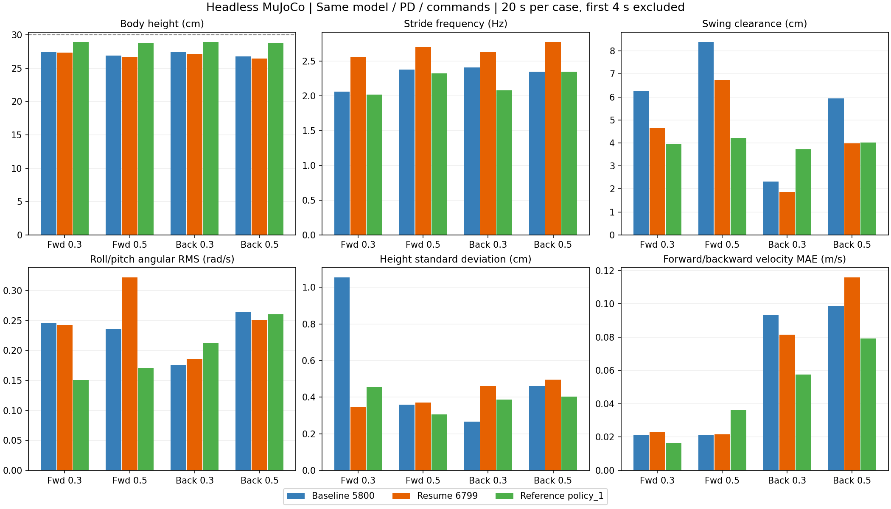

# 5800到6799续训效果复审（2026-11-04）

## 结论

按用户希望的更高机身、慢步、后退抬脚和rough适应，最新6799不优于原5800，不建议替换生产policy或在此组合上盲目长续训。前进+.3机身上下波动减小、左右转向前向漂移减少、部分横移跟踪有收益；代价是平移步频普遍上升、摆动时长和净空下降、机身仍低且略降低、右转响应明显下降。12个固定rough方向探针平均vx MAE .16107→.18364m/s，未见总体改善。并非训练数值崩溃或所有动作均退步。

## 身份、配置、导出

- 新run：2026-11-04_22-11-36_resume5800_airtime01，保存agent明确load_run旧00-37-16/run、load_checkpoint=model_5800.pt、max_iterations1000、seed42，最终model_6799.pt。名字airtime01不代表实际weight=.1，保存值确实1.0。
- 正式ppo/play.py --export_only在本机env_isaaclab GPU分别导出旧5800与新6799；独立快照在logs/resume5800_compare_2026-11-04/baseline5800.pt与resume6799.pt，各8个Actor张量与原checkpoint max diff0。MuJoCo部署LibTorch实际加载通过，未手写导出。
- 11个新checkpoint model state均有限，末std均值约.363；没证明优化器每个张量有限。server git目录为空，原reward函数版本无法完整追溯。
- 本轮未替换生产policy、改奖励/模型/PD、启动新训练或硬件；旧run/exported/policy.pt本轮被正式导出为5800，不能继续当5899用，原5899独立快照在terrain_resume_compare_2026-11-04/terrain5899.pt仍保留。

| 配置 | 原5800所属run | 新6799所属run |
|---|---:|---:|
| feet_air_time weight/threshold | 1.8/.5 | 1.0/.5 |
| base_height weight/target | -18/.30 | -10/.30 |
| ang_vel_xy weight | -.05 | -.10 |
| max_init_terrain_level | 1 | 5 |
| FHB weight/target | -4/-.20 | 相同 |
| lin_z / tracklin / trackyaw | -4 / 1.5 / .6 | 相同 |
| vx/vy/yaw范围 | ±1/±.6/±1 | 相同 |
| 地形课程/速度课程 | 开/关 | 相同 |

完整保存env除log_dir外只有上表四项差异；故本次是联合修改，不是airtime单变量。heading、standing未变，没有实现方向分组采样。课程重启不会恢复旧每个env的等级，不能把新run开头简单地形上的低误差误认为突然进步。

## 训练趋势

| 窗口 | reward | xy内部误差 | yaw内部误差 | terrain level | mean std | value loss |
|---|---:|---:|---:|---:|---:|---:|
| 旧5700-5800 | 13.36732 | 0.37063 | 0.38973 | 5.84251 | 0.38783 | 0.01351 |
| 新5800-5899 | 13.99883 | 0.25862 | 0.28027 | 3.73393 | 0.34688 | 0.00882 |
| 新6200-6299 | 14.93394 | 0.36927 | 0.37892 | 6.00164 | 0.36374 | 0.01401 |
| 新6700-6799 | 15.28592 | 0.35772 | 0.37342 | 5.86562 | 0.36296 | 0.01381 |

新run后段相对中段跟踪略改善、std稳定，不能说已数值发散。reward13.37→15.29不等于步态改善：airtime和高度惩罚系数降低、角速度增加，回报函数已经改变。除weight后高度组合量.00069989→.00069022基本不变，angxy1.42415→1.17192减小约17.7%，airtime-.106933→-.118612更负，但后者是落地事件累计，不能仅它反推摆腿时间；物理测试见下。

## 同条件平地MuJoCo：27组实际运行

三策略×9指令，各20秒、前4秒排除，全部4000帧且无failure。生产PD/反馈适配器、同模型与固定仿真时钟，不涉及GUI/FSM启动过渡；run.json记录源码/场景/策略hash，结束确认全不变。每方向独立重置，相同暖机。步频为同足重复落地频率，不是控制Hz；净空为碰撞球底到平地的完整摆动峰值均值；角运动为roll/pitch角速度合成RMS，不是硬件高频振动。

| 指令 | 策略 | vx/vy/yaw | 机身cm | 高度std cm | 步频Hz | air s | 净空cm | 角运动RMS |
|---|---|---|---:|---:|---:|---:|---:|---:|
| stand | baseline5800.pt | 0.000/0.000/0.000 | 29.400 | 0.015 | — | — | — | 0.004 |
| forward03 | baseline5800.pt | 0.316/0.011/0.009 | 27.485 | 1.054 | 2.062 | 0.158 | 6.268 | 0.245 |
| forward05 | baseline5800.pt | 0.507/-0.002/0.005 | 26.874 | 0.359 | 2.381 | 0.148 | 8.393 | 0.236 |
| backward03 | baseline5800.pt | -0.207/0.004/0.004 | 27.491 | 0.267 | 2.410 | 0.103 | 2.327 | 0.175 |
| backward05 | baseline5800.pt | -0.402/-0.025/-0.028 | 26.787 | 0.462 | 2.353 | 0.142 | 5.933 | 0.264 |
| left03 | baseline5800.pt | 0.080/0.249/-0.036 | 27.180 | 0.279 | 2.985 | 0.118 | 4.945 | 0.310 |
| right03 | baseline5800.pt | 0.012/-0.246/-0.033 | 27.139 | 0.267 | 3.030 | 0.129 | 5.720 | 0.322 |
| turn_left03 | baseline5800.pt | 0.101/-0.001/0.289 | 28.254 | 0.633 | 2.105 | 0.085 | 1.457 | 0.176 |
| turn_right03 | baseline5800.pt | 0.078/-0.007/-0.260 | 28.523 | 0.514 | 2.222 | 0.068 | 0.677 | 0.140 |
| stand | resume6799.pt | 0.000/0.000/-0.000 | 29.216 | 0.006 | — | — | — | 0.005 |
| forward03 | resume6799.pt | 0.319/0.001/-0.012 | 27.339 | 0.348 | 2.564 | 0.115 | 4.653 | 0.243 |
| forward05 | resume6799.pt | 0.496/0.007/-0.011 | 26.614 | 0.371 | 2.703 | 0.125 | 6.741 | 0.322 |
| backward03 | resume6799.pt | -0.219/-0.008/-0.022 | 27.160 | 0.462 | 2.632 | 0.087 | 1.867 | 0.186 |
| backward05 | resume6799.pt | -0.384/-0.013/-0.029 | 26.450 | 0.495 | 2.778 | 0.104 | 3.989 | 0.252 |
| left03 | resume6799.pt | 0.042/0.244/-0.020 | 27.157 | 0.154 | 3.571 | 0.101 | 3.624 | 0.314 |
| right03 | resume6799.pt | 0.024/-0.260/-0.017 | 26.893 | 0.120 | 3.571 | 0.105 | 4.597 | 0.292 |
| turn_left03 | resume6799.pt | 0.036/-0.005/0.203 | 28.988 | 0.410 | 1.429 | 0.057 | 0.597 | 0.169 |
| turn_right03 | resume6799.pt | 0.015/0.004/-0.082 | 28.723 | 0.494 | 2.532 | 0.066 | 1.162 | 0.090 |
| stand | policy_1.pt | 0.000/0.000/-0.000 | 30.318 | 0.004 | — | — | — | 0.005 |
| forward03 | policy_1.pt | 0.288/-0.011/-0.015 | 28.906 | 0.456 | 2.020 | 0.191 | 3.966 | 0.151 |
| forward05 | policy_1.pt | 0.465/-0.010/-0.009 | 28.710 | 0.306 | 2.326 | 0.174 | 4.228 | 0.170 |
| backward03 | policy_1.pt | -0.243/0.006/-0.021 | 28.932 | 0.387 | 2.083 | 0.179 | 3.717 | 0.213 |
| backward05 | policy_1.pt | -0.421/0.009/-0.023 | 28.834 | 0.404 | 2.353 | 0.167 | 4.028 | 0.261 |
| left03 | policy_1.pt | 0.016/0.263/-0.018 | 29.227 | 0.478 | 2.174 | 0.166 | 3.754 | 0.281 |
| right03 | policy_1.pt | 0.015/-0.278/-0.017 | 28.976 | 0.482 | 2.222 | 0.167 | 3.666 | 0.276 |
| turn_left03 | policy_1.pt | 0.022/-0.004/0.142 | 30.107 | 0.366 | 1.575 | 0.096 | 0.983 | 0.145 |
| turn_right03 | policy_1.pt | 0.016/-0.006/-0.131 | 30.058 | 0.490 | 1.600 | 0.063 | 0.464 | 0.110 |

图已实际打开核对。+.3高度std1.05→.35cm确实改善，但+.5角运动.236→.322rad/s恶化；不能概括为全方向更抖或更稳。-.3实际vx-.207→-.219略改善，但净空2.33→1.87cm，步频2.41→2.63；-.5跟速-.402→-.384变差、净空5.93→3.99cm。左/右yaw指令±.3：实际+.289/-.260→+.203/-.082，而前向漂移.101/.078→.036/.015m/s；转得更少本身也会减小漂移，非无条件改善。新策略各case动作饱和为0，未复现历史髋动作持续饱和；不能把此轮退步归为旧mu=-78问题。静止两者均稳定，未复现稳态严重站抖。

## 相同Isaac rough探针：24个case

旧5800与新6799各12env，6类型×前后±.3，seed42、固定difficulty.5，12秒/600step排除前2秒，关闭obs噪声/startup/interval随机化，root reset pose/velocity固定，无自适应课程。共同dt、关节序、默认角、PD和地形参数输出逐项一致。当前源码受控测试，不是原训练逐字复现，body/foot z参考patch原点不是局部净空，未记录完整xy路径，不能称楼梯完成率。

| 地形/指令 | 5800实际vx | 6799实际vx | 5800 vx MAE | 6799 vx MAE |
|---|---:|---:|---:|---:|
| pyramid_stairs_forward03 | 0.235 | 0.175 | 0.103 | 0.152 |
| pyramid_stairs_backward03 | -0.036 | -0.045 | 0.264 | 0.255 |
| pyramid_stairs_inv_forward03 | 0.434 | 0.212 | 0.141 | 0.211 |
| pyramid_stairs_inv_backward03 | -0.161 | -0.174 | 0.140 | 0.126 |
| boxes_forward03 | 0.094 | 0.075 | 0.206 | 0.225 |
| boxes_backward03 | -0.008 | -0.023 | 0.292 | 0.277 |
| random_rough_forward03 | 0.277 | 0.217 | 0.079 | 0.118 |
| random_rough_backward03 | 0.001 | -0.000 | 0.301 | 0.300 |
| hf_pyramid_slope_forward03 | 0.370 | 0.215 | 0.081 | 0.096 |
| hf_pyramid_slope_backward03 | -0.212 | -0.012 | 0.115 | 0.288 |
| hf_pyramid_slope_inv_forward03 | 0.398 | 0.409 | 0.100 | 0.109 |
| hf_pyramid_slope_inv_backward03 | -0.217 | -0.295 | 0.110 | 0.047 |

总体MAE .16107→.18364、前进.11851→.15190、后退.20363→.21538m/s。正向坡后退-.212→-.012几乎停住；反向坡后退-.217→-.295改善，不能说每种地形都退步。两模型全部resets0；旧全部upright_fraction1，新倒楼梯前进.902，其余1，这个指标是姿态门限而非摔倒次数，且illegal_contact关闭，零reset不证明全部安全通过。

## 建议与待完成

1. 保留5800与policy_1，不把6799替换为新的通用生产策略。policy_1在本次同批平地前后依旧更高、更慢步，但纯yaw仍欠跟踪，不能称所有项最优。6799保留为联合修改的负/混合结果，不删日志。
2. 不从6799继续原样追加数千轮来赌慢步恢复；如需继续奖励研究，回共同5800，只变一个定义明确的目标。当前实测不支持减高度惩罚的组合更适合“高身慢步”；也不能单独证明air1.0导致全部退步，因为angxy/高度/初始课程同变。先不把全部机身惩罚同时加大。
3. 面向可复用主方案，显式后退/纯yaw/静止采样与平地常驻仍待实现，当前附件没有完成；FHB的机身参考与固定摆动目标也仍待处理。不要宣称只改heading=False已经保证分组。
4. 本轮有训练日志、正式导出、身份/有限性、27组平地MuJoCo与24个Isaac rough实跑。未运行Gazebo、减速/FSM切换/实机、多seed、不同初态和更长地形通过测试；没有测试所有中间checkpoint，不能断言该run每个checkpoint都比5800差。硬件等效性、单项因果和最终配方效果仍待验证。

## 产物

原始CSV、导出日志、两JIT快照、Isaac逐步数据统一在imgo2_rl/logs/resume5800_compare_2026-11-04。

- [MuJoCo完整指标](resume5800_mujoco_2026-11-04.json)、[Isaac rough摘要](resume5800_isaac_rough_2026-11-04.json)。
- [保存配置差异](../training/resume5800_config_diff_2026-11-04.json)、[训练窗口](../training/resume5800_training_windows_2026-11-04.json)、[checkpoint/Actor核对](../training/resume5800_checkpoint_audit_2026-11-04.json)、[新末窗口奖励](../training/resume5800_final_window_2026-11-04.json)。
