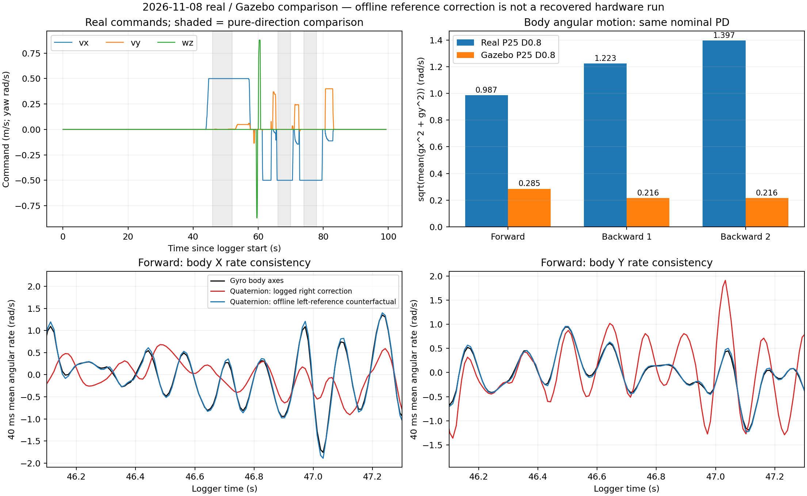

# 11月8日实机与Gazebo链路对照

## 结论与状态

**首要问题在实机IMU启动归零：当前源码右乘初始姿态的逆，改变了四元数所用的机体轴，而gyro仍为原机体轴。日志中约64.6°的初始偏航恰好解释动态X/Y轴混合。先处理此输入问题，再判断奖励、模型与PD。**

- 已完成：实机日志审计、相同P25/D0.8的Gazebo前后向短测、目标转换/反馈单位/时序检查、独立启动姿态驱动的离线坐标复核；纠正10月23日文档对右乘的错误解释。
- 待修复：生产IMU归零实现、实机真正推理输入输出配对记录；本轮按排查范围未改硬件控制代码。
- 待确认：修正后的实机运动是否改善、剩余执行器/接触/延迟差异、运行二进制与当前源码一致性、真实部署policy哈希、末尾FR电机健康故障细节。
- 本轮没有启动硬件、训练或替换策略；Gazebo临时D0.8测试结束已恢复原配置D0.5，进程已停止。

## 数据、策略与窗口

实机目录：`imgo2_deploy/logs/2026-11-08_21-32-40_7802/`。robot.csv为19855行/169列，policy.csv为2863行/67列；meta中的153列描述已过时。实机稳定PPO阶段实际P25/D0.8。

同PD新仿真：`imgo2_deploy/logs/gazebo_old9299_kd08_forward05_20261108/`、`gazebo_old9299_kd08_backward05_20261108/`。另保留11/7 D0.5前进基线。

仿真使用旧足高目标−0.20的9299，SHA256 `d2334e9845c237062fc0671e6df8e79440efbfa035c0c9a3c2c884daac40cfea`。它是上传实机动作离线重放最接近的候选；但meta没有policy哈希，不能仅凭近似重放宣称严格同一文件。

排除横移/转向混入：实机取46–52s前进（vy仅0–0.0034m/s）、66–70s及74–78s纯后退。中间混合指令另外保留，不拿来推断纯前后性能。仿真取PPO稳定后的窗口。

| 指标 | 实机前进 | Gazebo前进 D0.8 | 实机后退1 | 实机后退2 | Gazebo后退 D0.8 |
|---|---:|---:|---:|---:|---:|
| gyro XY向量RMS rad/s | 0.9865 | 0.2849 | 1.2235 | 1.3967 | 0.2163 |
| logged roll std ° | 1.885 | 0.597 | 1.538 | 1.376 | 0.336 |
| logged pitch std ° | 2.487 | 0.261 | 1.995 | 1.770 | 0.370 |
| 12关节目标跟踪RMS rad | 0.2219 | 0.1875 | 0.2102 | 0.2146 | 0.1797 |

注意：实机logged roll/pitch来自有坐标错误的四元数，不宜按单独身体轴直接解释；gyro XY合量仍可比较。实机前进角运动约3.46倍，后退约5.66–6.46倍。PPO零指令40–43s及84–94s的gyro XY RMS仅约0.0017/0.0018rad/s，问题主要在运动闭环，不是本次日志的持续静站振荡。

Gazebo实际前进均速约0.455m/s、后退−0.380m/s；实机没有独立基座速度、地面相对机身高度、接触力，不能计算真实跟速、滑足与净空，也不能把髋或gyro谱峰当步频。



## 1. 具体错误：IMU右乘初始姿态的逆

位置：`imgo2_deploy/real/Imu/src/imu_monitor.cpp` 的 `applyBias()`（约110行）。头文件注释也写了同样的错误约定。

当前：

```cpp
corrected = quatMultiply(q, inv);  // Qraw * inverse(B)
```

这里Q是机体到世界的姿态；改变世界参考应在左侧乘参考旋转，改变机体系定义才在右侧乘。令B为启动姿态，则当前Qc=Qraw B⁻¹，四元数增量对应的角速度变成R(B)ω，而gyro仍是ω。策略同时看到错轴的倾斜/重力与原轴角速度，反馈会交叉耦合。

独立证据（不是从运动数据拟合旋转角）：

1. 启动前45个主环日志样本尚未归零，约0–0.220s；0.225s出现归零跳变。这与50个IMU有效帧暖机相符，主环样本数不等于传感器帧数。
2. 这些原始四元数平均姿态为roll +0.806°、pitch −1.512°、yaw **−64.615°**。用它估计B，不用运动数据调参。
3. 对已记录Qc离线作B⁻¹ Qc B，恢复“左侧改变世界参考”的同一姿态序列。gyro不改、时间不移。

| 四元数导出角速度与gyro的相关性 | 原日志X | 原日志Y | 离线改参考后X | 离线改参考后Y |
|---|---:|---:|---:|---:|
| 前进46–52s | 0.700 | 0.214 | **0.998** | **0.998** |
| 后退66–70s | 0.780 | 0.110 | **0.997** | **0.998** |
| 正常Gazebo前进 | 0.997 | 0.995 | — | — |

原日志四元数Y角速度与gyro X反而约−0.97相关。±100ms时移不能修复，而上述固定参考修正能恢复一致。纯机体X轴1rad/s的代数检验：右乘得到约[0.429,−0.903,0.026]，左乘得到[1,0,0]。

**如何修：** 如果保留“启动完整姿态归零”的旧需求，至少改为`quatMultiply(inv, q)`，保持gyro机体轴不变。但启动roll/pitch不一定是IMU偏置，也可能是真实倾斜；完整归零会重新定义世界竖直。对PPO重力观测更合适的是**保留真实roll/pitch，仅左乘初始yaw的逆**（纯偏航对投影重力本身没有影响），或直接用原始姿态；安装外参要单独标定，不能拿随机初始偏航当安装旋转。显示用Euler归零也应与策略姿态处理区分，不能用逐项Euler减法当通用姿态转换。

此处理确实进入控制：`ImuMonitor::Run`先applyBias再发布Snapshot，`RealHardware::snapshotLocked()`取Snapshot，`robot_adapter.cpp`直接传quat/gyro，`rl_sdk.cpp`据此算投影重力。并非只影响面板。

**边界：** 当前源码与日志行为高度吻合，但缺实机可执行文件哈希。离线修参考只证明坐标一致性恢复；不会让已经记录的关节运动改变，也不证明全部抖动都由IMU造成。需要修后重新编译、动态轴检查及实机闭环记录。

## 2. policy.csv时序：不能简单错开一整行

已按用户提醒，把“当前记录的obs”与“此前输入产生的action”分开处理。源码`rl_real_imgo2.cpp`在消费新策略结果时重新buildObservation，并非保存工作线程实际forward输入。因此不是可保证的同一行配对，也不保证恰好相差一个20ms策略周期。

旧9299候选以本行重建obs重放动作RMSE约0.0862；机械地改用上一行obs反而约0.2739。在静止段重放误差约0.0027，动态增大与重建时差相容，但不能据此精确确认模型或延迟。不要用这个误差认定TorchScript导出错误。

已核对重建obs与同tick robot.csv：gyro、gravity、q/dq、指令缩放都在CSV精度内；last_action与上一条记录动作最大差约5.1e-6。必须在推理线程保存实际输入张量、对应输出及采样/生成/消费时间，才能完成严格逐帧对照。已有问题DEPLOY-DIAG-01继续保留。

仿真新采集是同一次forward成对输入输出；重放最大差约2.15e-6/1.67e-6、目标转换/last_action差0。

## 3. 关节、电机与通信：已排除什么，还缺什么

- 指令到角度：`q_des=default_pose+action_scale*consumed_action`核对最大差约1.5e-5rad；PPO安全限幅行0，不是大量目标被安全裁剪。动作clip占比约0.21%，也不是持续饱和。
- 反馈：12轴q差分与dq相关性约0.993–0.996，没有看到整体速度符号反转；这不能代替物理单关节接线/零位检查。
- 实机运动时髋速度波动大于仿真，部分小腿跟踪误差及估计力矩更大；实机前进反馈估计力矩峰值约22.25N·m，Gazebo约11.58N·m。反馈力矩不是独立力传感器读数，不据此判模型惯量错误。
- 历史目标移7.5–10ms更能解释反馈估算力矩；自由PD拟合Kp约24–25.5、Kd约0.66–0.77。对齐同时包含命令保持、执行、反馈和估计滤波，**不是直接测出的USB延迟**。
- 主环间隔中位5ms、p99约6.89ms、最大14.11ms；IMU age中位2ms/p99 6ms，关节age中位2ms/p99 6ms；总线事务中位约2.1ms。存在抖动，但不能仅凭平均频率或本次记录把通信认作主因。
- D0.5→0.8能减轻某些振荡是合理现象，但同D0.8仿真仍明显更稳，PD不是全部解释。先保留实机已较稳的0.8，不建议为“对齐”强行降回0.5；修输入后再单独评估PD。

事件末尾99.319s出现FR电机0健康反馈Fault，在94.658s已经退出PPO趴下之后。记录行最高温30°C、err_mask均0；具体异常发生于最后一条robot记录之后，trace只保留末尾约5s且未记录该异常的充分原始健康位。应另行追查，不能把它当成前面全程抖动的已证根因。

## 后续顺序

1. 修IMU世界参考处理，动态检查：分别绕机体X/Y倾动，四元数导出角速度、gyro和投影重力应一致。不要靠旋转gyro去迁就错误的四元数归零。
2. 补实际forward配对日志与policy/配置/二进制哈希。使用相同策略、P25/D0.8，重复静止→纯前进→静止→纯后退，先避免混合输入。
3. 再比较抖动、跟踪误差、延迟及接触/执行器模型。若仍有差异，再做PD、延迟/电机动力学和摩擦的单项对照；此时才考虑训练域随机化和奖励。

## 复现与原始依据

本轮统计使用系统`/usr/bin/python3`（3.10）；CPU Torch模型重放另用本机Isaac环境，Gazebo/ROS2用Humble与已有构建。绘图需numpy/matplotlib，审计核心为标准库。没有训练。

```bash
python3 imgo2_rl/scripts/tools/audit_sim_real_chain.py \
  --real imgo2_deploy/logs/2026-11-08_21-32-40_7802 \
  --sim sim_kd05_forward=imgo2_deploy/logs/gazebo_old9299_forward05_20261107_172338 \
  --sim sim_kd08_forward=imgo2_deploy/logs/gazebo_old9299_kd08_forward05_20261108 \
  --sim sim_kd08_backward=imgo2_deploy/logs/gazebo_old9299_kd08_backward05_20261108 \
  --output docs/deployment/sim_real_chain_2026-11-08.json
python3 imgo2_rl/scripts/tools/compare_logged_imu_rates.py \
  --real imgo2_deploy/logs/2026-11-08_21-32-40_7802 \
  --sim imgo2_deploy/logs/gazebo_old9299_kd08_forward05_20261108 \
  --output docs/deployment/imu_kinematics_compare_2026-11-08.json
python3 imgo2_rl/scripts/tools/plot_sim_real_chain.py
```

机器可读依据：[状态与转换](sim_real_chain_2026-11-08.json)、[IMU动态与离线参考复核](imu_kinematics_compare_2026-11-08.json)、[候选策略与行时移重放](sim_real_identity_2026-11-08.json)、[反馈动态](real_joint_dynamics_2026-11-08.json)、[时序](real_runtime_2026-11-08.json)、[仿真运行及恢复](gazebo_kd08_batch_2026-11-08.json)、[仿真重放](gazebo_kd08_replay_2026-11-08.json)。

## 补充：绝对偏航、地磁与归零（2026-11-08）

策略不直接使用绝对yaw，初始yaw−64.615°本身不是异常。地磁参与姿态融合可定义世界航向；目前采样CSV记录融合四元数，不能仅凭它确认原始磁场质量或融合配置。当前入口是读取IMU融合姿态后归零，不是把磁场三轴直接作为策略输入。

但偏航不直接入策略，不等于任意四元数归零操作都不影响策略。对机体到世界旋转R和世界重力g，策略使用Rᵀg。若左乘纯yaw参考Z⁻¹，得到RᵀZg=Rᵀg，重力不变；现有右乘初始yaw逆得到ZRᵀg，会把机体系重力水平分量旋转。水平静止时水平分量为0，错误不显现；倾斜运动时显现。完整启动四元数还包含roll/pitch，因此当前操作也不是单纯消yaw。

示例：初始纯yaw−64.615°，随后纯roll +10°。正确机体重力约[0,−0.17365,−0.98481]，当前右乘处理约[−0.15688,−0.07444,−0.98481]，把横滚倾斜混成了两个方向。正确纯yaw左侧参考归零或原始姿态给出相同重力。这里诊断的是参考处理错误，不是“磁航向不为零”或者已证明磁干扰。

本次补充只澄清语义与旋转代数；未修改生产代码、未启动硬件，已有待修/待验证状态不变。
