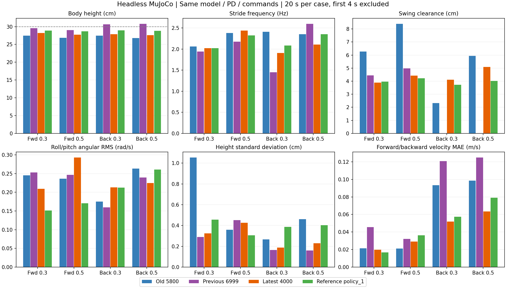

# 13-55-41新低速PPO 4000效果复审（2026-11-05）

## 结论

最新收到模型是2026-11-05_13-55-41/model_4000.pt，事件到4100，保存max_iterations7000但未收到更后模型，不能称已完成7000。新4000从头平地低速训练，在MuJoCo后退/横移/转向恢复有效抬脚，明显优于上一组01-38-11/6999；Isaac固定初态也复现后退跟速和转向响应改善。但MuJoCo身体降到约28cm，前进+.5角运动较大，未全面超过policy_1。适合保留为后续开发候选，不自动替换生产策略，不声称rough/高速/硬件验收通过。

## 1. 配置、身份和验证

- agent resume=false、seed42，4096env、24step/env/iteration；plane，headingFalse，standing2%，vx±.5/vy±.4/yaw±.6，无地形/速度课程与方向分组。
- 41份model_0…4000模型张量有限，末std mean .18091/max .24252；未逐项审计优化器张量。
- 最新4000与上一6999均通过项目正式ppo/play.py --export_only在env_isaaclab GPU导出；8个Actor参数逐张量diff0、部署LibTorch实际加载成功。未手写导出。快照new4000.pt/previous6999.pt与各run/exported均存在，生产policy未替换。
- 相比上一run保存env（除log_dir）只有下述奖励差异；两个run git目录空，服务器实际函数源码仍无法完整确认，不能凭env反推FHB是否逐字同于本机。

| 设置 | 上一6999 | 最新4000 |
|---|---:|---:|
| baseheight weight/target | -40/.30 | -35/.30 |
| feet_slide | -.05 | -.15 |
| feet_height | -3/world目标.10 | null关闭 |
| FHB | -2/body目标-.20 | -4/body目标-.20 |
| linz / angxy | -5/-.1 | 相同 |
| tracklin / trackyaw | 1.5/1.2 | 相同 |
| air / variance | 1.6/.5 / -8 | 相同 |
| hip / jointpos | -.5 / null | 相同 |

这是从头联合候选，不是仅将滑移weight增加三倍的单变量试验；训练轮数也不同。

## 2. 新训练曲线

| 窗口 | reward | xy内部指标 | yaw内部指标 | std均值 | value loss |
|---|---:|---:|---:|---:|---:|
| 1000-1499 | 40.87238 | 0.18673 | 0.22691 | 0.18913 | 0.00193 |
| 2000-2499 | 41.48463 | 0.18510 | 0.22360 | 0.18550 | 0.00178 |
| 3000-3499 | 42.01170 | 0.18162 | 0.21977 | 0.18151 | 0.00163 |
| 3500-4000 | 42.11783 | 0.18162 | 0.21973 | 0.18101 | 0.00163 |

1000→3000有改善，3000后跟踪和loss趋稳，无标量数值崩溃证据。高reward不单独代表摆腿正常；新旧回报函数不同，不能按42vs39直接排名。

最新3500–4000有效接触足速度组合量C_slide/weight约.25189，上一6500–6999约.86824，相同保存指令范围下下降约71%；包含接触与直立门和所有方向，不能直接当每足/每方向的滑速。足滑加权贡献-.04341→-.03778，变得不那么负并非因为权重减小（实际上乘3），提示运动分布改变；不能唯一归因滑移系数。air负贡献-.08964、variance-.06591，旧variance-.19503，时序规律改善的解释需结合实际接触而非只读标量。

## 3. 同条件MuJoCo：36段实际运行

四策略×9指令，各20秒，前4秒排除、每段4000帧、全部failure空。同模型、场景、生产PD/反馈与固定仿真时钟，结束run.json验证测试输入hash全不变。比较policy_1和旧5800本次同批实跑，未复用旧批指标；GUI/FSM起步/减速过渡未测。角运动为roll/pitch角速度RMS，不是硬件高频振动；净空为足部碰撞球底到平地的完整候选摆动峰值均值。

| 策略 | 指令 | 实际vx/vy/yaw | 身高cm | 高度std cm | 步频Hz | air s | 净空cm | 角运动RMS |
|---|---|---|---:|---:|---:|---:|---:|---:|
| new4000.pt | stand | 0.000/-0.000/0.000 | 28.294 | 0.005 | — | — | — | 0.004 |
| new4000.pt | forward03 | 0.310/0.007/-0.008 | 28.217 | 0.323 | 2.020 | 0.168 | 3.895 | 0.210 |
| new4000.pt | forward05 | 0.471/0.026/-0.014 | 27.763 | 0.426 | 2.439 | 0.145 | 4.431 | 0.293 |
| new4000.pt | backward03 | -0.253/-0.006/-0.026 | 27.842 | 0.188 | 1.905 | 0.173 | 4.111 | 0.213 |
| new4000.pt | backward05 | -0.437/-0.013/-0.013 | 27.610 | 0.229 | 2.105 | 0.175 | 5.086 | 0.225 |
| new4000.pt | left03 | 0.034/0.264/0.022 | 28.264 | 0.101 | 2.381 | 0.161 | 4.357 | 0.254 |
| new4000.pt | right03 | 0.009/-0.260/0.008 | 28.178 | 0.200 | 2.469 | 0.153 | 4.476 | 0.271 |
| new4000.pt | turn_left03 | 0.034/0.009/0.291 | 28.124 | 0.164 | 2.174 | 0.139 | 2.410 | 0.176 |
| new4000.pt | turn_right03 | 0.027/0.005/-0.288 | 28.053 | 0.201 | 2.222 | 0.128 | 2.676 | 0.142 |
| previous6999.pt | stand | -0.000/-0.000/-0.000 | 30.756 | 0.007 | — | — | — | 0.006 |
| previous6999.pt | forward03 | 0.345/0.006/-0.009 | 29.583 | 0.289 | 1.942 | 0.141 | 4.441 | 0.253 |
| previous6999.pt | forward05 | 0.532/0.015/-0.002 | 29.015 | 0.452 | 2.174 | 0.142 | 4.979 | 0.246 |
| previous6999.pt | backward03 | -0.179/-0.006/0.007 | 30.663 | 0.164 | 1.449 | 0.040 | 0.012 | 0.160 |
| previous6999.pt | backward05 | -0.375/-0.027/0.016 | 30.782 | 0.160 | 2.597 | 0.045 | 0.018 | 0.240 |
| previous6999.pt | left03 | 0.046/0.235/0.016 | 30.279 | 0.214 | 2.198 | 0.128 | 3.109 | 0.313 |
| previous6999.pt | right03 | 0.079/-0.256/-0.023 | 30.562 | 0.276 | 2.439 | 0.127 | 3.261 | 0.280 |
| previous6999.pt | turn_left03 | 0.000/-0.011/0.226 | 30.607 | 0.137 | 1.338 | 0.047 | 0.238 | 0.153 |
| previous6999.pt | turn_right03 | -0.030/0.008/-0.254 | 30.363 | 0.196 | 1.361 | 0.050 | 0.200 | 0.191 |
| baseline5800.pt | stand | 0.000/0.000/0.000 | 29.400 | 0.015 | — | — | — | 0.004 |
| baseline5800.pt | forward03 | 0.316/0.011/0.009 | 27.485 | 1.054 | 2.062 | 0.158 | 6.268 | 0.245 |
| baseline5800.pt | forward05 | 0.507/-0.002/0.005 | 26.874 | 0.359 | 2.381 | 0.148 | 8.393 | 0.236 |
| baseline5800.pt | backward03 | -0.207/0.004/0.004 | 27.491 | 0.267 | 2.410 | 0.103 | 2.327 | 0.175 |
| baseline5800.pt | backward05 | -0.402/-0.025/-0.028 | 26.787 | 0.462 | 2.353 | 0.142 | 5.933 | 0.264 |
| baseline5800.pt | left03 | 0.080/0.249/-0.036 | 27.180 | 0.279 | 2.985 | 0.118 | 4.945 | 0.310 |
| baseline5800.pt | right03 | 0.012/-0.246/-0.033 | 27.139 | 0.267 | 3.030 | 0.129 | 5.720 | 0.322 |
| baseline5800.pt | turn_left03 | 0.101/-0.001/0.289 | 28.254 | 0.633 | 2.105 | 0.085 | 1.457 | 0.176 |
| baseline5800.pt | turn_right03 | 0.078/-0.007/-0.260 | 28.523 | 0.514 | 2.222 | 0.068 | 0.677 | 0.140 |
| policy_1.pt | stand | 0.000/0.000/-0.000 | 30.318 | 0.004 | — | — | — | 0.005 |
| policy_1.pt | forward03 | 0.288/-0.011/-0.015 | 28.906 | 0.456 | 2.020 | 0.191 | 3.966 | 0.151 |
| policy_1.pt | forward05 | 0.465/-0.010/-0.009 | 28.710 | 0.306 | 2.326 | 0.174 | 4.228 | 0.170 |
| policy_1.pt | backward03 | -0.243/0.006/-0.021 | 28.932 | 0.387 | 2.083 | 0.179 | 3.717 | 0.213 |
| policy_1.pt | backward05 | -0.421/0.009/-0.023 | 28.834 | 0.404 | 2.353 | 0.167 | 4.028 | 0.261 |
| policy_1.pt | left03 | 0.016/0.263/-0.018 | 29.227 | 0.478 | 2.174 | 0.166 | 3.754 | 0.281 |
| policy_1.pt | right03 | 0.015/-0.278/-0.017 | 28.976 | 0.482 | 2.222 | 0.167 | 3.666 | 0.276 |
| policy_1.pt | turn_left03 | 0.022/-0.004/0.142 | 30.107 | 0.366 | 1.575 | 0.096 | 0.983 | 0.145 |
| policy_1.pt | turn_right03 | 0.016/-0.006/-0.131 | 30.058 | 0.490 | 1.600 | 0.063 | 0.464 | 0.110 |

PNG已实际打开核对。上一6999后退净空接近零，卸载事件频率1.45Hz等不能称理想慢步；新4000后退-.3为净空4.11cm、1.90Hz、实际vx-.253，-.5为5.09cm、2.11Hz、实际-.437，有真实摆动改善。左右转向净空约2.41/2.68cm，yaw+.291/-.288更接近±.3；横移净空4.36/4.48cm。前进+.3净空3.89cm/2.02Hz与policy_1的3.97cm/2.02Hz接近。

代价：新前进+.3身高28.22cm（上一29.58、policy_1 28.91），后退-.3高27.84（上一30.66、policy_1 28.93）；前进+.5高27.76cm且角运动.293rad/s，上一.246、policy_1 .170。不能概括全方向更稳：新前进+.3角运动.209较上一.253下降，+.5却上升；身体均值高度与上下波动是不同指标。MuJoCo稳态stand新4000角运动约.004、前进/后退无明显持续动作饱和，未复现历史髋持续饱和。

## 4. Isaac交叉检查：8个case

新4000与上一6999各4env（stand、前进+.3、后退-.3、左yaw+.3），固定root初态、名义DCMotor增益，关闭obs噪声/startup/interval随机化，seed42，600step/12s排除前2s；--fixed-reset。实际actuator gains、默认关节角/顺序/dt逐项匹配，名义25/.5。不是原服务器训练逐字复现，也不与MuJoCo执行器/接触/暖机完全相同。

| 策略 | 指令 | 实际vx | 实际yaw | 高度cm | 角运动RMS | last_air均值s |
|---|---|---:|---:|---:|---:|---:|
| new4000 | stand | 0.000 | -0.010 | 26.22 | 0.069 | 0.037 |
| new4000 | forward03 | 0.215 | 0.008 | 28.53 | 0.223 | 0.106 |
| new4000 | backward03 | -0.250 | -0.022 | 28.54 | 0.284 | 0.089 |
| new4000 | turn_left03 | 0.023 | 0.220 | 28.58 | 0.261 | 0.071 |
| previous6999 | stand | -0.001 | -0.002 | 27.58 | 0.009 | 0.049 |
| previous6999 | forward03 | 0.273 | -0.028 | 29.83 | 0.486 | 0.055 |
| previous6999 | backward03 | -0.069 | -0.001 | 29.96 | 0.415 | 0.011 |
| previous6999 | turn_left03 | 0.023 | 0.117 | 29.57 | 0.397 | 0.087 |

全部upright_fraction1、resets0，但illegal_contact关闭，不能据此验收安全。后退vx-.069→-.250且sensor last_air .011→.089s，左转yaw.118→.220，改善方向与MuJoCo一致；没有在Isaac测真实碰撞球底净空，不能称具体4cm已双引擎等值验证。新前进vx.215较旧.273更欠跟踪，尽管角运动.223较旧.486小。新stand约26.22cm/角运动.069，旧27.58/.009，与MuJoCo结果不同，说明初态/动力学下仍有适应限制，不能用一个引擎的稳定站立代替所有场景。

## 5. 建议与问题状态

- 保留新4000及上一6999、旧5800/policy_1。当前新4000确实改善此前最严重后退/转向拖脚，值得作为开发候选；不自动替换生产/真机策略。
- 暂不继续加大足高、airtime、滑移等所有权重，已经有约4–5cm有效摆动，先保留本版以免丢失收益。下一重点是机身均值高度与前进+.5角运动，不把低身和抖动混为一个量，也不立刻把机身各项全部加重。
- 若继续当前run，可保留较早和末checkpoint定期同条件评估，日志最后500轮平台不保证越晚越好。若准备扩速，它是候选起点；需先补零速/减速/切换和更多指令测试，不能凭本批就宣布rough或高速能力通过。未经验证不直接扩大到全高速并同时改reward。
- FHB摆动掩码的设计局限仍在；新策略改善不证明漏洞消失，也不证明仅一个系数是根因。此轮没有实现此前讨论的归一化局部地面净空新函数，不把方案当已落地。服务器函数源码缺失，需留存commit/diff。

已完成：配置/训练趋势、41模型有限性、两正式导出Actor全等、36MuJoCo/8Isaac、图表QA与记录。没有修改训练奖励、模型、PD或生产policy，没有新训练或硬件运行。待确认：Gazebo、FSM切换/减速、不同初态/seed、多次训练复用性、rough/高速与硬件；跨引擎站立/身高差异、奖励单项成因和最终修法继续保留PPO-GAIT-01。

原始快照/CSV/日志集中imgo2_rl/logs/slide15_compare_2026-11-05。

- [MuJoCo完整指标](slide15_mujoco_2026-11-05.json)、[Isaac摘要/增益](slide15_isaac_2026-11-05.json)。
- [配置/模型/导出身份](../training/slide15_identity_2026-11-05.json)、[训练窗口](../training/slide15_training_windows_2026-11-05.json)、[分项量级](../training/slide15_reward_scales_2026-11-05.json)。
