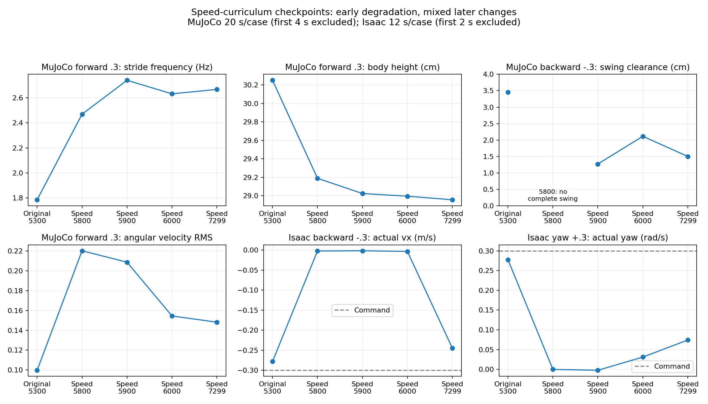

# 速度课程5800/5900/6000补测与采样保护（2026-11-05）

## 结论、已完成与待确认

对象为新速度课程run `imgo2_rl/logs/rsl_rl/base_move_rough/2026-11-05_19-15-47_speed_curriculum_resume`，不是原低速run的同名轮次。本次正式导出并新增48个MuJoCo和12个Isaac测试，比较已有原5300与速度7299。

**低速快步/低身在5800时已出现；5800–6000并非整体优于7299，不能归因为“后面训练太多所以全坏了”。** 6000在MuJoCo后退跟速/净空比7299部分更好，但在Isaac后退−.3仍基本不走；7299恢复了Isaac后退能力并进一步降低前进角运动。后期静止角运动和部分足端净空确有退化，因此也不能说所有能力都单调改善。

- 已完成/已修复：补齐三个中间checkpoint的正式导出身份、有限性、两引擎闭环证据和图表；无生产控制或奖励修复。
- 待确认/待修复：方向采样保护的实际实现与验证、低速保留的因果、跨引擎接触/初始化差异、动态/FSM、rough与硬件；需要实现统计/短训及对应闭环。原run5400/5500请求仍待补测，本轮没有把新run同名文件冒认为它们。
- 本次未修改训练代码/配置/奖励、模型/PD或部署生产策略，未启动训练。

## 身份与方法

三个checkpoint均为有限模型；正式`ppo/play.py --export_only`导出JIT、8个Actor张量与1024条seed42确定性45维输入最大差均0，部署LibTorch实际加载成功。详见[身份记录](../training/speed_curriculum_early_identity_2026-11-05.json)。

每份策略16个MuJoCo平地工况，每个20秒4000帧、剔除前4秒；共48次均无测试停止/失败，所有输入前后哈希不变，与上次对照共同的7份模型/控制源码/配置哈希相同。使用已有同一benchmark二进制，不改变控制时钟/PD/反馈。工况为静止、前进.3/.5/.8/1/1.2、后退.3/.5/.8、横移±.3、yaw±.3/±.8、前进.4+yaw.8。测试“未失败”不代表跟踪合格，例如5800后退站着不动也不触发停止。

每份策略Isaac四工况并行：静止、前进.3、后退−.3、yaw+.3；600步12秒、剔除前100步2秒，固定重置、seed42、实际名义执行器25/.5、关闭观测噪声/startup/interval随机化。12次resets=0、upright_fraction=1；dt/关节顺序/参考角/实际执行器/平地条件与此前5300基准相同。illegal_contact关闭，不能据此视为安全验收。原5300与7299使用上次已有JSON，本次新增只包含5800/5900/6000。

## MuJoCo低速与高速

角运动为√mean(ωx²+ωy²)，rad/s；净空为离地段足端碰撞球底部峰值均值，不是body相对高度或世界link原点高度。

| checkpoint | 前进.3步频Hz | 前进.3身高cm | 前进.3角运动 | 后退−.3实际vx | 后退−.3净空cm | 前进1.0实际vx/角运动 |
|---|---:|---:|---:|---:|---:|---|
| 原5300 | 1.786 | 30.25 | .100 | −.248 | 3.46 | 1.091 / .343 |
| 速度5800 | 2.469 | 29.19 | .220 | −.001 | 无完整离地段 | 1.047 / .322 |
| 速度5900 | 2.740 | 29.02 | .209 | −.254 | 1.27 | 1.031 / .265 |
| 速度6000 | 2.632 | 28.99 | .154 | −.283 | 2.11 | 1.022 / .266 |
| 速度7299 | 2.667 | 28.96 | .148 | −.232 | 1.50 | 1.009 / .252 |

5800前进.3周期已降到约.405秒（原.560秒），不是到7299才突然快。6000后退−.5实际−.460，比7299的−.430更接近指令；但该工况净空3.81cm，原5300为4.68cm。6000低速左右转净空只有约.77/.63cm；左右yaw实际+.258/−.291，不能只看yaw合格就说抬脚好。5800/5900的右转净空同样约.64/.66cm。

本次48工况中，仅5800前进1.2m/s动作饱和率约.708%，其余均0。5800后退−.3不走却能后退−.5走，说明低速响应存在明显缺口，不支持将5800视为比7299全面更好的起点。

完整数据：[48次新结果](speed_curriculum_early_mujoco_2026-11-05.json)、[连同旧对照80次结果](speed_curriculum_early_combined_2026-11-05.json)。

## Isaac结果

| checkpoint | 前进.3实际vx | 后退−.3实际vx | 左转.3实际yaw | 静止角运动RMS |
|---|---:|---:|---:|---:|
| 原5300 | .195 | −.278 | .278 | .0249 |
| 速度5800 | .256 | −.002 | .000 | .0143 |
| 速度5900 | .276 | −.002 | −.002 | .0150 |
| 速度6000 | .285 | −.004 | .031 | .0132 |
| 速度7299 | .297 | −.245 | .074 | .0969 |

早期静止比7299稳，但早期低速后退/转向几乎不响应。后面训练恢复了一些能力，同时部分指标变坏，属于不同指标的取舍，不能用单一轮数或loss最低决定策略优劣。6000仅可作为MuJoCo局部表现候选保留，未通过跨引擎低速验收，不建议仅因轮次较小就替代原5300作为rough起点。

[Isaac摘要/契约](speed_curriculum_early_isaac_2026-11-05.json)。

## 后面是否“训练太多”

5700后两项课程已扩满。因此5800–6000不是还在旧低速范围的策略，而是刚开始适应最终大范围。

| 窗口 | mean reward | xy日志误差 | yaw日志误差 | value loss |
|---|---:|---:|---:|---:|
| 5800–5899 | 28.547 | .33407 | .31365 | .01457 |
| 5900–5999 | 29.104 | .32471 | .31254 | .01335 |
| 6000–6099 | 29.597 | .31909 | .30748 | .01289 |
| 7000–7299 | 31.008 | .29992 | .29584 | .01102 |

在相同最终范围下平均指标持续改善，没有数值崩溃证据；有限性检查也通过。但是总目标改善不能保证旧低速风格不变。训练后期局部退化属实，目前不足以证明“过拟合”或PPO固定轮数上限。要判断更早的最佳折中，还需更密的目标工况筛选；本次不额外无穷扩测。

[同窗口趋势](../training/speed_curriculum_early_windows_2026-11-05.json)。

## 采样保护应该如何改

建议新增PPO可选的分组命令类，只在PPO rough配置启用，避免全局影响AMP/HIM。命令类和配置类都位于`mdp/commands.py`，当前没有比例开关，不是只改ranges就能实现。

为简化实现，候选用10%静止、40%低速六方向均分、50%宽范围混合；每次重采样随机抽组，长期比例近似固定。低速范围独立保存，不随课程扩大；父类standing mask必须同步更新、heading关闭，否则后续_update_command会覆盖已采样命令。宽范围组继续读课程范围。纯前后/横移只激活对应一轴，纯转向vx=vy=0；保持平移幅值>.2避免硬死区。

完整位置、算法伪代码、与现有课程/standing/pit限制的相互作用及验证要求见[采样保护方案](../training/ppo_grouped_command_sampling_plan_2026-11-05.md)。本次策略补测时仅明确改法；同日后续已按用户要求追加实现，旧类保留、rough尚未切换，实际字段与验证以[接入说明](../training/ppo_grouped_command_sampling_plan_2026-11-05.md)为准。 固定采样比例也不是自动锁定步频，最终仍需固定工况检验。

## 图与运行产物

原始正式导出日志、独立JIT、CSV、Isaac逐步JSON位于`imgo2_rl/logs/speed_curriculum_compare_2026-11-05/early/`。本次最后正式导出为6000，所以该速度run的`exported/policy.pt`现在对应6000，**不再是7299**；7299独立快照仍为父目录`speed7299.pt`。生产部署策略未覆盖。

解释器：标准库解析用系统python3；导出/Isaac/绘图使用`/home/tommy0929/miniconda3/envs/env_isaaclab/bin/python`。单seed/初态、有界平地测试，未运行Gazebo、动态/FSM、rough/硬件或新训练；图已视觉复核。
