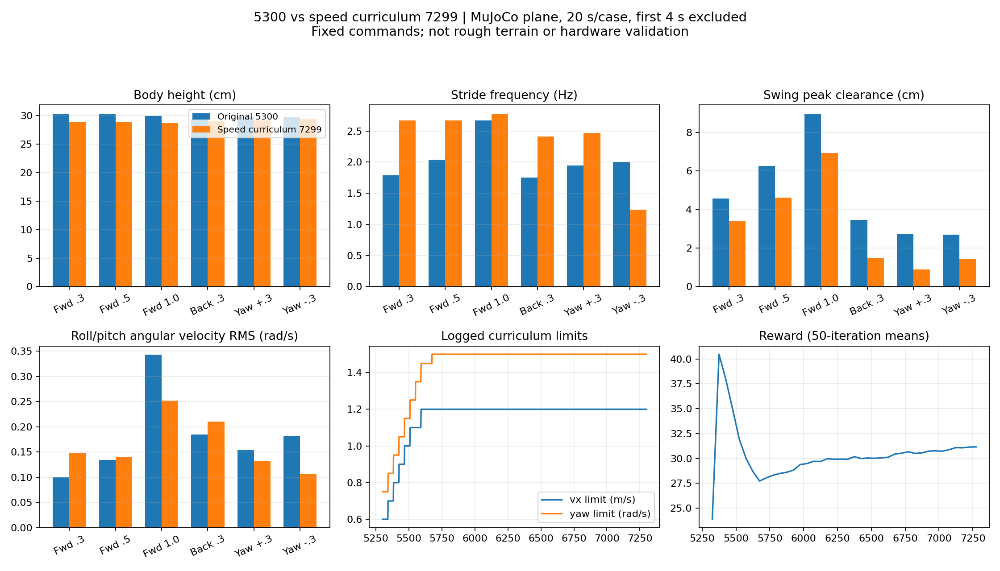

# 5300恢复速度课程7299复核（2026-11-05）

## 结论与状态

新run：`imgo2_rl/logs/rsl_rl/base_move_rough/2026-11-05_19-15-47_speed_curriculum_resume`，保存配置声明从`2026-11-05_15-19-20/model_5300.pt`恢复，额外2000轮，最终`model_7299.pt`。本次正式导出7299并实跑32个MuJoCo工况、4个Isaac工况，与原5300比较。

**速度课程确实生效，高速前进的跟踪和角运动改善；但低速步态更快、机身更低，后退/纯转向的净空与部分低速跟踪退化，不能当作全面超过5300。** 建议保留7299为高速候选，原5300保留为低速基准；不直接用7299替换当前实机策略或立即叠加地形课程。

- 已完成/已修复：补齐本次课程开启与扩速证据、checkpoint/JIT身份检查、两引擎短时平地对照与可追溯记录。无新增生产控制/奖励修复。
- 待修复/待确认：低速/静止/纯转向能力保留、跨引擎低速转向差异，以及动态过渡、Gazebo、rough/硬件验证；需要明确采样配方、对应短训/闭环验证。未修改奖励、模型、PD或部署生产policy，未启动训练。
- 先前另行请求的原run5400/5500邻域补测仍未完成，本报告不是这两份的比较。

## 课程与配置核对

保存的env.yaml与原5300 run相比，除log_dir外，仅课程及速度范围变化；奖励/观测/动作/模型/PD保存配置无差异。环境为plane，generator和terrain_levels均null，heading关闭、显式站立2%。服务器git目录无可用于核对奖励源码的快照，不能仅凭保存配置保证函数版本完全一致。

| 项目 | 初始范围 | 最终范围 |
|---|---|---|
| vx | ±.6 m/s | ±1.2 m/s |
| vy | ±.4 m/s | ±.8 m/s |
| yaw | ±.75 rad/s | ±1.5 rad/s |

两项range_multiplier=(.5,1)。event中线速度课程日志由.6升到1.2，在5592附近完整达到上限；角速度由.75升到1.5，在5675附近达到上限。部分中间迭代数值是runner一个rollout内的均值，不是源码扩速步幅变成小数。课程在恢复后约300–400轮就达到最终范围，此后主要在全范围适应，不是2000轮都在慢慢扩速。线速度课程日志仅返回vx上界，vy最终范围来自保存配置及课程同时扩x/y的源码逻辑，未单独记录vy实时上界。

## 更新后的event与checkpoint

| 迭代窗口 | mean reward | 日志xy误差 | 日志yaw误差 | noise std | value loss |
|---|---:|---:|---:|---:|---:|
| 5300–5499 | 34.320 | .20457 | .20624 | .18565 | .00634 |
| 5500–5999 | 28.999 | .33246 | .31039 | .28997 | .01509 |
| 6000–6499 | 29.882 | .31461 | .30400 | .28999 | .01273 |
| 6500–6999 | 30.438 | .30874 | .30107 | .28866 | .01176 |
| 7000–7299 | 31.008 | .29992 | .29584 | .28384 | .01102 |

范围扩大后reward下降、误差和value loss增加，随后在相同最终范围内回升/改善，没有数值崩溃依据。不能将低速原run的reward≈41与新全范围≈31直接作为质量排名。6000–6499到7000–7299 reward增加约3.77%、xy误差下降约4.67%，仍在适应；这不代表低速步态会自动恢复。

后期lin_z贡献−.05505、ang_xy−.19136、base_height−.03008、slide−.07290、air−.13849、FHB−.00786，均来自更宽命令分布，不能直接当作固定工况物理量。后期episode length=1000/time_out=1，且illegal_contact=null；这不是100%安全或无跌倒认证。

21份checkpoint模型张量均有限；最终std均值.283989、最大.360779，单凭此值不需要判停。7299正式JIT的8个Actor张量与checkpoint最大差0，seed42的1024条45维输入与ELU Actor最大差0。部署LibTorch实际加载成功。新run首次保存的model_5300与旧5300模型最大差.01312；该文件是恢复后进入训练循环再保存的快照，不能把它当原权重的逐位备份，也不凭这个差异认定加载错误。本次低速基准采用原run已验证的正式5300导出快照。

依据：[事件与窗口](../training/speed_curriculum_windows_2026-11-05.json)、[身份与有限性](../training/speed_curriculum_identity_2026-11-05.json)。

## MuJoCo：32个实际工况

两策略各16工况（静止、前进.3/.5/.8/1/1.2，后退.3/.5/.8，左右横移.3，左右转向.3/.8，前进.4+yaw.8），每个20秒、4000帧，剔除前4秒。复用生产PD/反馈适配器和确定仿真时钟；无GUI/FSM过渡。全部无测试失败，运行输入哈希前后不变；与上次5300测试共有8个输入哈希一致（7份模型/源代码/配置及5300策略）。

表格均为“原5300 → 新7299”；角运动为√mean(ωx²+ωy²)，rad/s，不是roll/pitch角度RMS；净空是离地段碰撞球底部峰值的均值。

| 指令 | 实际vx或yaw | 机身高cm | 同脚周期s | 摆动净空cm | 角运动RMS |
|---|---|---|---|---|---|
| 前进.3 | .307 → .329 | 30.25 → 28.96 | .560 → .375 | 4.56 → 3.41 | .100 → .148 |
| 前进.5 | .496 → .514 | 30.35 → 28.90 | .490 → .375 | 6.27 → 4.63 | .134 → .141 |
| 前进1.0 | 1.091 → 1.009 | 29.96 → 28.66 | .375 → .360 | 8.98 → 6.94 | .343 → .252 |
| 前进1.2 | 1.360 → 1.219 | 29.86 → 28.46 | .345 → .350 | 9.67 → 7.52 | .312 → .262 |
| 后退−.3 | −.248 → −.232 | 29.50 → 28.98 | .570 → .415 | 3.46 → 1.50 | .184 → .210 |
| 后退−.5 | −.432 → −.430 | 29.17 → 28.71 | .545 → .400 | 4.68 → 3.41 | .209 → .182 |
| 左转.3 | .276 → .325 | 29.69 → 29.15 | .515 → .405 | 2.74 → .90 | .153 → .132 |
| 右转−.3 | −.286 → −.177 | 29.74 → 29.37 | .500 → .815 | 2.71 → 1.41 | .181 → .107 |

- 高速前进明显改善：1m/s过冲和yaw漂移减小（−.081→−.007rad/s），角运动约减少26.5%；1.2m/s实际更接近指令。原5300的1.2为分布外探测，不能据此解释为原训练失败。
- 低速前进周期.56→.375s，步频1.79→2.67Hz，增加约49%；机身降低约1.3cm，后退净空明显下降。与用户希望慢步、较高机身、后退正常抬脚的目标有冲突。
- 低速左转伴随vx≈.064m/s的前漂，右转明显欠跟踪；角运动更小不等于步态更好，可能同时更少转动/抬脚。
- MuJoCo静止两者均约29.7cm、角运动约.005rad/s，未复现严重静站抖动。新策略全部动作饱和率0；原5300仅前进1.2出现约.385%的动作饱和，其余0。

完整指标：[MuJoCo JSON](speed_curriculum_mujoco_2026-11-05.json)。

## Isaac：新7299的4工况与已有5300固定条件基准

600步12秒、剔除前100步2秒；固定重置、名义25/.5执行器、关闭观测噪声/startup/interval随机化。与此前5300基准的dt、关节顺序、参考角、实际执行器增益、平地和固定重置契约相同。新7299四工况均resets=0、upright_fraction=1；5300使用此前已有原始JSON，不冒称此次重新运行了5300的Isaac。

| 工况 | 原5300实际vx/yaw | 新7299实际vx/yaw | 原角运动RMS | 新角运动RMS |
|---|---:|---:|---:|---:|
| 静止（yaw） | −.0018 | −.0054 | .0249 | .0969 |
| 前进.3（vx） | .1951 | .2965 | .2563 | .1916 |
| 后退−.3（vx） | −.2780 | −.2448 | .2594 | .1703 |
| 左转.3（yaw） | .2776 | .0742 | .2386 | .1207 |

前进跟踪改善，后退略弱；纯转向退化明显。Isaac与MuJoCo的低速左转结果差距大，不能用单引擎结果作为实机结论，也不能断言部署转换已坏。当前条件下静止角运动约增至3.9倍，但不应把.097rad/s直接称为“剧烈抖动”；MuJoCo未出现同样差异，接触/初始化影响仍待查。

依据：[Isaac摘要与契约](speed_curriculum_isaac_2026-11-05.json)。

## 建议如何继续

1. **保留原5300与新7299，不直接叠加rough。** 7299有高速价值，但尚未满足全方向低速质量目标。
2. 若想统一低高速，优先保护采样分布：保留固定比例静止、低速前后/横移与纯转向，同时训练高速度；当前只扩大三轴独立均匀范围，会让低速和纯方向指令占比下降。示例候选为10%静止、30–40%低速方向组、其余宽范围，需实现/验证，当前并不存在这样的分组开关。
3. 课程只按跟踪奖励是否超过80%来扩速，不检查机身高度、步频、净空或方向组验收。这次很快扩满，不保证每个方向的步态已经合格；仅把更多轮数加上去未必恢复慢步/抬脚。
4. 暂不同时加大高度/角运动/足高/滞空所有权重。保存奖励未变仍出现风格变化，说明速度分布是关键变量之一；不能据此将问题全归咎于FHB。要确认奖励因果仍需同分布单变量实验。
5. 同配方后期仍有改善趋势，不能说必须停止；但继续目标应包含固定低速/站立/左右转向验收，而非只看总reward增加。改善采样后先做短训及固定工况验证，再考虑地形。

## 产物与限制

原始运行目录：`imgo2_rl/logs/speed_curriculum_compare_2026-11-05/`，含正式导出日志、独立`speed7299.pt`、32份CSV/运行日志、Isaac原始JSON。本次7299检查结束时原run的`exported/policy.pt`对应7299；后续5800–6000补测已将该导出目录更新为6000，7299独立快照保留，见[后续记录](speed_curriculum_early_review_2026-11-05.md)。生产`imgo2_deploy/ros2_ws/policy/imgo2/ppo/policy.pt`未替换。

单seed、单初态短时平地诊断，未测试动态指令、Gazebo、FSM、rough或硬件；无新训练。曲线与表格已生成并视觉核对，本机解释器为`/home/tommy0929/miniconda3/envs/env_isaaclab/bin/python`，标准库解析使用系统`python3`。

## 同日解释：奖励不变，为什么低速步频变化很大

奖励系数不变不等于训练目标分布不变：优化的是各命令和访问状态下的期望累计奖励，扩速改变命令分布、接触/姿态/力矩状态及各项奖励的实际量级。三轴共享同一策略网络，更新高速行为时没有自动冻结原来的低速输出，也没有与原5300动作保持一致的约束。当前没有直接指定步态周期/落脚相位的目标。

在最终独立均匀采样、忽略站立覆盖与平移死区时，旧矩形vx±.5/vy±.4占新矩形vx±1.2/vy±.8的20.8%；再要求yaw在旧±.6而非新±1.5，旧三维范围仅占约8.3%。这是采样分布几何比例，不是实际采样计数或某一纯方向的比例。课程恢复后约300–400轮即扩满，后面大部分迭代处于更宽分布，高速改善与低速风格变化同时出现，符合共享策略发生权衡的解释；尚无控制变量实验能把全部因果只归于分布。

相同模型/控制测试下，MuJoCo前进.3的频率1.786→2.667Hz、周期.560→.375s，完整离地段均值.2042→.1288s；前进1.0仅2.667→2.778Hz。更明显的是低速行为变得接近快步模式，而不是控制频率由50Hz变了。低速平均每周期前移距离v/f约.172→.123m（不是单足摆幅/步长的直接测量）。

源码feet_air_time在首次落地计算(t_air−.5)，不是把周期拉到.5s。它确实反对当前更短滞空/更多落地，并非主动奖快；但只是总目标的一项，不保证压过高速跟踪/稳定性等收益。FHB是离地后按body相对高度及足速加权的误差代价，不定义落地间隔，不能锁住慢步。保存权重一样，各项原始值、出现次数和门控仍会变化。以上解释已核对当前源码和实测，服务器历史函数版本及具体权重/采样因果仍待确认；未改训练代码或新训。

## 同日建议：下一轮调整优先级（方案，未实施）

推荐从原run的model_5300.pt恢复一次平地混合指令训练，保留7299为高速对照；理由是5300低速步态较完整，7299已有低速净空/周期退化。暂保持奖励、模型、PD、动作缩放和控制dt，先处理分布。此为候选方案，不能保证一次训练得到所有地形最优策略。

建议采样比例：10%全零；40%固定低速纯方向组（前/后/左/右/左右转向等比例，平移幅值>.2以避免当前硬死区，前后.25–.5、横移.25–.4m/s、yaw.2–.5rad/s）；30%中速混合（vx±.7、vy±.5m/s、yaw±1rad/s）；20%高速前后（|vx|=.7–1m/s，|vy|≤.2、|yaw|≤.3）。低速组不随课程扩大。各组总计100%，实现时不能再额外叠加父类rel_standing_envs覆盖而导致实际比例漂移；需要统一管理静止/方向抽样。最终范围暂收敛到vx±1、vy±.5、yaw±1，而非立即同时扩到±1.2/±.8/±1.5。

现有UniformThresholdVelocityCommand只有三轴均匀采样+平移死区，没有以上比例参数，不能仅改ranges或range_multiplier实现该方案；需在mdp/commands.py及其cfg增加可配置分组采样，并在rough_env_cfg.py启用。原80%跟踪课程若保留，只能作用于扩速组，不可再次缩放/扩大低速保护组；不应不加修改地叠加原全局扩速逻辑。10秒重采样可暂保留，不额外同时引入指令斜坡/新奖励。

同一新run先计划额外1000–2000轮，保存中间结果，用固定指令而非总reward验收：前进.3/.5、后退−.3/−.5、左右横移.3、纯yaw±.3、静止及前进1m/s。低速周期/净空/机身高度参考原5300，且高速跟速不能明显退化；不能只以平均80%跟踪奖励作为所有方向均已合格的证据。通过后才加入rough；没有验证前不称为已修复。若用户只允许改现有配置，可先缩小速度范围并增加显式静止，但这不保证保护低速/纯转向分布，效果不等同于分组采样。

## 同日澄清：分组采样不是必需、从头训练与步频上限

修正前述方案容易引起的误解：开启速度课程不需要修改commands.py，只有要实现固定比例低速/纯方向保护组时才需要；分组采样是候选改进，不是已证实的唯一修法。原5300在低速的闭环表现好，并不意味着相同奖励能够在扩大指令分布后自动保护它原来的低速输出。此次同时扩大vx/vy/yaw，目标也包含更多高速横移/转弯的组合，不只是高速直行；共享网络更新改变低速行为是可能机制，未做因果消融，不保证是唯一原因。

从头训练可以到达不同解，但同样的宽分布和奖励下，也可能出现类似快步/低身。没有实验证据保证从头会更好或断言一定相同。2.67Hz不是代码或50Hz控制频率限定的步频上限；同脚周期取决于速度、步幅、接触稳定性和代价权衡，不应要求所有速度都用低速的.56s周期。

若暂不改采样代码，较小改动是保留5300起点与奖励，先只扩前后范围，横移和转向仍维持原±.4m/s/±.6rad/s，避免三轴同时放大；现有线速度课程同时扩x/y，不能误说它是仅扩vx。可用固定范围训练或另行调整课程实现独立扩轴，两者都不自动提供低速保护或保证恢复慢步。后续仍需固定低速/高速对照，不以重训次数/总reward决定质量。仅澄清，无生产修复、未改训练代码或启动训练；从头/续训对照及具体因果待验证。

## 同日算例：2.67Hz对应的air惩罚量级

频率本身不能决定该项。采用MuJoCo前进.3实测：新7299同脚频率2.6667Hz、过滤后完整离地段均值.12881s；阈值.5、weight1.6、控制dt=.02。假设四脚同频、每周期一次落地且姿态/指令门控为1，则每脚每次落地贡献≈1.6×.02×(.12881−.5)=−.011878；每秒四脚约10.667次落地，时间平均贡献≈−.12670/秒，平均每控制步−.002534，20秒累积约−2.534。RewardManager源码确认weight×dt、Episode_Reward累计后除max_episode_length_s，所以相应TensorBoard分项量级约−.127，而不是−2.534。

同条件原5300用频率1.7857Hz、滞空.20420s估算约−.06761/秒，新项惩罚约1.87倍。此为接触滤波统计代入的稳态估算，不是Isaac原始传感器首次接触事件逐步重算；各脚频率/时间分布、接触去抖、门控、过渡和训练指令分布会造成实际差异。前进1m/s的新7299虽频率接近（2.7778Hz），其滞空.15185s不同，也说明不能只用频率求唯一惩罚。核对源码/算式完成，无生产修复/新训练，精确逐事件复算仍待原Isaac传感器日志。

## 同日量级比较：7000–7299训练窗口

同一窗口的Episode_Reward实际贡献：平移跟踪+1.341752、转向跟踪+1.062774；角运动−.191362、髋偏离−.145550、air−.138494、slide−.072896、触地力−.056160、垂直速度−.055049、动作变化−.052582、air方差−.042963、高度−.030075、mirror−.027203、关节加速度−.014793、水平姿态−.011834、FHB−.007859、stand_still−.002671、power−.002380、torques−.000831、计划外接触−.000152。

正项合计+2.404527、负项−.852855、净+1.551672/秒（20秒约31.03，与mean_reward≈31相近；不同回合统计窗口不要求逐位一致）。air为第三大负贡献，约占全部负贡献绝对值16.24%、两项跟踪正贡献5.76%；并非无效小项，也没有占据主要总目标。它约是高度项4.6倍、FHB17.6倍，但这不能直接证明后两者权重不足：单位/误差函数/门控/发生率不同，当前贡献大小也不等于梯度大小或改变行为的能力。前述MuJoCo固定前进.3估算−.127不能替代当前混合训练均值−.13849。仅数值/口径核对，无生产修复/新训，权重因果仍待同分布实验。

## 同日收窄执行方案：先不改采样器的下一轮

用户再次询问后续调整，优先提供仅改已有配置的候选：从原15-19-20/model_5300.pt恢复新run，平地、heading=False，关闭两项全局速度课程，固定vx±1.0、vy±.4、yaw±.6，显式站立比例从.02提高到.10，其余保存奖励/PD/动作缩放保持原5300。这样主要扩大前后速度、避免大横移/大转向同时引入；不需修改commands.py。按非站立、死区前独立均匀采样几何估算，旧三维范围在新范围占50%，而原7299最终分布约8.3%；不等于固定保护50%低速样本或纯方向分组。增加站立占比是另一项有意采样调整，因此本方案也不是严格单变量因果实验。

先计划同一新run额外1000–2000轮，保存中间checkpoint并复测静止、前后.3/.5、横移.3、yaw±.3与前进1m/s。低速周期/净空/身高应参考原5300，不能只看总reward；仍无改善时再实现可配置方向/速度分组或做单项奖励实验。不直接从7299叠rough或同时加大air/base_height/FHB/ang_xy，也不保证重启5300一定更优。从原5300恢复是保留较好低速基础的工程选择，未经相同新配方下的起点A/B验证。该方案未实施、未修改生产代码、未启动训练；目标仍是验证低速保留与前后扩速，不声称覆盖旧±1.2/±.8/±1.5或复杂地形。

## 同日澄清：与原策略继续多训的区别及建议边界

原低速5300保持原配置再训，仍优化vx±.5/vy±.4/yaw±.6；7299保持当前配置再训，仍优化最终vx±1.2/vy±.8/yaw±1.5；前述收窄方案改为固定vx±1/vy±.4/yaw±.6和10%静止，本质是换命令分布后续训，没有引入周期约束或新的慢步机制。“关闭课程”仅关闭自动扩范围，不等于关闭速度学习。若本来就使用相同的新范围/采样配置，那么与多训几轮没有额外机制差异。

修正建议强度：收窄分布只是尚未验证的候选，不能称为确定修法，也不保证长期维持低速慢步。若用户要求保留当前最大三轴范围又不损失低速，就不能把缩范围当最终解决方案；需要验证固定低速/方向样本保留，或引入明确的速度相关步态目标/旧策略低速行为约束。仅保持权重、多训或从头训练都不自动保证这些目标。当前无需据此立即再提交一轮训练；尚缺相同条件下分布/目标改变的因果验证。无生产修复、未修改训练配置或启动训练。
