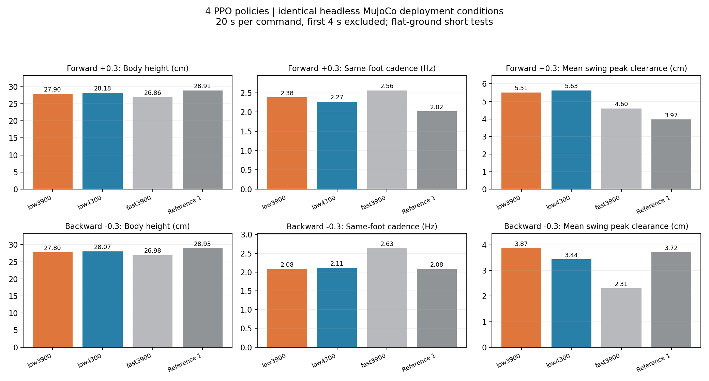

# 低速/高速关闭地形课程训练对比（2026-11-04）

## 结论

优先按低速行走目标保留低速model_3900，不直接选最新4300：同轮3900时，低速比高速前后更高机身/更慢步/更高净空，但未全方向更平稳；4300虽改善前进机身与跟速，却在右转-.3出现完全不动。该退步在MuJoCo与Gazebo均复现。高速组在1.0/1.2前进跟踪更好，且部分方向角运动更小，并非训练崩溃。不能按不同任务分布下的总reward直接排名。

## 1. 配置与样本身份

- 低速run：2026-11-03_20-44-05_terrain_curriculum_stop，日志截至4333，最新checkpoint4300。另导出3900作同轮比较。
- 高速run：2026-11-03_20-47-29_fast_no_curriculum，日志截至3971，最新checkpoint3900。
- 两者均resume=false，从零开始，4096环境/seed42/计划5000轮，不是之前9999起点的500轮续训。上传材料不是完整5000轮结果。
- 关闭的是terrain_levels和generator.curriculum；command_levels_lin_vel/ang_vel本就None。用户所称“关闭速度课程”应区分为这里的“关闭地形课程”。

| 项目 | 低速 | 高速 |
|---|---|---|
| vx范围m/s | ±.6 | ±1.2 |
| vy范围m/s | ±.4 | ±.8 |
| yaw范围rad/s | ±1 | ±1 |
| heading/rel_heading | true/1.0 | true/1.0 |
| 站立采样 | 2% | 2% |
| FHB weight/target | -4/-.24 | -5/-.20 |
| ang_vel_xy_l2 | -.05 | -.10 |
| lin_vel_z_l2 | -4 | -4 |
| base_height_l2 | -18/target .30 | -18/target .30 |
| feet_air_time | 1.8/threshold .5 | 1.8/threshold .5 |

两组差异不止速度范围，属于整体配方比较，不构成速度范围或某单项奖励因果证明。模型/PD/其余保存参数按配置记录；两个git目录为空，缺服务器源码快照，不能证明实际服务器FHB、脚滑等函数逐字等于本机。env的FHB params未显式记录sensor_cfg，不能据此断定旧实现，也不能保证使用当前swing版本，续训前需核对服务器源码。

正式ppo/play.py --export_only经本机env_isaaclab GPU运行，三份JIT Actor八个张量与原checkpoint完全一致，被部署LibTorch实际加载；84份训练checkpoint全部有限。低速4300 std均值.2888/最大.3899，高速3900 .4181/.5230，没有sigma爆炸迹象。独立快照在logs/speed_range_compare_2026-11-04，生产policy.pt未替换。同run的exported/policy.pt会被后一次导出覆盖：低速目录最终对应4300，3900评测快照为该日志目录low3900.pt。

## 2. 训练趋势

500轮窗口、低速3500–3999→4000–4333：reward20.684→21.014，xy误差.2808→.2768，yaw.3247→.3226，std.3004→.2938，value loss .0063→.0059，仍有小幅改善。高速3000–3499→3500–3971：reward8.525→8.958，xy误差.4288→.4232，yaw.4244→.4232，std.4207→.4161，value loss .0178→.0175。均无非有限标量。

两组回合长度几乎1000不代表步态已好：illegal_contact关闭，timeout及越界也标记为time_out，存活不是动作质量指标。日志error是按命令持续时间归一化累积、含重采样/回合统计的项目指标，不能直接等同下面固定指令MAE。不同速度分布和不同reward权重使两组reward、误差不能直接当公平排名。上述窗口最后一个不足500点，已明确端点。

## 3. 地形和速度采样的重要限制

两组地形均楼梯20%+倒楼梯20%+boxes20%+rough20%+正倒坡各10%，没有显式平地子地形。generator.curriculum=false、difficulty_range=(0,1)，本机Isaac terrain_generator._generate_random_terrains会对每块随机取全区间难度；max_init_terrain_level=5不代表最高仅半难度，行号与难度不再单调。这与“只在容易地形练基本行走”不同。服务器运行实现仍待源码快照确认。

UniformThresholdVelocityCommand将xy范数≤.2的指令清零；仅缩小范围不能密集训练0～.2平移。低速yaw范围仍±1，heading=true/rel_heading=1时由目标朝向误差生成yaw，并非整段保持独立均匀yaw指令。纯转向有样本，不等于没有训练；但不能据此保证左右恒定小角速度跟踪和过渡质量。

## 4. 固定条件MuJoCo实测

42组：3900同轮两策略×12 +低速4300×12 +两最新策略×3更高速测试。每组20s，跳过前4s，同场景、生产PD/反馈适配器、固定仿真时钟。全部4000帧、无failure；无failure不代表满足速度指令。前批policy_1/原9999/feetheight4控制指标复用，公共模型/源码/配置哈希一致，本轮没有重跑它们。该测试是平地，不证明台阶/坡面能力。

速度列vx/vy/yaw，单位m/s、m/s、rad/s；高度及净空cm；频率是同足着地事件Hz；角运动是roll/pitch角速度RMS(rad/s)，非硬件高频振动。

| 指令 | 策略 | vx/vy/yaw | 机身高cm | 频率Hz | 净空cm | 角运动RMS |
|---|---|---|---:|---:|---:|---:|
| stand | low3900.pt | -0.000/-0.000/-0.000 | 30.07 | — | — | 0.005 |
| stand | low4300.pt | 0.000/-0.000/0.000 | 30.18 | — | — | 0.005 |
| stand | fast3900.pt | -0.000/-0.000/0.000 | 29.36 | — | — | 0.004 |
| forward02 | low3900.pt | 0.260/0.001/-0.010 | 28.31 | 2.35 | 4.30 | 0.191 |
| forward02 | low4300.pt | 0.259/-0.001/0.014 | 28.69 | 2.27 | 4.79 | 0.218 |
| forward02 | fast3900.pt | 0.300/-0.004/-0.025 | 27.13 | 2.47 | 3.60 | 0.214 |
| forward03 | low3900.pt | 0.358/-0.005/-0.007 | 27.90 | 2.38 | 5.51 | 0.225 |
| forward03 | low4300.pt | 0.341/-0.008/0.006 | 28.18 | 2.27 | 5.63 | 0.271 |
| forward03 | fast3900.pt | 0.377/0.000/-0.020 | 26.86 | 2.56 | 4.60 | 0.222 |
| forward05 | low3900.pt | 0.536/-0.019/0.019 | 27.03 | 2.44 | 7.21 | 0.318 |
| forward05 | low4300.pt | 0.519/-0.016/0.003 | 27.16 | 2.44 | 6.65 | 0.376 |
| forward05 | fast3900.pt | 0.535/0.004/-0.015 | 26.45 | 2.70 | 5.79 | 0.295 |
| forward08 | low3900.pt | 0.809/-0.022/0.060 | 26.08 | 2.60 | 8.07 | 0.474 |
| forward08 | low4300.pt | 0.843/-0.009/0.049 | 26.14 | 2.70 | 7.82 | 0.486 |
| forward08 | fast3900.pt | 0.816/-0.002/-0.018 | 26.15 | 2.90 | 7.59 | 0.388 |
| backward03 | low3900.pt | -0.226/-0.014/-0.029 | 27.80 | 2.08 | 3.87 | 0.213 |
| backward03 | low4300.pt | -0.211/-0.009/0.002 | 28.07 | 2.11 | 3.44 | 0.195 |
| backward03 | fast3900.pt | -0.226/-0.021/-0.017 | 26.98 | 2.63 | 2.31 | 0.209 |
| backward05 | low3900.pt | -0.395/-0.003/-0.042 | 26.65 | 2.33 | 5.42 | 0.274 |
| backward05 | low4300.pt | -0.395/-0.006/-0.029 | 27.06 | 2.50 | 5.12 | 0.229 |
| backward05 | fast3900.pt | -0.397/-0.018/-0.020 | 26.67 | 2.78 | 4.41 | 0.227 |
| left03 | low3900.pt | 0.059/0.249/0.008 | 27.91 | 3.33 | 5.04 | 0.259 |
| left03 | low4300.pt | 0.048/0.253/0.010 | 28.16 | 3.13 | 5.25 | 0.269 |
| left03 | fast3900.pt | 0.060/0.244/-0.019 | 26.82 | 3.33 | 4.18 | 0.250 |
| right03 | low3900.pt | 0.048/-0.251/-0.013 | 27.78 | 3.39 | 4.40 | 0.341 |
| right03 | low4300.pt | 0.042/-0.237/-0.010 | 28.38 | 3.28 | 5.45 | 0.273 |
| right03 | fast3900.pt | 0.056/-0.258/-0.031 | 26.89 | 3.33 | 3.87 | 0.227 |
| turn_left03 | low3900.pt | 0.061/-0.001/0.264 | 29.43 | 1.77 | 1.06 | 0.155 |
| turn_left03 | low4300.pt | 0.060/0.015/0.267 | 29.39 | 2.22 | 0.56 | 0.179 |
| turn_left03 | fast3900.pt | 0.098/-0.007/0.202 | 28.10 | 1.90 | 1.22 | 0.211 |
| turn_right03 | low3900.pt | 0.054/-0.001/-0.299 | 28.92 | 2.74 | 0.65 | 0.147 |
| turn_right03 | low4300.pt | -0.000/-0.000/-0.000 | 29.60 | — | — | 0.008 |
| turn_right03 | fast3900.pt | 0.084/-0.008/-0.213 | 28.42 | 1.42 | 0.70 | 0.165 |
| arc | low3900.pt | 0.543/0.011/0.802 | 27.44 | 2.94 | 8.14 | 0.370 |
| arc | low4300.pt | 0.486/0.025/0.829 | 27.95 | 2.90 | 8.05 | 0.454 |
| arc | fast3900.pt | 0.476/0.018/0.765 | 26.31 | 3.12 | 5.89 | 0.472 |

### 主要取舍

- 同3900、前进+.3：低速高27.90cm/2.38Hz/净空5.51cm；高速26.86/2.56/4.60。实际vx .358/.377，都过冲。后退-.3：低速高27.80/2.08/3.87，高速26.98/2.63/2.31，实际-.226/-.226，后退幅值均不足。低速摆动时间.123s对高速.100s；不能只看airtime reward判断步频。
- 低速4300前进+.3高28.18/2.27/5.63，接近但仍未达到policy_1机身28.91/步频2.02；净空反而高于policy_1的3.97，不是所有场景都“抬脚不足”。+.5低速角运动.376高于高速.295，不能笼统称低速更稳；低速3900→4300前进角运动也变大。
- 横移两者仍约3.1～3.4Hz，并有约.04～.06m/s前向漂移。右横移低速4300 gyro .273，对高速.227，仍有改善空间。
- 右转-.3低速3900实际-.299，高速-.213；低速4300几乎0。左转+.3低速3900/4300约.264/.267，高速.202；都有前向漂移，约.06/.06/.10m/s。
- 各3900前后对角接触相关多数>.8，没有复现旧1999那种明显非对角退化；相关和支撑比例不等于唯一“正确步态”分数。

### 高速补测（两最新checkpoint，低速组超出训练范围）

| 指令vx | 低速4300实际vx/MAE | 高速3900实际vx/MAE |
|---|---|---|
| +1.0 | 1.066/.0665 | 1.017/.0383 |
| +1.2 | 1.263/.0665 | 1.216/.0380 |
| -.8 | -.691/.1090 | -.684/.1159 |

高速组高速前进误差更小；+1.2机身角运动.456对低速.633，高速更平稳。后退-.8两者跟速仍弱，高速机身更高/角运动更小。低速超出±.6训练范围的成功短测不代表真实高速鲁棒性，不能据此扩大其硬件使用范围。更高速测试轮次不相等，不能解释为纯范围因果。

## 5. Gazebo针对右转退步的复核

两份低速checkpoint的独立右转-.3，正式ROS2/Gazebo headless路径，消息仿真时间统计：

- low3900.pt：实际yaw=-0.272786rad/s、vx=0.053066m/s、机身28.92cm。
- low4300.pt：实际yaw=-0.000153rad/s、vx=0.000028m/s、机身29.00cm。

两组完成，配置finally恢复，测试进程结束。两引擎一致支持“4300小右转冻结是本次策略的行为退步”，不是仅MuJoCo特例；不能由此排除其它部署/训练条件影响，也未证明发生退步的单一reward根因。只测这一Gazebo场景，前后/高速等数值均来自MuJoCo，不能冒充Gazebo全量结果。

## 6. 修改建议（未实施）

1. 保留低速3900作为下一基准，不直接部署最新4300；同时保留4300，说明它前进有进步、右转退步，而非整份策略完全无效。选checkpoint必须固定评测静止、前后/横移/左右转、起停，不能按总reward或日期。
2. 已上传日志未到既定5000，两组仍改善，无需现在从零再训。可完成原定预算但按100～200轮保存并验收，若右转冻结/跟速/净空退步则保留早期版本，不承诺多训必然修复4300。无需再直接把几项奖励全部加重。
3. 低速目标优先沿用低速范围±.6/±.4及该组奖励作基准。不要仅因理论就恢复target-.20或weight-5：本批低速-.24的实际净空反而更高，说明整体策略与其它设置影响显著。当前证据不足以说FHB只需更大权重就解决问题；不再同时加大airtime、lin_vel_z、base_height和ang_vel_xy。
4. 下一项独立候选从低速3900出发，保持reward/地形/范围不变，仅heading_command=False，直接采样yaw指令，先追加300～500轮，重点验收左右恒定小转向及平移漂移。它会改变训练指令过程，属于待验证候选，不保证修好右转冻结；不同时更改站立比例、足高或其它reward。如果之后要更明确的纯转向/静止覆盖，再单独设计分组采样。当前静站实测稳定，没有优先增大站立惩罚的证据。
5. 若优先任务是基本行走，另一个独立试验才考虑缩小地形difficulty_range或增大容易地形占比；关闭课程本身没有做到这一点。不要同时与第4项或reward变更混在一起。高速组保留独立，先完成预算；若想兼顾低速应显式保留低速采样，不能只扩大均匀范围。

## 7. 完成与待确认

已完成：保存参数核对、84checkpoint有限性、三份正式导出Actor全等、42组MuJoCo与24+12组接触分析、2组Gazebo右转复核、控制哈希一致与图表QA。新增工具仅eval_mujoco_policies.py三个高速可选case和eval_gazebo_ppo_policies.py右转可选case；默认案例不变，实际新增案例已运行。

未修改训练源码/奖励配置、模型、PD或生产策略；Gazebo仅临时选择日志内策略，配置已恢复，没有启动训练或硬件。待确认：服务器奖励函数版本/依赖、Isaac原训练配置行为、起停和急减速、地形/台阶、更多初态与seed、硬件；完整5000轮结果尚未上传。右转冻结已双引擎复现，但其根因及修法仍待验证，不能把建议标成已修。

数据与复现入口：[MuJoCo总指标](speed_range_compare_2026-11-04.json)、[Gazebo](speed_range_compare_gazebo_2026-11-04.json)、[Actor身份](speed_range_compare_identity_2026-11-04.json)、[训练窗口](../training/speed_range_compare_windows_2026-11-04.json)、[保存配置](../training/speed_range_compare_config_2026-11-04.json)、[checkpoint及配置差异](../training/speed_range_compare_checkpoint_audit_2026-11-04.json)。原始CSV/日志/三份策略快照统一在imgo2_rl/logs/speed_range_compare_2026-11-04；已有eval/analyze_mujoco_policies.py、analyze_contact_coordination.py、read_tfevents.py可离线重算。torch/导出解释器env_isaaclab，离线分析/usr/bin/python3；仿真调用项目部署LibTorch，无需安装Python MuJoCo。

## 从低速策略扩大速度并重开地形课程（2026-11-04，建议未实施）

可以从低速run的model_3900.pt续训，不要求从零；不选已经双引擎右转冻结的4300。此方案为用户优先训练通用高速/rough的路线选择，与上节独立heading试验为替代方案，不应同时改heading/奖励。保持低速组的模型、PD、FHB -4/-.24、base -18/.30、lin_z -4、ang_xy -.05、air1.8/.5等配置；resume只加载checkpoint状态，不自动恢复旧env.yaml，不能直接套高速组奖励。

若服务器在rough子类加了terrain_levels=None与generator.curriculum=False，删除/注释这两项覆盖，让父类恢复默认terrain_levels课程，同时移除命令行对应null/false覆盖。生成器curriculum=True，建议max_init_terrain_level=1以较低行号启动；这是新run重新初始化课程，不恢复无课程run的原地形分配。生成器改变难度/地形布置不等于仅加一个奖励。

建议先范围vx±.8、vy±.4、yaw±1（低速yaw原已±1）并重开地形课程，追加500轮，按100～200轮验收前后/横移/双向yaw/净空/角运动，再决定扩大至vx±1.2、vy±.8。也可直接扩大到最终范围同时重开课程，但分布跳变较大，不保证保留低速；更大均匀范围还会稀释低速和纯转向采样。既有3900作固定对照，不按总reward挑checkpoint。

命令从imgo2_rl目录使用--resume --load_run=2026-11-03_20-44-05_terrain_curriculum_stop --checkpoint=model_3900.pt --run_name=low3900_speed_terrain_resume --num_envs=4096 --max_iterations=500 --seed=42 --device=cuda:0 --headless，入口scripts/run_isaaclab.sh scripts/rl_lab/ppo/train.py、task Imgo2-basemove-rough-ppo。当前代码确认max_iterations交给runner.learn作为本次追加预算。只核对本机checkpoint存在与继承/入口，服务器文件与新课程配置的冒烟、效果仍待运行，未修改配置或启动训练。

## 用户服务器候选附件检查（2026-11-04）

附件指纹b8720dc76539012f8d7144c2cf7df46262b1f2d98cf0c0ea2b8e1e9a6f2b2602。ast.parse与compile通过（未执行import）。20项显式非零reward weight与低速原run保存env逐项一致；FHB -4/target-.24、air1.8/.5、base -18/.30、lin_z -4、ang_xy -.05保持。feet_height为-0等于0，经disable_zero_weight_rewards关闭。

附件注释terrain_levels=None/generator.curriculum=False，设置max_init_terrain_level=1；按本仓父类默认可恢复地形课程，速度课程两项仍None。速度vx±1.0/vy±.6/yaw±1，比上节建议首段±.8/±.4更大，但不构成语法错误或不支持配置，可作为更积极的扩速选择。父类heading仍保持，不需同时改变。建议从低速3900续训，不从4300，原命令末尾不能残留terrain_levels=null/generator.curriculum=false覆盖。

已完成静态附件检查与原run权重比对，详见[JSON](../training/ppo_speed_terrain_resume_attachment_2026-11-04.json)。未替换本机源码、未构造Isaac环境或运行训练；服务器父类及reward函数版本、实际生效env.yaml、短运行仍待确认。不能把静态通过称为训练效果验证。
