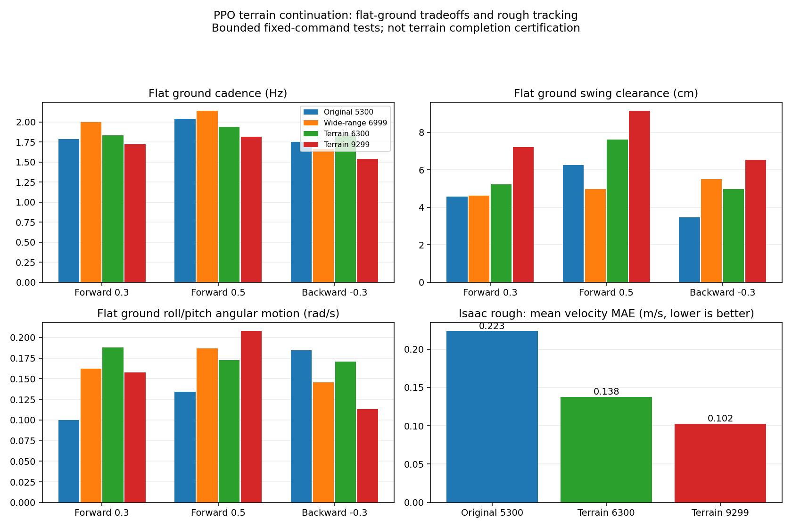

# 5300地形续训6300/9299实测对比（2026-11-06）

## 结论与状态

最新run为`2026-11-06_15-10-00`，agent声明从11/05低速run的model_5300.pt恢复并追加4000轮，保存5300至9299共41份checkpoint。9299的rough跟速明显优于原5300和中期6300，平地后退/转向更慢步、更高抬脚；但平地前进身高低于原5300、角运动偏大，障碍前进仍慢，不能称全面优于原策略或可靠爬楼验收通过。建议保留9299作地形候选、5300作平地对照，6300作阶段对照，不按较小std或最新编号判全胜。

已完成/已修复：补齐保存配方/事件/41模型数值/正式导出身份及新32MuJoCo+44Isaac工况比较、图表与部署身份核对；无生产代码修复。待修复/待确认：障碍前进停滞、前进角运动/机身高度、纯方向覆盖、独立平地保留、多seed/动态切换/Gazebo/硬件及真实地形通过率。本轮未修改奖励/训练配置/模型/PD或部署策略，未训练；测试进程均已结束。

## 保存配置与曲线

与原5300保存env相比，主要改变为平地改generator并启用terrain_levels，max_init等级5→0；joint_mirror -1→-.4，feet_air_time_variance -8→-4。其余奖励、观测、动作、模型/PD声明与原run保存env相同（log_dir除外）。air仍1.6，并没有采用附件中的2.0。奖励函数源码未随服务器完整保存，保存配置相同不代表逐字同源码因果实验。

固定低速x±.5/y±.4/yaw±.6、heading=False、两速度课程关闭。仍UniformThreshold而非Grouped，显式静止2%；20%楼梯、20%反向楼梯、20%boxes、20%random_rough、两个坡各10%，没有独立平地类别。noise仍.01–.06。

| 窗口 | reward | xy误差 | yaw误差 | std | 地形均级 | value loss |
|---|---:|---:|---:|---:|---:|---:|
| 5300-5499 | 31.8743 | 0.2402 | 0.2292 | 0.2037 | 0.5220 | 0.0104 |
| 6000-6499 | 38.1170 | 0.2242 | 0.2326 | 0.1918 | 0.6758 | 0.0040 |
| 7000-7499 | 38.9165 | 0.2160 | 0.2246 | 0.1834 | 0.7008 | 0.0033 |
| 8800-9299 | 39.3868 | 0.2121 | 0.2233 | 0.1806 | 0.7205 | 0.0031 |

41份模型张量有限，最终std均值.178545/最大.224854，无数值崩溃证据；未穷举优化器张量。均级约.72并非所有环境仅处0/1级，也不代表学会最高难度；标量不能替代每类型通过率。非法接触终止关闭，后期满回合不能证明不跌倒。

[事件和配置差异](../training/terrain5300_audit_2026-11-06.json)、[导出/部署身份](../training/terrain5300_identity_2026-11-06.json)。

## 导出与测试契约

6300、9299均经正式ppo/play.py --export_only导出，Actor8张量全等；1024条seed42确定性45维输入对checkpoint max diff=0，Actor45/Critic235。LibTorch被MuJoCo基准实际加载。独立快照在imgo2_rl/logs/terrain5300_compare_2026-11-06/terrain6300.pt和terrain9299.pt；该run/exported/policy.pt当前为9299，未拷贝进部署生产目录。

当前部署policy.pt SHA256=8744dbb6cbfd8cdca16c4d96ebec4c5fb442aa6cf43890ad4783d466078fbd36，Actor指纹匹配原11/05 model_5100.pt，不等于新9299或此前6999。身份以本次磁盘读取为准，不沿用历史“当前策略”描述。

MuJoCo：两新策略各16工况、每工况20秒4000帧，剔除前4秒；同模型/25/.5/默认角/动作映射/生产反馈适配器/控制时钟，32次无基准failure。共同7模型/控制源/配置哈希与policy_1/6999旧基准一致；原5300与6999/policy_1沿用有身份的旧平地测量，未冒称本轮重跑。新基准记录文件前后哈希未变。无GUI/FSM切换复现声明。

Isaac新44工况：6300和9299各4平地+12rough，原5300新跑12rough。每次600步12秒，前100步2秒剔除，固定默认重置/seed42，观测噪声/startup/interval随机化关闭、实际执行器25/.5。rough六类、各前后±.3，difficulty=.5，patch12×12，行1列6按类型确定分配，课程只用于按列生成，评测不升级。不是服务器训练全量复现，未记录地形完成目标或完整世界位移，不能声称完成多少阶。高度相对patch原点，不是局部机身离地高度，不用rough原始z值判断蹲低。

## 平地结果（MuJoCo）

角运动为√mean(ωx²+ωy²)，单位rad/s，非角度RMS；净空为完整摆动段碰撞球底峰值均值。

| 策略 | 工况 | 实际vx/yaw | 高度cm | 频率Hz | 净空cm | 角运动rad/s |
|---|---|---:|---:|---:|---:|---:|
| new5300.pt | forward03 | 0.307 | 30.25 | 1.786 | 4.56 | 0.100 |
| new5300.pt | forward05 | 0.496 | 30.35 | 2.041 | 6.27 | 0.134 |
| new5300.pt | backward03 | -0.248 | 29.50 | 1.754 | 3.46 | 0.184 |
| new5300.pt | turn_left03 | 0.276 | 29.69 | 1.942 | 2.74 | 0.153 |
| new5300.pt | turn_right03 | -0.286 | 29.74 | 2.000 | 2.71 | 0.181 |
| policy_1.pt | forward03 | 0.288 | 28.91 | 2.020 | 3.97 | 0.151 |
| policy_1.pt | forward05 | 0.465 | 28.71 | 2.326 | 4.23 | 0.170 |
| policy_1.pt | backward03 | -0.243 | 28.93 | 2.083 | 3.72 | 0.213 |
| policy_1.pt | turn_left03 | 0.142 | 30.11 | 1.575 | 0.98 | 0.145 |
| policy_1.pt | turn_right03 | -0.131 | 30.06 | 1.600 | 0.46 | 0.110 |
| scratch6999.pt | forward03 | 0.299 | 29.06 | 2.000 | 4.63 | 0.162 |
| scratch6999.pt | forward05 | 0.495 | 29.07 | 2.139 | 4.97 | 0.187 |
| scratch6999.pt | backward03 | -0.238 | 29.06 | 1.667 | 5.51 | 0.145 |
| scratch6999.pt | turn_left03 | 0.247 | 29.14 | 1.493 | 3.85 | 0.120 |
| scratch6999.pt | turn_right03 | -0.300 | 29.04 | 1.639 | 4.18 | 0.129 |
| terrain6300.pt | forward03 | 0.308 | 29.42 | 1.835 | 5.23 | 0.188 |
| terrain6300.pt | forward05 | 0.474 | 29.53 | 1.942 | 7.61 | 0.173 |
| terrain6300.pt | backward03 | -0.290 | 28.68 | 1.835 | 4.99 | 0.171 |
| terrain6300.pt | turn_left03 | 0.291 | 29.27 | 1.852 | 3.41 | 0.147 |
| terrain6300.pt | turn_right03 | -0.250 | 29.52 | 1.600 | 2.71 | 0.130 |
| terrain9299.pt | forward03 | 0.330 | 29.39 | 1.724 | 7.23 | 0.158 |
| terrain9299.pt | forward05 | 0.504 | 29.40 | 1.818 | 9.14 | 0.208 |
| terrain9299.pt | backward03 | -0.259 | 28.99 | 1.538 | 6.53 | 0.113 |
| terrain9299.pt | turn_left03 | 0.303 | 29.43 | 1.667 | 4.86 | 0.101 |
| terrain9299.pt | turn_right03 | -0.268 | 29.46 | 1.515 | 5.15 | 0.090 |

9299前进.5比原5300周期约.490→.550s、净空6.27→9.14cm，但角运动.134→.208、身高30.35→29.40cm。前进.3高度std2.36左右→3.6mm，频率1.786→1.724，并非普遍频率变快。后退.3角运动.184→.113、净空3.46→6.53cm；转向角运动也改善。6300前进.5角运动.173低于9299 .208，后退实际-.290更接近-.3，而9299更慢步/更高净空，是取舍。

外推高速不是本次训练目标：9299 forward1.2实际约1.410m/s、角运动.548，动作元素裁剪率5.75%；forward.8/1.0也有裁剪。低速主要工况没有同级动作饱和，四髋动作裁剪率各0。不能把高速外推结果当新策略已具备高速能力。

[新MuJoCo32工况](terrain5300_mujoco_2026-11-06.json)、[含旧基准合并](terrain5300_combined_2026-11-06.json)。

## Isaac平地与地形

平地前进.3实际vx：6300 .228/9299 .236；后退-.3实际-.372/-.365，存在后退过冲；左转.3实际.259/.224。前进角运动.156→.220，而后退.207→.162，趋势不是所有工况一致。静止都近不动，未复现严重稳态站立抖动，但不代表切换瞬态正常。

| rough策略 | 12工况平均vx MAE | 前进MAE | 后退MAE | 平均角运动 |
|---|---:|---:|---:|---:|
| original5300 | 0.2235 | 0.2678 | 0.1791 | 0.4269 |
| terrain6300 | 0.1377 | 0.1570 | 0.1185 | 0.2975 |
| terrain9299 | 0.1024 | 0.1405 | 0.0643 | 0.3319 |

9299平均跟速误差比原5300降低约54%，比6300降低约26%；主要收益不是所有地形前进都已顺畅。原5300的boxes前进upright仅.552、一个坡后退.688，两新策略所有工况upright_fraction=1；全部reset0但illegal_contact关闭，不能用reset0掩盖原5300姿态退化。

| 地形 | 原5300实际vx | 6300实际vx | 9299实际vx |
|---|---:|---:|---:|
| pyramid_stairs_forward03 | 0.006 | 0.137 | 0.136 |
| pyramid_stairs_backward03 | -0.233 | -0.097 | -0.302 |
| pyramid_stairs_inv_forward03 | 0.068 | 0.093 | 0.122 |
| pyramid_stairs_inv_backward03 | -0.060 | -0.115 | -0.212 |
| boxes_forward03 | 0.061 | 0.082 | 0.069 |
| boxes_backward03 | -0.042 | -0.234 | -0.288 |
| random_rough_forward03 | 0.001 | 0.208 | 0.240 |
| random_rough_backward03 | -0.169 | -0.314 | -0.315 |
| hf_pyramid_slope_forward03 | -0.000 | 0.169 | 0.219 |
| hf_pyramid_slope_backward03 | -0.190 | -0.318 | -0.363 |
| hf_pyramid_slope_inv_forward03 | 0.096 | 0.176 | 0.197 |
| hf_pyramid_slope_inv_backward03 | -0.146 | -0.288 | -0.287 |

例如9299楼梯前进.136、反向楼梯前进.122、boxes前进.069，仍明显低于.3。反向楼梯前进角运动从6300 .346升至9299 .617，说明更好的总体跟踪不等于身体更稳。rough新三策略均实跑同条件；尚无6999及policy_1本轮rough结果，不编造其地形排名。

[Isaac统计与限制](terrain5300_isaac_2026-11-06.json)。

## 下一步建议（未实施）

1. 地形方向优先保留9299作候选；6300保留做前进稳定/跟踪对照；原5300继续作为较稳平地基线。不自动替换生产策略。
2. 现有抬脚已足够，先不要增加airtime或FHB强度；平地前进.5净空已达约9cm，身体前进稳定性比再抬高更需要关注。
3. 当前欠缺独立平地保留和纯方向分组，建议下一配方优先补覆盖，保留低速范围、两速度课程关闭，暂不同时加大多项身体惩罚。已有数据不能把收益或身体代价单独归因FHB、mirror、variance某项。
4. 先固定难度/方向验收障碍前进，通过距离/碰撞/停滞与姿态一起评估；平均课程等级或满回合不是通过率。出现地形边缘高度项突变时核对局部射线参考，不在patch原点z上直接下结论。
5. 最新后500轮曲线收益递减，未见数值崩溃；仅在同配方长续训不能保证解决前进停滞/平地代价。后续要以具体指标选点，而非只看std或轮次。

## 图表

图已生成并视觉检查。CPU审计/导出一致性和绘图使用env_isaaclab Python；标准库事件解析/指标使用系统python3，Isaac使用env_isaaclab。原始新回放保存在imgo2_rl/logs/terrain5300_compare_2026-11-06/；机器可读统计保存于docs。未跑Gazebo或硬件，未宣称楼梯通过。
