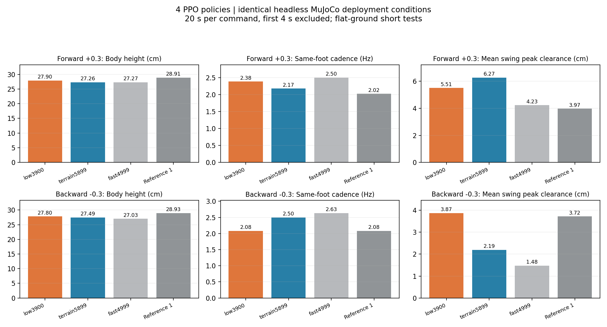

# 高速4999与低速续训地形5899对比（2026-11-04）

## 结论与选择

按用户优先慢步、抬脚、同时发展复杂地形的目标，两份新结果优先保留terrain5899作为下一候选：前进/横移步频较低、净空较高，右转跟踪更准，受控Isaac楼梯前进测试也较好。不是全面胜出：高速4999前进角运动通常更小、高速跟速更准；5899的后退跟速/净空和机身高度较原low3900退步，纯转向伴随明显向前漂移。不要丢掉原3900或policy_1。最终部署policy未替换。

已完成30组MuJoCo、两策略各12个Isaac粗糙地形探针和2组Gazebo右转复核。测试均为短时单初态/seed，不代表全地形或硬件验收。

## 1. 身份与配置

| 项目 | 高速 | 低速起点+地形课程续训 |
|---|---|---|
| run | 2026-11-03_20-47-29_fast_no_curriculum | 2026-11-04_00-37-16_low3900_speed_terrain_resume |
| 末checkpoint | model_4999.pt | model_5899.pt |
| 训练来源 | 从零5000轮 | 低速3900起点追加2000轮 |
| vx/vy/yaw范围 | ±1.2/±.8/±1 | ±1.0/±.6/±1 |
| 地形课程 | 关闭 | 开启，初始max level1 |
| FHB weight/target | -5/-.20 | -4/-.20 |
| ang_vel_xy weight | -.10 | -.05 |
| base_height/lin_z/airtime | -18/.30；-4；1.8/.5 | 相同 |

用户称3800起点，实际保存agent为load_checkpoint=model_3900.pt；以运行材料为准。续训相对原低速还把FHB target -.24→-.20，与用户先前附件-.24不同。这是扩速+地形生成/课程+足高目标的联合修改，且两新run训练总量不同，不能把所有改善或退步归为单项因果。两组heading=True/rel_heading1、站立2%，速度课程仍关闭，actor不含高度扫描。

高速51份、续训21份，共72个checkpoint全有限；末std均值/最大高速.4077/.5194、续训.3828/.5043，没有数值爆炸。正式ppo/play.py --export_only在本机env_isaaclab GPU导出，各run/exported有JIT/ONNX/兼容checkpoint，Actor八参数与原checkpoint全等；实际部署LibTorch已加载。独立快照fast4999.pt/terrain5899.pt在logs/terrain_resume_compare_2026-11-04。原服务器git目录缺源码快照，仍不能证明其reward函数与本机逐字一致。

## 2. 训练趋势

高速4000–4499→4500–4999：reward9.447→9.541、xy误差.4221→.4218、yaw误差.4172→.4199、std.4093→.4101、value loss .01709→.01740，后段改善很小/接近当前分布平台，未见崩溃。不能据此保证多训就会改善后退。

续训4500–4999→5500–5899：reward12.968→13.414、xy误差.3802→.3731、yaw误差.3917→.3883、std.3887→.3864、value loss .01394→.01337，仍有缓慢改善。terrain level约5.865→5.823，不是持续上升；初期课程变难与统计初始化使reward先降不能独自判为训练坏了。最后窗口不足500点，端点已注明。均无非有限标量。

不能横比两run总reward或日志误差定胜负：采样范围、地形分布、奖励系数和训练来源不同。episode length接近1000也非动作质量证明，illegal_contact关闭，存活并不代表会按指令前进/后退。

## 3. 同条件平地MuJoCo

两策略各15个指令、每组20s/4000帧，统计跳过前4s；全部无failure。同模型、PD/反馈、固定仿真时间；模型/配置/源码哈希与此前控制批次公共项一致，生产文件在本批前后未变。原low3900、fast3900、policy_1引用已有结果而非本轮重跑，来源明确标在JSON。

速度列vx/vy/yaw，单位m/s、m/s、rad/s；净空为完整摆动期间碰撞球底部相对平地的峰值平均。步频是同足着地事件Hz，非控制频率；角运动是roll/pitch角速度RMS(rad/s)，不是硬件高频振动。

| 指令 | 策略 | vx/vy/yaw | 机身cm | 步频Hz | 净空cm | 角运动RMS |
|---|---|---|---:|---:|---:|---:|
| stand | fast4999.pt | 0.000/-0.000/0.000 | 29.56 | — | — | 0.005 |
| stand | terrain5899.pt | 0.000/-0.000/0.000 | 29.22 | — | — | 0.005 |
| forward02 | fast4999.pt | 0.285/-0.015/-0.003 | 27.65 | 2.38 | 2.95 | 0.206 |
| forward02 | terrain5899.pt | 0.261/0.000/0.015 | 27.58 | 2.08 | 4.76 | 0.201 |
| forward03 | fast4999.pt | 0.363/-0.022/-0.002 | 27.27 | 2.50 | 4.23 | 0.206 |
| forward03 | terrain5899.pt | 0.342/0.001/0.022 | 27.26 | 2.17 | 6.27 | 0.235 |
| forward05 | fast4999.pt | 0.536/-0.032/0.002 | 26.64 | 2.63 | 5.71 | 0.232 |
| forward05 | terrain5899.pt | 0.538/-0.011/0.029 | 26.70 | 2.35 | 8.36 | 0.273 |
| forward08 | fast4999.pt | 0.819/-0.032/-0.016 | 25.94 | 2.86 | 7.10 | 0.319 |
| forward08 | terrain5899.pt | 0.846/-0.016/0.039 | 26.17 | 2.63 | 9.14 | 0.336 |
| forward10 | fast4999.pt | 1.017/-0.024/-0.026 | 25.70 | 2.94 | 7.91 | 0.378 |
| forward10 | terrain5899.pt | 1.035/-0.011/0.038 | 26.07 | 2.70 | 9.86 | 0.366 |
| forward12 | fast4999.pt | 1.216/-0.013/-0.031 | 25.51 | 3.08 | 8.54 | 0.426 |
| forward12 | terrain5899.pt | 1.230/-0.023/0.047 | 26.00 | 2.82 | 10.54 | 0.387 |
| backward03 | fast4999.pt | -0.213/-0.009/0.004 | 27.03 | 2.63 | 1.48 | 0.192 |
| backward03 | terrain5899.pt | -0.196/-0.005/-0.020 | 27.49 | 2.50 | 2.19 | 0.204 |
| backward05 | fast4999.pt | -0.379/0.006/-0.031 | 26.69 | 2.60 | 3.38 | 0.222 |
| backward05 | terrain5899.pt | -0.359/0.003/-0.038 | 26.66 | 2.50 | 4.70 | 0.273 |
| backward08 | fast4999.pt | -0.699/0.007/-0.037 | 26.16 | 3.03 | 5.72 | 0.280 |
| backward08 | terrain5899.pt | -0.656/-0.008/-0.026 | 25.79 | 2.63 | 6.99 | 0.267 |
| left03 | fast4999.pt | 0.073/0.228/-0.009 | 27.15 | 3.57 | 3.02 | 0.257 |
| left03 | terrain5899.pt | 0.070/0.228/0.006 | 27.26 | 2.94 | 5.11 | 0.303 |
| right03 | fast4999.pt | 0.036/-0.285/-0.013 | 26.88 | 3.70 | 3.54 | 0.281 |
| right03 | terrain5899.pt | 0.052/-0.250/0.008 | 27.18 | 3.12 | 6.48 | 0.310 |
| turn_left03 | fast4999.pt | 0.106/-0.004/0.240 | 28.39 | 1.70 | 1.47 | 0.157 |
| turn_left03 | terrain5899.pt | 0.087/-0.012/0.278 | 28.62 | 2.38 | 0.73 | 0.188 |
| turn_right03 | fast4999.pt | 0.098/-0.001/-0.178 | 28.85 | 1.39 | 0.95 | 0.152 |
| turn_right03 | terrain5899.pt | 0.120/-0.002/-0.288 | 28.18 | 2.15 | 1.08 | 0.138 |
| arc | fast4999.pt | 0.466/-0.012/0.776 | 27.02 | 3.12 | 5.67 | 0.290 |
| arc | terrain5899.pt | 0.513/0.006/0.784 | 27.00 | 2.94 | 8.39 | 0.385 |

### 与两份新策略、原低速的取舍

- 前进+.3：5899步频2.17/净空6.27cm，高速2.50/4.23cm，原低速3900为2.38/5.51cm。5899实际vx .342比高速.363更接近.3，但机身高27.26cm与高速27.27相近，低于原低速27.90cm和policy_1 28.91cm。
- +.5：5899净空8.36cm、角运动.273，高速5.71cm/.232；已有较高前进抬脚，不支持不加区分地继续提高足高/airtime来解决所有方向问题。更高摆动可能与角运动竞争，但联合改动不证明唯一因果。
- 后退-.3：5899实际-.196、净空2.19cm、频率2.50；高速-.213/1.48/2.63。两份新策略都弱于原低速3900的-.226/3.87/2.08，后退是共同短板。
- 横移±.3：5899约2.94～3.12Hz，高速3.57～3.70；5899净空较高，但角运动也更大，且两者都有前向漂移。
- 右转-.3：5899实际-.288，低速4300曾经冻结的现象本次未出现；但5899前向漂移.120m/s，而原低速3900为.054，高速4999约.098。左转+.3实际5899 .278、高速.240，亦有前向漂移。能转不等于纯原地转质量已好。
- +1.2：高速实际1.216、5899 1.230；高速跟踪略准、5899频率较低。5899的±1.2测试超出其±1训练范围，仅作短时探针，不代表高速鲁棒性。

## 4. Isaac六类粗糙地形受控回放

为直接检查地形行为，扩展已有eval_exported_locomotion.py的可选--terrain rough：每策略12环境，六类地形各前后±.3，seed42，单一难度.5，固定6列各一类、1行、12×12m地块，12s/600控制步，前2s不统计。generator.curriculum=True仅用于确定性按列排布，环境难度课程全部禁用，没有评测过程升降级。初始位置/姿态/速度固定为零相对平台，噪声/startup/interval随机化关闭，reset关节规则沿当前配置；不是原服务器训练复现。

当前源码stairs step_height_range .025～.08，难度.5约5.25cm一阶。地形前后方向、平台及布局按当前生成器；不将标签简单等同为某方向必然上楼。表中是机身系实际vx / 对指令的MAE，单位m/s。

| 地形/方向 | 高速4999 vx / MAE | 续训5899 vx / MAE |
|---|---:|---:|
| pyramid_stairs_forward03 | 0.208 / 0.109 | 0.335 / 0.062 |
| pyramid_stairs_backward03 | -0.053 / 0.247 | -0.083 / 0.217 |
| pyramid_stairs_inv_forward03 | 0.436 / 0.167 | 0.391 / 0.113 |
| pyramid_stairs_inv_backward03 | -0.031 / 0.269 | -0.111 / 0.189 |
| boxes_forward03 | 0.086 / 0.215 | 0.147 / 0.156 |
| boxes_backward03 | -0.010 / 0.290 | -0.009 / 0.291 |
| random_rough_forward03 | 0.331 / 0.063 | 0.270 / 0.093 |
| random_rough_backward03 | 0.011 / 0.311 | 0.001 / 0.301 |
| hf_pyramid_slope_forward03 | 0.334 / 0.059 | 0.286 / 0.067 |
| hf_pyramid_slope_backward03 | -0.125 / 0.190 | -0.148 / 0.162 |
| hf_pyramid_slope_inv_forward03 | 0.427 / 0.127 | 0.408 / 0.110 |
| hf_pyramid_slope_inv_backward03 | -0.308 / 0.062 | -0.157 / 0.148 |

所有探针upright_fraction=1（重力投影upright>.7），resets=0，但不代表成功跨越地形。平均vx MAE高速.1758、5899 .1590，前进.1234→.1001、后退.2283→.2179。5899在两类楼梯前进、boxes前进上改善；随机粗糙前进、部分坡面有退步。两份boxes后退及random_rough后退都接近0，明显未满足-.3，不能称为复杂地形通用策略。

本工具未记录完整世界xy轨迹/完成距离，固定探针也只有一种初态/难度/seed。因此只能说受控地形上的运动和跟速，不声称爬完多少阶/通过整块地形。foot_origin_z/base z为相对地块原点高度，不是局部离地净空，不用它比较楼梯足高。

## 5. Gazebo右转复核

正式ROS2/Gazebo无界面路径，独立启动右转-.3；仿真时间统计，实际结果：

- fast4999.pt：yaw -0.1675rad/s，vx 0.0804m/s，机身28.85cm。
- terrain5899.pt：yaw -0.2876rad/s，vx 0.1188m/s，机身28.29cm。

与MuJoCo一致支持5899恢复右转响应，同时确认向前漂移仍大。两组完成，临时model_name恢复，所有测试进程结束；没有替换生产policy。只复核该Gazebo指令，其余数值不冒充Gazebo全量测试。

## 6. 如何继续（建议，未实施）

1. 两份最新里按用户慢步/抬脚/地形目标优先保留5899；高速4999保留作高速、平稳性对照，原low3900/policy_1也保留。5899不是“全方面最好”，尤其后退与机身高度不如低速起点。
2. 不建议高速配方原样无限追加：最后500轮指标近平台。5899仍缓慢改善，可在保留各版本前提下小批追加并评估，但不能保证继续训练自然修好后退。
3. 下一优先是后退和纯转向覆盖/跟踪，不再同时提高足高目标、足高weight、airtime与机身惩罚。前进+.5已有8cm净空且角运动更大，盲目加抬脚会偏离当前短板。
4. 若开展新试验，保留5899奖励和地形，仅独立测试heading_command=False的直接yaw命令分布；后续再研究显式纯前后/纯转向采样，避免混合指令掩盖零平移转向。它是待验证候选，不是对漂移/后退的已证实修法。不要同时恢复target-.24，否则无法解释结果。
5. rough评测显示后退/boxes仍弱；应先固定小台阶和容易障碍做标准验收，再决定改地形占比/难度。开启课程本身不是地形通过保证。本轮未改用户训练配置、未开新训练。

## 7. 已完成、待确认与产物

已完成：72checkpoint有限性、保存参数/起点核对、两份正式Actor全等导出、30组MuJoCo/接触分析、24个Isaac粗糙地形探针、2组Gazebo右转、图表QA和配置恢复。新增的工具rough选项实际两次运行通过；语法检查通过，默认plane逻辑保留，本轮未重复旧flat/HIM测试。

待确认：服务器原reward函数版本/模型源码一致性、更多seed/初态、地形完成距离/摔倒率、不同难度/楼梯高度、起停/急减速、硬件。日志只是本机复制的服务器产物，当前源码受控回放不等于完整原训练复现。新候选建议未验证，后退/机身/漂移仍在问题表，不能标为已修。

[MuJoCo指标](terrain_resume_mujoco_2026-11-04.json)、[接触](terrain_resume_contacts_2026-11-04.json)、[Isaac粗糙地形](terrain_resume_isaac_rough_2026-11-04.json)、[Gazebo](terrain_resume_gazebo_2026-11-04.json)、[Actor身份](terrain_resume_identity_2026-11-04.json)、[训练窗口](../training/terrain_resume_windows_2026-11-04.json)、[配置/72checkpoint](../training/terrain_resume_config_audit_2026-11-04.json)。原始CSV、两份JIT快照、导出日志、Isaac原始JSON和Gazebo原始数据集中在imgo2_rl/logs/terrain_resume_compare_2026-11-04。正式导出/Isaac使用env_isaaclab解释器，离线分析用/usr/bin/python3；未改生产模型、PD、奖励或策略。

## 8. 与policy_1的补充对比（2026-11-04）

结论按用途区分：日常平地、较高机身、较慢步频与动作平顺，当前仍优先policy_1；复杂地形进一步开发优先terrain5899，不能把policy_1的平地优势推导为其rough也最好。两份新策略中5899更接近用户慢步/抬脚目标，但不是全面超过policy_1。生产policy仍未替换。

### 平地同条件已有数据

引用同模型/PD/时序的已有MuJoCo控制（公共哈希一致，policy_1 SHA53a57f909b61d2a708d24d6c08a90e086409b6d4fce4fdd3e6f3e1849abce7cf未变）：

| 指标 | policy_1 | fast4999 | terrain5899 |
|---|---:|---:|---:|
| +.3实际vx | .288 | .363 | .342 |
| +.3机身cm | 28.91 | 27.27 | 27.26 |
| +.3步频Hz | 2.02 | 2.50 | 2.17 |
| +.3净空cm | 3.97 | 4.23 | 6.27 |
| +.3角运动RMS | .151 | .206 | .235 |
| -.3实际vx | -.243 | -.213 | -.196 |
| -.3净空cm | 3.72 | 1.48 | 2.19 |
| 左横移+.3实际vy | .263 | .228 | .229 |
| 左横移步频Hz | 2.17 | 3.57 | 2.94 |
| 左转+.3实际yaw | .142 | .240 | .278 |
| 左转前向漂移vx | .022 | .106 | .087 |

policy_1的平地机身/慢步、前后跟踪及后退净空更好；新策略yaw跟踪更好但漂移明显，抬脚更高不自动等于整体步态更优。后退角运动policy_1 .213略高于新两策略.192/.204，不夸大为所有方向最稳。policy_1静站同样稳定。

### 本轮新增三组MuJoCo高速探针

policy_1指令+1.0/+1.2/-.8实际vx .951/1.154/-.693，机身28.36/28.18/28.68cm、频率2.67/2.78/2.41Hz，无failure。高速4999对应1.017/1.216/-.699，前进高速跟踪更准；5899对应1.035/1.230/-.656。policy_1高速也能运动，不能仅因名字就说高速组任何指标都更好；只是本批高速前进跟踪更接近指令。数据见[补测](terrain_resume_policy1_high_2026-11-04.json)。

### 本轮新增policy_1的12个Isaac rough探针

与之前两策略完全相同的当前源码、seed42、六类地形/难度.5、零初始base姿态和速度、12s/前2s跳过。机器人默认角、刚度、阻尼、body/joint顺序、dt、地形参数均核对一致。不是policy_1原训练环境复现。表为实际vx/MAE：

| 地形/方向 | policy_1 | fast4999 | terrain5899 |
|---|---:|---:|---:|
| pyramid_stairs_forward03 | 0.445/0.213 | 0.208/0.109 | 0.335/0.062 |
| pyramid_stairs_backward03 | 0.000/0.300 | -0.053/0.247 | -0.083/0.217 |
| pyramid_stairs_inv_forward03 | 0.078/0.255 | 0.436/0.167 | 0.391/0.113 |
| pyramid_stairs_inv_backward03 | -0.072/0.228 | -0.031/0.269 | -0.111/0.189 |
| boxes_forward03 | 0.135/0.199 | 0.086/0.215 | 0.147/0.156 |
| boxes_backward03 | -0.146/0.161 | -0.010/0.290 | -0.009/0.291 |
| random_rough_forward03 | 0.212/0.134 | 0.331/0.063 | 0.270/0.093 |
| random_rough_backward03 | -0.145/0.155 | 0.011/0.311 | 0.001/0.301 |
| hf_pyramid_slope_forward03 | 0.282/0.261 | 0.334/0.059 | 0.286/0.067 |
| hf_pyramid_slope_backward03 | -0.400/0.131 | -0.125/0.190 | -0.148/0.162 |
| hf_pyramid_slope_inv_forward03 | 0.132/0.178 | 0.427/0.127 | 0.408/0.110 |
| hf_pyramid_slope_inv_backward03 | -0.118/0.182 | -0.308/0.062 | -0.157/0.148 |

12探针平均vx MAE：policy_1 .1997、fast4999 .1758、terrain5899 .1590；前进.2066/.1234/.1001，后退.1929/.2283/.2179。故5899受控rough整体/前进更好，但后退均值policy_1反而最好；policy_1在boxes/random_rough后退实际约-.146/-.145，新两者接近0。

policy_1部分探针upright_fraction（重力upright>.7）低于1：stairs前进.958、inv stairs后退.756、坡面前进.750；新两策略本批各探针均1。它仅表示超过姿态阈值的采样比例，不能当跨地形摔倒成功率；仍缺世界xy完成轨迹、多初态/seed。不能把单次MAE平均当绝对排行榜。

### 当前选择

若现在只能选一份满足用户当前日常平地步态目标，仍选policy_1；若继续训练rough策略，选5899作候选并优先修后退和原地转向漂移。两种用途的结论不矛盾，也不意味着5899已经学会稳定通过所有台阶。

本轮已完成：新增3段MuJoCo、12个Isaac rough（均正常结束），公共物理/身份核对；没有重跑已有平地批次或Gazebo，已有Gazebo数值保留前次来源。无生产/训练配置修改。待确认：terrain通过距离、更多初态/种子/高度、转向与起停、原训练环境和硬件；不将比较建议标成修复。
