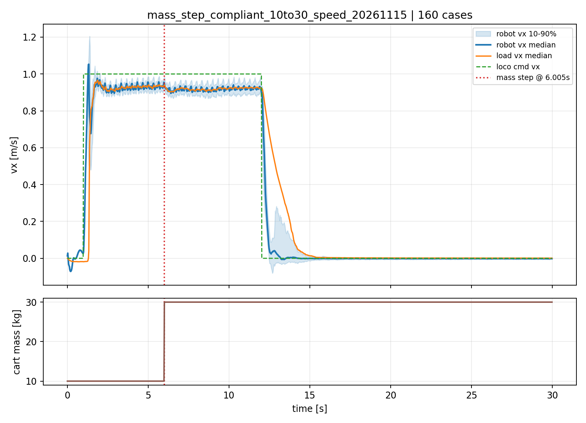
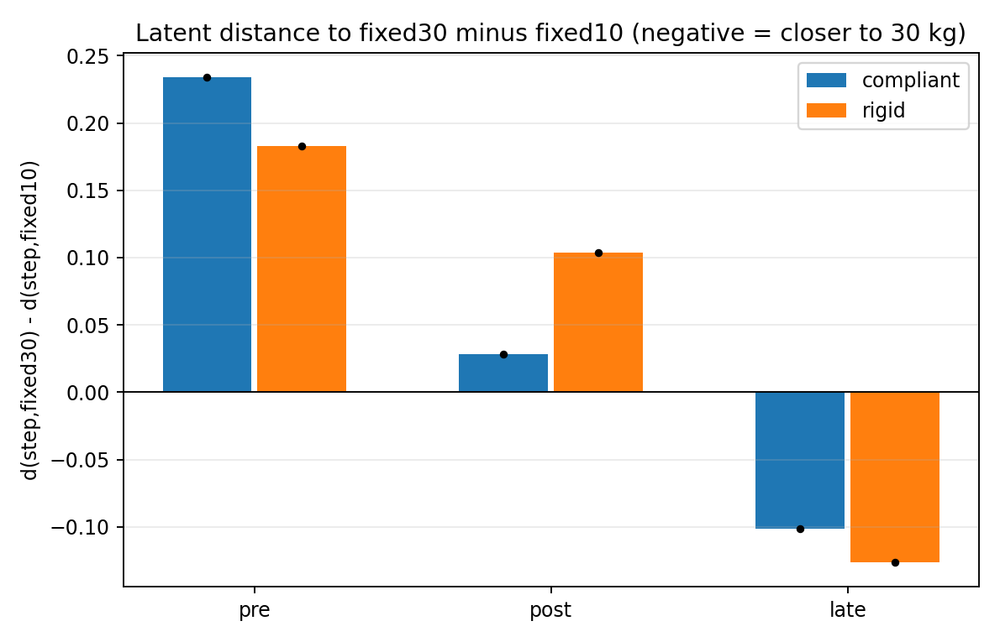

# 质量突变测试：compliant / rigid 全部结果（2026-11-15）

> 6 个 run 全部完成：compliant × {fixed10, fixed30, 10→30}，rigid × 同三组。
> 条件：平地 0°、1.0 m/s、160 env、compliant 列 0–7 / rigid 列 8–15；
> 在 **tow 开始后 5 s（绝对 6.0 s）** 把 10 kg 瞬时改为 30 kg，更新 mass/inertia/CoM，
> 不 reset。当前 v6 model2000/老 PPO。

## 1. 行为结果

6 个 run 全部：

- `state=completed`；
- **0 FALL**；
- 速度、横向、启停冲击、不翻车检查全部通过；
- 任务通过 0/160，唯一失败是 **JNT**；
- 10→30 step 的 task 标签仍按初始 10 kg 记 light，不能把 160/160 速度直接当成
  “30 kg 后通过”。

汇总见 [runs.csv](data/towing_mass_step_2026-11-15/runs.csv)。

## 2. 速度曲线（compliant 10→30）

| 窗口 | robot vx 中位 | load vx 中位 | 质量 |
|---|---:|---:|---:|
| 5.5–5.9 s（突变前） | 0.933 | 0.936 | 10 kg |
| 6.1–7.0 s（突变后） | **0.913** | **0.912** | 30 kg |
| 8–10 s | 0.914 | 0.917 | 30 kg |

结论：平地 1.0 m/s 下 **10→30 kg 没有造成速度塌陷**；robot 只降约 0.02 m/s，
load 降约 0.024 m/s。速度曲线逐点数据见
[speed_curve_compliant_10to30.csv](data/towing_mass_step_2026-11-15/speed_curve_compliant_10to30.csv)。

> **限制：rigid 没有 `--write-csv all` 的速度轨迹**；当前只有 compliant 有速度曲线。

## 3. Latent 适应

固定窗口：pre 5.0–5.9 s，post 6.1–7.0 s，late 8–10 s。

| 连接 | 窗口 | step→fixed10 | step→fixed30 | 最近 fixed30 |
|---|---|---:|---:|---:|
| compliant | pre | 0.000 | 0.234 | 12/160 |
| compliant | post | 0.086 | 0.114 | 53/160 |
| compliant | late | 0.163 | **0.062** | **144/160（90%）** |
| rigid | pre | 0.020 | 0.203 | 40/160 |
| rigid | post | 0.079 | 0.183 | 44/160 |
| rigid | late | 0.181 | **0.054** | **158/160（98.8%）** |

- 突变前 step 基本在 fixed10 流形；
- 突变后先靠近 fixed10，约 0.6–1 s 开始向 fixed30 移动；
- 8–10 s 后基本到 fixed30：compliant 90%、rigid 98.8%；
- rigid 的适应比 compliant 更干净；
- 但 fixed10/30 的 latent 质心距离只有约 0.19–0.23，质量信号相对工况漂移很小。

数据：

- [latent_means.csv](data/towing_mass_step_2026-11-15/latent_means.csv)：6 run × 3 窗口 × 16 维
- [latent_adaptation.csv](data/towing_mass_step_2026-11-15/latent_adaptation.csv)：距离与最近固定30比例

## 4. 结论

1. **平地 1.0 m/s、compliant/rigid、10→30 kg 瞬时加载**都被 v6 稳定处理：无 FALL、速度无明显塌陷；
2. latent 会响应质量变化，但适应约 0.6–1 s，8–10 s 基本收敛；
3. rigid 的 latent 适应略强于 compliant（98.8% vs 90% 最近 fixed30）；
4. 该结果**不能推广到 15°、0.5 m/s、更高速度或更大质量**；
5. step case 的 light/heavy 判定口径需按时间重定义；当前报告按初始 10 kg 分类。

## 5. 归档

目录：[data/towing_mass_step_2026-11-15](data/towing_mass_step_2026-11-15)

- runs.csv
- latent_means.csv
- latent_adaptation.csv / .png
- speed_curve_compliant_10to30.csv / mass_step_speed_compliant_10to30.png
- metadata.json
