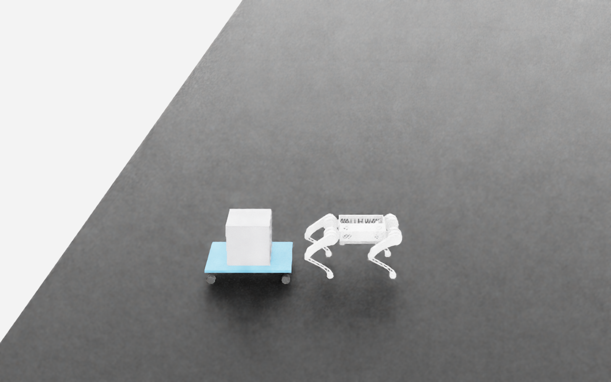
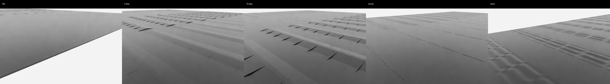

# 拖曳场景最终截图（2026-11-22）

## 图 1：机器人 + 被拉小车

- 平地 0°、10 kg、compliant 列；
- 机器人右、小车左，侧视；
- 来自 v4 Isaac Sim Camera RGB 渲染。

## 图 2：训练地形

五格依次：

1. `flat`：0°
2. `5 deg`：5° 平滑坡
3. `10 deg`：10° 平滑坡
4. `bump`：减速带
5. `wave`：波浪

单张高分辨率：

- [side.png](data/scene_capture_2026-11-22_final/side.png)
- [terrain_flat.png](data/scene_capture_2026-11-22_final/terrain_flat.png)
- [terrain_5deg.png](data/scene_capture_2026-11-22_final/terrain_5deg.png)
- [terrain_10deg.png](data/scene_capture_2026-11-22_final/terrain_10deg.png)
- [terrain_bump.png](data/scene_capture_2026-11-22_final/terrain_bump.png)
- [terrain_wave.png](data/scene_capture_2026-11-22_final/terrain_wave.png)
- [terrain.png](data/scene_capture_2026-11-22_final/terrain.png)：远景
- [terrain_close.png](data/scene_capture_2026-11-22_final/terrain_close.png)：减速带/波浪近景

## 生成方式

`play_towing_test.py --capture-dir ... --enable-cameras`：

- 侧视：机器人+小车实际中点 + `(0, -4.5, 1.8)`；
- 地形：5 类各拍一张近景（`(-16, -20, 11)`），再用 PIL 拼成一行五格；
- 保存后 `os._exit(0)`，不再卡在 Kit finalize。

## 限制

- 地形材质/光照对比度低，`flat` 和 `bump` 不如坡/波浪明显；
- 侧视中绳线未明显渲染；如果必须看到绳，需要额外调试绳的可视化；
- 这是 Camera sensor 渲染，不是 GUI viewport 截图。
