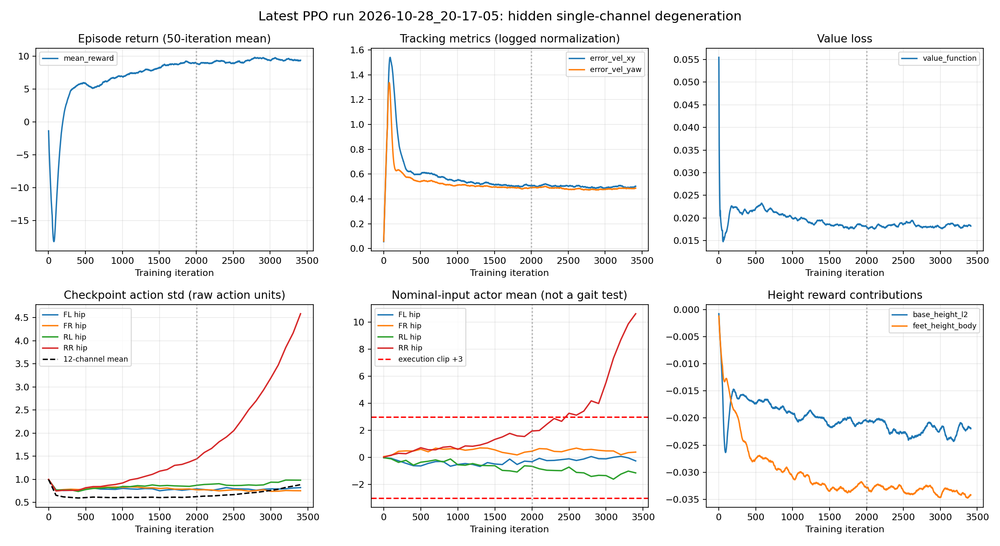

# 最新PPO训练后期姿态退化复核（20:17 run）

核对日期：2026-10-28。用户确认“崩溃”指步态/站姿变坏、训练仍能运行，不是程序异常退出。本次只读分析用户附件、保存配置、事件和checkpoint，没有调整奖励、导出/替换策略、启动训练或硬件。

## 1. 本次结果与此前试验必须分开

- 最新目录：`imgo2_rl/logs/2026-10-28_20-17-05/`。
- 本机复制到的事件截止3413轮，checkpoint到`model_3400.pt`，不能把它当成服务器已经结束5000轮。
- `params/agent.yaml`为`resume=false`，起始`model_0.pt`也呈随机初始Actor；这次是从零训练，不是4999/5499续训。
- 用户附件21项weight赋值与该run保存配置逐项一致（0对应最终null），未发现“贴错配置”证据。
- 最新run的`feet_height=null`，不能把17:45/5998试验的世界系足高-3.5解释套到这次。
- 本机生产rough仍保留另一个配方；本次按run保存配置分析，未覆盖本机配置或部署文件。

实际配方：base_height=-12、target=.30；feet_air_time=+1.8、threshold=.5；stand_still=-.2；feet_height_body=-4.5、target=-.20；joint_pos_penalty、joint_deviation_l1、joint_pos_limits与feet_height均null；joint_mirror=-1仍选四髋/大腿/小腿；flat_orientation=-5、action_rate=-.01、acc=-5e-9、torque=-2.5e-6。Actor45、无线速度/地形高度输入，Critic235；控制dt=.02、动作wrapper裁剪±3、髋scale=.125。

## 2. 最强证据：单通道分布退化被平均值掩盖

| checkpoint | 12通道平均std | RR髋std | RR髋名义站姿输入mu |
|---|---:|---:|---:|
| 1000 | .608 | .922 | .600 |
| 1500 | .606 | 1.177 | 1.333 |
| 2000 | .625 | 1.443 | 1.954 |
| 2500 | .669 | 2.055 | 3.269 |
| 3000 | .761 | 3.195 | 5.554 |
| 3400 | .885 | 4.583 | 10.631 |

**mu是原始动作均值，不是关节角**。固定名义输入：角速度0、投影重力(0,0,-1)、指令0、关节位移/速度/上一动作0。原始动作经±3裁剪后，髋目标相对q0最多±.375rad；mu从3增到10不会使执行目标继续增加。

在这组名义输入的高斯假设下，3400的RR髋样本落在裁剪区外的概率约95.35%；确定性mu本身也会被裁成+3。这是**固定输入计算，不是实际闭环95.35%饱和率**，更不证明所有运动状态都相同。其余多数通道std在.4～1.0，平均.885看起来温和，但RR已经4.58。观察到的增长从约1500开始，2500名义mu超过clip。

本次四个run共103份原始checkpoint所有模型张量均有限、scalar窗口无NaN/Inf；不是读到的权重发生数值NaN爆炸。最新Actor在内存严格加载到现装`rsl_rl.models.MLPModel`，256×45 seed42输入与逐层Linear/ELU重算max diff=0。此验证不导出JIT、不改checkpoint。已有历史exported JIT与假定4999原始文件不匹配，排除作本次数值基准，未据此评价最新策略。

## 3. 日志为什么看起来还不错

250轮窗口平均：

| 指标 | 1000–1249 | 3250–3413 |
|---|---:|---:|
| Train/mean_reward | 7.370 | 9.361 |
| mean_noise_std | .610 | .864 |
| Value loss | .0196 | .0182 |
| xy error（项目日志归一化口径） | .535 | .495 |
| 地形level | 6.017 | 5.990 |
| Episode length | 1000 | 999.998 |
| feet_air_time | -.1996 | -.1873 |
| feet_height_body | -.0307 | -.0342 |
| base_height_l2 | -.0197 | -.0219 |
| action_rate_l2 | -.1318 | -.1257 |

总奖励与跟速仍有改善，不等于姿态合格。倒地接触终止关闭，满1000步也不证明没跌倒。日志缺少实际关节均值、逐通道std/mu、原始动作裁剪率、周期和净空；本次checkpoint快照补出了单通道问题。当前动作变化分项约-.126，不应套用旧轨迹“所有动态代价都近零”的结论，再盲目把所有动态惩罚放大50倍。



## 4. 奖励与算法如何共同留下退化空间

### 4.1 去掉全关节项后，没有单独髋姿态偏好

`joint_pos_penalty=0`不是必然错误，去掉它能释放大腿/小腿步幅。但当前独立髋偏差和软限位也都关闭；仅靠跟速、足高、功率和镜像，不保证四髋回到正常范围。

`stand_still=-.2`仅小指令(norm<.05)时惩罚全部关节偏离，运动时关闭；站立样本比例约2%，不能把它当成全速度域髋约束。不要简单继续加大站立项来修运动髋偏置。

### 4.2 对角同号镜像不是髋姿态/站宽约束

`joint_mirror=-1`比较FR与RL、FL与RR的同号角度。本模型髋轴均为+X，这允许前外后内的某些角度组合镜像代价为0，也允许正常零髋。它不等于奖励无限髋角，不能单凭此项证明退化全部由它造成；但它不能充当防退化约束。

### 4.3 足高、机身高度仍有潜在竞争

机身相对足高-4.5依然包含正常支撑足，世界相对地面不动的脚在机身系有非零相对速度；机身降低可减小部分高度误差。base_height=-12只是平方软代价，偏离6cm时约-.0432（U=1、回合/秒口径），不是强制维持.30m。射线全批异常时高度项回退为近0的问题仍存在，但本次日志没有射线有效率，不能证明发生过。

这解释了可能的低机身偏好，**不能证明它单独造成RR的mu/std发散**。该项建议后续单独消融，而非把它归为已经确认的唯一根因。

### 4.4 动作裁剪与熵让原始分布不受执行目标直接约束

wrapper先裁剪原始动作，奖励看执行后的状态；raw mu很大时，很多不同mu仍给相近的裁剪后目标。现有位置/扭矩/动作差分项无法保证raw mu回到±3内。entropy_coef=.01鼓励原始高斯分布探索，是std可能继续增大的因素；从日志不能证明它是唯一原因。

不能以缩小std代替修复mu，不能认为把clip由3改小就治好；也不要把写在env中、读取已裁剪action的惩罚称为“原始mu越界惩罚”。如果加了髋实际角正则仍退化，要进一步在算法侧检查raw mean/分布约束与执行clip的一致性。

## 5. 建议：先救髋，再处理高度与步态

这是候选方案，**尚未实现或训练验证**。不建议从3400继续无变化长训；保留它作为反例。可先回放最新run的1000、1500两个早期checkpoint选择尚正常的起点，不能仅因早期std较小就称其步态最好。若都不好，考虑之前已实际回放过的4999；5499虽步频较慢但机身低，不能直接称最优起点。相同Actor45/Critic235接口下恢复，原始/兼容格式应与服务器RSL版本匹配。

### 第一组：髋姿态配方（200轮筛选，每50轮保存）

1. 保持`joint_pos_penalty=0`，不恢复全12关节-.5。
2. `joint_deviation_l1=-.2`，仅选四髋`.*_hip_joint`；这是软偏好，不锁死髋，横移受限可再试-.1。
3. `joint_mirror`去掉hip，只保留thigh/shank对角配对；其他权重先保持本次run值。

配置写法（仅说明，生产代码未修改）：

```python
self.rewards.joint_deviation_l1.weight = -0.2
self.rewards.joint_deviation_l1.params["asset_cfg"].joint_names = [".*_hip_joint"]
self.rewards.joint_mirror.params["mirror_joints"] = [
    ["FR_(thigh|shank).*", "RL_(thigh|shank).*"],
    ["FL_(thigh|shank).*", "RR_(thigh|shank).*"],
]
```

这两处是同一组髋结构性变更；若有效不能区分各自贡献，需要进一步单独消融才可归因。先验证髋均值/目标角/站宽、逐通道std与clip，不能只用总回报。

### 第二组：足高冲突（从同一合格起点独立对照）

试`feet_height_body=0`对照-4.5，保持`feet_height=0`、base_height=-12、airtime=1.8。这消除一个潜在蹲低收益，但失去足高塑形，不能保证净空改善。不要在rough上恢复world target=.10的feet_height；摆动净空实现应使用当地地面并处理起落脚阶段，尚未编写。

### 算法侧备用实验

若髋配方后std仍持续膨胀，可独立对照entropy_coef .01→.003；小样本微调可用固定learning_rate=3e-4，200轮。当前实际自适应LR常在2.6e-4～5.9e-4，并非全程1e-3，因此不能将发散简单归为学习率太高；只改初始learning_rate而保留adaptive也不保证其不上升。上述算法设置与奖励不要全部同时改变。

### 暂不继续加大的项

feet_air_time保持1.8，threshold仍.5；当前它已接近Go2跟速满额的一成量级，且后期分项略好但髋照样退化，不能靠它救髋。base_height维持-12，stand_still维持-.2；先不盲目提高扭矩、加速度和动作变化罚，不恢复全关节-.5。滞空不直接约束步高/完整周期。后续再依据真实足速修feet_slide，恢复base触地终止前先验证正常站立不误触发。

验收建议：相同seed/速度/预算，静止、+.3、-.3和yaw±.3快速回放；每50轮检查逐通道均值/std/裁剪率和实际髋姿态，200轮决定是否延长。某通道mu持续越clip且std单独上升时先检查策略，不机械等到平均noise>1或总奖励下降。候选不保证200轮一定改善；无改善也不证明全局不可能。

## 6. 补答：速度从哪里来

训练Actor中`base_lin_vel=None`，45维包含的是命令速度、角速度、重力投影、关节位置/速度与上一动作，Actor没有直接看到真实机身线速度；Critic保留仿真真实线速度。`track_lin_vel_xy_exp`使用仿真机身真值`root_lin_vel_b[:, :2]`与机身系`v_cmd[:2]`比较；转向使用`root_ang_vel_b[:,2]`与yaw指令比较。不是从IMU加速度积分，也不是由足端速度充当机身速度。地形斜坡下它是完整机身系，区别于只绕yaw旋转的速度版本。奖励函数可以读取Actor看不到的训练真值，这是合法的特权训练；与真机部署估计器问题应分开。

## 7. 已完成、待确认与可复核依据

**已完成**：附件与保存weight核对、4个run事件250轮窗口、103份checkpoint有限性和逐通道std、固定输入mu、当前Actor严格MLP数值核对、趋势PNG/PDF生成并目视检查。原始数值、各输入文件SHA256、参数和窗口保存在[JSON](ppo_latest_collapse_audit_2026-10-28.json)。事件可用标准库工具复核：

```bash
/usr/bin/python3 imgo2_rl/scripts/tools/summarize_training_windows.py \
  imgo2_rl/logs/2026-10-28_20-17-05/events.out.tfevents.1793189852.gpufree-container.7181.0 \
  --window=250 --out=/tmp/imgo2_latest_scalar_windows.json
```

逐通道读取方法见[手册5.3.1](../xiaoji_cmd/PPO奖励与TensorBoard完整说明_2026-10-27.md#531-查看逐动作通道标准差2026-10-28)。本次张量核对解释器为`/home/tommy0929/miniconda3/envs/env_isaaclab/bin/python`；该路径仅本机示例。

**待修/待验证**（继续归PPO-ROUGH-01/PPO-GAIT-01）：髋配方/分布约束、足高与脚滑语义、实际地形净空和闭环质量。最新run的`git/`为空，不能证明服务器奖励函数源码与本机逐字节相同，只能核对保存配置的函数名/参数。当前环境CUDA不可用、nvidia-smi也无法联系驱动，没有运行最新3400的Isaac/MuJoCo闭环或正式导出；禁止将固定输入mu/概率当作实际接触、步高或饱和率。若要闭环验证，需要可启动Isaac的环境先用正式play导出，再进行固定场景测试。本次没有把调权建议标为修复成功。
