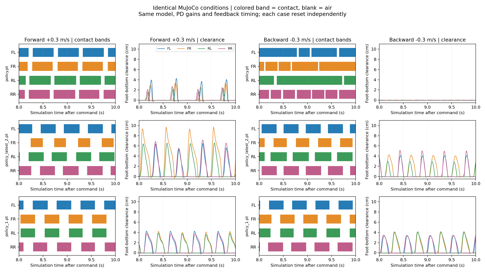

# 最新低速PPO 1999：拖步、非对角配合与训练目标复核

> **同日后续判断修正**：用户质疑显式步态奖励的必要性后，重新核对公开工程与本地证据。没有feet_gait不等于配方错误，旧7497本身就是反例；也没有消融证明2000轮已充分或两项函数修改无负面影响。第6节保留为最初候选路线，**当前优先执行第8节：Isaac核对、固定配方追加500轮的有界对照，必要时只关闭脚滑做配对试验**；不将新增gait/净空当作已确立的唯一修法。

核对日期：2026-11-02。用户指定以deploy中当前policy.pt为最新结果，并报告对角配合差、足端抬不起来。本轮读取保存配置/事件/21份checkpoint，核对当前Actor身份，实际完成24段同条件MuJoCo与5段零附加电机反馈延迟对照；没有修改训练奖励、配置、部署策略或启动训练/硬件。

## 1. 结论

用户描述的部署步态问题已在MuJoCo复现：最新前进主要是短促摆动、前脚彼此同步和后脚彼此同步的趋势，四脚接地时间占比高；后退几乎贴地，横移落脚事件快且不规则。它没有形成旧policy_1那样稳定的对角两组交替支撑。机身高度与髋角倒没有塌低/极端偏置。不能把总reward上升当作步态达标，也不能只解释成训练轮数还不够。

前面的“先缩小速度/简化地形，关闭足高建立基线”建议缺少对目标步态与净空的保证。这次基线只在站立/高度上成立，步态目标未达标，应修正方案，不能继续将其当作成功低速策略向复杂地形推进。

严格边界：本机NVIDIA驱动不可通信，未运行新的Isaac对照。现有证据强烈指向策略和目标定义问题，不证明训练仿真与MuJoCo轨迹完全相同，也没有完成奖励消融来分离单项因果。

## 2. 当前文件与训练身份

| 文件 | SHA256前缀 | 已核对身份 |
|---|---|---|
| imgo2_deploy/ros2_ws/policy/imgo2/ppo/policy.pt | 5a4cc726 | 2026-10-31_01-07-35/model_1999.pt |
| 同目录policy_latest_2.pt | dd130ea9 | 前次第二次续训model_7497.pt；不再是此前同名的6900文件 |
| 同目录policy_latest_1.pt | 79102100 | 前次model_5498.pt；本次只核对文件，不纳入24段回放 |
| 同目录policy_1.pt | 53a57f90 | 原真机使用基准；原训练run仍未定位 |

最新JIT与1999的8个Actor张量差0，在1024个确定性测试输入上输出max diff=0；正式exported/policy.pt同哈希。C++部署LibTorch实际加载并完成回放，所以没有发现本次导出数值转换错误。完整哈希见[总JSON](ppo_low_speed_1999_review_2026-11-02.json)。未另行导出或替换策略。

保存agent为**resume=false，从零训练**，不是保留旧对角步策略后的续训。8192环境、rollout24、2000轮，约393,216,000条transition，等于4096环境约4000轮的采样量；不能简单因轮号1999就断定预算太少。

## 3. 实际训练配置与日志

保存配置确认：vx±.6、vy±.35、yaw±.6、heading false、站立概率.15、5～8s重采样；平地.8/轻粗糙.2、课程关闭；Actor45/Critic235，dt=.02，PD25/.5。主要奖励base=-20/target=.32、髋L1=-1、全关节偏差=-.1、mirror=-1仅thigh/shank、air=1.5/threshold=.5、air variance=-8、slide=-.05。`feet_gait`、`feet_height`、`feet_height_body`均为null；非法接触终止仍为None。

与前次7497所在run相比，主要改变是从零开始、指令范围/heading/站立份额/重采样、地形分布/课程及air2→1.5。高度目标、髋与镜像权重、PD/观测未改变。保存的git/imgo2.diff包含10/31的两处高度/脚滑修复，不能再无依据地把结果归为“还在用旧脚滑函数”。射线有效率没有日志，不能判定修复触发频率。

| 250轮窗口 | 250～499 | 1000～1249 | 1750～1999 |
|---|---:|---:|---:|
| mean reward | 24.402 | 27.296 | 27.972 |
| xy error（当前项目口径） | .3047 | .2737 | .2644 |
| yaw error（同上） | .3555 | .3312 | .3234 |
| value loss | .00283 | .00244 | .00235 |
| mean noise std | .2569 | .2129 | .2058 |
| feet_air_time贡献/s | -.1577 | -.0896 | -.0812 |

21份checkpoint张量均有限；1999的mean std=.2065，最大通道=.3079，没有旧策略单髋std爆炸/动作饱和的证据。末段仍在改善现有目标，但幅度已小；没有训练接触/净空时序日志，不能声称步态在末段同步改善。回合长度1000和time_out=1也不能在倒地终止关闭时独立证明没有跌倒。

修改重采样最大时间后，当前error_vel指标归一化与旧10s配置不同；不能直接比较两run日志绝对值。不同命令/地形/奖励下总return也不可直接排名。

## 4. 24段部署MuJoCo实测

3策略×站立/前进.3/.5/后退.3/左右横移.3/左右转.3；每段2s固定站姿+3s零指令PPO+20s指令，统计指令后4～20s。MuJoCo3.2.7、.5ms物理、50Hz策略、200Hz记录，生产逐步PD/反馈适配器，PD25/.5，电机附加延迟10ms、IMU0及原默认噪声。24段均4000行、无failure-stop，原模型/配置/策略哈希前后不变。这不是GUI/FSM切换、Gazebo或硬件实测。

净空是足端碰撞球底相对平地，按完整离地段>=30ms统计平均峰值；不是FOOT原点高度。事件频率经5N/2N接触滞回、10ms持续确认及<20ms去抖；拖步/不规则接触中的频率不等于稳定标准步态。

| 指标 | 最新1999 | 前次7497 | 原policy_1 |
|---|---:|---:|---:|
| 静止高度cm | 29.94 | 30.41 | 30.32 |
| 前进.3实际vx m/s | .275 | .328 | .288 |
| 前进.3行走高度cm | 29.61 | 28.00 | 28.91 |
| 前进.3平均峰值净空cm | 3.02 | 7.18 | 3.97 |
| 前进.3平均滞空s | .0819 | .1870 | .1911 |
| 前进.3同脚落脚频率Hz | 1.87 | 2.02 | 2.02 |
| 前进.3 gyro_xy RMS rad/s | .531 | .260 | .151 |
| 前进.5净空cm | 3.31 | 8.82 | 4.23 |
| 前进.5 gyro_xy RMS rad/s | .604 | .326 | .170 |
| 后退-.3实际vx m/s | -.192 | -.202 | -.243 |
| 后退-.3净空cm | 约.01 | 4.04 | 3.72 |
| 左横移.3净空cm | .55 | 5.91 | 3.75 |
| 左横移落脚事件频率Hz | 4.12 | 2.82 | 2.17 |
| 右横移-.3净空cm | 1.28 | 5.73 | 3.67 |
| 左转.3实际wz rad/s | .130 | .208 | .142 |
| 右转-.3实际wz rad/s | -.189 | -.281 | -.131 |

最新并非所有方向都更快：前进.3频率反而稍低，但摆动时间仅旧policy_1的约43%，其余时间大量四脚支撑。后退净空实质接近0；转向净空约.28～.34cm，旧策略转向也不完美，不能声称policy_1所有方向均已达标。

### 4.1 对角配合的定量证据

前进.3时，恰有对角两脚接触、另两脚离地的时间占比：**最新.84%、7497为67.06%、policy_1为75.13%**。同时最新四脚接触占68.56%，policy_1为20.44%。

最新前脚FL/FR接触相关=.822、后脚RL/RR=.686，而对角FL/RR=-.174、FR/RL=.268；policy_1两组对角相关=.936/.972。结合净空曲线可见最新前后两组短促摆动、近同时抬落的趋势，不能仅凭总体频率宣称是标准trot或标准bounding。

后退时，最新四脚接触占78.56%、对角两脚支撑仅1.19%；policy_1分别20.59%/69.69%。这就是“后退拖地、对脚不行”的具体表现。



图第一行为最新policy.pt，第二行为当前policy_latest_2.pt（7497），第三行为policy_1；左两列前进.3，右两列后退-.3。色带表示接触，空白表示离地，净空线应与接触一起解释。

### 4.2 零电机附加延迟对照

只在日志目录复制诊断base配置，把电机附加反馈延迟从10ms改0，其余相同，最新策略再跑前进.3/.5、后退.3、左横移.3、左转.3，共5段，均无failure-stop。未修改生产base.yaml。

0ms时前进.3对角两脚支撑仍仅1.97%，后退净空约.006cm；前进.5频率2.63Hz、左横移净空.44cm。说明附加延迟影响幅度/频率，但不是该结果缺乏对角配合与后退净空的唯一原因。这仍不等于Isaac双引擎一致性验证。

## 5. 源码说明了哪些目标缺口

1. **joint_mirror不是完整对角步约束。** 它只惩罚所选对角关节角差，没有强制两组脚反相交替；小动作或接近站姿也可代价很低。
2. **air variance不区分步态类型。** 足间历史滞空/接触时长相似，不代表指定哪两只脚一起抬；前后配对、短摆动也可能满足部分目标。
3. **当前feet_air_time仅在落地事件计算。** 对air<.5的脚是负贡献；减少实际离地/落地事件能减少这一项的扣分，持续拖地也没有足够的独立净空目标约束。末段该项从-.158趋近-.081不能单独解释成脚抬得更高或滞空更长。阈值.5不是步态周期.5s。
4. **两种足高和feet_gait均关闭。** 训练目标没有直接规定4cm摆动峰值或两组对角交替。缩速/加站立/简化地形本身不生成这些要求。
5. **跟速奖励对相对低速误差宽容。** std=.5，后退指令-.3而均值仅-.192时，将该均值误差代入指数仍可得到约95.4%的线速度最高分。这是均值输入的解析示例，不是逐帧奖励平均，但说明相对误差大仍可能得高分。

它们是与实测一致的结构性风险，不是已经完成单项消融的因果证明。也不能把同样被旧7497使用且有效的髋/镜像数值直接认定为新结果退化的唯一根因。

### 5.1 mirror确实约束对角腿，为何仍出现前后配合

用户同日追问“mirror不是对脚步奖励吗”。需要准确区分：它**确实鼓励对角大腿/小腿角度同步**，不是无效项；配置名称为FR-RL、FL-RR，没有写成前脚一组/后脚一组。只是它没有同时要求两组反相、实际交替接触、足端净空及周期。

每腿用大腿/小腿角度向量q表示，原始代价为：

```text
C = (||q_FR - q_RL||² + ||q_FL - q_RR||²) / 2
```

四腿全相同，代价为0；两组对角腿分别取A(t)、B(t)，代价同样为0。只有后者的A/B另有合适的反相关系时，才构成目标交替动作。静站、四腿同相也可能满足镜像，因此它不是完整步态定义。前后两组有少量相位/角度差时会被罚，但作为软项，策略可以接受其代价来取得其他收益，不是硬约束。

对现有+.3m/s回放按逻辑关节名重算（t>=4s，未dump Isaac运行时find_joints顺序，非训练日志原值）：最新C=.015825、7497=.007287、policy_1=.000468。最新确实**更违反**mirror，不应说成“它比旧对角策略更满足镜像”。weight=-1、dt=.02时，新镜像每步扣约.0003165，线速度跟踪最高每步+.03，前者仅约1.06%；小关节差经过平方后代价较小，总目标能容忍这种偏差。这里未计直立门控的重算量足以说明量级，不是完整奖励总和或因果消融。

为什么恰好前脚彼此同步、后脚彼此同步：本次接触数据证实了这一结果；小摆动、长时间多足支撑仍能跟速，而缺少实际接触反相/净空目标，使这种局部解可以保留。不能仅凭公式断言所有训练必然选前后步，或已经找到全局最优。

因此mirror可以保留作辅助；单独提高其权重仍允许四腿同相，甚至可能通过缩小运动幅度来降低误差。明确trot应补两组实际接触时序的同步与反同步，净空再独立处理。解析反例、三策略量级与原CSV哈希见[镜像重算JSON](ppo_low_speed_1999_2026-11-02_mirror.json)。本次仅补解释与离线计算，没有改奖励、权重或重跑仿真，步态目标修正继续待PPO-GAIT-01。

## 6. 下一步建议（尚未改配置或训练）

### 6.1 起点与范围

不建议当前1999原样再追加几千轮来赌恢复trot。优先从**本次已实测有对角配合的旧7497 checkpoint**做独立短续训试验；6900曾有较慢/较稳前进表现，也可另作起点对照，但本次没有重新回放6900。当前Actor45/Critic235可保持，首轮低速范围/简单地形先固定，保留正常的机身高度与髋约束，以减少变量。

### 6.2 用已有GaitReward明确配对，但不能只开默认值

仓库已有`GaitReward`/`feet_gait`，无需为了对角配对从零写同类函数。期望配对是`(("FL_FOOT","RR_FOOT"),("FR_FOOT","RL_FOOT"))`；在rough的零权重清理之前配置，并让零指令不强制踏步。正权重.5、std=.03、max_err=.2只作为需要短训标定的候选，不是已证明最优配方。

**不能只把weight改非零而沿用全部默认参数**：当前实现指数分母直接使用std，父配置默认sqrt(.5)较宽。抽离实际类的CPU例子：理想对角相位得到1，前后配对相位默认可得.893，全脚触地.5s仍得.636；std=.03时后二者降到.0695和.0000233。与此同时，全脚刚接触.001s时仍接近1，说明即便收紧std，频繁微小接触切换仍可能取巧；此项不直接规定周期或净空。算例见function_checks JSON，不能当作训练效果证明。

### 6.3 单独补摆动净空目标

要保证“真正抬起来”，需要明确相对当地地面的足底净空，平地摆动峰值先以约4cm为候选；起落脚回到0、支撑脚不被拉高，并考虑拖地时实际离地mask永远不激活的情况。配合期望接触相位/最低摆动持续时间或完整轨迹目标设计，不能仅恢复旧FHB=-.20或盲加air权重。该新项尚未实现。

模型足端球半径=.022m，球心相对FOOT有非零偏移（例如FL为[-.008,.0035,-.02]）；需要用FOOT位姿旋转偏移后计算球底，再减足下地面高度。FOOT原点目标高度不等于足底净空，直接把target_height=.04不能保证4cm净空。后续地形不能一律用世界z或机身下方一个地面值代替各足当地地面。

新增目标先做一个500轮有界对照并每100轮保存，不直接承诺2000/5000轮足够。固定指令验收对角接触时序、前后净空、跟速、机身角速度和髋姿态；不按总reward选checkpoint。本轮没有替用户执行这些训练或更改权重。

## 7. 已完成、待确认与复现

已完成：身份/1024输入Actor对比、21 checkpoint有限性/std、保存env/agent差异、事件到1999、24+5段回放、接触配合统计、PNG目视检查及同图PDF导出；主组与对照组模型/配置/策略哈希前后不变。新增标准库`analyze_contact_coordination.py`，理想trot/前后配对/静态接触3组解析轨迹检查通过；绘图可选matplotlib。`eval_mujoco_policies.py`仅增加诊断`--base-config`参数，未改生产控制。

复现入口：

```bash
python3 imgo2_rl/scripts/tools/eval_mujoco_policies.py --output imgo2_rl/logs/mujoco_low_speed_1999_2026-11-02 --policies policy.pt policy_latest_2.pt policy_1.pt --cases stand,forward03,forward05,backward03,left03,right03,turn_left03,turn_right03 --seconds 20
python3 imgo2_rl/scripts/tools/analyze_mujoco_policies.py --run imgo2_rl/logs/mujoco_low_speed_1999_2026-11-02/run.json --output imgo2_rl/logs/mujoco_low_speed_1999_2026-11-02/metrics.json
python3 imgo2_rl/scripts/tools/analyze_contact_coordination.py --run imgo2_rl/logs/mujoco_low_speed_1999_2026-11-02/run.json --output docs/training/ppo_low_speed_1999_2026-11-02_coordination.json
```

重跑前按总JSON校验policy身份，文件名可能被用户替换。原始CSV/run.json与诊断base在两个对应logs目录中，按仓库规则忽略、不作为可跨机自动同步的结果；统计与完整metadata已入[总JSON](ppo_low_speed_1999_review_2026-11-02.json)。

待确认继续PPO-GAIT-01/PPO-ROUGH-01：Isaac实际接触/净空对照（需可用NVIDIA驱动/GPU）、训练奖励消融、新目标实现/短训、不同seed及后续rough/硬件。仅单seed和平地有界回放，无长期、GUI/FSM或真实硬件结论。所有新奖励参数仍是候选。

## 8. 重新核对：当前启停清单、轮数和下一步（当前建议）

### 8.1 显式步态奖励有实例，但不是必需品

重新联网读取原项目源码（2026-11-02）：[HIMLoco A1公开配置](https://github.com/InternRobotics/HIMLoco/blob/main/legged_gym/legged_gym/envs/a1/a1_config.py)的奖励包括足高、跟速与动态代价，没有显式对角接触相位项。与之相对，[Walk These Ways训练脚本](https://github.com/Improbable-AI/walk-these-ways/blob/master/scripts/train.py)实际启用接触力/接触速度时序跟踪，亦使用步态命令和clock观测。两条路线都存在，不能说所有项目必须加，或没有项目会加；不能跨路线直接复制数值。

本项目旧7497在feet_gait和两种足高项也关闭时已经有明显对角配合，直接说明“1999没有feet_gait所以必须新增才能恢复”超出了证据。第5节对镜像数学与当前坏步态的描述仍成立，但**不构成缺少显式gait导致失败的因果证明**。此前从结果直接跳到新增gait/净空建议过快，应先控制变量。

### 8.2 以最新run保存配置为准，19个非零项

本机rough源仍有旧值（base -16/.30、air1.8、旧速度范围）；下面是**服务器产生1999时保存的params/env.yaml**，不是本机默认值：

| 类别 | 实际启用的项与weight |
|---|---|
| 速度跟踪 | track_lin_vel_xy_exp=1.5；track_ang_vel_z_exp=.6；std均.5 |
| 机身 | base_height_l2=-20，target=.32；flat_orientation_l2=-5；lin_vel_z_l2=-2；ang_vel_xy_l2=-.05 |
| 关节姿态 | joint_deviation_l1=-1，仅四髋；joint_pos_penalty=-.1，12关节；stand_still=-.1 |
| 对角关节 | joint_mirror=-1，仅大腿/小腿，FR-RL及FL-RR |
| 滞空 | feet_air_time=1.5，threshold=.5；feet_air_time_variance=-8 |
| 滑移 | feet_slide=-.05，使用10/31修改后的世界系xy足速版本 |
| 动态/能耗 | action_rate_l2=-.01；joint_torques_l2=-2.5e-6；joint_acc_l2=-5e-9；joint_power=-2e-5 |
| 接触 | undesired_contacts=-.5；contact_forces=-.02，力阈值100N |

关闭：feet_gait、feet_height、feet_height_body、feet_contact、feet_contact_without_cmd、feet_stumble、feet_distance_y_exp、action_mirror、action_sync、关节位置/速度/力矩软限位奖励等。关闭限位**奖励**不等于URDF硬限位不存在。完整启停表与目标值见[状态JSON](ppo_low_speed_1999_2026-11-02_current_state.json)。

其他：地形课程/两种速度课程关闭；80%平地/20%轻粗糙；vx±.6、vy±.35、yaw±.6；standing .15、heading false、5～8s重采样；当前是纯PPO从零训练，没有AMP专家模仿。

### 8.3 两处函数修改是否可能影响训练

10/31实际改了两个函数，不是新增gait/足高：

- 高度：跨batch异常回退改为逐环境有效射线均值，全部失效回退地形原点高度。正常有效射线时与旧公式相同；坏射线时会改变高度奖励，缺有效率日志所以影响量未知，复杂地形回退仍有限制。
- 脚滑：从足速减机身速度，改为静止地面参考的足端世界xy速度。方向上有依据；例如[MuJoCo Playground Go1实现](https://github.com/google-deepmind/mujoco_playground/blob/main/mujoco_playground/_src/locomotion/go1/joystick.py)也用global foot horizontal velocity和接触判据，但其平方形式、门控、场景和weight不同，不能据此声称本项目训练效果已验证。

CPU验证证明所写公式在算例中的行为，不证明对最终步态无负面影响。**不能排除函数修改改变了优化结果**，也不能把世界足速语义正确等同于当前-.05/历史接触门控一定合适。接触历史在刚离地时残留，仍可能对摆动早期速度扣分。应通过同起点单项对照判断，不直接恢复已知语义有问题的旧脚滑函数，更不同时回滚两项。

#### 8.3.1 feet_gait 与脚滑速度口径补充核对

`feet_gait` 是原有 `GaitReward`，父配置默认 weight=0、配对名称为空；最新保存配置为 null，未启用。本轮没有新增或启用它。它把两组同相脚的当前滞空/接触时间匹配和跨组反相时间匹配合成六个指数因子的乘积，并按指令/实际速度及姿态门控；它不直接规定步频或净空，也不等同于关节角镜像。若未来试验，需先配置真实足端配对，不能只提高默认 weight。

脚滑旧式为接触脚 `||[Rᵀ(v_foot_world-v_base_world)]xy||`，新式为 `||v_foot_world_xy||`。例：机身前进0.4m/s、脚在地面静止时，旧式单脚原始代价0.4、新式0；脚以0.4m/s随机身拖动时，旧式0、新式0.4。两者均乘相同的历史接触标记（历史力模长最大值>1N）、姿态因子、weight及控制dt；不是对所有摆动脚一直扣分，但历史接触残留可能影响刚离地阶段。新式取FOOT刚体线速度，未扣移动地面速度，也未投影到坡面切平面，属于静止近水平地面的近似。已核对源码及最新保存配置；训练收益/副作用仍待同起点单项对照，本次仅补充说明，未改奖励代码或权重。

#### 8.3.2 feet_height_body 仅摆动脚候选（未实施）

按用户要求先提方案、不改源码：完整注释保留原函数，新函数紧邻且同名；保留机身系足位、原相对平移足速tanh、指令和姿态门控，仅增加contact sensor参数及逐脚摆动掩码，代价改为 `Σ swing_mask*(z_body-target_height)^2*tanh(tanh_mult*||v_relative_xy||)`。优先使用现有track_air_time传感器的current_air_time>0区分摆动，避免直接复用历史接触力造成离地残留；传感器和机器人足端必须显式按相同逻辑名称排序匹配，不能默认body_ids通用。配置同时补sensor_cfg，仍用负权重；不得把实现改完等同于开启最新null奖励。

这是最小语义修正，仍属机身参考而非局部地面净空；身体高度、倾斜仍影响它，原相对足速也未扣角速度项。支撑脚代价为0，但不摆腿也可能规避该项，因此不保证主动开始抬脚、不规定对角步态或步频。没有摆动相位时也不能声称只约束中摆动段。权重/目标待足端原点与碰撞几何核对及单项短训；若实施需验证全支撑为0、混合接触只计离地脚、纯转向门控、足端排序、静止门控和旧代码回退。已完成源码接口核对，未修改代码/配置、未训练或验证效果；问题仍待PPO-GAIT-01。

### 8.4 轮数：可以再验证，但不能保证靠追加恢复

8192×24×2000约3.93亿transition，采样预算相当于4096环境约4000轮。末段奖励/误差仍有小幅改善，不能宣称已充分收敛或肯定续训无用；同样不能凭value loss平稳预测会从当前接触模式自动变成trot。现有证据只有1999在MuJoCo的坏步态，缺早期checkpoint的闭环步态和服务器Isaac时序。

先保持当前训练源码与配置，追加**500轮**形成“更多轮次”的对照；若对角配合/后退净空确有上升，再考虑下一段500。若只是总reward涨、接触与净空不变，转入单项试验，不无上限追加。这里500是控制花费的检查预算，不是证明收敛/不能收敛的数学界限。

### 8.5 服务器操作顺序和命令

使用产生1999的同一个服务器环境和代码。**resume恢复模型/优化器，不会自动把旧env.yaml恢复成当前源码配置**；启动前确认第8.2节保存值一致，本机不同的rough源码不能直接覆盖服务器当作同配方续训。以下`/root/Desktop/imgo2`是原服务器路径示例。

第一步：在服务器Isaac检查当前checkpoint的固定前进/后退。可用GUI直接play；无GUI可录一段有界视频，前进示例：

```bash
cd /root/Desktop/imgo2/imgo2_rl
export IMGO2_ISAACLAB_PYTHON="$(python -c 'import sys; print(sys.executable)')"
bash scripts/run_isaaclab.sh scripts/rl_lab/ppo/play.py \
  --task=Imgo2-basemove-rough-ppo \
  --checkpoint="$PWD/logs/rsl_rl/base_move_rough/2026-10-31_01-07-35/model_1999.pt" \
  --num_envs=1 --device=cuda:0 --headless --video --video_length=1000 \
  env.commands.base_velocity.ranges.lin_vel_x='[0.3,0.3]' \
  env.commands.base_velocity.ranges.lin_vel_y='[0.0,0.0]' \
  env.commands.base_velocity.ranges.ang_vel_z='[0.0,0.0]' \
  env.commands.base_velocity.rel_standing_envs=0.0 \
  env.commands.base_velocity.heading_command=false \
  env.observations.policy.enable_corruption=false \
  env.scene.terrain.terrain_type=plane \
  env.scene.terrain.terrain_generator=null \
  env.curriculum.terrain_levels=null
```

视频写到该run的videos/play；后退将x改为[-.3,-.3]，录完先另存/区分视频再重复，以免同名视频被覆盖。play会按既有入口重新导出该checkpoint，但不会拷贝替换部署策略。录视频需服务器可用图形渲染与视频依赖；本机驱动不可用，未运行此命令。若Isaac里已有正常对角抬脚而MuJoCo没有，优先查sim2sim差异，不继续据MuJoCo结果改训练奖励。

第二步（A）：若Isaac也差，保持全部配方的有界续训对照：

```bash
cd /root/Desktop/imgo2/imgo2_rl
IMGO2_ISAACLAB_PYTHON="$(python -c 'import sys; print(sys.executable)')" \
bash scripts/run_isaaclab.sh scripts/rl_lab/ppo/train.py \
  --task=Imgo2-basemove-rough-ppo --resume \
  --load_run=2026-10-31_01-07-35 --checkpoint=model_1999.pt \
  --num_envs=8192 --max_iterations=500 --seed=42 \
  --run_name=more_iters_control --device=cuda:0 --headless
```

当前入口将max_iterations传给learn；本机RSL5实现为start_iter+num_learning_iterations，因此500为追加量，结束约2500轮（保存编号可能偏一），不是把总终点设为500。服务器应沿用原训练版本，不为执行该命令升级依赖。保存间隔100，固定测试+.3/+.5/-.3/左右横移/左右转和站立。

第三步（B，若A没有改善）：仍从**同一个model_1999**起步、同seed/环境数/500轮，只将run_name改为`no_slide_control`，并在同一条命令末尾增加：

```bash
  env.rewards.feet_slide=null
```

该项是Hydra覆盖，不需要注释/恢复函数。除脚滑以外其余配置保持A相同，包括高度修复、air1.5及两个足高关闭。若B更好，说明当前滑移项的约束/门控可能压制该起点的步态，应再标定；不证明旧相对机身公式正确，也不追溯证明初训的唯一成因。A/B只做各500轮的筛选，不自动扩成长训练。

若A/B都不能改善，再优先用已经有对角配合的旧7497做低速适配对照，或按单项启用已有feet_gait/净空项；保留所有分支，不能把这条路线当作必须从头再训或所有奖励一起改。

本次完成配置清单、公开源码复核与有界对照设计；**没有执行服务器play/续训，没有改生产源码/weight或声称这些候选已有效**。命令经本机Bash语法/参数名检查，但服务器Isaac/渲染/完整resume与结果待验证。现阶段缺的是引擎内接触证据及训练对照，不是已经证明必须新增某个奖励。

## 9. 地形与课程入口补充（2026-11-02，仅源码核对）

本机当前rough_env_cfg.py继承父CurriculumCfg.terrain_levels，未置None，因此地形课程当前默认开启；它关闭的是command_levels_lin_vel/ang_vel，不是地形课程。不要将服务器1999保存配置（课程关闭、80%平地）当成本机当前源码。此次未改配置、未运行Isaac。

入口：velocity_env_cfg.py的MySceneCfg.terrain使用TerrainImporterCfg、terrain_type="generator"、ROUGH_TERRAINS_CFG，max_init_terrain_level=5；CurriculumCfg.terrain_levels=CurrTerm(mdp.terrain_levels_vel)。父__post_init__根据课程项是否为None同步terrain_generator.curriculum。rough子类先调用super，因此若在子类关闭课程，应同时设置self.curriculum.terrain_levels=None与self.scene.terrain.terrain_generator.curriculum=False，不能只假定父类稍后会同步。启动低等级另设max_init_terrain_level=0，但仅该值不是关闭课程；关闭课程时也不等于只生成简单难度。

当前本机IsaacLab-rsl5/source/isaaclab/isaaclab/terrains/config/rough.py提供六类地形及比例：正/反楼梯各.2、boxes .2、random_rough .2、正/反斜坡各.1，没有显式平地项。rough_env_cfg.py第44–59行覆盖boxes高度.025–.1m、noise .01–.06m/step .01m、楼梯高度.025–.08m；未改地形比例。比例通过terrain_generator.sub_terrains[key].proportion调整，在项目子类改即可，通常无需改IsaacLab依赖文件。纯平地用terrain_type="plane"、terrain_generator=None，并关闭terrain_levels；相关地形生成器设置必须放在原地形参数块之后，否则先置None再访问sub_terrains会报错。要混合平地需显式添加MeshPlaneTerrainCfg地形，不能把缺省六类配方说成80%平地。上述是本机依赖源码口径，服务器应以params/env.yaml实际落盘为准。
