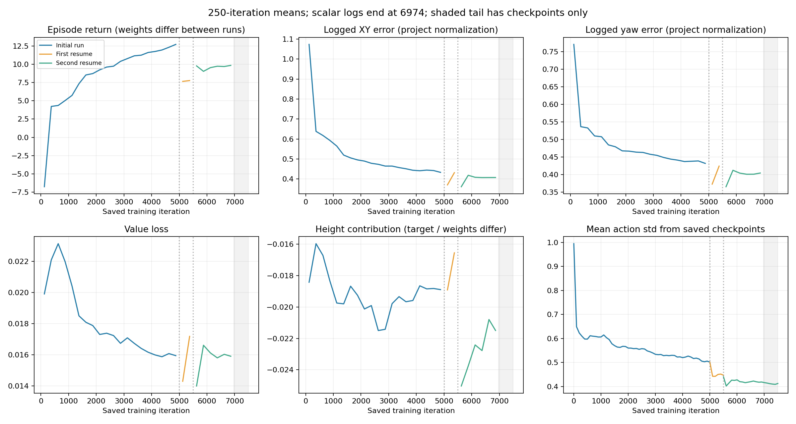
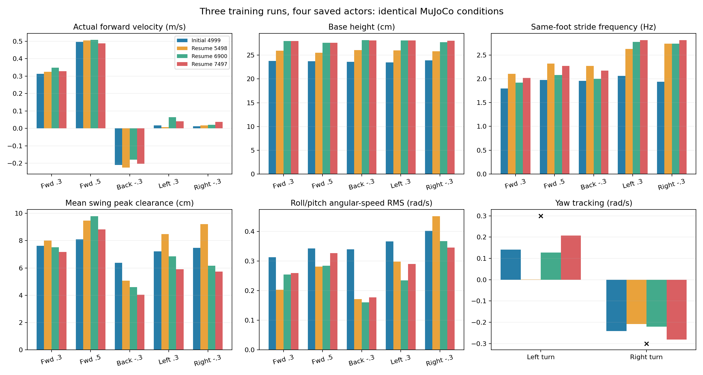

# 三个PPO训练目录的参数、效果与重训配方复核

核对日期：2026-10-31。用户要求比较初训、两次续训与最新三个策略文件，并确定从头训练的奖励起点。本轮完成保存配置完整差异、78份checkpoint有限性/逐通道std、Actor身份和32段同条件MuJoCo回放；未修改训练配置/奖励/模型/PD/部署策略，未启动训练或硬件。

## 1. 先更正文件名与阶段的对应关系

当前部署目录没有`policy.py`，有`policy.pt`。逐份读取JIT的Actor张量，按名称、顺序和全部权重字节与三个run的所有checkpoint匹配，结果与用户标注顺序不同：

| 当前文件 | SHA256前缀 | 实际匹配 |
|---|---|---|
| policy.pt | 79102100 | 第一次续训，16-06-09/model_5498.pt |
| policy_latest_2.pt | ce77ab55 | 第二次续训，17-37-05/model_6900.pt |
| policy_latest_3.pt | dd130ea9 | 第二次续训，17-37-05/model_7497.pt |
| 初训run/exported/policy.pt | 17b0049b | 初训，00-53-27/model_4999.pt；8个Actor张量max diff=0 |

所以本轮将4999也纳入，共比较4份策略。只是把已有正式play导出的文件按字节复制到被忽略的诊断日志目录，命名stage1_4999/stage2_5498/stage3_6900/stage3_7497，防止同名policy.pt覆盖结果；没有手写导出或改部署文件。完整文件哈希、匹配checkpoint路径和复制来源见同名JSON。

## 2. 训练参数实际怎么改了

| 项目 | 初训00-53-27 | 首次续训16-06-09 | 第二次续训17-37-05 |
|---|---:|---:|---:|
| 恢复起点 | 从零 | 初训4999 | 首次续训5498 |
| 配置追加轮数 | 5000 | 500 | 2000 |
| 最后checkpoint | 4999 | 5498 | 7497 |
| 环境数量 | 4096 | 4096 | **8192** |
| base_height_l2 | -12 | -16 | -20 |
| **target_height** | .30m | .30m | **.32m** |
| feet_height_body | -1.5，target-.20 | 关闭 | 关闭 |
| feet_height | 关闭 | 关闭 | 关闭 |
| hip joint_deviation_l1 | -.2 | -1 | -1 |
| joint_pos_penalty（12关节） | 关闭 | -.1 | -.1 |
| feet_air_time | 1.8，threshold=.5s | 1.8，threshold=.5s | 2.0，threshold=.5s |
| joint_mirror | -1，仅thigh/shank | 同左 | 同左 |

第一到第二run的env差异只有日志目录和4个奖励改动（base权重、FHB关闭、髋L1加强、全关节弱偏差启用）。第二到第三run另有高度目标、base权重、air权重及环境数变化。速度范围、观测/动作、模型路径、PD、地形课程及其他保存env字段未变化。

PPO超参数本身未变化：rollout24、5epochs×4minibatches、学习率初值.001且adaptive、entropy=.01、gamma=.99、lambda=.95、clip=.2、seed42；改变的agent字段为恢复目录/checkpoint、追加轮数、resume/run_name。保持Actor45/Critic235、控制dt=.02、PD25/.5和动作缩放不变。

**并行数不能忽略**：前两run每轮4096×24=98,304条transition，第三run每轮196,608条，mini-batch也变大。按配置追加预算估算，三段分别491,520,000 / 49,152,000 / 393,216,000条transition；这不是服务器实测耗时。不能把相同轮数当作等量采样，更不能把阶段改善独立归因于某一个weight。

### 2.1 对先前记录的勘误

10/30部分文档将6900阶段高度目标写成.30m，这是漏查参数；当前params/env.yaml的SHA256仍是当时保存的`2d01e253...`，内容明确为.32m，并非本轮临时变更。已更正相关文档。增权与目标抬高同时发生，之前把行走高度增加约2cm只归因于-16→-20不成立。

## 3. 训练日志与checkpoint情况

末段250轮（第三段末窗口仅225轮）均值：

| 指标 | 初训4750–4999 | 首次续训5250–5498 | 第二次续训6750–6974 |
|---|---:|---:|---:|
| Train/mean_reward | 12.709 | 7.762 | 9.836 |
| xy error（项目归一化口径） | .433 | .431 | .407 |
| yaw error（同口径） | .432 | .424 | .404 |
| Value loss | .0159 | .0172 | .0159 |
| mean_noise_std日志均值 | .5035 | .4487 | .4190 |

奖励项、目标、环境数不同，**不能按12.7>9.8认定初训最好**。第二次续训后半段6200～6974跟速误差已较平缓，说明继续同配方的边际收益下降，不等于所有指标收敛。

最新event仅复制到6974，后面523轮没有本地事件数据，但checkpoint已到7497。不能声称看到了7497的loss/回报走势。保存模型的平均std依次为4999 .5015、5498 .4470、6900 .4189、7497 .4126；7497四髋std约.537/.538/.537/.534，78份模型张量全有限。本次没有旧3400那种单髋std4.58、mu远超clip的退化证据。



## 4. 32段同条件MuJoCo效果

4策略×静止/+.3/+.5/-.3/左右横移.3/左右转.3，均独立reset；2s固定站姿+3s零指令PPO+20s测试，统计最后16s。沿用生产逐步PD/反馈适配器，PD25/.5、.5ms物理、50Hz策略/200Hz记录、电机额外延迟10ms、IMU额外延迟0及既有噪声，seed12345。C++/适配器/MJCF哈希与旧binary构建源一致。32段无failure-stop，前后源策略与模型/配置哈希不变；不是硬件/Isaac/Gazebo或FSM切换实测。

| 指标 | 初训4999 | 续训5498 | 续训6900 | 最后7497 |
|---|---:|---:|---:|---:|
| 静站高度cm | 27.96 | 29.86 | 30.80 | 30.41 |
| +.3实际vx | .313 | .326 | .348 | .328 |
| +.3行走高度cm | 23.79 | 25.94 | 27.98 | 28.00 |
| +.3步频Hz | 1.80 | 2.11 | 1.92 | 2.02 |
| +.3平均摆动峰值净空cm | 7.62 | 8.00 | 7.52 | 7.18 |
| +.3 gyro_xy RMS rad/s | .313 | .203 | .255 | .260 |
| +.5实际vx | .497 | .505 | .509 | .489 |
| +.5行走高度cm | 23.74 | 25.55 | 27.59 | 27.63 |
| +.5步频Hz | 1.98 | 2.33 | 2.08 | 2.27 |
| +.5净空cm | 8.09 | 9.46 | 9.79 | 8.82 |
| +.5 gyro_xy RMS rad/s | .342 | .281 | .284 | .326 |
| -.3实际vx | -.210 | -.224 | -.179 | -.202 |
| -.3行走高度cm | 23.59 | 26.08 | 28.18 | 28.11 |
| +.3前/后髋外展均值deg | -5.83/-2.22 | +.53/-.90 | +.89/-1.00 | -.33/-.52 |
| +.5动作裁剪占比 | 6.38% | 3.37% | .97% | .54% |
| 左转+.3实际yaw | .142 | ≈0 | .128 | .208 |
| 右转-.3实际yaw | -.242 | -.209 | -.220 | -.281 |
| 右转时非期望vx | .052 | .043 | .059 | **.110** |
| 左转净空cm | 3.97 | 无持续摆动 | .12 | .60 |

步频为同脚重复落地的完整周期频率，接触滞回/持续时间/抖动过滤与原工具一致；转向不规则拖步的中位数不是严格周期保证。净空为碰撞球底相对平地，不是FOOT原点。gyro不含期望yaw，但不是硬件振动测量。



### 4.1 可以确认的趋势

- 初训有低机身、运动髋内收、较多动作裁剪；首次续训将髋拉回中立，机身增加约2cm，明显有效。
- 第二次续训将行走高度再提高约2cm，髋维持正常、裁剪进一步减少。由于同时改权重、目标、采样预算，不拆分其单独因果贡献。
- 6900→7497没有普遍变好：+.3过冲减小、后退和yaw跟速改善；但+.5频率2.08→2.27、gyro .284→.326，纯转向向前漂移加大。机身高度基本不再增加。
- 最新7497不是崩溃，但也不是所有目标的最佳checkpoint。若优先慢步与+.5稳定，6900仍值得保留；若优先后退/yaw跟速，7497有优势，不能按轮号直接替换。
- 所有阶段前进净空仍约7～10cm；最新左右横移步频约2.82Hz，转向净空不足1cm且出现漂移。现有配方没有明确规定这些方向的净空形状。

## 5. 从头训练应该保留、调整什么

现有续训已经改善髋姿态与高度，不必仅因剩余问题就从零。用户若决定重训，应从改善后的配方起步，不恢复初训的FHB=-1.5/hip=-.2/jpp=0组合。以下是一套**待验证的单一新基线**，不是已证明最优的配方；本轮未改源码。

### 5.1 现有奖励基线建议

| 项目 | 候选设置 | 依据/限制 |
|---|---:|---|
| track_lin_vel_xy_exp | 1.5 | 先保留，靠纯方向样本改善覆盖 |
| track_ang_vel_z_exp | .6 | 最新yaw已接近指令，主要问题还有平移漂移，不先盲加yaw |
| base_height_l2 | -20，target=.32m | 保留已有高机身候选；.32是软目标，不保证实际全程.32 |
| joint_deviation_l1 | -1，仅四髋 | 保留已经有效的中立姿态偏好，不锁死髋 |
| joint_pos_penalty | -.1，12关节 | 弱名义姿态偏好，不恢复-.5 |
| joint_mirror | -1，仅thigh/shank | 保留去髋配对 |
| feet_air_time | **1.8**，threshold=.5s | 比第三段2.0略减；是新候选，可能增加步频，需与2.0对照 |
| feet_air_time_variance | -8 | 先保留，不能把低方差当指定周期 |
| feet_height_body / feet_height | **0 / 0** | 不恢复全足相对机身或world z目标 |
| stand_still | -.1 | 保留；它不直接惩罚机身漂移 |
| action_rate_l2 | -.01 | 保留，不把所有平滑项一起提高 |
| lin_vel_z_l2 / ang_vel_xy_l2 | -2 / -.05 | 保留 |
| flat_orientation_l2 | -5 | 先保留，坡地/楼梯倾斜适应性另测 |
| joint_torques_l2 / joint_acc_l2 | -2.5e-6 / -5e-9 | 先保留，不盲目按公开配方放大50倍 |
| joint_power | -2e-5 | 先保留，机械/电功率不混用 |
| contact_forces / undesired_contacts | -.02 / -.5 | 保留，接触阈值按当前实现 |
| feet_slide | 修正地面相对速度后-.05 | 若暂不修，可另开关闭该项的基线；不能称当前相对机身速度为真实滑移 |

候选只将air从第三段2.0减为1.8，其余权重以第三段为主。表中脚滑是条件项，不表示已实现。若目标优先保持6900约.5s周期，也可先保留2.0，独立比较1.8；没有公式保证减少滞空权重会同时让周期更慢。这里不建议动模型轴、默认关节角、PD、动作缩放或45/235维接口。

### 5.2 重训前需要解决的实现问题

1. `base_height_l2`应逐环境过滤异常射线，而非任一坏射线导致全batch高度项回退；记录有效率，不能用加大weight掩盖它。
2. `feet_slide`应约束触地足相对地面的切向滑移，当前相对机身速度会惩罚正常支撑。修复后要重新观察分项量级。
3. 如恢复base接触倒地终止，先在reset/正常站立/台阶姿态验证选择器与阈值，不能对全部非足接触直接一律终止。

这三项未在本轮修改。当前源码基线仍为base -16/target .30/air1.8，不会因为文档建议而自动变成表中设置。

### 5.3 为“适中抬脚、纯转向不拖步”增加的目标

仅以上现有权重不足以保证这个风格，现有奖励没有指定4～6cm净空轨迹或同脚完整周期。若这是硬目标，需要新增当地地面参照的足高/摆动轨迹项；参考[上一轮摆动足高设计](../deployment/mujoco_ce77_vs_policy1_2026-10-30.md)。

关键边界：只按“已经离地”mask惩罚足高，只能塑形已有摆动；如果策略一直拖地，mask=0可以绕过该项。应结合期望摆动相位/接触时序或可靠的在线摆动进度，起落脚高度接近0，中段净空先以平地4～6cm为候选，并约束过高抬脚。实际相位不能依赖未来落地时间。若为此新增相位观测，要同步部署接口，不能只改一个weight。严格单边下限也不会主动压低当前过高的前进净空。

纯转向还可以单独测试“有yaw指令而xy指令近0时，惩罚真实机身xy速度”的项。候选原始量：

```text
I(norm(v_cmd_xy)<.05 and abs(w_cmd)>.1) * norm(v_body_xy)^2
```

负权重-2～-5仅为待标定起点；不同于stand_still关节姿态项，也不同于只在三维指令全0时开启。以vx=.1为例，-5对应-.05/s软代价（dt另乘），不会硬性锁位置。此函数尚未编写或验证；也需防止过强而牺牲旋转跟速。

### 5.4 采样和验证比继续堆轮数更重要

完整速度范围vx±1.2、vy±.8、yaw±1留作后续阶段；用户进一步明确先练低速后，第一轮以第7节的范围和采样方案为候选。要增加纯后退、纯左右旋转、横移以及直行的专项样本，避免总是混合三轴。当前heading_command=true且heading比例1，yaw不等同于直接均匀采样wz；要明确纯旋转样本如何生成。仅缩小范围不能保证纯方向覆盖。用户接受≤.2不走，不为此强行修改死区。

重训先4环境10轮验证接线，再固定4096或8192（按服务器容量选定），比较按累计transition计。每100轮保存、每500轮固定方向回放，不能只看总回报或loss；新项/修复首次200～300轮筛选。候选配方无效不等于必须再加几千轮；先确认目标方向是否真的在奖励/采样中。

## 6. 已完成、待确认与复现

已完成：4个Actor身份确认、3份保存env完整差异、3份agent差异、78份checkpoint有限性/std、32段短回放、生产源策略哈希保全、两套PNG/PDF已目视检查；数值/源哈希在[JSON](ppo_three_stage_reward_review_2026-10-31.json)。最新6975～7497训练scalar缺失，不称其loss已收敛。

现有标准库工具`check_ppo_rough_config.py`已增加target_height/threshold差异检查，防止再只比较weight漏掉目标值；本机.30与第三run.32差异已实测检出。训练/奖励配置本身未改。运行分析复现入口为`eval_mujoco_policies.py`与`analyze_mujoco_policies.py`，日志目录`imgo2_rl/logs/mujoco_three_stage_2026-10-31`，参数和CSV路径均保存于run.json。诊断阶段文件只是原正式导出的字节副本，不作为新的部署产物。

- 原始32CSV/日志/run/metrics归档：`ppo_three_stage_reward_review_2026-10-31_raw.tar.gz`，61,471,801字节，SHA256 `c0e11e18fc010e3963bca8f8ee9a05d3d8e4e0b008563f21874d989d2fbb7f4b`；按根*.tar.gz规则忽略，仅本机保存。
- `plot_ppo_training_stages.py`从本报告JSON生成图形，需要matplotlib；其他离线日志/指标检查用标准库，CPU权重读取使用本机env_isaaclab的torch/PyYAML，路径不是服务器通用安装要求。
- 单seed、平地、默认仿真PD25/.5、有界20s；本轮不证明Gazebo/硬件/楼梯或长时稳定性。由于同时变更奖励和采样预算，阶段相关不等于单项因果。
- 待修/待确认继续PPO-ROUGH-01/PPO-GAIT-01：射线/真实脚滑/倒地终止，摆动相位/净空与转向平移项的实现、专项采样、新配方冒烟/从头训练与方向/rough/实机验收。没有将建议标为验证通过。

## 7. 第一轮低速训练的具体候选（同日补充，尚未实施）

用户随后提供服务器rough附件，已是base -20/.32、air2.0。按该附件应用时，优先保留air2.0隔离采样/地形变化，下面1.8仅作独立对照候选；逐处位置、完整代码与首轮限定回退见[服务器修改清单](../xiaoji_cmd/PPO低速首轮服务器修改清单.md)。该清单片段有CPU验证，生产源码未改、服务器运行待验。

### 7.1 “高度射线回退”是什么

`mdp/rewards.py::base_height_l2`正常以机身下方射线命中的地面世界高度均值，加目标离地高度，作为机身世界z目标。例如地面0、目标.32、机身.25时，原始平方误差为(.25-.32)²=.0049；直立门控为1时，weight=-20得到-.098/s，控制dt=.02后每步-.00196。

当前异常分支的`any()/max()`跨全部环境：任一个环境的一条射线为NaN/Inf或绝对高度超过1e6，就令**所有环境**的高度目标回退为各自当前root_link高度。误差因此可能接近0，健康环境也失去高度约束。不是把机器人位置重置，也不是正常地形课程行为。root_pos与root_link_pos可能有定义差异，不声称必然严格为0；日志未记录坏射线率，不能证明现有训练经常触发。

待修方案是逐环境、逐射线过滤异常，使用该环境有效射线均值，其他环境保持正常。单环境全部射线失效时，应明确使用缓存的有效地面估计等回退，并记录异常率；不再悄悄把全批目标设成当前高度。当前`him_base_height`有逐环境过滤，但全失效回退仍会使该环境高度项接近失效，且没有自动接入本PPO项，不能称已经修好。

### 7.2 足高项何时加入

本轮候选第一阶段仍关闭`feet_height_body`与`feet_height`，先验证高度/脚滑修复和指令覆盖；这不是否定足高塑形的作用。第二阶段可从第一阶段合格checkpoint做一个独立对照，加入**局部地面参照、仅期望摆动阶段、起落脚低/中段高**的目标。实际相位定义、无摆动时的激励、接触滞回与奖励量级需要实现并验证后才能给它weight，不能把旧函数简单改名后照搬-1.5或-6。

仅给旧FHB乘“已离地”mask，虽然去掉支撑足项，但仍有相对机身高度耦合、整个摆动固定高度目标、拖地绕过mask的问题。它与base_height_l2可以分工：后者保持机身相对当地地面高度，前者塑造摆动足相对地面的净空。平地中段4～6cm仅为工程候选，不是楼梯通用目标，也不保证轨迹一定更美观。当前前进净空已有7～10cm，重点还包括限制过抬及改善转向拖步，不宜统一增加足高奖励。

### 7.3 指令范围、全零比例和方向分布

仍使用`Imgo2-basemove-rough-ppo`，保留Actor45/Critic235和height scanner；不要为了平地阶段切换到Critic48的flat任务。建议第一轮：

| 现有配置字段 | 当前 | 第一轮候选 |
|---|---|---|
| ranges.lin_vel_x | [-1.2,1.2] m/s | [-.6,.6] m/s |
| ranges.lin_vel_y | [-.8,.8] m/s | [-.35,.35] m/s |
| ranges.ang_vel_z | [-1,1] rad/s | [-.6,.6] rad/s |
| rel_standing_envs | .02 | .15 |
| resampling_time_range | [10,10] s | [5,8] s |
| heading_command / rel_heading_envs | true / 1 | false / 0 |
| ranges.heading | [-pi,pi] | None（不再用朝向生成角速度） |
| 线/角速度课程 | 已关闭 | 第一轮保持关闭，避免训练中自行扩速 |

这些数值是待测试起点。`rel_standing_envs=.15`表示每次重采样时约15%概率把三轴指令全部置零，不是15%机器人永远站立，也不是用各轴[-小值,+小值]模拟零指令。现有xy范数≤.2死区继续保留；它只清零平移，yaw仍可能非零，因此不等于全零站立。

理想专项分组如下，比例针对全部新指令，合计100%；其他轴严格置零：

| 指令组 | 概率 | 非零分量采样 |
|---|---:|---|
| 全零站立 | 15% | vx=vy=wz=0 |
| 纯前进 | 25% | vx=.25～.60 m/s |
| 纯后退 | 20% | vx=-.60～-.25 m/s |
| 纯左移 / 纯右移 | 各10% | vy分别+.25～+.35 / -.35～-.25 m/s |
| 纯左转 / 纯右转 | 各10% | wz分别+.25～+.60 / -.60～-.25 rad/s |

**当前采样器没有这些分组比例字段**；实现它需要扩展采样逻辑，且“站立15%”只抽一次，不能先按组抽15%再叠加父类15%造成重复置零。仅改range和rel_standing能得到低速混合指令与更多站立样本，不能声称已经获得上述纯方向分布。角速度单位rad/s；非零平移从.25起是为了避开现有.2范数死区，不要求训练.1强制抬脚。初期排除混合指令后，后续仍需补斜行/边走边转，不能把专项测试通过当作所有运动通过。

### 7.4 地形分布与课程

已读本机IsaacLab-rsl5的`isaaclab/terrains/config/rough.py`并对照本地覆盖：当前配置比例为上楼梯20%、下楼梯20%、方块20%、随机粗糙20%、正反坡各10%，没有独立平地子地形。楼梯覆盖为2.5～8cm，方块2.5～10cm，随机粗糙noise_range为[.01,.06]m；max_init_terrain_level=5且地形课程开启。出生平台平坦不等于存在专门平地训练份额。

第一轮以**平地80% + 轻微粗糙20%**为候选：在本项目配置中增加`MeshPlaneTerrainCfg`子项、比例.8；保留random_rough、比例.2，noise_range=[-.01,.01]m、noise_step=.005m（现有vertical_scale=.005m可整除）；楼梯、方块、坡地各比例0。这里是子地形配置比例，不保证整段采样时间精确80/20。保留原键后再覆盖比例，避免现有按键修改boxes/stairs的代码访问已删除条目；不改外部IsaacLab公共配置。

第一轮关闭`curriculum.terrain_levels`并确保generator.curriculum=false，固定在上述简单地形集合，保留观测扫描器。**max_init_terrain_level=0只限制出生行，不是整个训练的难度上限；当前随机粗糙生成函数忽略difficulty参数**，所以不能只降课程级别而不缩noise_range。第一轮不训练8cm楼梯能力；低速各方向及站立达标后，再在同rough观测契约下逐渐加入坡地/低阶楼梯并恢复地形课程，地形能力需另测。

### 7.5 奖励与启动顺序

第一轮沿用5.1的候选表：base=-20/target=.32，髋L1=-1、全关节偏差=-.1、mirror=-1仅thigh/shank、air=1.8/threshold=.5，两个足高项0，其他先保留。相比当前源码，这里base的weight/target需要显式修改；相比第三run，air从2.0减为1.8是额外候选变化，不能据此保证降频。若优先隔离指令/地形影响，可固定第三run的air=2.0，不同时比较1.8；两者不可混称同一配方。脚滑须修成触地足相对地面切向速度，或明确先关闭该项。

执行顺序：实现并离线核对射线/脚滑、确认分组采样统计与地形实际生成 → 4环境10轮冒烟 → 固定服务器并行数训练首轮 → 每100轮保存、每500轮同条件方向回放。先看真速度误差、站立漂移、机身高度、髋偏差/动作裁剪、周期/净空、gyro与跌倒率；loss或总reward单独不能作为晋级条件。新增摆动足高应单独做短续训对照，保持观测接口时才可直接按同架构恢复。

本节已完成源码解释与方案细化；**未改训练/奖励配置，未实现上述修复、分组采样或新足高项，未启动新仿真或训练**。缺少实现、采样/射线运行统计及短训验收才能判断有效，继续列入PPO-ROUGH-01/PPO-GAIT-01；不将本计划标为已修复。
